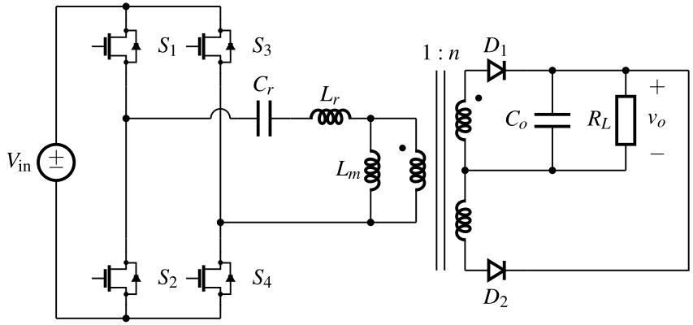
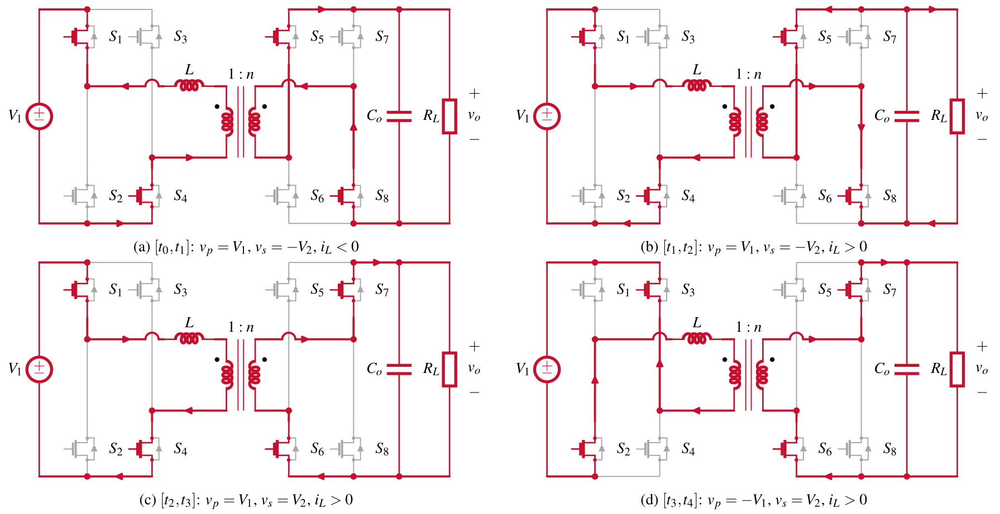
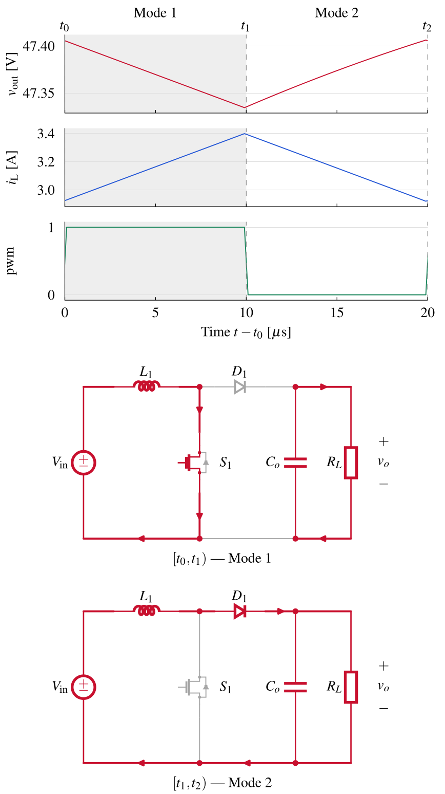
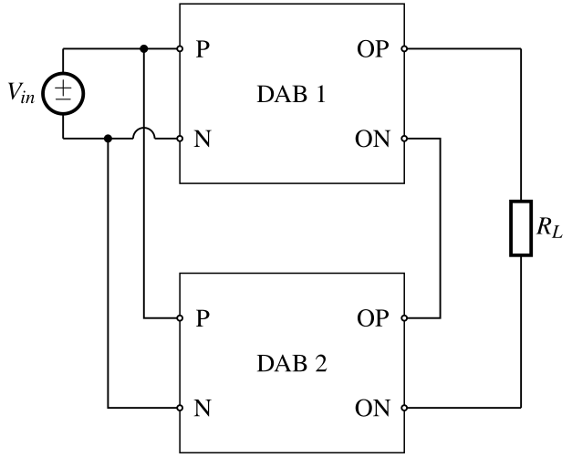
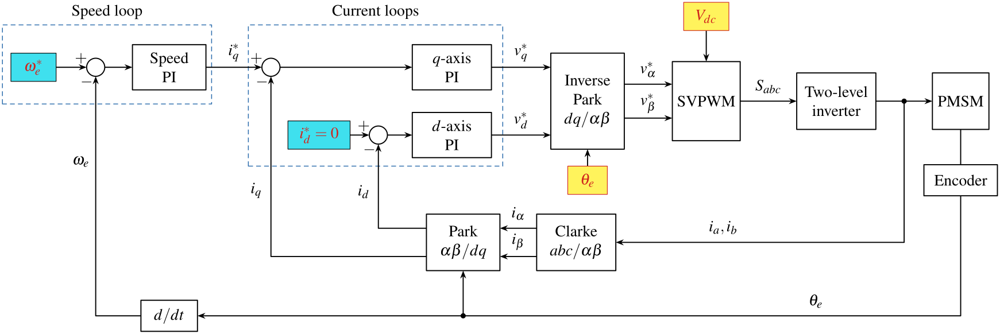
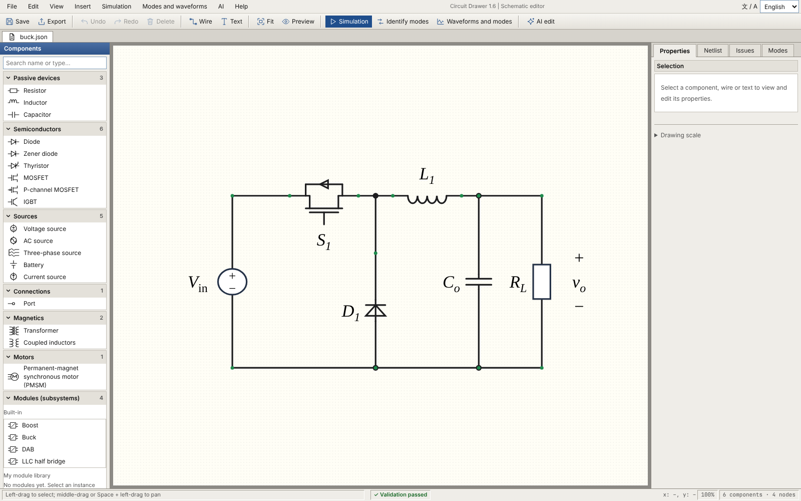

# Circuit Drawer for EE

[简体中文](README.zh-CN.md) | English

Circuit Drawer turns one hand-placed, validated coordinate table into paper-ready CircuiTikZ figures of power electronic converters, and exports the same table to ngspice, Simulink and PLECS.

<p align="center">
  <a href="https://github.com/ahainur/circuit-drawer-for-ee/releases/download/v1.6.0/circuit_drawer_for_ee-1.6.0-py3-none-any.whl"></a>
  <a href="https://github.com/ahainur/circuit-drawer-for-ee/releases/download/v1.6.0/circuit_drawer_for_ee-1.6.0-py3-none-any.whl"></a>
  <br>
  <a href="https://github.com/ahainur/circuit-drawer-for-ee/releases/download/v1.6.0/circuit_drawer_for_ee-1.6.0-py3-none-any.whl"></a>
  <a href="https://github.com/ahainur/circuit-drawer-for-ee/releases/download/v1.6.0/circuit_drawer_for_ee-1.6.0-py3-none-any.whl"></a>
</p>

All four buttons download the same **universal Python package (`.whl`, Python 3.10+)**. See [installation](#installation) below. macOS and Linux currently have preview support.

[Release notes](https://github.com/ahainur/circuit-drawer-for-ee/releases/tag/v1.6.0) / [Trial bundle with examples](https://github.com/ahainur/circuit-drawer-for-ee/releases/download/v1.6.0/circuit-drawer-trial-1.6.0.zip) / [Offline manuals — 简体 / 繁體 / English](https://github.com/ahainur/circuit-drawer-for-ee/releases/download/v1.6.0/circuit-drawer-manuals-1.6.0.zip) / [Source code](https://github.com/ahainur/circuit-drawer-for-ee/releases/download/v1.6.0/circuit-drawer-public-source-1.6.0.zip)



## Highlights

1、**One table, many outputs.** A single JSON file holds the parts, wires, netlist, operating modes, annotations, simulation parameters and waveform settings. From it you get PDF, SVG, PNG and TeX figures, ngspice decks with CSV results, a MATLAB build script for Simulink + Simscape, and a native PLECS Standalone model.

2、**Paper-ready by default.** Figures fit IEEE single (8.79 cm) or double (17.99 cm) columns with 8 pt Times text. Symbol sizes stay fixed; only the spacing between parts is scaled, so you insert the PDF at 100 % and the text matches your captions.

3、**No automatic layout, strict checking.** Every pin and every wire corner comes from a template or from you. The checker rejects slanted wires, overlapping symbols and labels, unmarked crossings, dangling wires and any difference between the drawing and its netlist, and tells you where and why.

4、**Web editor.** Drag parts from a categorised library, draw wires, select with a box, edit groups, use context menus, undo and redo, nudge with the arrow keys, and see every problem the moment it appears.

5、**Modules.** Define a converter cell once, drag it from the library into the canvas, and connect its ports with ordinary wires. Instances can be folded into boxes with IEC symbols. Folding changes the picture only; simulation always uses the full circuit.

6、**Operating modes and waveforms.** Highlight the conducting path of each switching state, export a mode sheet, and line up simulated or measured waveforms with t0, t1, ... and the matching mode figures.

7、**Control block diagrams.** A separate editor for PI loops, FOC, MPC and similar diagrams, with loop analysis (margins, Bode plots, Type I/II/III compensators) and fixed- or floating-point C code generation. A control table can close the loop around a circuit in ngspice, Simulink and PLECS.

8、**AI drawing assistant (optional).** Describe a topology that has no template, or ask for a change to the current figure in one sentence. Circuit AI writes coordinates; control-diagram AI writes structure that the program lays out. Both go through validation. It uses your own API key with an Anthropic-compatible or OpenAI-compatible interface.

## Gallery

| Operating modes of a DAB converter | Waveforms matched to modes |
| --- | --- |
|  |  |

| Folded modules wired by port name | Control block diagram (FOC) |
| --- | --- |
|  |  |

The web editor:



## Installation

Circuit Drawer needs Python 3.10 or newer. The core package has no third-party Python dependencies.

Download the wheel using a button above, then open a terminal in its download folder.

On Windows:

```powershell
python -m pip install circuit_drawer_for_ee-1.6.0-py3-none-any.whl
```

On macOS or Linux, install it in a virtual environment:

```bash
python3 -m venv .venv
source .venv/bin/activate
python -m pip install circuit_drawer_for_ee-1.6.0-py3-none-any.whl
```

Keep this environment active when running the commands below. On Debian or Ubuntu, install `python3-venv` if the `venv` module is missing.

Or install straight from the repository:

```bash
python -m pip install "git+https://github.com/ahainur/circuit-drawer-for-ee"
```

This installs three commands: `circuit-drawer` (circuits), `circuit-drawer-control` (control diagrams) and `circuit-drawer-launcher` (a small window for opening files, mainly for Windows users). If your shell cannot find them, use `python -m circuit_drawer`, `python -m circuit_drawer.control` and `python -m circuit_drawer.launcher` instead.

The example files used throughout the documentation live in the [`examples/`](examples/) folder of this repository. They are not part of the wheel; download the source archive from the release page or clone the repository to get them.

Optional components:

| Component | Needed for |
| --- | --- |
| LaTeX (MiKTeX or TeX Live) with `circuitikz` | PDF output and the editor's true preview |
| Poppler `pdftocairo` | SVG and PNG output |
| `CJKutf8` LaTeX package | Chinese text in figures |
| ngspice | Running simulations and getting CSV results |
| MATLAB, Simulink and Simscape | Running the exported Simulink model; PMSM and Clarke/Park blocks also need Simscape Electrical |
| PLECS Standalone | Opening the exported `.plecs` model |
| Python package `anthropic` | The AI assistant with an Anthropic-compatible interface (`python -m pip install "anthropic>=2.3"`) |

Drawing, editing, checking, exporting TeX and exporting simulation models need none of these. See the [user manual](docs/USER_MANUAL.en.md#2-installation-and-startup) for step-by-step instructions on each platform.

## Five-minute start

```bash
# 1. List the built-in templates and their options
circuit-drawer list

# 2. Draw a template: PDF, SVG, PNG and TeX in figs/
circuit-drawer draw llc_fullbridge -o figs -f pdf,svg,png,tex

# 3. Start from the Buck template and edit it in the browser (http://127.0.0.1:8765)
circuit-drawer edit my_buck.json -t buck

# 4. One figure per operating mode, plus an overview sheet
circuit-drawer modes buck -o figs -f pdf,png

# 5. Add example simulation parameters and run ngspice
circuit-drawer spice-init my_buck.json --preset buck -o my_buck_sim.json
circuit-drawer spice my_buck_sim.json -o out/spice --run

# 6. Export the same circuit to PLECS Standalone and to Simulink
circuit-drawer plecs my_buck_sim.json -o out/plecs
circuit-drawer simulink my_buck_sim.json -o out/simulink
```

In the editor, drag parts and wires, watch the status bar for problems, then use **File → Export circuit figure…** to write the figure. Export is only possible when the checker passes. Both editors offer **简体中文 / 繁體中文 / English** in the top-right language selector. Switching is immediate and preserves unsaved edits; the browser remembers the choice for that address and port.

## What you can do

| Task | Where |
| --- | --- |
| Draw a common topology (Buck, Boost, LLC, DAB, flyback, CLLC, NPC, Vienna, Z-source, ...) | `circuit-drawer draw <template>` |
| Move parts, change labels, colours and symbol sizes | Web editor |
| Group selection, context menus, undo/redo, arrow-key nudging | Web editor |
| Background regions, stacked panels, block arrows, curved and wavy arrows, control blocks | Web editor, **Insert** menu |
| Step and pulse marks next to sources | Web editor, part properties |
| Reusable modules, folding, module library | Web editor, **Modules (subsystems)** group of the parts library |
| Operating-mode figures | **Modes** tab, or `circuit-drawer modes` |
| Waveforms bound to modes | **Analysis → Waveforms and modes…**, or `circuit-drawer waveforms` |
| ngspice simulation | **Analysis → SPICE simulation…**, or `circuit-drawer spice` |
| Conducted EMI engineering estimates and filter comparison | **Analysis → Conducted EMI estimate…**; start with the `buck_emi` template |
| Simulink and PLECS models, closed-loop controllers, folded modules as subsystems | **Analysis → SPICE simulation…**, or `circuit-drawer simulink` / `circuit-drawer plecs` |
| Control diagrams, loop analysis, C code | `circuit-drawer-control` |
| New topology from a description, or a one-sentence change | **AI** menu, or `circuit-drawer new` / `circuit-drawer tweak` |
| Save a checked table as your own template | `circuit-drawer save-template` |

What the checker does not do: it verifies connections, geometry and text placement, not operating conditions. Bias, device ratings, dead time and whether a mode really occurs remain your engineering judgement. The simulation models are simplified and are not meant for loss, efficiency or ZVS conclusions.

## Documentation

1、[User manual (English)](docs/USER_MANUAL.en.md)

2、[使用说明书（中文）](docs/USER_MANUAL.zh-CN.md)

3、[繁體中文使用說明書](docs/USER_MANUAL.zh-TW.md)

4、[Change log](CHANGELOG.md)

5、[Examples](examples/)

## License

Circuit Drawer for EE is released under the [MIT License](LICENSE).
