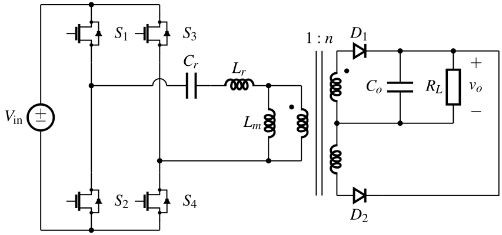
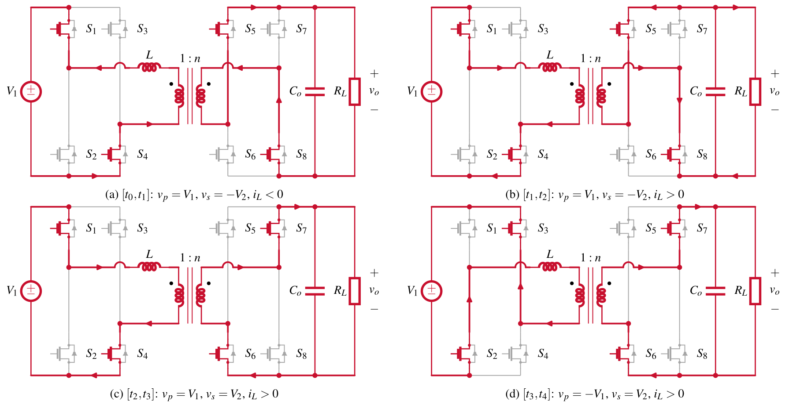
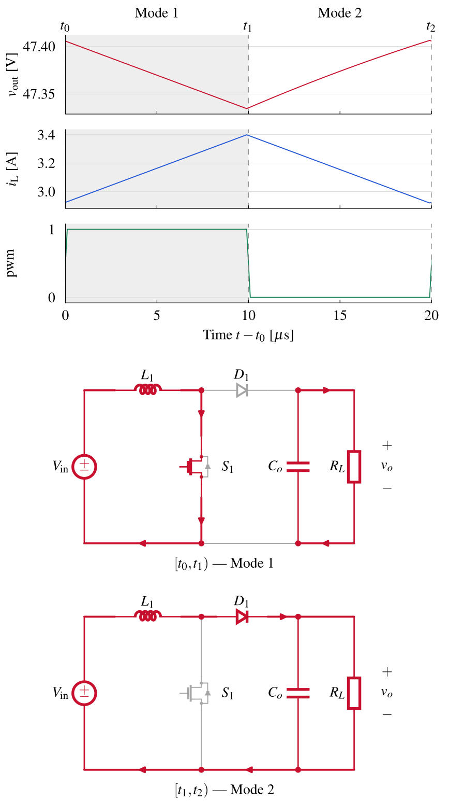
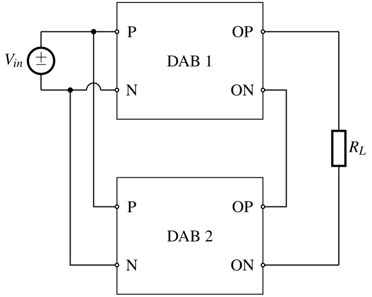
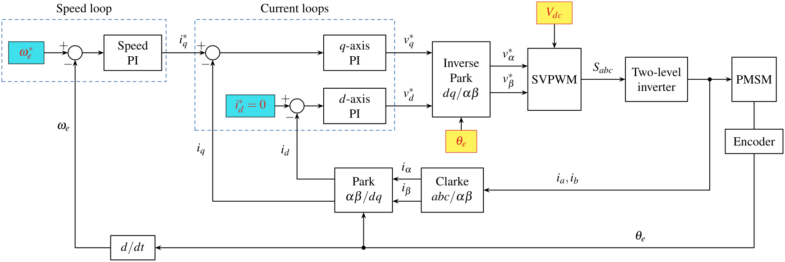
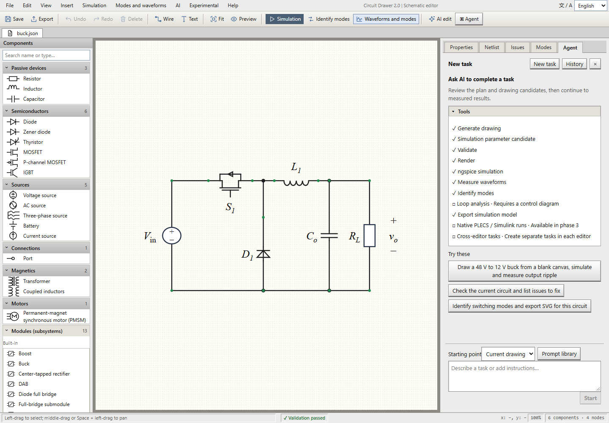

# Circuit Drawer for EE

[简体中文](README.zh-CN.md) | English

Circuit Drawer is a circuit and control-diagram editor for power electronics. Draw by hand, edit a template, or ask the AI Agent to start from a blank canvas, configure parameters, run ngspice and inspect waveforms and operating modes. Editable JSON drawings produce paper-ready CircuiTikZ figures, and linked power circuits and control diagrams can be exported as complete closed-loop simulation models.

<p align="center">
  <a href="https://github.com/ahainur/circuit-drawer-for-ee/releases/download/v2.2.0/CircuitDrawer-Setup-2.2.0.exe"></a>
  <br>
  <a href="https://github.com/ahainur/circuit-drawer-for-ee/releases/download/v2.2.0/circuit_drawer_for_ee-2.2.0-py3-none-any.whl"></a>
  <a href="https://github.com/ahainur/circuit-drawer-for-ee/releases/download/v2.2.0/circuit_drawer_for_ee-2.2.0-py3-none-any.whl"></a>
  <br>
  <a href="https://github.com/ahainur/circuit-drawer-for-ee/releases/download/v2.2.0/CircuitDrawer-Setup-2.2.0.exe"></a>
  <a href="https://github.com/ahainur/circuit-drawer-for-ee/releases/download/v2.2.0/circuit_drawer_for_ee-2.2.0-py3-none-any.whl"></a>
</p>

The Windows button downloads the offline installer. The macOS and Linux buttons download the universal Python package (`.whl`, Python 3.10+). macOS and Linux currently have preview support. See the installation steps below.

[Release notes](https://github.com/ahainur/circuit-drawer-for-ee/releases/tag/v2.2.0) / [Trial bundle with examples](https://github.com/ahainur/circuit-drawer-for-ee/releases/download/v2.2.0/circuit-drawer-trial-2.2.0.zip) / [Offline manuals — 简体 / 繁體 / English](https://github.com/ahainur/circuit-drawer-for-ee/releases/download/v2.2.0/circuit-drawer-manuals-2.2.0.zip) / [Source code](https://github.com/ahainur/circuit-drawer-for-ee/releases/download/v2.2.0/circuit-drawer-public-source-2.2.0.zip)

[Start from a blank canvas](#quick-start) · [Link a controller and export a closed loop](#link-a-controller-and-export-a-complete-closed-loop-model) · [Agent and MCP guide](docs/AGENT_MCP.md)



## Highlights

1、**Agent workflow and prompt library.** Describe a task on a blank canvas or an existing drawing, supply parameters, review circuit, controller and simulation-parameter candidates, then adopt them to continue with ngspice, measurements, mode identification and figure export. Follow-up requests, stop/resume and undoable adoption are supported. Search the DC/DC, inverter and grid, rectifier and PFC, or motor-control categories, and save personal prompts. New examples cover Boost, single-phase full bridge, three-phase grid-connected dq control, Boost APFC and PMSM FOC. [Agent guide](docs/AGENT_MCP.md#四内置-agent-的使用)

2、**One table, many outputs.** A single JSON file holds the parts, wires, netlist, operating modes, annotations, simulation parameters and waveform settings. From it you get PDF, SVG, PNG and TeX figures, ngspice decks with CSV results, a MATLAB build script for Simulink + Simscape, and a native PLECS Standalone model. Open-loop PSIM export provides a Python builder for the official PSIM 2026 API. [PSIM models and steps](docs/PSIM_EXPORT.md)

3、**Paper-ready by default.** Figures fit IEEE single (8.79 cm) or double (17.99 cm) columns with 8 pt Times text. Symbol sizes stay fixed while the spacing between parts is scaled, so you insert the PDF at 100 % and the text matches your captions.

4、**Editable drawings with validation.** Manual, template and AI-generated drawings share the coordinate-table format and remain editable after adoption. Explicitly expanding a module can make room for its contents. The checker reports slanted wires, overlapping symbols and labels, unmarked crossings, dangling wires and differences between the drawing and its netlist.

5、**Web editor.** Move parts, wires and modules as one selection, rotate ordinary parts and wires in either direction, merge overlapping wires and keep wire hops at their crossings. Box selection, context menus, undo/redo, arrow-key nudging and drawing scaling are available.

6、**Modules.** Define a converter cell once, drag it from the library into the canvas, and connect its ports with ordinary wires. Instances can be folded into boxes with IEC symbols. Simulation uses the full circuit, and native exports can represent folded modules as subsystems.

7、**Operating modes and waveforms.** Highlight conducting paths and export mode sheets. Fixed-frequency internal PWM cases support mode identification from ngspice waveforms. Results show sampling windows, output means, ripple and cycle checks. Simulated or measured waveforms can also be arranged alongside t0, t1, ... and the matching mode figures.

7a、**Figure studio and personal icons.** Drag symbols, text and callout arrows on the paper preview, or select an object and send it to the figure Agent. Edit a system symbol’s border and fill. Under **System symbols → Images and personal icons**, choose the drawing model for line icons or a dedicated image model for equipment illustrations. Compose algorithm flowcharts, circuits and annotated waveforms on one sheet.

8、**Control diagrams and complete closed loops.** A separate editor supports PI, FOC and MPC diagrams, loop analysis (margins, Bode plots, Type I/II/III compensators) and fixed- or floating-point C code generation. AI diagrams are laid out from their connections. Routing and layout adjustments can be previewed and adopted as one undoable edit. Link a saved power circuit, feedback signals and PWM, VCO or single-group SPS bindings to run supported ngspice loops or export Simulink and PLECS models.

9、**AI interfaces and MCP.** The AI menu generates new drawings and edits existing ones. Agent tasks combine drawing, simulation and export. Built-in AI uses your API key with an Anthropic-compatible or OpenAI-compatible service. External MCP clients can use the optional Python MCP interface for candidate editing, validation, rendering, simulation and loop analysis. [MCP setup](docs/AGENT_MCP.md)

## Gallery

| Operating modes of a DAB converter | Waveforms matched to modes |
| --- | --- |
|  |  |

| Folded modules wired by port name | Control block diagram (FOC) |
| --- | --- |
|  |  |

The 2.2 circuit editor shows a Boost converter with its task mode in the Agent prompt library.



## Installation

### 64-bit Windows 10 and 11

1、Download `CircuitDrawer-Setup-2.2.0.exe` and run it. Select the installer language and follow the wizard. Installation is per user. [Release downloads](https://github.com/ahainur/circuit-drawer-for-ee/releases)

2、Choose an installation path containing ASCII characters. Spaces are supported. Drawing files, export folders and Windows user names can contain Chinese characters.

3、Open **Circuit Drawer** from the desktop or Start menu. The installer includes Python, TinyTeX with Chinese fonts, Poppler, ngspice and the Anthropic SDK. Drawing, previews, exports and ngspice simulation work offline. The AI assistant uses your configured online service.

4、The installer is unsigned, so Windows may show **Unknown publisher** or **Windows protected your PC**. After checking the download source and SHA256, select **More info → Run anyway** if that option is available. In PowerShell, compare the following result with the installer's entry in the release's `SHA256SUMS.txt`.

```powershell
Get-FileHash .\CircuitDrawer-Setup-2.2.0.exe -Algorithm SHA256
```

5、Save your drawings and close the launcher and running Circuit Drawer command-line tasks before upgrading or uninstalling. Run a newer installer to upgrade. To uninstall, open Windows **Settings → Apps → Circuit Drawer → Uninstall**. User drawings and settings are retained. Save drawings in your own document folders.

### Python installation for developers, macOS and Linux

Circuit Drawer needs Python 3.10 or newer. The core package has no third-party Python dependencies.

Download the wheel from the release page, then open a terminal in its download folder.

On Windows:

```powershell
python -m pip install circuit_drawer_for_ee-2.2.0-py3-none-any.whl
```

On macOS or Linux, install it in a virtual environment:

```bash
python3 -m venv .venv
source .venv/bin/activate
python -m pip install circuit_drawer_for_ee-2.2.0-py3-none-any.whl
```

Keep this environment active when running the commands below. On Debian or Ubuntu, install `python3-venv` if the `venv` module is missing.

Or install straight from the repository:

```bash
python -m pip install "git+https://github.com/ahainur/circuit-drawer-for-ee"
```

Drawing entry points include `circuit-drawer` for circuits, `circuit-drawer-control` for control diagrams and `circuit-drawer-launcher` for the launcher window. If your shell cannot find them, use `python -m circuit_drawer`, `python -m circuit_drawer.control` and `python -m circuit_drawer.launcher`. External MCP clients use `circuit-drawer-mcp` with the optional MCP dependencies installed. [MCP setup](docs/AGENT_MCP.md#一安装与启动)

The example files used throughout the documentation live in the [`examples/`](examples/) folder of this repository. They are not part of the wheel; download the source archive from the release page or clone the repository to get them.

The Python installation can use the following optional components. The Windows installer already includes LaTeX, Poppler, Chinese fonts, ngspice and the Anthropic SDK.

| Component | Needed for |
| --- | --- |
| LaTeX (MiKTeX or TeX Live) with `circuitikz` | PDF output and the editor's true preview |
| Poppler `pdftocairo` | SVG and PNG output |
| `CJKutf8` LaTeX package | Chinese text in figures |
| ngspice | Running simulations and getting CSV results |
| MATLAB, Simulink and Simscape | Running the builder and generated `.slx`. C Function controllers require a compatible C compiler. PMSM and Clarke/Park blocks also require Simscape Electrical |
| PLECS Standalone | Opening the exported `.plecs` model |
| PSIM 2026 and its official Python API | Building and running the exported open-loop PSIM model; [supported models and steps](docs/PSIM_EXPORT.md) |
| Python package `anthropic` | The AI assistant with an Anthropic-compatible interface (`python -m pip install "anthropic>=2.3"`) |

Drawing, editing, checking, exporting TeX and exporting simulation models need none of these. See the [user manual](docs/USER_MANUAL.en.md#2-installation-and-startup) for step-by-step instructions on each platform.

## Quick start

### Start from a blank canvas

1、Open **Circuit Drawer** and configure the provider, model and API key in the launcher's **API 与仿真设置…** dialog. Choose **新建电路… → 空白电路** and save the drawing in your project folder.

2、Open **Agent → Prompt library**, choose **Blank canvas** and search for **Boost**. Choose **Drawing only** to keep unspecified component values symbolic, or **Example simulation** to match the circuit connections to an example operating point. Click **Fill requirement (editable)**, edit the task, then click **Start**.

3、For a simulation, adopt the circuit drawing first. The next review shows current values, proposed values and assumptions. Confirm the operating point to run ngspice. **View results** shows output voltage, inductor current and PWM. Save the drawing to keep its parameters. Run files are in `agent-output` beside the drawing. [Agent instructions](docs/AGENT_MCP.md#四内置-agent-的使用)

4、To try a second load, open **Simulation → SPICE simulation…**. Search for `RL` on the left and change its resistance from 30 Ω to `12`. Search for `S1` and change the switching frequency from 50 kHz to `40k`. Check the operating point and channels at the top, select a new output folder, then run or rerun to compare the waveforms. You can also start directly with the [editable Boost circuit](examples/spice/boost.json).

### Repair a candidate drawing

1. The candidate card identifies the parts and pins to check. Choose **Edit candidate manually**, add the missing wire, then **Save and check again** to compare and adopt the draft.
2. Compare single and double column, or **Try a single-column label layout**. Wide winding spacing appears as print advice. Dashed outlines locate the labels being checked. Amber outlines mark tight spacing or overlapping text. You can adopt, preview and export the drawing as it stands, or drag just the label. Explore both widths using the supplied PFC and LLC drawing. [Open the example](examples/agent_review/pfc_llc.json)

### Link a controller and export a complete closed-loop model

1、Save the power circuit, for example as `power.json`. Return to the launcher and choose **新建控制框图… → 空白控制框图**. Save the control drawing as `controller.json` in the same folder.

2、In the control editor's Agent, specify the power file, feedback signal, control target and modulation. Confirm numerical parameters and adopt the candidate. The request below provides a starting point.

> Link power.json in the same folder and draw a complete output-voltage feedback loop with reference, error, PI, modulator, power stage and voltage feedback. Use the saved circuit to identify parameters and switch bindings that need confirmation. After adoption, export a continuous-control Simulink model containing both the power stage and controller.

3、The control JSON stores the power-file reference, feedback measurements and switch bindings. The program resolves the controller from the actual connections and reads the saved power circuit. **Export once from the control editor's Agent to produce the integrated closed-loop model.** Save power-circuit changes before exporting again.

4、Use the generated files as described below. Native model building or solving takes place in the corresponding application.

| Export target | Files and next step |
| --- | --- |
| Simulink | A `build_*.m` script, mapping manifest and instructions. In MATLAB, change to the export folder and run the builder to generate and open the `.slx`, then click Run |
| PLECS | A `.plecs` model and supporting files. Open and run the model in PLECS Standalone |
| PDF / SVG / PNG / TeX | Figure files for a paper or report. The control editor's toolbar **Export…** action provides these formats |

The circuit editor's **Simulation → Export to Simulink… / Export to PLECS…** commands export the model and control bindings configured in that circuit. [Controller linking and export](docs/AGENT_MCP.md#四内置-agent-的使用)

### Command-line examples

<details>
<summary>Expand template drawing, ngspice and native-model export commands</summary>

```bash
# 1. List the built-in templates and their options
circuit-drawer list

# 2. Draw a template: PDF, SVG, PNG and TeX in figs/
circuit-drawer draw llc_fullbridge -o figs -f pdf,svg,png,tex

# 3. Start from the Buck template and edit it in the browser (http://127.0.0.1:8765)
circuit-drawer edit my_buck.json -t buck

# 4. One figure per operating mode, plus an overview sheet
circuit-drawer modes buck -o figs -f pdf,png

# 5. Add example simulation parameters and run ngspice
circuit-drawer spice-init my_buck.json --preset buck -o my_buck_sim.json
circuit-drawer spice my_buck_sim.json -o out/spice --run

# 6. Export the same circuit to PLECS Standalone and to Simulink
circuit-drawer plecs my_buck_sim.json -o out/plecs
circuit-drawer simulink my_buck_sim.json -o out/simulink
```

</details>

In the editor, drag parts and wires, watch the status bar for problems, then use **File → Export circuit figure…** to write the figure. Export is only possible when the checker passes. Both editors offer **简体中文 / 繁體中文 / English** in the top-right language selector. Switching is immediate and preserves unsaved edits; the browser remembers the choice for that address and port.

## What you can do

| Task | Where |
| --- | --- |
| Generate from a blank canvas, review candidates, simulate, measure and export | **Agent** in either editor's toolbar |
| Fill common requirements or save personal prompts | **Agent → Prompt library** |
| Draw a common topology (Buck, Boost, LLC, DAB, flyback, CLLC, NPC, Vienna, Z-source, ...) | `circuit-drawer draw <template>` |
| Move parts, change labels, colours and symbol sizes | Web editor |
| Group selection, context menus, undo/redo, arrow-key nudging | Web editor |
| Background regions, stacked panels, block arrows, curved and wavy arrows, control blocks | Web editor, **Insert** menu |
| Step and pulse marks next to sources | Web editor, part properties |
| Reusable modules, folding, module library | Web editor, **Modules (subsystems)** group of the parts library |
| Operating-mode figures and fixed-PWM mode identification | Toolbar **Identify modes**, **Modes** tab or Agent, also `circuit-drawer modes` |
| Place a legend, schematic, equipment symbol or personal image on a waveform (development version) | **Figure studio → Waveform publication → Insert**. Drag to position it, set the plot tint and grids, or turn off **Show border** under **Appearance**. Hover over **?** for help with a setting. [Three-load Boost example](examples/waveforms/boost_paper_insets.json) |
| Waveforms bound to modes | **Modes and waveforms → Waveforms and modes…**, or `circuit-drawer waveforms` |
| ngspice simulation | **Simulation → SPICE simulation…**, or `circuit-drawer spice` |
| Conducted EMI engineering estimates and filter comparison | **Experimental → Conducted EMI estimate…**; start with the `buck_emi` template |
| Simulink and PLECS models, closed-loop controllers, folded modules as subsystems | **Simulation → Export to Simulink… / Export to PLECS…**, or `circuit-drawer simulink` / `circuit-drawer plecs` |
| Open-loop PSIM models | **Simulation → Export to PSIM…**, or `circuit-drawer psim`; run the generated Python builder with the official PSIM API |
| Control diagrams, loop analysis, C code | Launcher **新建控制框图…**, or `circuit-drawer-control` |
| Link a complete controller to a power circuit and export the closed loop | Control editor **Agent**, with power and controller JSON files in the same project folder |
| Adjust control-diagram routing and layout | **Reroute wires / Rearrange layout** in the control editor, preview and adopt |
| Call drawing tools from an external AI client | Optional Python MCP interface `circuit-drawer-mcp` |
| New topology from a description, or a one-sentence change | **AI** menu, or `circuit-drawer new` / `circuit-drawer tweak` |
| Save a checked table as your own template | `circuit-drawer save-template` |

Drawing validation checks connections, geometry and text placement. Simulation and result tools check numerical configuration, solver results and sampling windows. Device ratings, losses, efficiency and ZVS require suitable device models and engineering verification.

Automatic mode identification applies to fixed-frequency internal PWM. The internal mode check and the results page's cycle check can differ because of sampling. Dynamic PWM dead time uses a carrier-threshold approximation, and SPS uses one two-bridge group. See the release notes and manual for the supported conditions. [Supported conditions](RELEASE_NOTES.md#当前适用范围)

## Documentation

1、[Agent workflow and MCP interface](docs/AGENT_MCP.md)

2、[User manual (English)](docs/USER_MANUAL.en.md)

3、[使用说明书（中文）](docs/USER_MANUAL.zh-CN.md)

4、[繁體中文使用說明書](docs/USER_MANUAL.zh-TW.md)

5、[Change log](CHANGELOG.md)

6、[Examples](examples/)

## Contributors

1. [@YouthWell](https://github.com/YouthWell) reported the disabled **Adopt** button and shared Boost PFC + LLC screenshots that helped identify overly strict label checks.

## License

Circuit Drawer for EE is released under the [MIT License](LICENSE).
