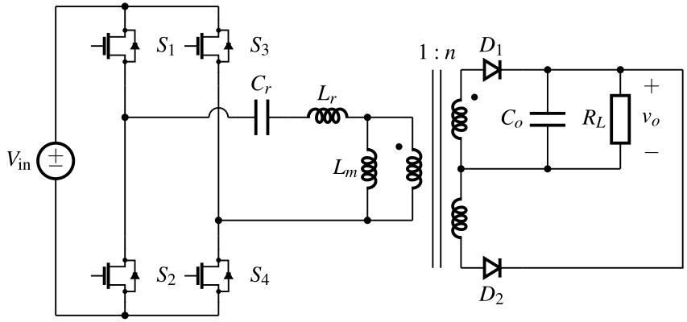
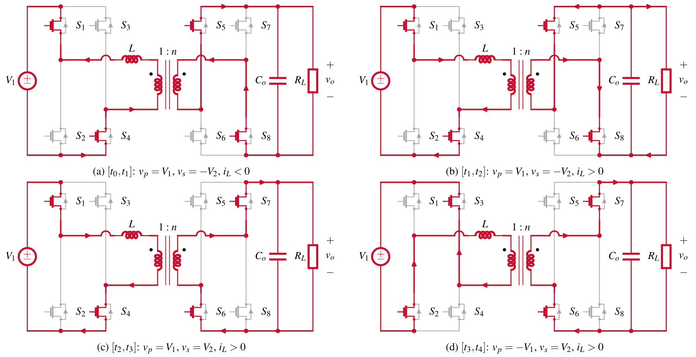
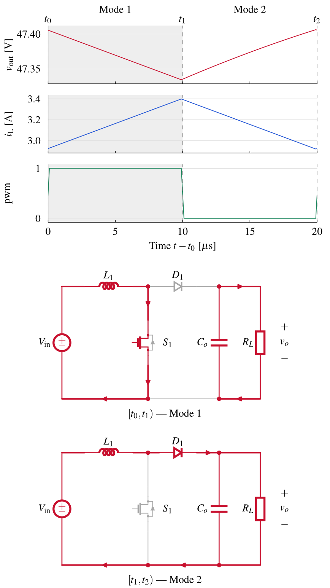
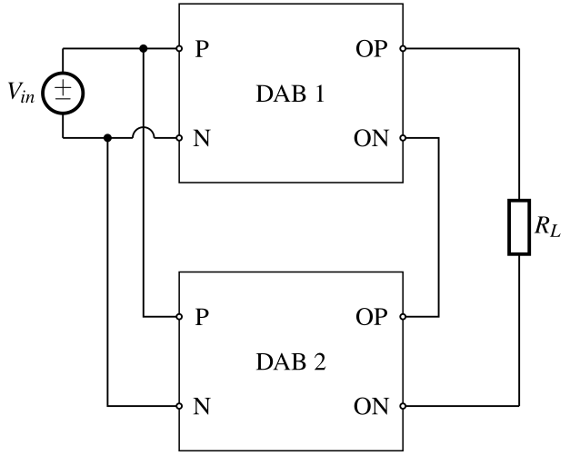
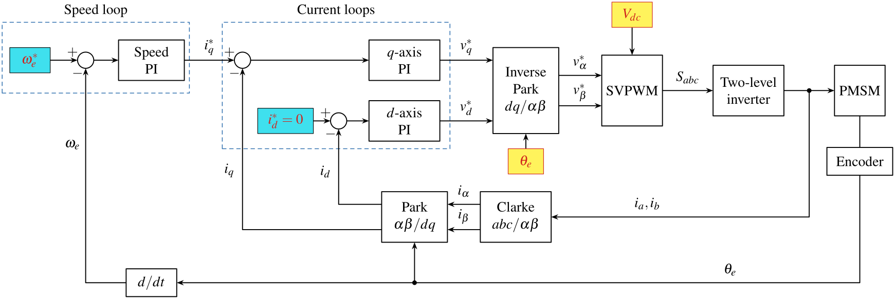
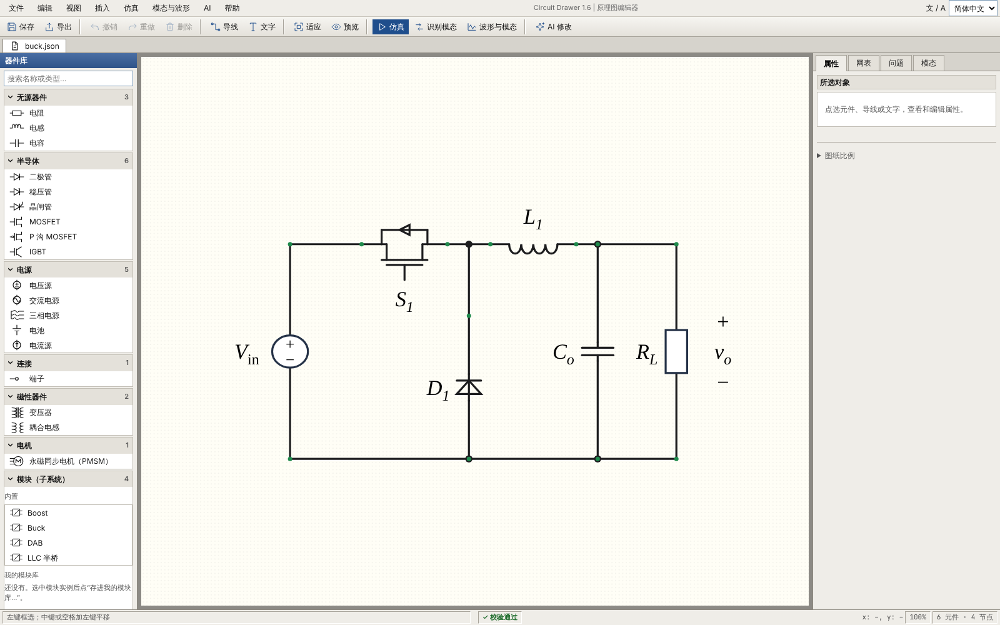

# Circuit Drawer for EE

简体中文 | [English](README.md)

Circuit Drawer 用一张手工摆放、经过校验的坐标表，画出可直接放进论文的电力电子 CircuiTikZ 电路图，并把同一张表导出为 ngspice、Simulink 和 PLECS 仿真模型。



## 一、主要特点

1、**一张表，多种输出。** 一份 JSON 同时保存元件、导线、网表、工作模态、标注、仿真参数和波形设置。由它可以得到 PDF、SVG、PNG、TeX 电路图，ngspice 网表和 CSV 仿真结果，Simulink + Simscape 的 MATLAB 建模脚本，以及 PLECS Standalone 原生模型。

2、**默认就是论文版式。** 图宽适配 IEEE 单栏（8.79 cm）或双栏（17.99 cm），文字为 8 pt Times。符号尺寸固定，适配栏宽时只伸缩元件之间的间距，所以 PDF 按 100% 插入论文，图中字号与图注一致。

3、**不做自动布局，严格校验。** 每个引脚、每个导线拐点都来自模板或你自己。校验器拒绝斜线、符号和文字重叠、没有标跨线的交叉、悬空导线，以及图与网表不一致，并指出位置和原因。

4、**网页编辑器。** 从分类器件库拖入元件，画导线，框选，整组编辑，右键菜单，撤销重做，方向键微调，问题随改随报。

5、**模块化。** 一个变换器单元定义一次，可从库中拖入画布、放置多份，用普通导线连接端口，也可折叠成带 IEC 符号的方框。折叠只改画面，仿真始终使用完整电路。

6、**模态图与波形。** 按开关状态高亮导通回路，导出整组模态图；把仿真或实测波形与 t₀、t₁… 分界和对应模态图排在一起。

7、**控制框图。** 独立的控制框图编辑器，适合 PI 环、FOC、MPC 等框图，带环路分析（裕度、Bode 图、Type I/II/III 补偿器）和定点 / 浮点 C 代码生成。控制表还能接到电路上，在 ngspice、Simulink、PLECS 中闭环仿真。

8、**AI 画图助手（可选）。** 模板库里没有的拓扑可以用一段文字描述，现有的图可以用一句话修改。电路 AI 写坐标；控制框图 AI 写结构，再由程序排版，校验器照常把关。需要你自己的 API Key，支持 Anthropic 兼容接口和 OpenAI 兼容接口。

## 二、效果图

| DAB 变换器的工作模态 | 波形与模态对应 |
| --- | --- |
|  |  |

| 按端口连线的折叠模块 | 控制框图（FOC） |
| --- | --- |
|  |  |

网页编辑器：



## 三、安装

需要 Python 3.10 或更新版本。核心功能不依赖任何第三方 Python 包。

从 [GitHub Release](https://github.com/ahainur/circuit-drawer-for-ee/releases) 下载 wheel 安装：

```bash
python -m pip install circuit_drawer_for_ee-1.6.0-py3-none-any.whl
```

或直接从仓库安装：

```bash
python -m pip install "git+https://github.com/ahainur/circuit-drawer-for-ee"
```

安装后有三个命令：`circuit-drawer`（电路）、`circuit-drawer-control`（控制框图）和 `circuit-drawer-launcher`（打开文件用的小窗口，主要给 Windows 用户）。终端找不到命令时，改用 `python -m circuit_drawer`、`python -m circuit_drawer.control` 和 `python -m circuit_drawer.launcher`。

文档中用到的示例文件在本仓库的 [`examples/`](examples/) 文件夹，不包含在 wheel 里；请从 Release 页面下载源码压缩包，或克隆仓库。

可选组件：

| 组件 | 用途 |
| --- | --- |
| LaTeX（MiKTeX 或 TeX Live），含 `circuitikz` | 输出 PDF，以及编辑器的“真实预览” |
| Poppler 的 `pdftocairo` | 输出 SVG 和 PNG |
| LaTeX 宏包 `CJKutf8` | 图中有中文 |
| ngspice | 运行仿真、得到 CSV 结果 |
| MATLAB、Simulink 和 Simscape | 运行导出的 Simulink 模型；PMSM 和 Clarke／Park 变换还需要 Simscape Electrical |
| PLECS Standalone | 打开导出的 `.plecs` 模型 |
| Python 包 `anthropic` | AI 画图助手使用 Anthropic 兼容接口时（`python -m pip install "anthropic>=2.3"`） |

画图、编辑、校验、导出 TeX 和导出仿真模型都不需要这些组件。各平台的安装步骤见[使用说明书](docs/USER_MANUAL.zh-CN.md#二安装与启动)。

## 四、五分钟上手

```bash
# 1、列出内置模板和可选项
circuit-drawer list

# 2、用模板出图：PDF、SVG、PNG、TeX 写到 figs/
circuit-drawer draw llc_fullbridge -o figs -f pdf,svg,png,tex

# 3、从 Buck 模板开始，在浏览器里编辑（http://127.0.0.1:8765）
circuit-drawer edit my_buck.json -t buck

# 4、每个工作模态一张图，另加一页总览
circuit-drawer modes buck -o figs -f pdf,png

# 5、写入示例仿真参数，用 ngspice 运行
circuit-drawer spice-init my_buck.json --preset buck -o my_buck_sim.json
circuit-drawer spice my_buck_sim.json -o out/spice --run

# 6、同一电路导出到 PLECS Standalone 和 Simulink
circuit-drawer plecs my_buck_sim.json -o out/plecs
circuit-drawer simulink my_buck_sim.json -o out/simulink
```

在编辑器里拖动元件和导线，留意底部状态栏的校验结果，然后点 **文件 → 导出电路图…** 写出图。只有校验通过才能导出。两个编辑器右上角均可选择 **简体中文 / 繁體中文 / English**，立即切换并保留未保存的编辑；浏览器会记住同一地址和端口的选择。

## 五、功能一览

| 想做的事 | 在哪里 |
| --- | --- |
| 画常见拓扑（Buck、Boost、LLC、DAB、反激、CLLC、NPC、维也纳、Z 源……） | `circuit-drawer draw <模板>` |
| 挪元件、改标签、颜色和符号尺寸 | 网页编辑器 |
| 整组选择、右键菜单、撤销重做、方向键微调 | 网页编辑器 |
| 背景色块、叠放面板、块箭头、弯弧和波浪箭头、控制方框 | 网页编辑器 **插入** 菜单 |
| 电源旁的阶跃 / 脉冲小图 | 网页编辑器元件属性 |
| 可复用模块、折叠、模块库 | 网页编辑器器件库的 **模块（子系统）** 分组 |
| 工作模态图 | **模态** 页，或 `circuit-drawer modes` |
| 波形与模态对应 | **分析 → 波形与模态…**，或 `circuit-drawer waveforms` |
| ngspice 仿真 | **分析 → SPICE 仿真…**，或 `circuit-drawer spice` |
| 传导 EMI 工程估算及滤波前后对比 | **分析 → 传导 EMI 估算…**，从 `buck_emi` 模板开始 |
| Simulink 和 PLECS 模型、闭环控制器、折叠模块导出为子系统 | **分析 → SPICE 仿真…**，或 `circuit-drawer simulink` / `circuit-drawer plecs` |
| 控制框图、环路分析、C 代码 | `circuit-drawer-control` |
| 用文字生成新拓扑，或一句话修改当前图 | **AI** 菜单，或 `circuit-drawer new` / `circuit-drawer tweak` |
| 把校验通过的表存成自己的模板 | `circuit-drawer save-template` |

校验器不检查什么：它核对连接、几何和文字位置，不判断工况。偏置、器件额定值、死区、某个模态是否真的出现，仍需按你自己的分析确认。仿真模型是简化模型，不用于损耗、效率或 ZVS 结论。

## 六、文档

1、[使用说明书（中文）](docs/USER_MANUAL.zh-CN.md)

2、[繁體中文使用說明書](docs/USER_MANUAL.zh-TW.md)

3、[User manual (English)](docs/USER_MANUAL.en.md)

4、[更新记录](CHANGELOG.md)

5、[示例](examples/)

## 七、许可证

Circuit Drawer for EE 以 [MIT 许可证](LICENSE) 发布。
