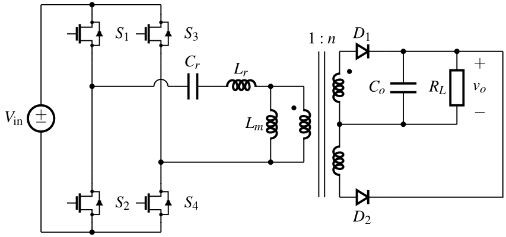
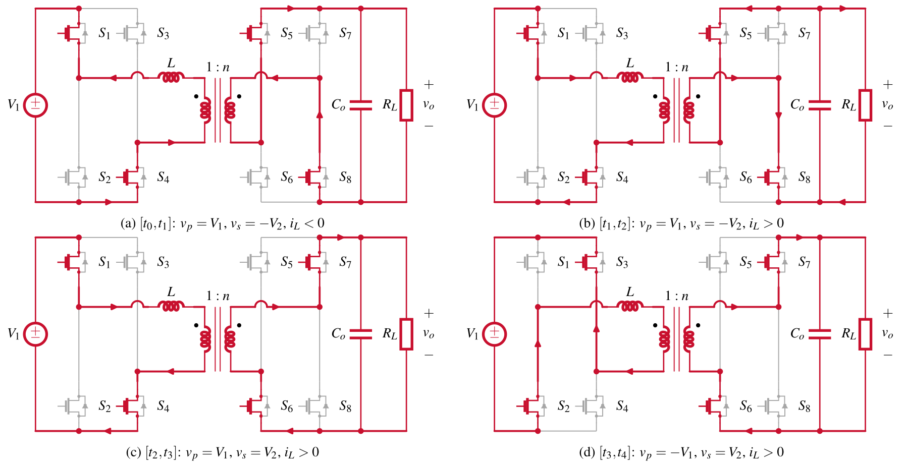
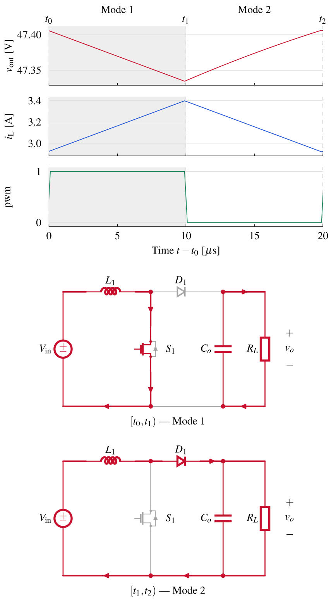
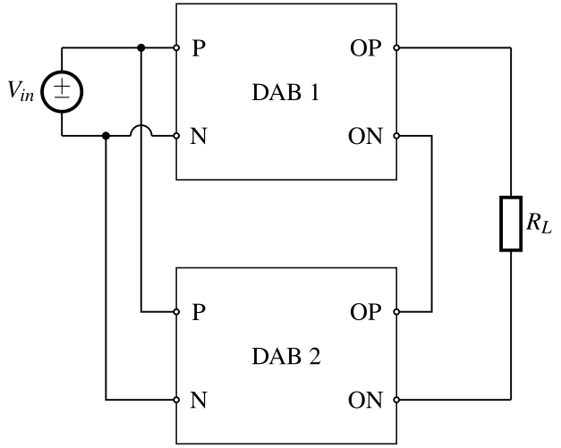
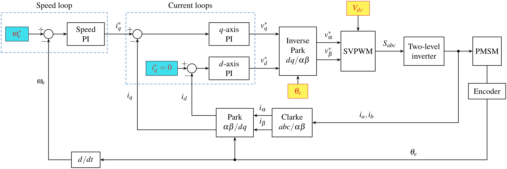
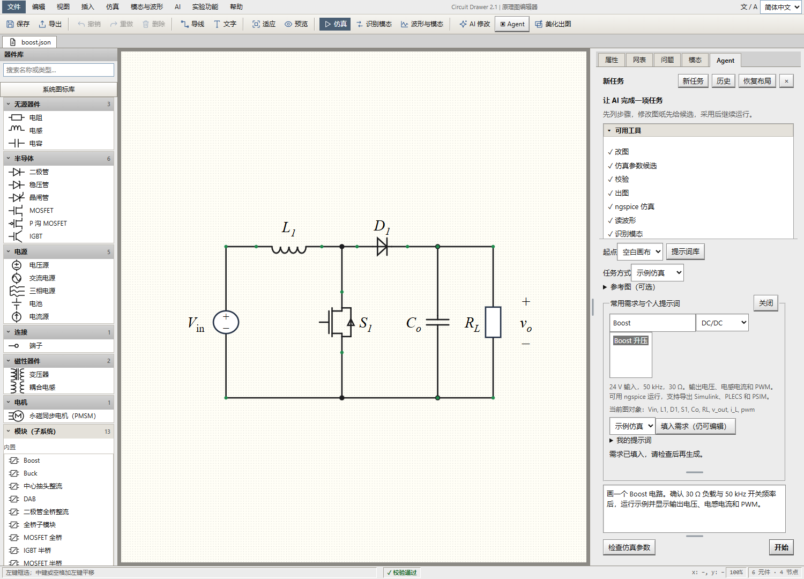

# Circuit Drawer for EE

简体中文 | [English](README.md)

Circuit Drawer 是面向电力电子的电路与控制框图编辑器。支持手工绘图、模板编辑，以及让 AI Agent 从空白画布生成图纸、配置参数、运行 ngspice、查看波形与模态。图纸以可编辑 JSON 保存，可输出论文用的 CircuiTikZ 图形，并关联功率电路与控制框图，导出完整闭环仿真模型。

<p align="center">
  <a href="https://github.com/ahainur/circuit-drawer-for-ee/releases/download/v2.2.0/CircuitDrawer-Setup-2.2.0.exe"></a>
  <br>
  <a href="https://github.com/ahainur/circuit-drawer-for-ee/releases/download/v2.2.0/circuit_drawer_for_ee-2.2.0-py3-none-any.whl"></a>
  <a href="https://github.com/ahainur/circuit-drawer-for-ee/releases/download/v2.2.0/circuit_drawer_for_ee-2.2.0-py3-none-any.whl"></a>
  <br>
  <a href="https://github.com/ahainur/circuit-drawer-for-ee/releases/download/v2.2.0/CircuitDrawer-Setup-2.2.0.exe"></a>
  <a href="https://github.com/ahainur/circuit-drawer-for-ee/releases/download/v2.2.0/circuit_drawer_for_ee-2.2.0-py3-none-any.whl"></a>
</p>

Windows 按钮下载离线安装程序。macOS 和 Linux 按钮下载通用 Python 安装包（`.whl`，需要 Python 3.10+），当前为预览支持。安装步骤见下方。

[新版说明](https://github.com/ahainur/circuit-drawer-for-ee/releases/tag/v2.2.0) / [含示例的试用包](https://github.com/ahainur/circuit-drawer-for-ee/releases/download/v2.2.0/circuit-drawer-trial-2.2.0.zip) / [离线三语说明书](https://github.com/ahainur/circuit-drawer-for-ee/releases/download/v2.2.0/circuit-drawer-manuals-2.2.0.zip) / [完整源码](https://github.com/ahainur/circuit-drawer-for-ee/releases/download/v2.2.0/circuit-drawer-public-source-2.2.0.zip)

[从空白画布开始](#四快速上手) · [控制图关联与闭环导出](#关联控制图并导出完整闭环) · [Agent 与 MCP 使用说明](docs/AGENT_MCP.md)



## 一、主要特点

1、**Agent 工作流与提示词库。** 从空白画布或当前图纸描述任务，补充参数，审阅并采用电路、控制图和仿真参数候选，再执行 ngspice、指标测量、模态识别及出图。支持追问、停止继续和可撤销采用。提示词库可按 DC/DC、逆变与并网、整流与 PFC、电机控制分类搜索。新增 Boost、单相全桥、三相 dq 并网、Boost APFC 和 PMSM FOC 五种示例。[Agent 使用说明](docs/AGENT_MCP.md#四内置-agent-的使用)

2、**一张表，多种输出。** 一份 JSON 同时保存元件、导线、网表、工作模态、标注、仿真参数和波形设置。由它可以得到 PDF、SVG、PNG、TeX 电路图，ngspice 网表和 CSV 仿真结果，Simulink + Simscape 的 MATLAB 建模脚本，以及 PLECS Standalone 原生模型。PSIM 开环导出提供 Python 建模脚本，通过 PSIM 2026 官方 API 生成模型和求解 CSV。[PSIM 支持范围与操作](docs/PSIM_EXPORT.md)

3、**默认就是论文版式。** 图宽适配 IEEE 单栏（8.79 cm）或双栏（17.99 cm），文字为 8 pt Times。符号尺寸固定，适配栏宽时只伸缩元件之间的间距，所以 PDF 按 100% 插入论文，图中字号与图注一致。

4、**可编辑图纸与校验。** 手工、模板及 AI 生成的结果都保存为坐标表，采用后可继续拖动和修改。主动展开模块时可自适应留出空间。校验器检查斜线、符号和文字重叠、未标跨线的交叉、悬空导线及图与网表不一致，并指出位置和原因。

5、**网页编辑器。** 元件、导线和模块可混合多选移动，普通元件与导线可整组双向旋转。支持叠线合并、跨线跟随和整体缩放，提供框选、右键菜单、撤销重做及方向键微调。

6、**模块化。** 一个变换器单元定义一次，可从库中拖入画布、放置多份，用普通导线连接端口，也可折叠成带 IEC 符号的方框。仿真使用完整电路，原生导出可将折叠模块表示为子系统。

7、**模态图与波形。** 按开关状态高亮导通回路，导出整组模态图。固定频率内部 PWM 工况可从 ngspice 波形识别模态，结果页展示取样区间、输出均值、纹波及周期检查。仿真或实测波形还可与 t₀、t₁… 分界和模态图一起排版。

7a、**美化出图与个人图标。** 在纸面拖动图标、文字和说明箭头，或选中对象交给出图 Agent。系统图标可调外框和填色。“系统图标库 → 图片与个人图标”可选择用绘图模型生成简洁线稿，或用专用图像模型生成设备插画。也可把算法流程图、拓扑和带标注的波形组合为一张图。

8、**控制框图与完整闭环。** 独立编辑器支持 PI、FOC、MPC 等框图、环路分析（裕度、Bode 图、Type I/II/III 补偿器）和定点／浮点 C 代码生成。AI 控制图按连接关系排版，也可预览“整理布线”与“重新排版”，采用后单条撤销。控制图可关联已保存的功率电路，配置反馈与 PWM、VCO 或单组 SPS 调制绑定，再执行支持的 ngspice 闭环或导出 Simulink／PLECS 模型。

9、**AI 接口与 MCP。** “AI”菜单支持描述新图和修改当前图，Agent 可把绘图、仿真和出图串成任务。内置 AI 使用你配置的 API Key，支持 Anthropic 兼容接口和 OpenAI 兼容接口。外部 MCP 客户端可通过可选 Python MCP 接口调用候选编辑、校验、出图、仿真及环路分析。[MCP 安装与连接](docs/AGENT_MCP.md)

## 二、效果图

| DAB 变换器的工作模态 | 波形与模态对应 |
| --- | --- |
|  |  |

| 按端口连线的折叠模块 | 控制框图（FOC） |
| --- | --- |
|  |  |

在 2.2 电路编辑器中，画布显示 Boost 电路，右侧提示词库可选择任务方式。



## 三、安装

### 64 位 Windows 10 和 11

1、下载并双击 `CircuitDrawer-Setup-2.2.0.exe`，选择安装语言，按向导完成当前用户安装。[发布下载页](https://github.com/ahainur/circuit-drawer-for-ee/releases)

2、安装目录使用 ASCII 字符，允许空格。图纸、导出目录和 Windows 用户名可使用中文。

3、从桌面或开始菜单打开 **Circuit Drawer**。安装包包含 Python、带中文字体的 TinyTeX、Poppler、ngspice 和 Anthropic SDK。绘图、预览、导出及 ngspice 仿真可离线使用，AI 助手连接你配置的在线服务。

4、安装包尚未签名，Windows 可能显示“未知发布者”或“Windows 已保护你的电脑”。核对下载来源及 SHA256 后，可在提供该选项的界面选择“更多信息 → 仍要运行”。在 PowerShell 运行下面的命令，将结果与同一发布页 `SHA256SUMS.txt` 中的对应条目比较。

```powershell
Get-FileHash .\CircuitDrawer-Setup-2.2.0.exe -Algorithm SHA256
```

5、升级或卸载前先保存图纸，关闭启动器和正在运行的 Circuit Drawer 命令行任务。升级时运行新版安装程序。卸载入口在 Windows“设置 → 应用 → Circuit Drawer → 卸载”，用户图纸和设置会保留。图纸请保存到自己的文档目录。

### 开发者、macOS 和 Linux 的 Python 安装方式

需要 Python 3.10 或更新版本。核心功能不依赖任何第三方 Python 包。

从发布页下载 wheel，在下载文件所在目录打开终端。

Windows：

```powershell
python -m pip install circuit_drawer_for_ee-2.2.0-py3-none-any.whl
```

macOS 或 Linux：在虚拟环境中安装。

```bash
python3 -m venv .venv
source .venv/bin/activate
python -m pip install circuit_drawer_for_ee-2.2.0-py3-none-any.whl
```

运行后文命令时保持此环境已激活。Debian／Ubuntu 若提示缺少 `venv` 模块，先安装 `python3-venv`。

或直接从仓库安装：

```bash
python -m pip install "git+https://github.com/ahainur/circuit-drawer-for-ee"
```

绘图入口包括 `circuit-drawer`（电路）、`circuit-drawer-control`（控制框图）和 `circuit-drawer-launcher`（启动器窗口）。终端找不到命令时，改用 `python -m circuit_drawer`、`python -m circuit_drawer.control` 和 `python -m circuit_drawer.launcher`。外部 MCP 客户端使用 `circuit-drawer-mcp`，先按说明安装 MCP 可选依赖。[MCP 安装与连接](docs/AGENT_MCP.md#一安装与启动)

文档中用到的示例文件在本仓库的 [`examples/`](examples/) 文件夹，不包含在 wheel 里；请从 Release 页面下载源码压缩包，或克隆仓库。

Python 安装方式可按需要配置下列组件。Windows 安装包已包含 LaTeX、Poppler、中文字体、ngspice 和 Anthropic SDK。

| 组件 | 用途 |
| --- | --- |
| LaTeX（MiKTeX 或 TeX Live），含 `circuitikz` | 输出 PDF，以及编辑器的“真实预览” |
| Poppler 的 `pdftocairo` | 输出 SVG 和 PNG |
| LaTeX 宏包 `CJKutf8` | 图中有中文 |
| ngspice | 运行仿真、得到 CSV 结果 |
| MATLAB、Simulink 和 Simscape | 执行建模脚本并运行生成的 `.slx`。含 C Function 控制器时需适配的 C 编译器，PMSM 和 Clarke／Park 变换另需 Simscape Electrical |
| PLECS Standalone | 打开导出的 `.plecs` 模型 |
| PSIM 2026 及官方 Python API | 建立并运行导出的开环 PSIM 模型 |
| Python 包 `anthropic` | AI 画图助手使用 Anthropic 兼容接口时（`python -m pip install "anthropic>=2.3"`） |

画图、编辑、校验、导出 TeX 和导出仿真模型都不需要这些组件。各平台的安装步骤见[使用说明书](docs/USER_MANUAL.zh-CN.md#二安装与启动)。

## 四、快速上手

### 从空白画布开始

1、打开桌面上的 **Circuit Drawer**，在启动器的 **API 与仿真设置…** 中填写接口、模型和 API Key。点 **新建电路… → 空白电路**，把图纸保存到自己的项目文件夹。

2、点 **Agent → 提示词库**，起点选 **空白画布**，搜索 **Boost**。选 **只画图**，留空的器件值会保留为符号。选 **示例仿真**，Agent 会按电路连接匹配示例工况。点 **填入需求（仍可编辑）**，核对文字后再点 **开始**。

3、示例仿真先请你采用电路图（若无法采用先排查初始拓扑和当前候选图的报错），再列出当前值、建议值和假设。确认工况后才运行 ngspice。点 **查看结果** 可看输出电压、电感电流和 PWM。点 **保存** 保留图纸与参数，运行文件位于图纸旁的 `agent-output`。[Agent 操作手册](docs/AGENT_MCP.md#四内置-agent-的使用)

4、要试另一种负载，打开 **仿真 → SPICE 仿真…**。在左侧搜索 `RL`，将示例电阻从 30 Ω 改为 `12`，再搜索 `S1`，将开关频率从 50 kHz 改为 `40k`。核对顶部工况和通道，换一个输出文件夹后运行或复跑，可保留两组波形作比较。手工操作可以直接从已有的 [Boost 图纸](examples/spice/boost.json) 开始。

### 修复候选的接线与排版

1、候选卡会点名待修的元件或引脚。选 **手动修改候选** 打开独立草稿，补线后点 **保存并重新校验**，回到原图比较和采用。
2、纸面过挤时，可在候选卡比较单栏、双栏，或 **试排单栏标签**。绕组稍宽只显示排版提醒。标签的虚线框标出文字检查位置。标签压线、压元件或彼此重叠时会显示黄色提醒，可照原样采用、预览和出图，也可以只拖动标签。两种栏宽的差异可用随附的 PFC＋LLC 图练习。[打开示例](examples/agent_review/pfc_llc.json)

### 关联控制图并导出完整闭环

1、先保存功率电路，例如 `power.json`。回到启动器点 **新建控制框图… → 空白控制框图**，把控制图保存为同目录的 `controller.json`。

2、在控制图的 Agent 中说明关联文件、反馈信号、控制目标和调制方式，确认数值参数后采用候选。下面这段请求可作为开始。

> 关联同目录的 power.json，绘制完整输出电压闭环，包含参考、误差、PI、调制器、功率级和电压反馈。根据已有功率电路列出需要确认的参数与开关绑定。采用后导出包含功率级和控制器的连续控制 Simulink 模型。

3、控制 JSON 保存功率文件引用、反馈测量及调制开关绑定。程序按实际连线解析控制器，并读取已保存的功率电路。**从控制图 Agent 导出一次即可得到整合后的闭环模型**。修改功率电路后先保存，再重新导出。

4、按下表使用导出文件。Simulink／PLECS 的原生建模或求解在对应软件中执行。

| 导出目标 | 得到的文件与后续操作 |
| --- | --- |
| Simulink | 得到 `build_*.m`、映射清单和说明。在 MATLAB 中进入该目录，运行建模脚本，生成并打开 `.slx`，再点击运行 |
| PLECS | 得到 `.plecs` 模型及配套文件，在 PLECS Standalone 中打开并运行 |
| PDF／SVG／PNG／TeX | 得到图形文件，可插入论文或报告。控制窗口工具栏 **导出…** 提供这些格式 |

电路窗口的 **仿真 → 导出到 Simulink…／导出到 PLECS…** 导出当前电路中已配置的模型与控制绑定。[完整关联与导出操作](docs/AGENT_MCP.md#四内置-agent-的使用)

### 命令行示例

<details>
<summary>展开模板绘图、ngspice 和原生模型导出命令</summary>

```bash
# 1、列出内置模板和可选项
circuit-drawer list

# 2、用模板出图：PDF、SVG、PNG、TeX 写到 figs/
circuit-drawer draw llc_fullbridge -o figs -f pdf,svg,png,tex

# 3、从 Buck 模板开始，在浏览器里编辑（http://127.0.0.1:8765）
circuit-drawer edit my_buck.json -t buck

# 4、每个工作模态一张图，另加一页总览
circuit-drawer modes buck -o figs -f pdf,png

# 5、写入示例仿真参数，用 ngspice 运行
circuit-drawer spice-init my_buck.json --preset buck -o my_buck_sim.json
circuit-drawer spice my_buck_sim.json -o out/spice --run

# 6、同一电路导出到 PLECS Standalone 和 Simulink
circuit-drawer plecs my_buck_sim.json -o out/plecs
circuit-drawer simulink my_buck_sim.json -o out/simulink
```

</details>

在编辑器里拖动元件和导线，留意底部状态栏的校验结果，然后点 **文件 → 导出电路图…** 写出图。只有校验通过才能导出。两个编辑器右上角均可选择 **简体中文 / 繁體中文 / English**，立即切换并保留未保存的编辑；浏览器会记住同一地址和端口的选择。

## 五、功能一览

| 想做的事 | 在哪里 |
| --- | --- |
| 从空白生成、确认候选、仿真、测量和出图 | 两种编辑器工具栏 **Agent** |
| 填写常用需求或保存个人提示词 | **Agent → 提示词库** |
| 画常见拓扑（Buck、Boost、LLC、DAB、反激、CLLC、NPC、维也纳、Z 源……） | `circuit-drawer draw <模板>` |
| 挪元件、改标签、颜色和符号尺寸 | 网页编辑器 |
| 整组选择、右键菜单、撤销重做、方向键微调 | 网页编辑器 |
| 背景色块、叠放面板、块箭头、弯弧和波浪箭头、控制方框 | 网页编辑器 **插入** 菜单 |
| 电源旁的阶跃 / 脉冲小图 | 网页编辑器元件属性 |
| 可复用模块、折叠、模块库 | 网页编辑器器件库的 **模块（子系统）** 分组 |
| 工作模态图及固定 PWM 模态识别 | 工具栏 **识别模态**、**模态** 页或 Agent，也可用 `circuit-drawer modes` |
| 波形与模态对应 | **模态与波形 → 波形与模态…**，或 `circuit-drawer waveforms` |
| 在波形上放置图例、矢量拓扑、系统图标或个人图片（开发版） | **美化出图 → 波形出图 → 插入**，拖动摆位，设置淡色底和横纵网格线。在对象的 **外观** 中可关闭边框。悬停在设置旁的 **?** 可查看用法。[三负载 Boost 示例](examples/waveforms/boost_paper_insets.json) |
| ngspice 仿真 | **仿真 → SPICE 仿真…**，或 `circuit-drawer spice` |
| 传导 EMI 工程估算及滤波前后对比 | **实验功能 → 传导 EMI 估算…**，从 `buck_emi` 模板开始 |
| Simulink 和 PLECS 模型、闭环控制器、折叠模块导出为子系统 | **仿真 → 导出到 Simulink… / 导出到 PLECS…**，或 `circuit-drawer simulink` / `circuit-drawer plecs` |
| 开环 PSIM 模型 | **仿真 → 导出到 PSIM…**，或 `circuit-drawer psim`，随后用官方 PSIM API 运行生成的 Python 建模脚本 |
| 控制框图、环路分析、C 代码 | 启动器 **新建控制框图…**，或 `circuit-drawer-control` |
| 完整控制图关联功率电路并导出闭环 | 控制图 **Agent**，功率与控制 JSON 放在同一项目目录 |
| 控制图布线与排版调整 | 控制编辑器 **整理布线／重新排版**，预览后采用 |
| 外部 AI 客户端调用绘图工具 | 可选 Python MCP 接口 `circuit-drawer-mcp` |
| 用文字生成新拓扑，或一句话修改当前图 | **AI** 菜单，或 `circuit-drawer new` / `circuit-drawer tweak` |
| 把校验通过的表存成自己的模板 | `circuit-drawer save-template` |

图纸校验检查连接、几何和文字位置，仿真与结果工具检查数值配置、求解结果和取样区间。器件额定值、损耗、效率及 ZVS 判断需要相应器件模型与工程验证。

自动模态识别适用于固定频率内部 PWM。模态内部检查与结果页周期检查可能因采样方式出现差异，动态 PWM 死区采用载波阈值近似，SPS 使用单组双桥绑定。具体适用条件见本版说明和使用手册。[当前适用范围](RELEASE_NOTES.md#当前适用范围)

## 六、文档

1、[Agent 操作与 MCP 接口](docs/AGENT_MCP.md)

2、[使用说明书（中文）](docs/USER_MANUAL.zh-CN.md)

3、[繁體中文使用說明書](docs/USER_MANUAL.zh-TW.md)

4、[User manual (English)](docs/USER_MANUAL.en.md)

5、[更新记录](CHANGELOG.md)

6、[示例](examples/)

## 七、贡献者

1、感谢 [@YouthWell](https://github.com/YouthWell) 报告「采用」按钮变灰，并提供 Boost PFC＋LLC 使用截图，帮助定位标签检查过严的问题。

## 八、许可证

Circuit Drawer for EE 以 [MIT 许可证](LICENSE) 发布。
