# Circuit Drawer User Manual

[简体中文](USER_MANUAL.zh-CN.md) | English

This manual covers Circuit Drawer for EE 1.5.0. Read chapters 1 and 2 to install the program, then use the rest as a reference. Commands and field names are written exactly as the program expects them.

The editor's interface is in Chinese. Every menu item, button and option is quoted here in its original Chinese form, followed by an English translation in parentheses, for example **文件 → 导出电路图…** (File > Export circuit figure).

## Contents

1. [Introduction](#1-introduction)
2. [Installation and startup](#2-installation-and-startup)
3. [Drawing from templates](#3-drawing-from-templates)
4. [Editor tour](#4-editor-tour)
5. [Parts library and parts](#5-parts-library-and-parts)
6. [Part properties](#6-part-properties)
7. [Wires, hops and junctions](#7-wires-hops-and-junctions)
8. [Selection and group editing](#8-selection-and-group-editing)
9. [Context menus](#9-context-menus)
10. [Undo, redo and arrow-key nudging](#10-undo-redo-and-arrow-key-nudging)
11. [The checker and the Issues tab](#11-the-checker-and-the-issues-tab)
12. [Regions, blocks, arrows, layers and step and pulse marks](#12-regions-blocks-arrows-layers-and-step-and-pulse-marks)
13. [Colouring parts and text](#13-colouring-parts-and-text)
14. [Modules](#14-modules)
15. [Operating-mode figures](#15-operating-mode-figures)
16. [Waveforms and modes](#16-waveforms-and-modes)
17. [SPICE simulation](#17-spice-simulation)
18. [Simulink and PLECS export, closed-loop control](#18-simulink-and-plecs-export-closed-loop-control)
19. [Control diagram editor](#19-control-diagram-editor)
20. [AI drawing assistant](#20-ai-drawing-assistant)
21. [Export formats, LaTeX and Word](#21-export-formats-latex-and-word)
22. [Command-line reference](#22-command-line-reference)
23. [Environment variables](#23-environment-variables)
24. [FAQ and troubleshooting](#24-faq-and-troubleshooting)
25. [Keyboard and mouse reference](#25-keyboard-and-mouse-reference)
26. [Appendix A. Coordinate table format](#appendix-a-coordinate-table-format)
27. [Appendix B. Drawing rules](#appendix-b-drawing-rules)

---

## 1. Introduction

### 1.1 What it does

Circuit Drawer draws circuit figures for power electronics papers and reports. You place parts and wires in a JSON coordinate table (or in the web editor). The program checks that the drawing is tidy and agrees with its netlist, then writes CircuiTikZ figures sized for journal columns. The same table can be exported to ngspice, Simulink and PLECS models, drawn as operating-mode figures, and lined up with waveforms. Control block diagrams have their own editor.

### 1.2 Three principles

1. **The coordinate table is the single source of truth.** Part positions, wires, the netlist, modes, regions, simulation parameters and waveform settings all live in one `.json` file. PDF, SVG, PNG, TeX and the simulation models are generated from it. To change a figure, change the JSON or edit it in the editor; do not edit the exported TeX.

2. **No automatic layout, and no figure until the checker passes.** The program never computes part positions and never patches a table silently. Errors reported by the checker must be fixed first; [chapter 11](#11-the-checker-and-the-issues-tab) explains how.

3. **Passing the checker does not mean the circuit works.** The checker covers connections, geometry and text placement. Bias, current direction and magnitude, device values, dead time and whether a mode really occurs are for you to confirm. All simulation models are simplified and are not meant for loss, efficiency or ZVS conclusions.

### 1.3 Coordinates and sizes

Coordinates are in "layout units", roughly 1 cm each. Dragging in the editor snaps to a 0.05 grid. When a figure is produced, the horizontal scale follows the column width: at most 8.79 cm for a single column and 17.99 cm for a double column; the vertical scale stays between 1.0 and 1.2. Symbols and text have absolute sizes (8 pt Times by default); fitting a column only stretches or compresses the spacing between parts, and small circuits keep their natural width instead of being stretched to the full column. A horizontal scale below 0.55 means the drawing does not fit the chosen column.

---

## 2. Installation and startup

### 2.1 Requirements

| Component | Purpose | Required? |
| --- | --- | --- |
| Python 3.10 or newer | Running the program | Yes |
| LaTeX (MiKTeX or TeX Live) with `circuitikz`, `standalone`, `mathptmx` | PDF output, the editor's true preview | For PDF, SVG and PNG |
| Poppler `pdftocairo` | Converting PDF to SVG and PNG | For SVG and PNG |
| LaTeX package `CJKutf8` | Chinese text in figures | Only when you write Chinese |
| ngspice | Running SPICE simulations, CSV output | Only for "export and simulate" |
| MATLAB, Simulink, Simscape | Running the exported Simulink build script | Only for Simulink |
| PLECS Standalone | Opening the exported `.plecs` model | Only for PLECS |
| Python package `anthropic` | The AI drawing assistant with an Anthropic-compatible interface | Only for that interface |

Editing, checking and exporting TeX sources or simulation model files need neither LaTeX, ngspice nor any commercial software.

### 2.2 Installing the program

Option 1: download the wheel `circuit_drawer_for_ee-1.5.0-py3-none-any.whl` from the [GitHub Releases](https://github.com/ahainur/circuit-drawer-for-ee/releases) page and run, in the folder that contains it:

```bash
python -m pip install circuit_drawer_for_ee-1.5.0-py3-none-any.whl
```

Option 2: install directly from the repository:

```bash
python -m pip install "git+https://github.com/ahainur/circuit-drawer-for-ee"
```

To use the AI drawing assistant with an Anthropic-compatible interface, install one more package (the OpenAI-compatible interface does not need it):

```bash
python -m pip install "anthropic>=2.3"
```

The installation provides three commands:

| Command | Purpose |
| --- | --- |
| `circuit-drawer` | Circuits: templates, editor, checking, modes, waveforms, simulation export, AI |
| `circuit-drawer-control` | Control diagrams: editor, figures, loop analysis, C code |
| `circuit-drawer-launcher` | Launcher window: open or create files, manage editors, enter API settings |

If your shell cannot find them (Python's Scripts folder is not on PATH), use `python -m circuit_drawer`, `python -m circuit_drawer.control` and `python -m circuit_drawer.launcher` with the same arguments.

### 2.3 Installing optional components

1. **LaTeX (Windows):** install [MiKTeX](https://miktex.org/download) and set "Install missing packages on-the-fly" to "Yes". The first figure downloads circuitikz and other packages, so it needs a network connection and takes a while. TeX Live works as well.

2. **Poppler (Windows):** run `conda install -c conda-forge poppler`, or download a Windows build of Poppler and add its `bin` folder to PATH.

3. **Linux (Debian, Ubuntu):**

```bash
sudo apt-get install texlive-pictures texlive-latex-extra texlive-fonts-recommended poppler-utils
sudo apt-get install latex-cjk-chinese     # if figures contain Chinese
```

4. **macOS:**

```bash
brew install --cask mactex-no-gui
brew install poppler
```

5. **ngspice:** download it from the [ngspice website](https://ngspice.sourceforge.io/download.html). On Windows, unpack it and use `Spice64\bin\ngspice_con.exe`; on Linux, use your distribution's package manager. The program looks for it in this order: the `--ngspice` command-line option, the environment variable `CIRCUIT_DRAWER_NGSPICE`, then `ngspice_con` or `ngspice` on PATH. The Windows launcher's API and simulation settings can also point to it.

6. **MATLAB and PLECS:** the Simulink export uses the Simscape Foundation Library and needs MATLAB, Simulink and Simscape; closed-loop controllers that use Clarke or Park transforms also need Simscape Electrical. The PLECS export is a native PLECS Standalone file, not a PLECS Blockset file. Neither program is needed to produce the export files.

7. **Checking the installation:** open a new terminal and run the commands below. If the first two run at all, LaTeX and Poppler are installed.

```bash
pdflatex --version
pdftocairo -v
circuit-drawer list
```

### 2.4 Getting the example files

The `examples/...` files referred to in this manual are in the repository's [`examples/`](../examples/) folder and are not included in the wheel. Download the source archive from the Releases page, or:

```bash
git clone https://github.com/ahainur/circuit-drawer-for-ee
cd circuit-drawer-for-ee
```

Run the example commands in this manual from that folder. The built-in templates are installed with the program and work without the example files.

### 2.5 Starting the circuit editor from the command line

```bash
circuit-drawer edit fb.json -t flyback       # create fb.json from the flyback template if missing, then open the browser
circuit-drawer edit fb.json                  # continue editing an existing table
circuit-drawer edit inv.json -p double       # large circuits: open at double-column width (the JSON does not store it)
circuit-drawer edit fb.json --port 8770      # use another port when 8765 is taken
```

1. The editor runs on your computer; the browser opens `http://127.0.0.1:8765`. `127.0.0.1` means this computer, and the editor listens only locally. Ordinary drawing needs no network connection.

2. If the file does not exist and no `-t` is given, the command stops with an error instead of creating a file. To start from an empty canvas, write a minimal table first, or use **新建电路…** (New circuit) in the launcher:

```json
{"name": "my_circuit", "elements": [], "wires": []}
```

3. Other options: `--no-browser` does not open a browser; `-o` sets the export folder (default: the JSON's folder); `--provider` and `--model` choose the interface type and model for the AI drawing assistant.

4. Press `Ctrl+C` in the terminal to stop the editor. Closing the browser tab does not stop it; open the same address again to return.

### 2.6 Windows launcher

The launcher is a small window for opening circuits, creating circuits and managing editors without a terminal. It uses the Python installation and this program; it does not bundle LaTeX, Poppler or other tools.

1. **Opening the launcher:** type `circuit-drawer-launcher` in the Run box or a terminal (on Windows it opens without a console window), or run `python -m circuit_drawer.launcher`. For a desktop icon, find Python's Scripts folder with the command below and create a desktop shortcut to `circuit-drawer-launcher.exe` in it:

```bash
python -c "import sysconfig; print(sysconfig.get_path('scripts'))"
```

2. **打开 / 继续编辑** (Open / continue editing): pick a `.json` under **图纸 / 最近文件** (Drawing / recent files) or with **浏览…** (Browse), then click the button. With **下次双击启动器时，自动打开上次使用的图纸** (Open the last drawing next time) checked, the next start goes straight back to the last figure.

3. **新建电路…** (New circuit): the default is **空白电路（自己绘制 / AI 生成）** (Blank circuit, draw by hand or with AI); you can also start from a template such as Buck or LLC, then choose where to save. A new circuit needs a file name that does not exist yet, so existing figures are never overwritten.

4. **新建控制框图…** (New control diagram): likewise starts from blank or from a template and opens the control diagram editor.

5. **API 与仿真设置…** (API and simulation settings): enter the interface type (`anthropic` for an Anthropic-compatible interface, `openai` for an OpenAI-compatible interface), model ID, base URL, API key, the two reasoning-effort levels and the ngspice path, then click **应用设置** (Apply settings). With **在当前 Windows 账户中加密记住 API Key** (Remember the API key, encrypted for this Windows account) checked, the key is encrypted with Windows DPAPI and stored in `%LOCALAPPDATA%\CircuitDrawer\launcher.json`, never in the project, the circuit JSON or Git; unchecked, it is used only for the current launcher session. Drawing, modes and local simulation need no API.

6. **正在运行的编辑器** (Running editors): lists the editors the launcher started. If you closed the browser, select the editor and click **重新打开浏览器** (Reopen browser); click **停止所选编辑器** (Stop selected editor) when you no longer need it. Quitting the launcher stops every editor it started, so save in the browser first.

7. The launcher reuses the previous port for each file where possible, so settings the browser remembers (such as the export folder) still apply; if the port is busy it picks a free one. It never stops editors you started yourself in a terminal.

8. Command-line options: `circuit-drawer-launcher my.json` opens a file directly; `--control` starts by creating a control diagram; `--settings` uses another settings file.

9. The launcher also runs on Linux and macOS (Python with Tk is required), without the encrypted key storage.

### 2.7 Starting the control diagram editor

```bash
circuit-drawer-control edit my_ctrl.json -t dual_loop   # create my_ctrl.json from the dual_loop example if missing
```

The control diagram editor uses port 8766 by default and does not interfere with the circuit editor. See [chapter 19](#19-control-diagram-editor).

---

## 3. Drawing from templates

### 3.1 Basic commands

```bash
circuit-drawer list                                     # all templates, options and Chinese keywords
circuit-drawer draw llc_fullbridge                      # default drawing, IEEE single column, four formats into out/
circuit-drawer draw llc 全桥整流 switch=igbt -p double  # only state what differs from the default
circuit-drawer draw dab output=source currents -o figs --name dab_fig -f pdf,png
```

1. **Options** are written as `key=value` or as plain keywords, in English or Chinese (for example `igbt`, `全桥整流` for a full-bridge rectifier, `电流` for current arrows, `二极管在下` for a low-side diode). Unknown words are reported with the list of valid ones; they are never ignored silently.

2. **Column width:** `-p single` (`ieee-single`) or `-p double` (`ieee-double`). When a drawing does not fit a single column, the checker reports `too-cramped` and suggests the double column.

3. **Output:** `-o` output folder (default `out/`); `-f` formats, default `pdf,svg,png,tex`; `--name` file name; `--grid` overlays the coordinate grid (for checking only, not for papers); `--mono` turns regions and arrows grey.

### 3.2 Templates

| Template (aliases) | Content | Options | Default width | Built-in modes |
| --- | --- | --- | --- | --- |
| `llc_fullbridge` (`llc`, `全桥llc`) | MOSFET full bridge, Cr–Lr, Lm, 1:n, centre-tapped rectifier, Co ∥ RL | `switch=mosfet/igbt`, `rectifier=center_tap/full_bridge`, `currents`, `lm=yes/no`, `fs=below/resonance/above` | Single | 6 for fs < fr, 4 for fs = fr, 6 for fs > fr |
| `dab` | Two full bridges, series inductor, 1:n, Co ∥ RL | `switch`, `output=load/source`, `currents`, `inductor=text` | Single | 4 per half period, single phase shift |
| `flyback` (`反激`) | Single switch, coupled inductor with opposite dots, output diode | `switch`, `currents`, `diode=top/bottom` | Single | 3 (the third is the DCM idle interval) |
| `zsource_inverter` (`z源`, `阻抗源逆变器`, ...) | Diode, X-shaped impedance network, three-phase bridge, star load | `switch`, `diode=yes/no`, `load=r/rl`, `x=diagonal/orthogonal` | Double | None |
| `vienna_rectifier` (`维也纳`, `vienna`, ...) | Textbook three-phase Vienna PFC | `switch` | Single | None |
| `buck` (`降压变换器`, ...) | Buck with freewheeling diode | `switch=drawn/mosfet/igbt` | Single | 2 CCM |
| `boost` (`升压变换器`, ...) | Boost with output diode | `switch=drawn/mosfet/igbt` | Single | 2 CCM |
| `llc_halfbridge` (`半桥llc`, ...) | Half bridge, Cr–Lr, Lm, centre-tapped rectifier | `switch=drawn/mosfet/igbt` | Single | None |
| `cllc` (`clllc`, ...) | Two full bridges, series LC on both sides, Lm | `switch=drawn/mosfet/igbt` | Double | None |
| `three_phase_inverter` (`三相逆变器`, ...) | Two-level six-switch bridge, DC-link capacitor, star load | `switch=drawn/mosfet/igbt` | Double | None |
| `npc_3level` (`npc`, ...) | Three-phase three-level diode-clamped inverter | `switch=drawn/mosfet/igbt` | Double | None |
| `dab_multi` (`多模块dab`, ...) | Two DABs, outputs in series, one coloured region per module | `switch=drawn/mosfet/igbt` | Double | None |
| `llc_ipos` (`多模块llc`, ...) | Two half-bridge LLCs, inputs in parallel, outputs in series, with regions | `switch=drawn/mosfet/igbt` | Double | None |

1. `switch=drawn` keeps the devices the template was drawn with. Switching to MOSFET or IGBT only changes the symbols; it does not prove that the circuit still works.

2. The output of `circuit-drawer list` is the authoritative list and includes templates you saved yourself.

3. For templates without built-in modes, define your own in the editor or in the JSON; see [chapter 15](#15-operating-mode-figures).

### 3.3 Export the table, then edit it

```bash
circuit-drawer export llc -o llc.json       # write the template as JSON
circuit-drawer edit llc.json                # edit it in the editor
circuit-drawer check llc.json               # check only, print a JSON report; exit code 1 if it fails
circuit-drawer render llc.json -p single    # draw once the check passes
```

The exported JSON does not record the column width. Add `-p double` when reopening or drawing a large circuit.

### 3.4 Saving your own template

```bash
circuit-drawer save-template bb.json buck_boost --title "Four-switch buck-boost" --alias 四开关升降压
circuit-drawer draw 四开关升降压 switch=igbt
```

1. Template names may contain only lower-case letters, digits and underscores. Only tables that pass the checker are accepted, and the name may not clash with a built-in template; add `--force` to replace one of your own.

2. Templates are stored in `~/.circuit_drawer/templates/`, or in the folder named by the environment variable `CIRCUIT_DRAWER_TEMPLATES`.

3. **文件 → 存为模板…** (File > Save as template) in the editor does the same.

---

## 4. Editor tour

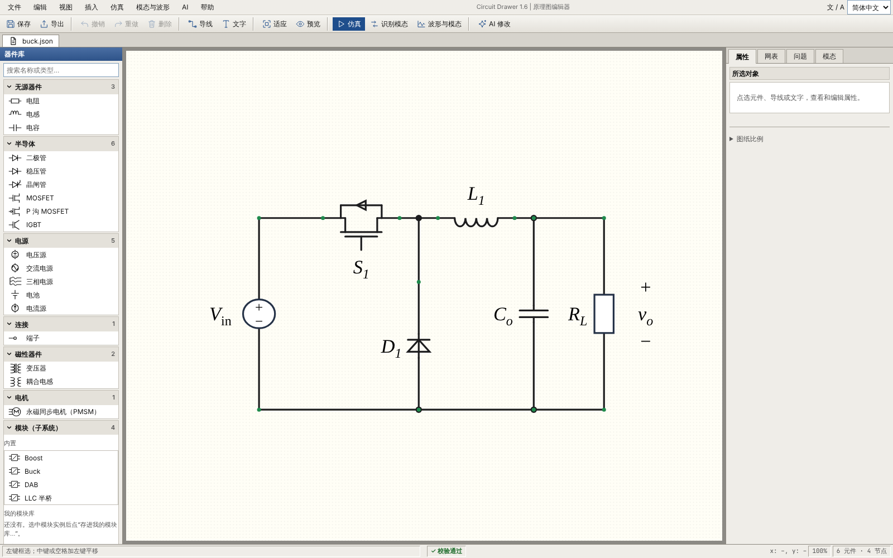

### 4.1 Layout

1. **Menu bar** (first row): 文件 (File), 编辑 (Edit), 视图 (View), 插入 (Insert), AI, 分析 (Analysis), 帮助 (Help). Shortcuts are shown on the right of menu items.

2. **Toolbar** (second row): 保存 (Save), 导出 (Export), 撤销 (Undo), 重做 (Redo), 删除 (Delete), 导线 (Wire), 适应 (Fit), 预览 (Preview), 波形与模态 (Waveforms and modes), AI 修改 (AI edit). Unavailable buttons are greyed out. While a module definition is being edited, **保存模块定义** (Save module definition) and **取消编辑定义** (Cancel definition editing) appear here.

3. **File tab:** shows the current file name; hover to see the full path. A dot before the name means there are unsaved changes.

4. **Parts library** (left): categorised cards that can be searched, clicked or dragged onto the canvas; see [chapter 5](#5-parts-library-and-parts).

5. **Canvas** (centre): the light dot grid matches the 0.05 snap step. Scroll to zoom; drag with the middle button, or hold Space and drag with the left button, to pan. **视图 → 显示画布坐标刻度** (View > Show canvas coordinate ruler) shows coordinate ticks.

6. **Information panel** (right): four tabs.

| Tab | Content |
| --- | --- |
| 属性 (Properties) | Settings of the selected object; opens automatically when you select a part, wire, text, region, block, arrow or module. **图纸比例** (Drawing scale) below shows the current scale |
| 网表 (Netlist) | Net names, pins and branch numbers; expand **SPICE 网表** (SPICE netlist) to see the netlist that would be exported now |
| 问题 (Issues) | Checker results and fix buttons; the number on the tab is the issue count |
| 模态 (Modes) | Switching, editing and exporting mode figures |

7. **Status bar** (bottom): on the left, a hint for the current action; in the middle, the check status (**未检查** not checked, **校验通过** check passed, or **有 N 个问题** N issues) — click it to select and centre each problem in turn; on the right, the pointer coordinates, the zoom relative to "fit", and the numbers of parts and nodes.

8. **Empty canvas:** when there are no parts, the centre of the canvas offers **打开示例** (Open example) and **AI 描述** (Describe with AI).

9. In a narrow window, the part cards switch to two columns and the information panel moves below the canvas. Successful saves and errors are also shown briefly in a corner of the canvas.

### 4.2 Menus

| Menu | Items |
| --- | --- |
| 文件 (File) | 保存 (Save), 存为模板… (Save as template), 存为模块… (Save as module), 导出电路图… (Export circuit figure), 导出全部模态… (Export all modes) |
| 编辑 (Edit) | 撤销 (Undo), 重做 (Redo), 剪切 (Cut), 复制 (Copy), 粘贴 (Paste), 创建副本 (Duplicate), 旋转 90° (Rotate 90°), 镜像 / 反向 (Mirror / reverse), 增大符号 (Enlarge symbol), 缩小符号 (Shrink symbol), 删除所选 (Delete selection), 同类对象图层 (Layer among objects of the same kind: raise, lower, bring to front, send to back); with modules also 编辑选中模块定义 (Edit selected module definition) and 解散选中实例为普通元件 (Dissolve selected instance), and for old-style module tables 模块定义… (Module definitions) and 转换为端口连接 (Convert to port links) |
| 视图 (View) | 适应窗口 (Fit), 放大 (Zoom in), 缩小 (Zoom out), 模块显示 (Module display, submenu), 显示节点/支路标号 (Show node and branch labels), 显示画布坐标刻度 (Show canvas ruler), 实时网表面板 (Live netlist panel), 全图器件模型… (Device models for the whole drawing), 栏宽 (Column width), 预览带坐标网 (Grid in preview), 色块灰度 (Grey regions), 真实预览 (True preview) |
| 插入 (Insert) | 画导线 (Draw wire), 画区域 (Draw region), 画方框 (Draw block), 画箭头 (Draw arrow), 添加模块… (Add module), 阶跃 / 脉冲标记 (Step / pulse mark), 导线交叉 (Wire crossing mode), 元件库 (all parts) |
| AI | AI 接口设置… (AI interface settings), 描述新拓扑… (Describe a new topology), AI 修改当前图… (AI edit of the current figure) |
| 分析 (Analysis) | 波形与模态… (Waveforms and modes), SPICE 仿真… (SPICE simulation), 以当前连接更新网表 (Update netlist from current connections), 上一个模态 / 下一个模态 (Previous / next mode), 模态真实预览 (True preview of mode) |
| 帮助 (Help) | 用户指南 (User guide), 提示词说明 (Prompt guide), 关于… (About), 操作与快捷键… (Actions and shortcuts) |

Menus can be operated with the arrow keys and Enter, and closed with Esc or by clicking the canvas. The user guide and prompt guide in the Help menu open the project's online documentation in a new browser tab and need a network connection.

### 4.3 Saving, previewing and exporting

1. **保存** (Save) writes the current JSON. The circuit editor has no save shortcut; use the toolbar button or **文件 → 保存** (File > Save).

2. **预览** (Preview, the true preview) runs LaTeX to show the final result. **视图 → 预览带坐标网** (View > Grid in preview) decides whether the preview overlays the coordinate grid for reference.

3. **导出** (Export): see [chapter 21](#21-export-formats-latex-and-word). Exported figures never contain the grid, and export is only possible when the checker passes.

4. **Column width:** **视图 → 栏宽** (View > Column width) switches between IEEE single and double column. The JSON does not store the width, so choose it again when you reopen a large circuit, or add `-p double` on the command line.

---

## 5. Parts library and parts

### 5.1 Using the parts library

1. **Adding parts:** click a card to place the part in the middle of the view, or drag the card onto the canvas to place it where you drop it. You can also use the parts list at the bottom of the **插入** (Insert) menu, or right-click an empty spot and choose **在这里插入 ›** (Insert here).

2. **Search:** type a name in Chinese or English, a part type or a category, for example "电感", "L", "igbt" or "电源" (sources). Matching groups open while searching and return to their previous state when the search is cleared.

3. **Groups:** 无源器件 (passive parts), 半导体 (semiconductors), 电源 (sources), 连接 (connections), 磁性器件 (magnetics), and at the bottom 模块（子系统） (modules, see [chapter 14](#14-modules)). Click a group title to collapse it.

### 5.2 List of parts

| Library name | Table `kind` | Pins | Notes |
| --- | --- | --- | --- |
| 电阻 (resistor) | `R` | `a`, `b` | Both pins share an x or a y |
| 电感 (inductor) | `L` | `a`, `b` | As above |
| 电容 (capacitor) | `C` | `a`, `b` | As above |
| 二极管 (diode) | `D` | `a` (anode), `b` (cathode) | Generic diode |
| 稳压管 (Zener diode) | `D` with `opts.zener: true` | As diode | Drawn as a Zener; simulation needs breakdown parameters |
| 晶闸管 (thyristor) | `scr` | `a` (anode), `b` (cathode) | Horizontal or vertical only; the gate lead is drawn on the left of a→b, `F` moves it to the right; the gate is driven by the simulation trigger pulse and is not a pin |
| MOSFET | `nmos` | `d`, `s` | Body diode by default (`opts.diode: false` removes it) |
| IGBT | `igbt` | `c`, `e` | Anti-parallel diode by default |
| 电压源 (voltage source) | `V` | `a` (−), `b` (+) | DC voltage source |
| 交流电源 (AC source) | `vac` | `a` (reference), `b` | Sinusoidal source |
| 三相电源 (three-phase source) | three `vac` | `a`, `b` each | Places three AC sources in star with the neutral wire, labelled v_a, v_b, v_c |
| 电池 (battery) | `V` with `opts.battery: true` | As voltage source | The long plate is +, at pin b; simulated like a voltage source |
| 电流源 (current source) | `I` | `a`, `b` | Current flows from a to b |
| 端子 (terminal) | `port` | `p` | Hollow circle where one wire ends, such as inputs a/b/c or outputs P/O/N |
| 变压器 (transformer) | `transformer` | `p1`, `p2` (primary, top to bottom), `s1`, `s2` (secondary), optional `sct` (centre tap) | Ratio text and dots can be set; can be rotated by 90° |
| 耦合电感 (coupled inductor) | `transformer` with `opts.core: false` | As transformer | A transformer drawn without core lines; same pins and simulation fields |

There is no separate card for a centre-tapped transformer: copy one from a template such as `llc_fullbridge`, or add an `sct` pin to the transformer in the table (see [Appendix A](#appendix-a-coordinate-table-format)).

---

## 6. Part properties

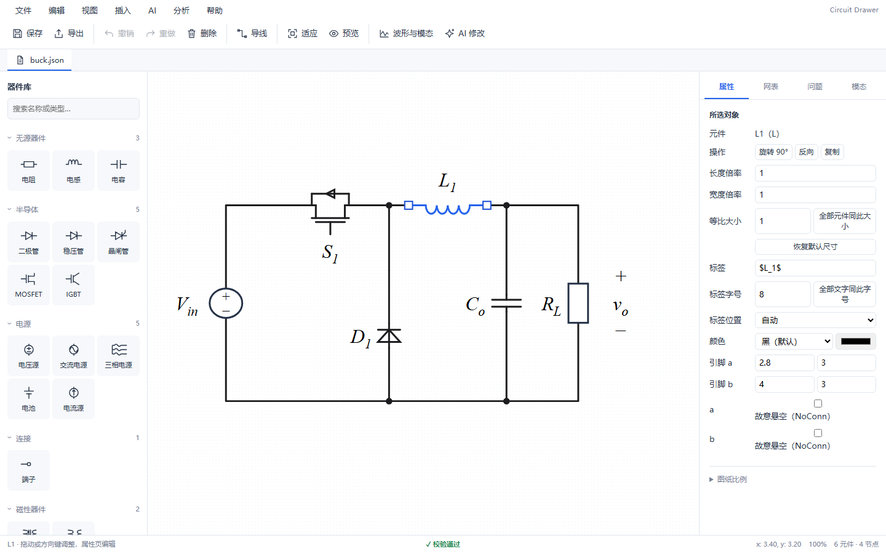

Select a part and the **属性** (Properties) tab shows its settings. Different parts show different items.

### 6.1 Action buttons

**旋转 90°** (Rotate 90°), **反向** (Reverse; shown as **镜像（门极换边）**, Mirror, gate to the other side, for MOSFETs and IGBTs, and absent for transformers) and **复制** (Duplicate) are the same as the keys `R`, `F` and `Ctrl+D`.

1. `R` rotates by 90°. Transformers can be rotated too; the ratio text stays upright.

2. `F` mirrors: switches and thyristors move the gate to the other side; other two-terminal parts are reversed. Transformers cannot be mirrored. Note that reversing a two-terminal part only changes the drawing (`opts.invert`) and does not swap its pins, so the simulation ignores it; to really reverse a part, swap the coordinates of its two pins.

### 6.2 Size

1. **长度倍率 / 宽度倍率** (Length factor / Width factor): symbol size along and across the pins, 0.5–2, following the part's rotation. Transformers show **绕组长度 / 绕组宽度** (Winding length / width).

2. **等比大小** (Uniform size) sets both axes to the same factor; **全部元件同此大小** (All parts this size) applies it to every part.

3. `+` / `-` (or **编辑 → 增大符号 / 缩小符号**, Edit > Enlarge / Shrink symbol) scale while keeping the current aspect ratio; **恢复默认尺寸** (Reset size) goes back to 1.

4. Size changes only the symbol. Pins, wires and the netlist stay the same; checking and export use the new size.

### 6.3 Label, text size and position

1. **标签** (Label): plain text or LaTeX, for example `$L_r$`, `$V_{\mathrm{in}}$`, `$\phi_1$`. Maths on the canvas is an approximation; the preview shows the final result. Subscripts with several letters need braces; `$V_in$` produces a warning.

2. **标签字号** (Label size): 5–14 pt, default 8 pt; also applies to the part's current-arrow text. **全部文字同此字号** (All text this size) unifies every label.

3. **标签位置** (Label position): automatic, above, below, left, right. Switch labels are placed by on-screen direction.

4. Free text such as vo, +, − shows **字号** (Size) and **颜色** (Colour) when selected.

### 6.4 Colour

The **颜色** (Colour) list and colour picker colour the part; see [chapter 13](#13-colouring-parts-and-text).

### 6.5 Pin coordinates and intentional no-connects

1. **引脚 a / 引脚 b** (Pin a / Pin b; d/s or c/e for switches, p1/p2/s1/s2 for transformers) accept coordinates directly.

2. Each pin has a **故意悬空（NoConn）** (Intentionally unconnected) checkbox. Tick it only for terminals that really need no connection: the "pin not connected" error goes away and a small cross is drawn on the canvas and in exports. It does not hide any other wiring error.

### 6.6 Part-specific settings

| Part | Settings |
| --- | --- |
| Diode | 画成稳压管 (Draw as Zener) |
| Voltage source | 画成电池 (Draw as battery); 源旁波形 (Source waveform: rising step, falling step, pulse), 波形位置 (position), 波形大小 (size) |
| Current source | 源旁波形, 波形位置, 波形大小 |
| Transformer, coupled inductor | 变比 (Ratio text), 同名端 (Dots: same side, opposite, none) |

### 6.7 Current arrows

The editor has no separate field for current arrows. For a two-terminal part, write `"opts": {"current": "$i_L$"}` in the JSON to draw an arrow on its lead; current arrows on wires are free text entries with an `arrow` field (see [Appendix A](#appendix-a-coordinate-table-format)). You can also ask the AI edit to add them.

### 6.8 Simulation parameters

Electrical values are not in the Properties tab but in **分析 → SPICE 仿真…** (Analysis > SPICE simulation); see [chapter 17](#17-spice-simulation). Right-clicking a part and choosing **仿真参数…** (Simulation parameters) jumps straight to its row. Labels on the drawing are only text; the program never derives values from them.

---

## 7. Wires, hops and junctions

### 7.1 Drawing wires

1. Click **导线** (Wire) on the toolbar or **插入 → 画导线** (Insert > Draw wire), then click each corner on the canvas. Double-click or press `Enter` to finish, `Esc` to cancel.

2. Every segment must be horizontal or vertical. Start at a pin and end at a pin or on another wire.

### 7.2 Editing existing wires

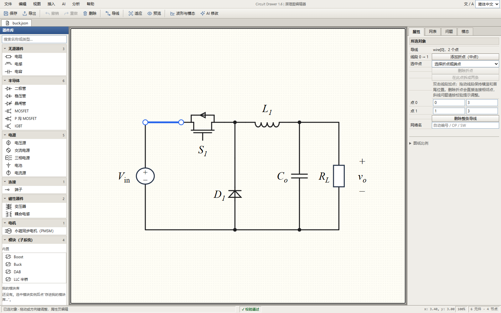

1. **Dragging:** select a wire and drag a corner (small circle), or drag a horizontal or vertical segment directly. Dragging a segment keeps both ends in place and adds horizontal and vertical jogs near the ends if needed; one drag is one undo step.

2. **Adding a corner:** double-click a segment to add a point where you clicked; or click **添加折点（中点）** (Add corner at midpoint) in the Properties tab; or right-click the wire and choose **在此处加折点** (Add corner here).

3. **Deleting a corner:** click the small circle, or choose an inner point in the **选中点** (Selected point) list, then press `Delete` / `Backspace` or click **删除折点** (Delete corner). The neighbouring points are joined directly; if that makes a slanted segment, follow the checker's advice. End points cannot be deleted this way.

4. **Splitting and merging:** select an inner point and click **在此点拆成两条** (Split here), or right-click and choose **在此处拆成两条** (Split here; no corner needed first). Two wires that share exactly one end point can be merged with **合并 wire[n]** (Merge wire[n]) in the Properties tab, or by right-clicking and choosing **和首尾相接的导线合成一条** (Merge with the wire that continues it). A wire cannot be split at a hop.

5. **Deleting a whole wire:** **删除整条导线** (Delete whole wire) in the Properties tab, or right-click and choose **删除这条线** (Delete this wire).

6. **Overlapping wires:** clicking the same spot again cycles through overlapping wires. The selected wire is blue even if it has an error.

7. **Exact duplicates:** when two wires have identical points (also in reverse order), the Properties and Issues tabs offer a delete button. Partial overlaps are only located, never deleted automatically.

8. Hovering over a point shows `wire[n] 点 m` (wire n, point m), counted from 0 in the same order as the JSON.

### 7.3 Crossings: hop or junction

1. Where two wires cross, draw either a hop (a semicircle, not connected) or a junction (a solid dot, connected). **插入 → 导线交叉** (Insert > Wire crossing) sets which one new wires use.

2. Afterwards, click the semicircle or dot at a crossing to switch it in the Properties tab; a hop can also be deleted on its own. Hops left dangling after a wire is moved are removed automatically.

3. A T-joint (a wire end on another wire) counts as connected and gets a dot automatically; three or more segments meeting at a point also get a dot. A wire ending in the middle of a part's lead is an error.

### 7.4 Net names, node and branch labels

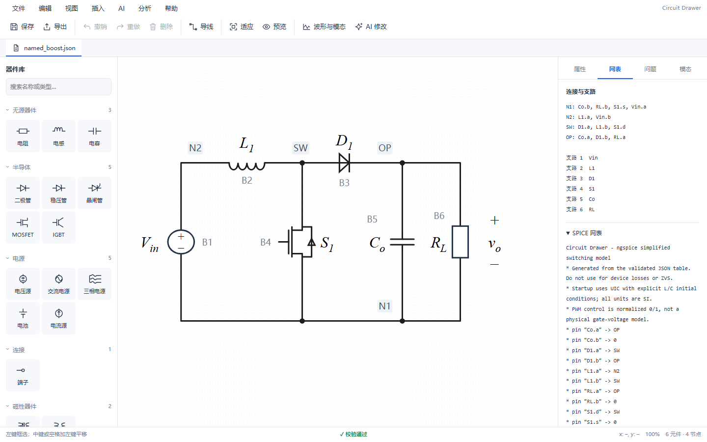

1. **视图 → 显示节点/支路标号** (View > Show node and branch labels) shows net names (N1, N2, ... or your own names) on a light background and grey branch numbers B1, B2, .... Turning it on the first time assigns fixed numbers; moving, adding or deleting other parts later does not renumber existing ones, and turning the display off does not erase them.

2. **Naming a net:** select a wire and type a name such as OP or SW under **网络名** (Net name); leave it empty to return to automatic numbering. Names are 1–41 ASCII letters, digits or underscores, start with a letter, and are unique across the drawing ignoring case.

3. **Netlist tab:** the **网表** (Netlist) tab (or **视图 → 实时网表面板**, View > Live netlist panel) lists the pins on each net and the branch numbers, refreshed after every edit; expand **SPICE 网表** to see the current netlist. If simulation parameters are still missing, it explains why.

4. When exporting a figure, the **包含节点标号** (Include node labels) checkbox decides whether these labels appear; it is unticked each time the dialog opens.

5. Once labels are enabled, the SPICE netlist uses the net names; parts keep their IDs (L1, S1, ...), and branch numbers appear only in comments. Older files that never enabled labels produce the same netlist as before.

### 7.5 Updating the netlist from the current connections

The table's `netlist` records which pins should be connected; the checker compares the connections found in the geometry with it pair by pair. If you changed the wiring on purpose (for example moved a diode to the return line), use **分析 → 以当前连接更新网表** (Analysis > Update netlist from current connections) to make the current geometry the new netlist; otherwise the checker reports a netlist mismatch. Do not use it to hide a wrong connection.

---

## 8. Selection and group editing

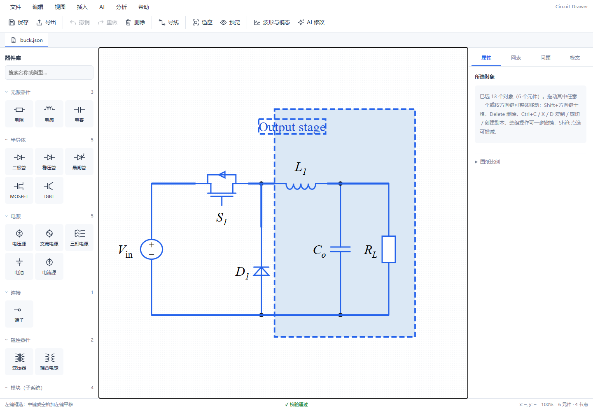

### 8.1 Selecting

1. **Click** a part, wire, text, region, block, arrow or module. Click an empty spot to clear the selection.

2. **Box selection:** drag from an empty spot or an unselected region to select top-level parts, wires, free text, regions, blocks and arrows. All pins, wire vertices or annotation bounds must lie inside the rectangle. Ctrl+A selects these six object types.

3. **Adding:** hold Shift while box-selecting to add; Shift-click toggles any of these objects. Module instances remain individually editable; standalone waveform marks are outside mixed selection.

4. While drawing wires, regions, blocks or arrows, or placing a module, the left button belongs to that tool and box selection is suspended; press `Esc` to leave the tool.

### 8.2 Panning and zooming

1. Scroll to zoom.

2. Drag with the middle button (wheel) to pan; on a touchpad, hold Space and drag with the left button. Space in a text field still types a space.

3. **视图 → 适应窗口** (View > Fit, or **适应** on the toolbar) fits the whole drawing; **放大** and **缩小** zoom in steps.

### 8.3 Group operations

With several parts or annotations selected:

1. Drag any one of them to move the whole group, snapping to the 0.05 grid. Wires inside the group move with it; wires to outside parts stretch by the same rules as when dragging a single end, and shared junctions stay connected. Press `Esc` during the drag to cancel.

2. `Delete` deletes the group, `Ctrl+C` copies, `Ctrl+X` cuts, `Ctrl+V` pastes, `Ctrl+D` duplicates; on macOS `Cmd` works in place of `Ctrl`. The same actions are in the **编辑** (Edit) menu and the context menu. Each group operation is one undo step.

3. Copies include the wires inside the group, the parts' simulation parameters and their no-connect marks; copies get new part IDs and separate nets. Wires leading outside the group are not copied. The first paste after a cut puts the parts back where they were and keeps their IDs where possible; later pastes are offset step by step.

4. Deleting or cutting parts also removes their simulation parameters, the probes that refer to them and their module port links.

5. Arrow keys nudge the group one grid step; Shift plus an arrow moves ten steps. Moving a group does not avoid other objects automatically; the checker reports any overlap. A fitted region needs all its members selected to move. Save as module requires selecting parts only, without explicit wires or annotations.

### 8.4 Smart guides

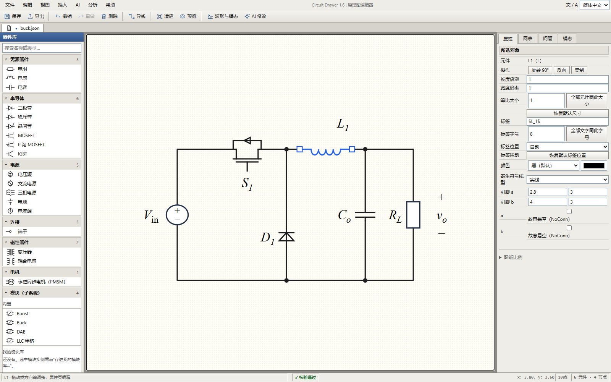

When you drag one part or free text, guide lines appear and snap, much as in presentation software. Group dragging follows the grid. Free text aligns with other text, part labels and part bodies, including equal spacing; labels can align exactly while part pins remain on the 0.05 grid.

1. First priority: a pin snaps to the horizontal or vertical line through another part's pin (so the wire can be straight). Next: alignment of body centres and body edges. Then: equal spacing with neighbouring parts in the same row or column.

2. Alignments are drawn as magenta dashed lines; equal spacing is marked by short ticks at both ends of each gap. The snap range is about 6 screen pixels regardless of zoom and takes precedence over the 0.05 grid.

3. Hold `Alt` while dragging to snap to the grid only.

---

## 9. Context menus

Context menus contain actions only; values such as colour, text size and symbol size stay in the Properties tab. Use the up and down keys to choose, `Enter` to run and `Esc` to close; the left and right keys enter and leave submenus. Hovering over a greyed-out item explains why it is unavailable. While drawing a wire or annotation, or placing a module, finish or press `Esc` before opening a context menu.

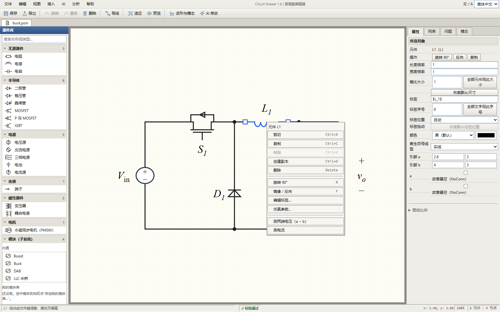

### 9.1 Parts

Right-clicking a part selects it first; right-clicking a group that is already selected keeps the whole group.

| Item | Action |
| --- | --- |
| 剪切, 复制, 粘贴, 创建副本, 删除 (Cut, Copy, Paste, Duplicate, Delete) | Same as the shortcuts, applied to the selection |
| 旋转 90°, 镜像 / 反向 (Rotate 90°, Mirror / reverse) | Single part only |
| 编辑标签… (Edit label) | Puts the cursor in the label field of the Properties tab |
| 仿真参数… (Simulation parameters) | Opens the SPICE window, scrolls to and highlights this part's row |
| 测两端电压, 测电流, 测驱动 (Measure voltage, current, drive) | Adds a supported measurement channel and opens the SPICE window for confirmation; unavailable types explain why |
| 存为模块… (Save as module) | Several parts; see [chapter 14](#14-modules) |

### 9.2 Wires

| Item | Action |
| --- | --- |
| 在此处加折点 (Add corner here) | Adds a corner at the pointer |
| 删除折点 (Delete corner) | Deletes an inner corner (not an end point) |
| 在此处拆成两条 (Split here) | Splits at the pointer in one undo step; not possible at a hop |
| 和首尾相接的导线合成一条 (Merge with the wire that continues it) | When several wires qualify, a submenu lists their numbers |
| 删除这条线 (Delete this wire) | Deletes the whole wire |
| 测对地电压 (Measure voltage to ground) | Adds a channel for the connected node; set a reference ground first |

Right-click a pin to toggle its intentional no-connect mark. At a four-way crossing, switch between a junction and a hop; a T connection or a part pin cannot become a hop. Related issues reuse the Issues panel's existing actions.

If a whole wire is selected but no corner or segment of it, the arrow keys only show a hint and never pull the wire off its pins.

### 9.3 Empty canvas

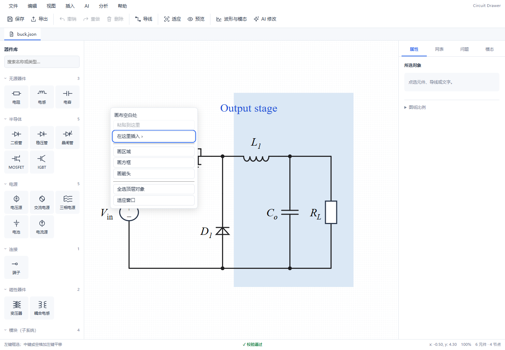

| Item | Action |
| --- | --- |
| 粘贴到这里 (Paste here) | Centres the copy on the pointer and snaps it to the grid; greyed out when the clipboard is empty |
| 在这里插入 › (Insert here) | Places a part or module at the pointer |
| 画区域, 画方框, 画箭头 (Draw region, block, arrow) | Starts the drawing tool |
| 全选顶层对象 (Select all top-level objects) | Selects parts, wires, text, regions, blocks and arrows |
| 适应窗口 (Fit) | Fits the drawing to the canvas |

### 9.4 Module instances

Right-clicking a module instance or a part inside it offers: 编辑模块定义 (Edit module definition), 实例参数… (Instance parameters), 端口连接… (Port links), 展开 / 折叠 (Expand / fold), 解散为普通元件 (Dissolve into ordinary parts), 存进我的模块库… (Save to my module library), and 从库更新 (Update from library) when the library has a newer version. See [chapter 14](#14-modules).

### 9.5 Regions, blocks and arrows

| Item | Action |
| --- | --- |
| 上移一层, 下移一层, 置顶, 置底 (Raise, Lower, Bring to front, Send to back) | Changes the order among objects of the same kind; greyed out at the top or bottom |
| 复制, 删除 (Copy, Delete) | Paste the copy with `Ctrl+V` or **粘贴到这里** on the empty canvas |
| 编辑文字… (Edit text) | Jumps to the text field in the Properties tab |

A copy of a region that fits its members automatically still follows the original members; to place it freely, first fix its boundary with **色块贴合成员** (Fit region to members) in the Properties tab. Graphics inside modules are edited in the module definition.

---

## 10. Undo, redo and arrow-key nudging

### 10.1 Undo and redo

1. The toolbar and the **编辑** (Edit) menu both have **撤销** (Undo) and **重做** (Redo). `Ctrl+Z` undoes, `Ctrl+Y` or `Ctrl+Shift+Z` redoes; `Cmd` works on macOS.

2. The buttons are greyed out when there is nothing to undo or redo. Selecting, zooming or panning does not clear the redo history; only a real change to the drawing starts a new branch.

3. After undo or redo, ordinary objects are deselected; click again to continue nudging. A module instance that still exists stays selected. The shared module definition and the main drawing keep separate histories.

### 10.2 Nudging with the arrow keys

1. Select one part, free text, fixed-boundary region, block, arrow, step / pulse mark or module instance and press an arrow key to move it by one grid step (0.05 layout units); hold Shift to move 10 steps (0.5). Connected wires follow by the same rules as when dragging; modules keep their port links.

2. Wires: with a corner selected, the arrow keys move the corner; with a segment selected, only movement perpendicular to the segment is allowed and the ends stay put.

3. In text fields, editable text, menus, dialogs and the waveform panel, the arrow keys act on those controls and never move the drawing.

---

## 11. The checker and the Issues tab

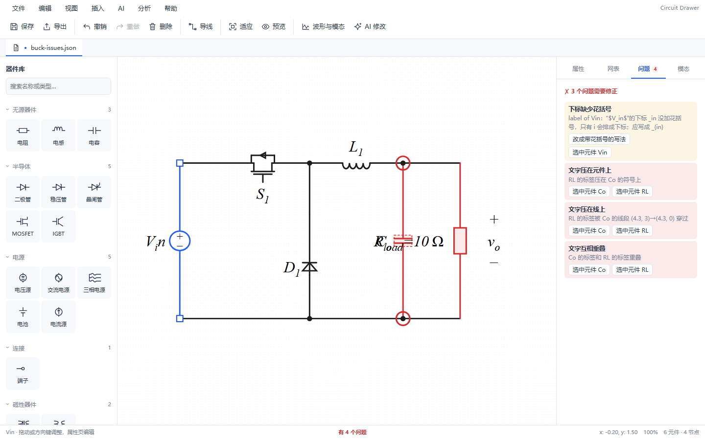

### 11.1 When checking happens

Every change is checked immediately in the background. Problem parts and positions turn red on the canvas; the **问题** (Issues) tab explains each problem in Chinese; the status bar shows **校验通过** (check passed) or **有 N 个问题** (N issues), and clicking it moves to each problem in turn.

### 11.2 Reading the Issues tab

1. The top line reads **✓ 校验通过，可以导出** (check passed, ready to export) or **✗ N 个问题需要修正** (N problems to fix).

2. Each problem is a card with a title, details (part IDs and coordinates) and buttons. **选中元件 X** (Select part X) jumps to the object; problems with an automatic fix have a fix button, for example **改成带花括号的写法** (Add braces), **加跨线** (Add hop) or **这是故意的……** (This is intentional).

3. Yellow cards are warnings (for example missing subscript braces) and do not block export; red cards are errors and must be fixed before export; blue-grey cards record something you allowed, and **撤回** (Withdraw) restores the check.

### 11.3 What it checks

| Category | Main rules | Example titles in the Issues tab |
| --- | --- | --- |
| Geometry | Wires and parts horizontal or vertical; enough distance between a part's pins for its symbol; transformer winding direction and order | 不是横平竖直 (not orthogonal); 元件两端太近，画不下 (pins too close for the symbol) |
| Overlap | Clearance between symbols, between wires and symbols, between parallel wires | 两个元件符号重叠 (symbols overlap); 导线穿过了元件符号 (wire crosses a symbol); 两条线叠在一起 (wires on top of each other); 两条平行线太近 (parallel wires too close) |
| Crossings and joints | Every crossing declared as a hop; no wire ending in the middle of a lead | 两线交叉但没标跨线 (unmarked crossing); 导线接在了元件引线中间 (wire touches a lead) |
| Connections | Every pin connected, no dangling wires; geometry agrees with the netlist pair by pair | 引脚没接上 (open pin); 导线一端悬空 (dangling wire); 该连的没连上 (missing connection); 不该连的连上了 (unwanted connection) |
| Text | Labels not on symbols, not on wires, not on each other; current arrows on wires | 文字压在元件上 (text on symbol); 文字压在线上 (text on wire); 文字互相重叠 (text overlap); 电流箭头不在导线上 (arrow off wire) |
| Column width | Horizontal scale at least 0.55 | 按当前栏宽放不下 (does not fit the column) |
| Regions, blocks, arrows | Region borders do not cut parts; arrows do not cover parts; zoomed details not wired to the main circuit; module members inside their region | 区域边框切过了元件 (region cuts a symbol); 箭头压在元件上 (arrow on symbol); 放大图被连到了主电路上 (detail wired to circuit); 模块成员不在区域框内 (member outside region) |
| Modules | Folded boxes do not overlap or cover parts; port links can be routed | 折叠框重叠或压到元件 (folded box overlap); 自动布线失败 (routing failed) |
| Fields | Valid options, colours and field names | 颜色名不认识 (unknown colour); 区域或箭头的设置不对 (bad region or arrow setting) |

[Appendix B](#appendix-b-drawing-rules) lists all rules.

### 11.4 What it does not check

Whether the bias is sensible, whether currents really flow in the drawn direction and with that magnitude, device values, dead time, and whether a mode occurs under your operating conditions. It only guarantees that the drawing is tidy and agrees with its declared netlist.

### 11.5 Fixing common problems

| Problem | Code | Fix |
| --- | --- | --- |
| Not horizontal or vertical | `not-orthogonal` | Align the two pins or corners to the same x or y; the smart guides help while dragging |
| Pins too close for the symbol | `too-short` | Drag the small blue square on a pin to lengthen the part, or reduce the length factor |
| Symbols overlap | `body-overlap` | Move one part by 0.1–0.2, or shrink the symbols |
| Wire crosses a symbol | `line-through-body` | Add corners so the wire goes around the part |
| Wires on top of each other / parallel wires too close | `collinear-overlap` / `too-close` | Delete the duplicate wire; keep parallel wires at least 0.18 cm apart |
| Unmarked crossing | `unmarked-crossing` | Click **加跨线** (Add hop); if the wires should connect, change the crossing to a junction |
| Wire touches a lead | `touches-lead` | Move the wire end onto the pin |
| Open pin | `open-pin` | Connect a wire; for a terminal that really needs no connection, tick **故意悬空（NoConn）** |
| Dangling wire | `dangling-wire` | Connect the end to a pin or another wire, or delete the segment |
| Missing / unwanted connection | `netlist-open` / `netlist-short` | First decide whether it is a mistake; if you changed the wiring on purpose, use **分析 → 以当前连接更新网表** |
| Text on symbol / on wire / overlapping | `text-on-symbol` / `text-on-line` / `text-overlap` | Change the label position, move the part by 0.1–0.2, or reduce the text size |
| Subscript without braces (warning) | `subscript-braces` | Click **改成带花括号的写法**; `$V_in$` becomes `$V_{in}$` |
| Does not fit the column | `too-cramped` | Switch to double column, or tighten the spacing and shrink symbols |
| Region border cuts a part | `region-cuts-symbol` | Drag the region's corners so the part is entirely inside or outside |
| Zoomed detail wired to the circuit | `detail-wired` | Remove the wire running into the detail; if the region is real circuitry, untick the arrow's **指向放大图** (Points at a zoomed detail) |
| Folded box overlaps parts | `module-box-overlap` | Shrink the box or move the instance |
| No room for a net label | `electrical-label-space` | Move nearby parts or text, or shorten the net name |
| Wrong field or value | `bad-option`, `bad-color`, `bad-region`, ... | Use one of the values listed in the message |

### 11.6 When overlap is intentional: allow it per object

The checker blocks overlaps by default because most of them are mistakes. When one is intentional, allow it for that object only; there is no global switch:

1. **A mark on a wire:** to draw a standalone step / pulse mark on a signal line, click **这是故意的：符号压在导线上** (Intentional: symbol on wire) in the issue card, or tick **压在导线上** (On wire) in the mark's properties. The figure covers that short piece of wire with the background colour; the connection is unchanged.

2. **An arrow that only points at a region:** if the region an arrow points at is real circuitry with a background colour, not a zoomed detail, click **这是故意的：箭头只是指向，不是放大图** (Intentional: the arrow only points, it is not a detail), or untick **指向放大图** in the arrow's properties.

3. **A block arrow covering parts or text:** tick **允许这支箭头覆盖元件／文字** (Allow this arrow to cover parts / text) in the block arrow's properties, or click **这是故意的** in the issue card.

4. After allowing, the Issues tab shows a blue-grey note; click **撤回** (Withdraw) to restore the check. These settings affect only checking and drawing; the netlist and the SPICE, Simulink and PLECS exports are unaffected.

### 11.7 Checking from the command line

```bash
circuit-drawer check my.json             # JSON report; exit code 1 if it fails
circuit-drawer check my.json -p double
```

The report lists part IDs, coordinates and reasons, for example `Lr: pins (3.35, 2.5) and (4.5, 2.7) are not on one horizontal or vertical line`.

---

## 12. Regions, blocks, arrows, layers and step and pulse marks

All of these are drawing aids. They take no part in connections or the netlist.

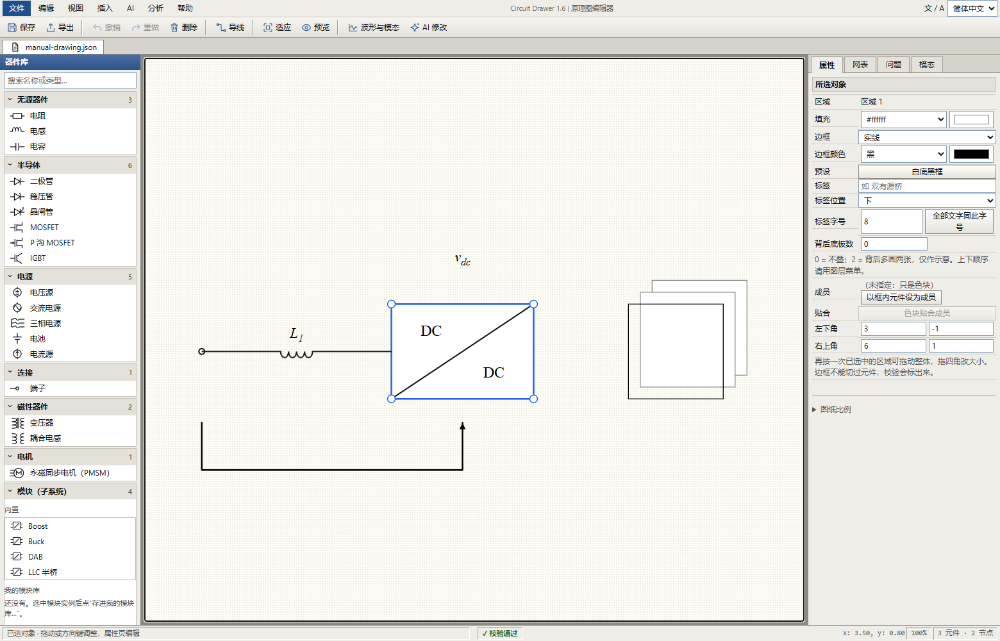

### 12.1 Regions (coloured backgrounds and dashed frames)

1. **Drawing:** **插入 → 画区域** (Insert > Draw region), then drag a rectangle. Click to select it, drag to move it, drag a corner to resize.

2. **Properties:** fill (green, blue, orange, red, purple, yellow, cyan-green, grey, a custom `#rrggbb`, or none), border (none, solid, dashed, dotted), border colour, label and its position (below, above, left, right, inside at the top) and label size. Custom colours that are too dark are lightened automatically so black lines and text stay legible.

3. **背后底板数** (Panels behind): 1–6 adds that many panels behind the region (offset 0.25 up and to the right by default), often used for "draw phase a, let panels stand for phases b and c". 0 means none. It does not copy any circuitry and is not a layer position.

4. **叠面板用途** (Purpose of stacked panels): drawings that will be simulated must declare whether the panels are decoration only or stand for omitted circuitry (listing the instance IDs, including the front panel). In the second case, if the real circuits are not defined, the SPICE export lists the missing instances and stops instead of exporting only the drawn phase.

5. **以框内元件设为成员** (Use parts inside as members) records the parts entirely inside the frame as members. From then on the checker verifies that members stay inside and warns about unlisted parts inside the frame.

6. **色块贴合成员** (Fit region to members): a region with `"fit": "members"` in the table takes its boundary from its members' symbols and labels (their union plus 0.3 layout units, rounded outwards to the 0.05 grid). The button fixes the current boundary as an ordinary rectangle that you can then adjust; `Ctrl+Z` restores automatic fitting. Example: `examples/regions/dab_multi_fit.json`.

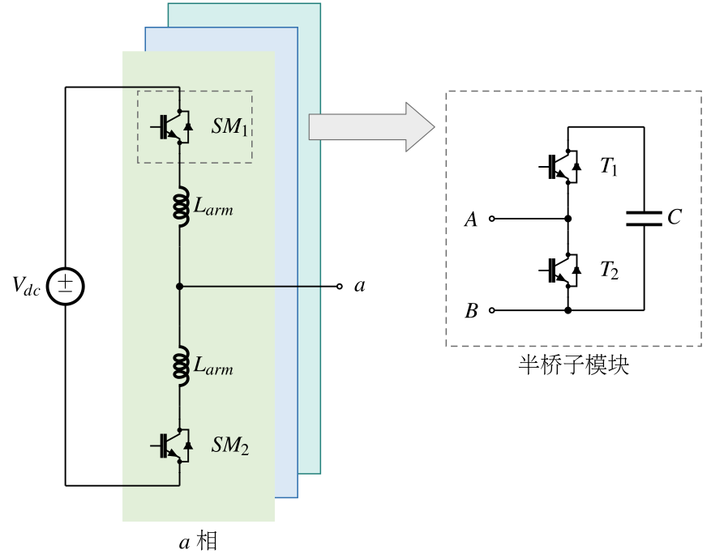

### 12.2 Blocks (control part)

1. **插入 → 画方框** (Insert > Draw block), then drag a rectangle. On the right you can set the text (LaTeX allowed, for example `$f_r$ calculation`), fill (white, none, a palette colour), border (solid, dashed, dotted), colour, text size, and the lower-left and upper-right corners.

2. Draw signal lines between blocks with **画箭头** (Draw arrow), using the thin arrow style in black.

3. Checks: blocks may not cover parts, wires may not cross blocks, blocks may not overlap each other, the text must fit (0.06 cm clearance on all sides), and thin arrows must end at a block's edge.

4. Complete example: `examples/control_blocks/llc_cells_dsp.json` (multi-module LLC with DSP control).

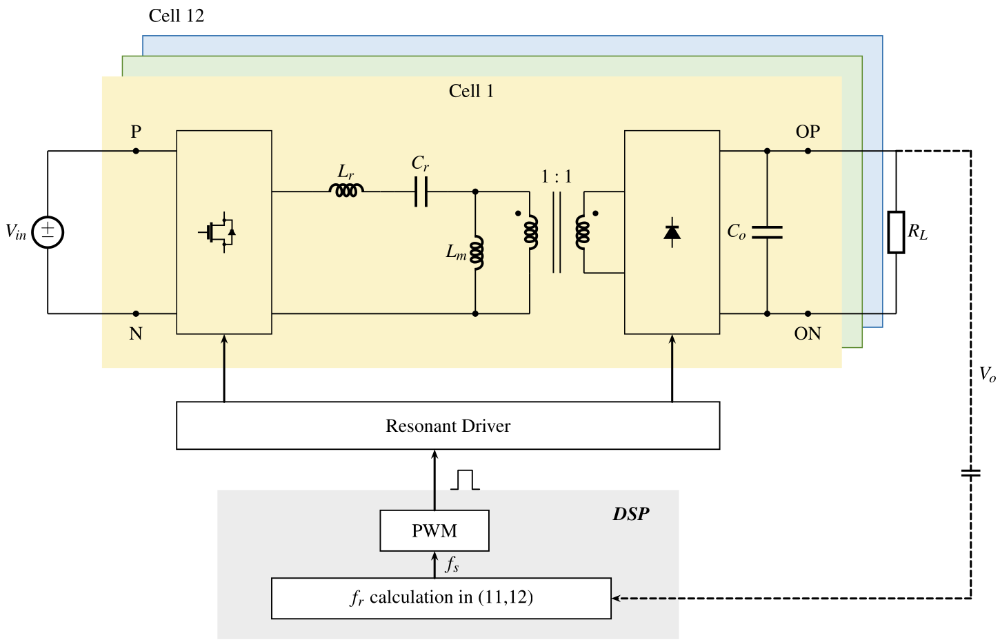

### 12.3 Arrows

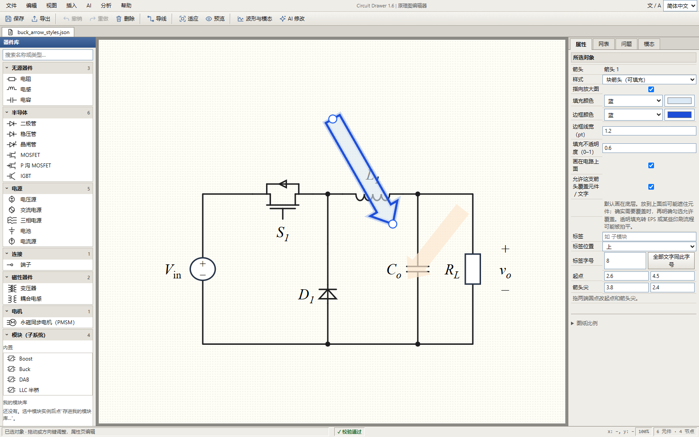

1. **插入 → 画箭头** (Insert > Draw arrow), then drag from the start to the tip. There are three styles: block arrow (filled, used to point at zoomed details), thin arrow / arc / polyline, and wavy indicator arrow.

2. **Thin arrows:** drag the middle handle to bend the arrow (or type −120 to 120 in **弯曲（度）**, Bend in degrees); **恢复直线** (Straighten) removes the bend. Corners can be added, dragged and deleted to route long arrows. Line style (solid, dashed, dotted), arrowhead position (end, start, both, none) and an isolation mark (two short bars, with adjustable position along the line) are available.

3. **Wavy arrows:** amplitude and number of waves (1–8) can be set; bending and corners cannot be combined with them. They are annotations, not simulated waveforms.

4. **Labels:** position above, below, left or right; thin arrows can also use **inline** (`inline`), which places the text on the path and breaks the line on both sides. The position along the path is a number between 0 and 1.

5. **Block arrow appearance:** fill colour, border colour (including **无边框**, no border, and **默认（随填充）**, default following the fill), border width (0.1–3 pt), fill opacity (0 transparent, 1 solid; fill only).

6. **画在电路上面** (Draw above the circuit): block arrows are below the circuit by default; when ticked they are drawn above the circuit and other annotations. If the arrow really must cover parts or text, also tick **允许这支箭头覆盖元件／文字**. The two do different jobs: one controls what is on top, the other records that the covering is intentional. PDF keeps transparency; converting to EPS or some print workflows flatten it, so check again.

7. **Zoomed details:** when a block arrow starts outside a region and points into it, the region is treated as a zoomed detail and no wire may run into it from outside; otherwise the checker reports "detail wired to circuit". If the region is just a background, untick **指向放大图**.

Examples: `examples/arrows/paper_arrows.json`, `examples/regions/buck_arrow_styles.json`.

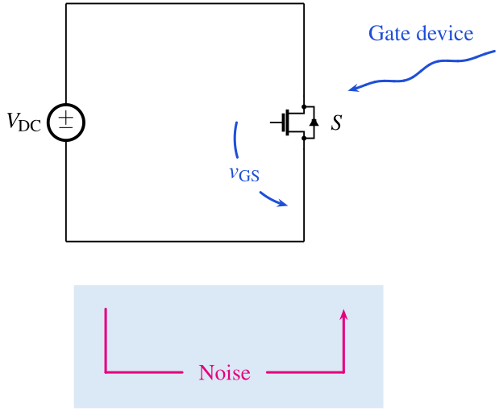

### 12.4 Layers

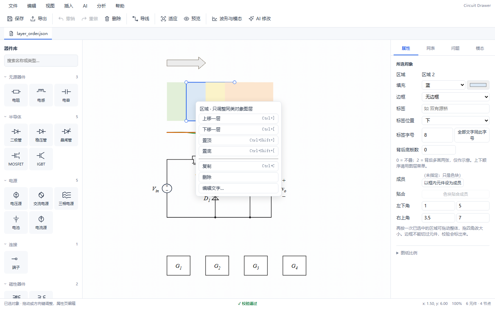

1. Right-click a region, block or arrow and choose **上移一层** (Raise), **下移一层** (Lower), **置顶** (Bring to front) or **置底** (Send to back); or select it and use **编辑 → 同类对象图层** (Edit > Layer among objects of the same kind). Shortcuts: `Ctrl+]` raise, `Ctrl+[` lower, with Shift for front and back.

2. Order changes only among objects of the same kind. The fixed order between kinds is: regions → ordinary block arrows → blocks → wires → parts → text and standalone marks → thin and wavy arrows; block arrows with "draw above the circuit" ticked are on top.

3. **置顶** does not turn an ordinary block arrow into a foreground arrow. Changes can be undone and are kept when saved. Example: `examples/regions/layer_order.json`.

### 12.5 Step and pulse marks

1. **Source waveforms:** select a voltage or current source and choose a rising step, falling step or pulse under **源旁波形** (Source waveform). Position (opposite the label, left, right, above, below) and size (0.5–2) can be changed. The source keeps its polarity or current arrow.

2. **Standalone marks:** **插入 → 阶跃 / 脉冲标记** (Insert > Step / pulse mark) places a figure symbol without electrical pins. It can be dragged, recoloured, resized, deleted and undone.

3. These are graphics only. The real excitation values and times are entered in **分析 → SPICE 仿真…**; changing the drawing never changes the simulation parameters, and vice versa. Example: `examples/source_waves.json`.

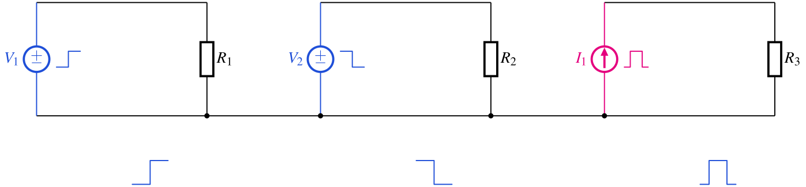

### 12.6 Black-and-white printing

**视图 → 色块灰度** (View > Grey regions; `--mono` on the command line) replaces region and arrow colours by distinguishable greys. Part colours print black in black-and-white output.

---

## 13. Colouring parts and text

Papers often mark a device and its currents and voltages in magenta or blue.

1. **In the editor:** select a part or free text and pick a colour under **颜色** (Colour), or use the colour picker for a custom `#rrggbb`; choose **黑（默认）** (black, default) to reset.

2. **Effect:** a coloured part draws its symbol, label and current arrow in that colour; coloured free text colours the text and its current arrow. Wires and junction dots are always black.

3. **Available colours:** `magenta`, `blue`, `red`, `green`, `orange`, `purple`, `teal`, `gray`, `black`, or `#rrggbb`; Chinese names such as 品红, 洋红, 蓝 and 红 are also understood. These are dark inks for white paper, separate from the light palette used for regions.

4. **Interaction with other features:** `--mono` prints everything black; mode figures colour parts by conducting / idle state and ignore part colours, while text colours are kept.

5. **JSON:** parts use `"opts": {"color": "magenta"}`, free text uses `"color": "blue"`.

---

## 14. Modules

Modules let you define a repeated converter cell once and place it several times. All instances share one definition; per-instance parameter differences are stored separately. Folding changes only the picture; simulation always expands every real part.

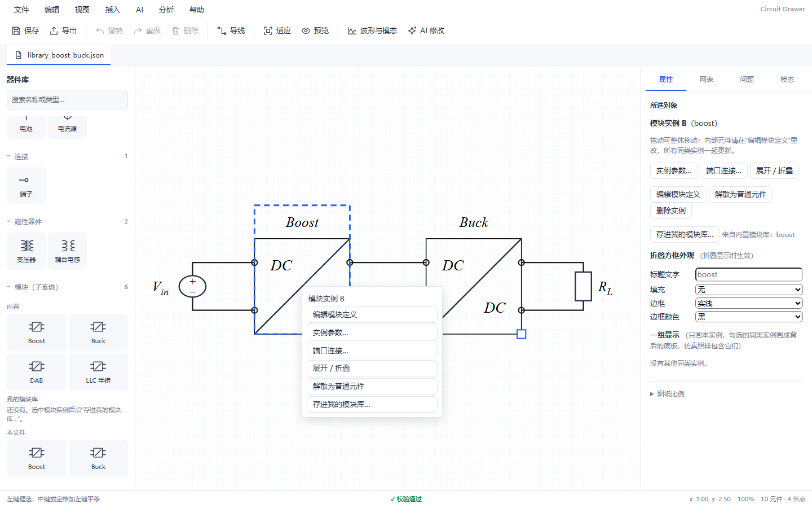

### 14.1 Module library

The 模块（子系统） (Modules) group at the bottom of the parts library has three sections:

1. **内置** (Built-in): Buck, Boost, DAB and LLC half bridge, shipped with the program. Ports are `P` and `N` on the left, `OP` and `ON` on the right.

2. **我的模块库** (My module library): modules you saved, usable from any circuit file. They are stored in `~/.circuit_drawer/templates/modules/` (or the `modules` folder under `CIRCUIT_DRAWER_TEMPLATES`), one JSON per module. Right-click an entry to delete it.

3. **本文件** (This file): module definitions already in the current file.

**插入 → 添加模块…** (Insert > Add module) lists the same three sections.

### 14.2 Placing and connecting

1. Click a module card (or drag it onto the canvas). A dashed frame of the module's real size follows the pointer; click on the canvas and the module's lower-left corner lands there.

2. A port link dialog then asks where each port connects. You can leave ports empty and connect them later by drawing a wire from a part's pin to the port.

3. Placing a library module copies its definition into the current file and records its origin, so the file contains the complete circuit and opens and simulates on any computer. Placing the same library module again reuses that definition.

4. A module that overlaps existing circuitry is still placed; the Issues tab marks the overlap and you drag it clear. Placement is refused only if the circuit itself cannot be connected.

5. Port links store only "which port connects to which"; the wires are drawn horizontally and vertically from the ports' current positions. Drag a segment of a link to change its route (the program remembers your corners); with a link selected, the Properties tab offers **恢复自动走线** (Restore automatic route) and **删除连接** (Delete link). If automatic routing fails, a right-angled line is drawn and the Issues tab reports "routing failed"; drag that line or increase the spacing between modules.

### 14.3 Expanding, folding and appearance

1. **Double-click** an instance, or right-click and choose **展开 / 折叠** (Expand / fold), to cycle through "expanded → folded into a box → partly folded (where supported)". The **视图 → 模块显示** (View > Module display) submenu selects instances and expands or folds all of them.

2. **Partly folded:** currently only the LLC half bridge supports it; the switching half bridge and the rectifier bridge each shrink into a small box with a device symbol, while the resonant tank and the transformer are still drawn.

3. **Box size:** select a folded box and drag the small square at its lower-right corner; on release it snaps to the grid and is checked. If the new size cannot be routed, the reason is shown and the old size is kept. **视图 → 模块显示 → 方框尺寸… / 恢复默认方框尺寸** (Box size / Reset box size) do the same from the menu.

4. **Symbol in the box:** IEC 60617 converter symbols `dcdc`, `acdc`, `dcac`, device symbols `mosfet`, `igbt`, `diode`, or just the name, `text`.

5. **Folded box appearance:** with an instance selected, the Properties tab sets the title text, fill, border style and border colour; they apply only when folded.

6. **Group display:** tick other instances of the same definition to draw only this instance, with the others shown as offset panels behind it; the simulation still includes them.

7. Fully expanded, fully folded and partly folded drawings export line-for-line identical SPICE netlists.


### 14.4 Editing the shared definition and instance parameters

1. Right-click a part inside a module, or the instance, and choose **编辑模块定义** (Edit module definition). An ordinary canvas opens for parts, wires and labels; when finished, click **保存模块定义** (Save module definition) on the toolbar, check the ports and parameters, click **保存定义并同步所有实例** (Save definition and update all instances), and finally **保存** (Save) to write the file. **取消编辑定义** (Cancel definition editing) discards the changes.

2. **实例参数…** (Instance parameters) changes the simulation parameters of this instance only; untick a value to return to the shared one. Only parameters marked in the definition as "may differ per instance" can be overridden.

3. **端口连接…** (Port links) adds or changes port links; ports deliberately left empty are recorded as unconnected and drawn with a small cross on the folded box.

4. Definition editing refuses to delete or rename a published port, so other instances are never disconnected silently.

### 14.5 Saving existing circuitry as a module

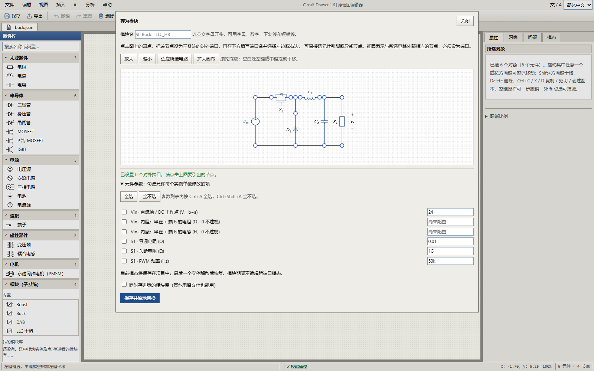

1. Box-select or Shift-click the parts to package, right-click and choose **存为模块…** (Save as module), or use **文件 → 存为模块…**.

2. Enter a module name, for example `Buck` or `LLC_HB`.

3. The dialog shows the same drawing. Red circles are nodes still connected to the outside: click one to make it a port, type a port name (such as P, N, OP, ON) and choose left or right; drag port rows or use the up and down arrows to reorder them. The module cannot be saved while an outside connection is unmarked.

4. **元件参数** (Part parameters) lists the simulation parameters the inner parts support; tick those that may differ per instance. Physical values that were never set are not guessed.

5. To reuse the module in other files, tick **同时存进我的模块库（其他电路文件也能用）** (Also save to my module library).

6. Click **保存并原地替换** (Save and replace in place). The selection becomes one instance; part IDs and probes stay the same, and the SPICE netlist before and after is line-for-line identical. Any electrical change makes the operation fail.

7. Existing modes are stored in the project and restored when the last instance is dissolved. Modes across ports are not edited while modules are in use.

### 14.6 Library versions, dissolving and limits

1. With an instance selected, **存进我的模块库…** saves it to your library; an existing entry with the same name is overwritten only after confirmation.

2. When a library module changes, files that use it are not changed silently. The Properties tab shows **模块库里有新版本** (newer version in the library); only **更新本文件的定义** (Update this file's definition), or **从库更新** in the context menu, replaces it, updating all instances together; you are warned first if the file's copy was also edited. A new version with renamed ports cannot be applied directly.

3. **解散为普通元件** (Dissolve into ordinary parts) expands this instance into ordinary parts; other instances and the library entry remain.

4. Currently there is one level of modules only: no modules inside modules, no mode highlighting across modules, and no dragging of individual parts inside an instance (the whole instance can be dragged).

5. Examples: `examples/modules/library_boost_buck.json` (built-in Boost and Buck in cascade), `examples/modules/boost_parallel_authored.json` (two Boosts in parallel), `examples/modules/llc_ipos.json`, `examples/modules/dab_ipos.json`, `examples/modules/llc_partial.json`.

---

## 15. Operating-mode figures

One base drawing, one figure per operating mode: conducting parts and the wires between them turn red and bold, the rest turns grey, and arrows show the current direction. Only the style changes, never the coordinates, and each figure is checked as usual.

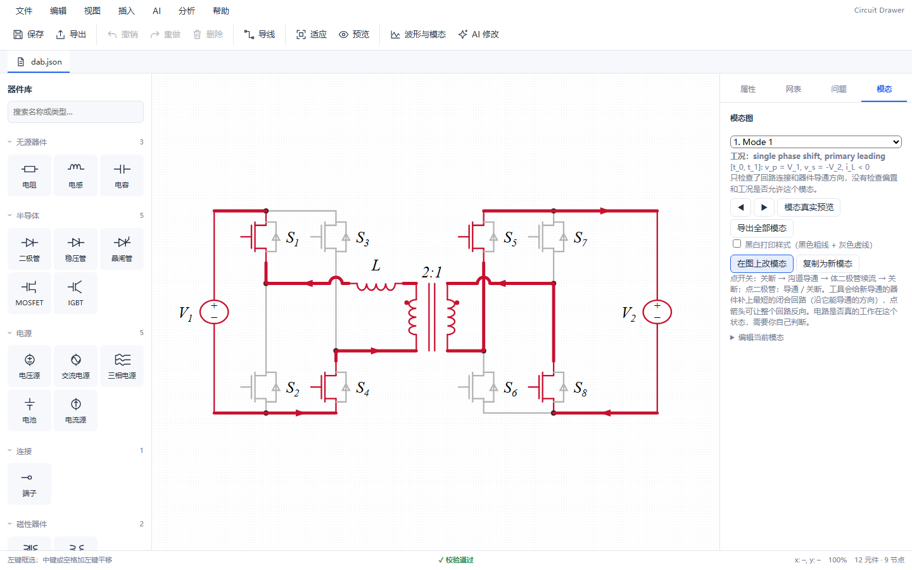

### 15.1 In the editor

1. Open the **模态** (Modes) tab and switch modes with the list or ◀ ▶ (keys `[` `]`); the canvas shows the highlight and arrows directly. The first list entry, **（不显示模态，正常编辑）** (no mode, normal editing), returns to ordinary editing.

2. **在图上改模态** (Edit mode on the drawing): click a switch to cycle "off → channel on → body diode on → off", click a diode to toggle it. If a newly conducting device is not in any loop, the shortest closed loop through it (in its conducting direction, with parallel branches merged) is added; loops through devices that stop conducting are removed. Click an arrow to reverse its whole loop. Dragging is paused while editing modes.

3. **复制为新模态** (Duplicate as new mode) inserts a copy of the current mode after it, so you only change what differs. Expanding **编辑当前模态** (Edit current mode) also offers **新增空模态** (New empty mode) and **删除当前模态** (Delete current mode), and lets you edit the JSON (`on`, `loops`, `caption`, `condition`) directly; click **应用** (Apply).

4. **模态真实预览** (True preview of mode) shows the LaTeX result; **导出全部模态** (Export all modes) writes every mode and an overview sheet in one go. Tick **黑白打印样式（黑色粗线 + 灰色虚线）** (black-and-white style: bold black lines and grey dashed lines) for a monochrome version.

5. Modes refer to part IDs, so they follow the base drawing when you move parts or reroute wires. If a deleted part or changed wiring breaks a mode, the Modes tab lists **模态 N 已失效** (mode N is invalid) with the reason; click it to jump there.

### 15.2 Command line

```bash
circuit-drawer modes llc -o figs                 # full-bridge LLC (fs < fr): 6 modes and an overview
circuit-drawer modes llc fs=above                # fs > fr; fs=resonance at resonance
circuit-drawer modes dab --mono                  # black and white: bold black lines, grey dashed rest
circuit-drawer modes flyback 二极管在下 --only 1,2 -f pdf
circuit-drawer modes llc --list                  # print the mode definitions only
circuit-drawer modes fig.json --modes my_modes.json   # your table, your modes
```

1. Each mode is written to `<name>_mode1.pdf`, `_mode2.pdf`, ...; `<name>_modes` puts all modes on one page, each with (a), (b), ... and its caption, two single-column figures per row, which is exactly double-column width. `--no-sheet` skips the overview.

2. `--color` changes the highlight colour (default `#c8102e`; xcolor names such as `blue!70!black` also work); `--off dashed` draws idle wires dashed; `--arrows N` sets the number of automatic arrows per loop (default 3, 0 for none).

3. Highlighted lines are twice as wide as normal lines and grey parts are 35 % black, so colour figures remain readable when printed in black and white. Part labels and texts such as vo, +, − stay black.

### 15.3 Built-in sequences

| Template | Modes |
| --- | --- |
| `llc_fullbridge` | `fs=below` (default, 6), `fs=resonance` (4), `fs=above` (6), for both centre-tapped and full-bridge rectifiers |
| `dab` | Single phase shift, primary leading, continuous current, 4 per half period |
| `flyback` | S on, magnetising; S off, energy released through D; DCM idle interval (DCM only) |
| `buck`, `boost` | 2 ideal CCM modes each |

When a switch carries reverse current, a MOSFET is drawn with its channel conducting (synchronous rectification) and an IGBT with its anti-parallel diode conducting. The built-in sequences are textbook drawings for common operating conditions and may not match your paper.


### 15.4 Writing your own modes

The table's `modes` list gives the conducting devices and the loops of each mode:

```json
{"name": "Mode 1", "caption": "$[t_0, t_1]$: $S_1$, $S_4$ on",
 "on": ["S1", "S4", "D1"],
 "loops": [["Vin", "S1", "Cr", "Lr", "T:p|Lm", "S4"],
           ["T:s1", "D1", "Co|RL"]]}
```

1. A loop lists its branches in the direction of the current; the last one connects back to the first. The program checks that neighbouring branches share a node and that the loop closes, then follows the real wiring to find the wire pieces between the pins to highlight.

2. Transformer windings are `T:p` and `T:s` (`T:s1`, `T:s2` for a centre tap); parallel branches are `Co|RL`; a switch conducting through its body diode is `S2:diode`.

3. For a loop of just two parallel parts, the direction is from the first part's first pin to its second pin. For example `["RL", "Co"]` means Co discharging into RL.

4. You may give `on` without `loops`: the program highlights every device on a closed path, but that is only a topological path, so no arrows are drawn and a hint asks you to confirm.

5. If you do not like the automatic arrows, place them yourself with `"arrows": [{"at": [1.6, 2.5], "dir": "right"}]`.

6. `condition` states the operating condition, such as `"$f_s < f_r$"`, shown by `--list` and in the editor.

### 15.5 What is checked

The program checks loop connectivity (names exist, neighbouring branches share a node, the loop closes, switch conduction is consistent) and warns when a diode or an IGBT channel is used in reverse. It does not check device bias, current magnitude, or whether the mode really occurs under your conditions.

---

## 16. Waveforms and modes

This feature lines up simulated or measured waveforms with mode figures: t0, t1, ... mark the waveform, and each interval is bound to one mode.

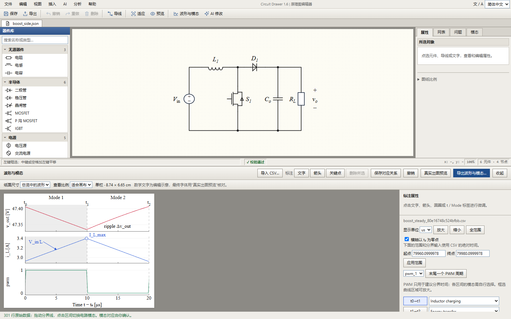

### 16.1 Opening the example

```bash
circuit-drawer edit examples/waveforms/boost.json
```

Click **波形与模态** (Waveforms and modes) on the toolbar, or **分析 → 波形与模态…**. The example already has two intervals bound, and no simulator is needed. Click `t0→t1` and the base drawing above switches to the inductor-charging mode; click `t1→t2` for the energy-transfer mode.

### 16.2 Importing a CSV file

1. Click **导入 CSV…** (Import CSV), choose a local file or type a path, and select the time column and its unit.

2. Format: the first row holds column names, followed by numbers; UTF-8 (a BOM is allowed), separated by commas, semicolons or tabs; at most 64 MiB, one million rows and 32 columns; strictly increasing time. Missing columns, non-numbers, NaN, infinity and repeated times are reported.

3. Under **通道、标签和单位** (Channels, labels and units), choose 1–6 curves to show and set their labels and units. Use English maths labels such as `i_L` or `v_out`; subscripts are typeset automatically.

4. Imported CSV files are copied into a `waveforms-data/` folder next to the JSON, with a content hash in the file name. Share the JSON together with that folder. The JSON stores only the path, channels and intervals, not the samples.

### 16.3 Choosing the time window and boundaries

1. Type the start and end times and click **应用范围** (Apply range), box-zoom on the curves, or use **放大 / 缩小 / 全范围** (Zoom in / out / Full range). The display unit can be s, ms or us; by default the time axis starts at zero at t0, while range and boundary inputs always use the CSV's absolute times.

2. Choose a PWM channel and click **末尾一个 PWM 周期** (Last PWM period) to get boundaries suggested from the last two rising edges and the falling edge between them. PWM only helps choose the window; it does not identify modes.

3. Drag the boundary lines, or expand **精确设置分界时间** (Exact boundary times) and type values; **拆分所选区间** (Split selected interval) adds a boundary. Boundaries may not coincide or cross.

4. Choose a mode for each interval in its list. Clicking an interval shows the corresponding current path on the base drawing. Click **保存对应关系** (Save bindings) to write them to the JSON.

### 16.4 Annotations

1. The **标注** (Annotate) buttons above the panel are: **文字** (Text) places text with one click; **箭头** (Arrow) is dragged from its tail to the point it marks; **关键点** (Key point) places a small hollow circle, optionally with text, at peaks, zero crossings and so on.

2. Text may contain English and `$maths$` only (for example `$i_L$ peak`, `$I_{L,\max}$`), no Chinese.

3. Click an annotation to drag it, drag either end of an arrow, or drag its text alone; double-click to edit the text; **删除所选** (Delete selected) or `Delete` removes it; **撤销** (Undo) restores. The t0, t1, ... and `Mode k` labels can also be dragged aside without moving the boundaries.

4. **标注属性** (Annotation properties) sets colour, text size (5–20 pt), line width (0.1–2 pt), circle radius (0.02–0.3 cm) and text offset; click **应用属性** (Apply). With an annotation selected, the arrow keys move it by 0.01 cm, Shift plus arrow keys by 0.1 cm.

5. The panel keeps the paper aspect ratio. **纸面尺寸** (Paper size) switches between **总览中的波形** (waveform in the overview) and **独立波形图** (standalone waveform figure); **查看比例** (View scale) only changes the on-screen magnification. Use **真实出图预览** (True output preview) to check the final maths rendering.

### 16.5 Export

1. Click **导出波形与模态…** (Export waveforms and modes), choose the output folder and formats (only SVG by default; SVG or PNG for Word, PDF for LaTeX; the TeX source is a separate option).

2. For `boost`, the output is:

| File | Content |
| --- | --- |
| `boost_waveforms.<format>` | Standalone waveform figure with the t0, t1, ... boundaries |
| `boost_mode1.<format>`, ... | One figure per mode used |
| `boost_waveform_modes.<format>` | Waveforms and modes overview |

3. **波形按模态切片** (Shade waveforms by mode, on by default) shades alternate intervals light grey and labels them `Mode 1`, `Mode 2`, ... (numbered in mode-list order, matching the `_mode1` files). Untick it to draw only dashed boundaries and t0, t1, ....

4. **总览排版** (Overview layout): stacked (default, single or double column), side by side (waveforms left, modes right, double column only), or two columns (waveforms on top, mode figures two per row below). The last two draw each mode once, with a caption listing all its intervals.

5. Untick **包含对应模态与总览** (Include modes and overview) to export only the waveforms. Files are copied to the target folder only after everything compiles; on failure the previous output is kept.


### 16.6 Command line

```bash
circuit-drawer waveforms examples/waveforms/boost.json -o out/boost-waveforms -f svg,pdf
circuit-drawer waveforms examples/waveforms/boost.json -o out/boost-waveforms -f png --wave-only
circuit-drawer waveforms examples/waveforms/boost_side.json -p double -o out/boost-side -f png
```

### 16.7 After re-simulating

1. After importing a new CSV, channel and interval bindings that still apply are kept; if you used **末尾一个 PWM 周期**, the boundaries are recomputed.

2. After changing only labels, positions or symbol sizes of the base drawing, you can export again directly. If connections, part kinds or simulation parameters change, the program asks you to import data for the new conditions; a modified CSV snapshot also blocks export.

3. For display and export, large files are reduced per bucket to the first, minimum, maximum and last points, so peaks are never smoothed away; the raw data is untouched.

---

## 17. SPICE simulation

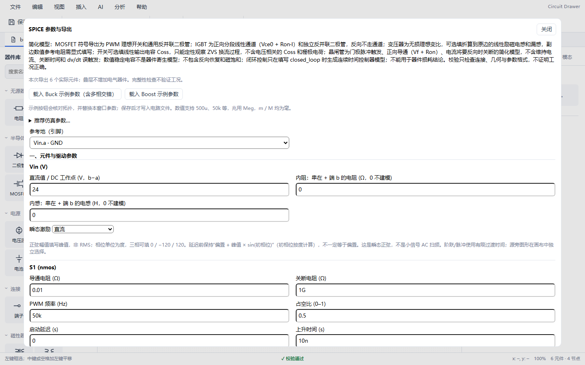

### 17.1 Preparation

1. Writing a `.cir` file does not need ngspice. Running a simulation needs ngspice installed (see [chapter 2](#2-installation-and-startup)), with its path set before the editor is started.

2. Parameters are stored in the `simulation` field of the current table. The program never derives values from text labels, and every part needs parameters.

### 17.2 The window

**分析 → SPICE 仿真…** opens the **SPICE 参数与导出** (SPICE parameters and export) window:

1. **载入 Buck 示例参数（含多相交错）/ 载入 Boost 示例参数** (Load Buck example parameters, including interleaved / Load Boost example parameters): checks the topology and fills in example values. For an interleaved Buck, each phase runs at 50 kHz with duty 0.5, and phase k starts k/N periods later. Only the form changes; **保存参数** (Save parameters) writes the circuit file.

2. **推荐仿真参数…** (Recommend simulation parameters): see section 17.6.

3. **参考地（引脚）** (Reference ground, a pin): choose a real pin; its net becomes SPICE ground.

4. **一、元件与驱动参数** (Part and drive parameters): one group per part; see section 17.3.

5. **二、瞬态设置** (Transient settings): output sampling interval, stop time, maximum integration step, and numerical stabilising capacitance (from every net to simulation ground; default 0, off; it is not a device parasitic). The rules are 0 < maximum step ≤ sampling interval < stop time, at least 50 samples per PWM period, and at least 10 integration steps in each on and off interval. Simulation starts at time 0 from the inductor and capacitor initial conditions, without a DC operating point.

6. **三、测量通道（可修改 JSON）** (Probes, editable as JSON): voltage probes name a positive and a negative pin; current probes name a part (a→b for D, L and scr; b→a for V and vac; c→e total terminal current for igbt; transformers also need a winding); drive probes name a switch and output the normalised 0/1 PWM. Probe names use English letters, digits and underscores, start with a letter, and there may be up to 32.

7. **四、闭环控制（可选）** (Closed-loop control, optional): see [chapter 18](#18-simulink-and-plecs-export-closed-loop-control).

8. **五、输出文件夹** (Output folder): browse or type; relative paths start from the folder of the circuit file.

9. **保存参数** (Save parameters) only saves; **导出 SPICE** (Export SPICE) writes the `.cir` file; **导出并仿真** (Export and simulate) writes the `.cir`, a `.csv` with units in the column names, and the run log. The drawing is checked before export as usual.

10. After a successful run, the waveform panel opens with the new CSV loaded, ready for [chapter 16](#16-waveforms-and-modes).

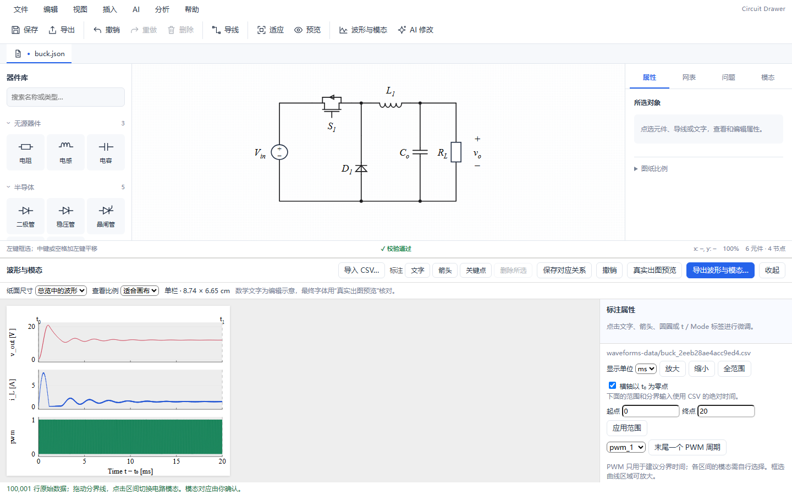

### 17.3 Parts and parameters

| Part | Model | Main parameters |
| --- | --- | --- |
| R, L, C | Linear | Value; L and C need an initial value (L current a→b, C voltage a−b); optional series resistance for L |
| V, vac | Voltage source | DC value (b−a); optional internal resistance and inductance (in series at the + terminal b); transient excitation, see 17.4 |
| I | Current source | DC value (a→b); transient excitation |
| D | `generic_diode` | Is, N, Rs; Zener diodes also need breakdown voltage Vz at Izt, test current Izt and dynamic resistance Zzt |
| nmos | `ideal_switch` | Ron, Roff, PWM frequency, duty, start delay, rise and fall times; optional RC snubber across the switch, extra phase shift and its ramp time, linear output capacitance Coss, body diode parameters |
| igbt | `simplified_igbt` | Vce0, Ron, Roff and PWM; forward channel c→e, reverse current through the anti-parallel diode |
| scr | `simplified_thyristor` | Vf, Ron, Roff; the trigger pulse uses the PWM fields (`delay` is the first firing time); optional holding current, latching current and turn-off time |
| transformer | `ideal_transformer` | Full secondary turns ratio Ns/Np (each half of a centre tap is half of it), dot polarity, reference resistance (at least 1 GΩ); optional magnetising and leakage inductance referred to the primary |

1. Values are in SI units and may use suffixes such as `500u`, `50k`, `20m`, `1Meg`. Following SPICE, both `m` and `M` mean milli; mega is `Meg`.

2. The PWM duty is measured between the 50 % points of the rising and falling edges. PWM in the CSV is a normalised 0/1 control signal, not a physical gate voltage.

3. Three-phase sources: the window's **三相统一设置** (Three-phase settings) fills in the sine parameters of all three sources from the line-to-line RMS voltage, frequency, phase-A angle and phase sequence (peak = line voltage × √2 / √3); **保存参数** writes them.

### 17.4 Excitation

Voltage and current sources can be DC, step (rising or falling), repeated pulse or sine; `vac` must be sine.

1. Step: initial value, final value, delay and transition time (greater than zero); exported as `PWL`.

2. Pulse: additionally return time, plateau width and period; exported as `PULSE`.

3. Sine: offset, peak amplitude (not RMS), frequency, delay and phase (degrees; 0, −120 and 120 for three phases). Before the delay the output holds "offset + amplitude × sin(initial phase)". This is a time-domain sine, not a small-signal AC sweep.

### 17.5 Output files and command line

```bash
circuit-drawer spice examples/spice/buck.json -o out/spice/buck            # .cir only
circuit-drawer spice examples/spice/buck.json -o out/spice/buck --run      # run and write CSV
circuit-drawer spice-init my_boost.json --preset boost -o my_boost_sim.json
```

1. The first CSV column is `time_s`; the other column names carry units, such as `v_out_V`, `i_L_A`, `pwm_1`. The time axis is resampled to the chosen uniform interval.

2. The file set is written only when the simulation succeeds. If the engine fails, times out (120 s at most) or produces incomplete waveforms, earlier results are kept and the error is reported.

3. `spice-init` checks the basic structure against the real netlist (one each of V, L, C, R, D and nmos) and writes Buck or Boost example parameters into a new JSON, leaving the input untouched; add `--force` if the output already exists.

4. Without `-p`, the command first checks at single-column width; if that fails but double column passes, it checks at double column and says so. With an explicit `-p` it checks strictly at that width. The width never changes the exported model.

5. Runnable examples are in `examples/spice/`: `buck.json`, `boost.json`, `llc_fullbridge.json`, `dab.json`, `igbt_ac.json`, `three_phase_ac.json`, `zener_regulator.json`, `thyristor_rectifier.json`, `thyristor_bridge_3ph.json`, `battery_internal_resistance.json` and more.

### 17.6 Recommended simulation parameters

Expand **推荐仿真参数…** in the SPICE window:

1. Without requirements, the basic and interleaved Buck use 24 V in, 12 V out, 24 W, 50 kHz; the Boost uses 24 V in, 48 V out, 24 W, 50 kHz; inductor ripple is 30 % of the average current per phase and output ripple is 1 % of the output voltage. With only the input voltage given, the Buck assumes Vout = Vin/2 and the Boost Vout = 2 × Vin.

2. You can also enter input and output voltages, power, switching frequency and ripple, or describe the requirements in a sentence (text requirements use the AI drawing assistant's interface settings). For other expanded open-loop circuits, the AI proposes the parameters.

3. Click **生成推荐并检查** (Generate and check): the result lists the old value, proposed value, reason and assumption for each item, and runs a short ngspice check of at most 10 ms in a temporary folder.

4. After reviewing, click **采用到参数表** (Apply to the form), then **保存参数** or export to write the file. Nothing is applied without ngspice, after a failed check, when the drawing has changed, or after cancelling. Module instances and closed-loop controllers are not yet supported.

5. These are first drafts from ideal CCM formulas: voltage drops are not compensated and device ratings are not chosen; a short simulation completing does not mean the targets are met.

### 17.7 Device models for the whole drawing

**视图 → 全图器件模型…** (View > Device models for the whole drawing) chooses simulation models for all parts at once; the drawing does not change:

| Category | Models | Parameters |
| --- | --- | --- |
| Switches | ideal switch, MOSFET (Level 1), IGBT (piecewise linear) | MOSFET needs vto, kp, gate_voltage; IGBT needs vce0 |
| Resistors | ideal, with parasitics | series inductance, parallel capacitance |
| Inductors | ideal, with parasitics | series resistance, parallel capacitance |
| Capacitors | ideal, with parasitics | series resistance, series inductance |

Fill in the parameters and click **应用到全图** (Apply to the whole drawing); **沿用各器件设置** (Keep per-part settings) restores the previous behaviour. If an inductor already has its own non-zero series resistance, choosing the parasitic inductor model reports a conflict; choose one of the two explicitly.

### 17.8 Limits

All models are simplified: no reverse recovery, magnetic saturation, temperature effects, tail current or vendor subcircuits. Verified cases include Buck / Boost, LLC, DAB, IGBT forward and reverse commutation, thyristor rectifiers and three-phase sines. The `.cir` file uses ngspice control syntax and is not guaranteed to work with other SPICE programs. Do not use the results for device loss, efficiency or ZVS conclusions.

---

## 18. Simulink and PLECS export, closed-loop control

The same circuit and simulation parameters can be exported as Simulink and PLECS models. The export carries the real wiring, part values, PWM and probes, and lays the model out like the original drawing.

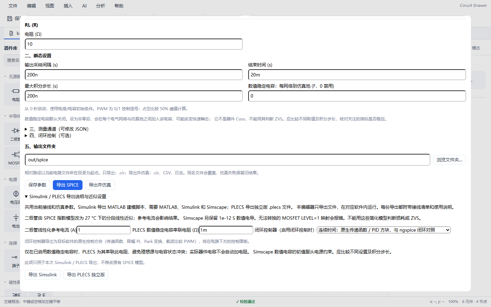

### 18.1 Exporting from the editor

1. Open **分析 → SPICE 仿真…**, check the parameters, reference ground and probes, and choose the output folder.

2. Expand **Simulink / PLECS 导出说明与近似设置** (Simulink / PLECS export notes and approximation settings): diode linearisation reference current (default 1 A), series resistance of PLECS numerical stabilising capacitors (default 1 mΩ), and closed-loop controller mode (continuous or discrete). These affect only this export and are not stored in the circuit's simulation parameters.

3. Click **导出 Simulink** (Export Simulink) or **导出 PLECS 独立版** (Export PLECS Standalone). The buttons save the window's simulation parameters first; if checking fails, nothing is saved or written.

4. Open and run the model in the target program. "Exported" in the editor only means the files were written; solving is done by the target program, which the editor never starts.

### 18.2 Simulink

```bash
circuit-drawer simulink examples/spice/buck.json -o out/simulink
```

1. The output is `build_cd_buck.m`, the manifest `cd_buck_simulink.manifest.json` and a notes file.

2. In MATLAB, change to the output folder and run:

```matlab
model = build_cd_buck;
result = sim(model);
```

3. The build script connects and compiles the model, then saves `cd_buck.slx`. Probes go to a Scope and to output ports in the original order; results are in `result.yout`, with units and order in the manifest's `columns`. The saved SLX no longer needs Python or the original JSON.

4. The script does not rebuild a model that is already open, and by default does not overwrite an existing SLX. To regenerate, close the model and run `build_cd_buck(true)`.

5. Requires MATLAB, Simulink and Simscape (Foundation Library); closed-loop controllers with Clarke or Park transforms also need Simscape Electrical.

### 18.3 PLECS Standalone

```bash
circuit-drawer plecs examples/spice/buck.json -o out/plecs
```

1. The output is the native model `cd_buck.plecs`, a manifest and a notes file. Open it in PLECS Standalone, run it and look at the Scope; probes are also connected to top-level output ports.

2. The model uses the Radau solver with extended matrix precision and keeps the original maximum step.

3. Model names start with `cd_`; file names with spaces, Chinese characters or excessive length are converted to safe names.

### 18.4 Differences from ngspice

1. **Diodes:** both targets use piecewise-linear diodes, taking the tangent at 27 °C and a reference current I0 (default 1 A; `--diode-current 2` on the command line uses 2 A). This is not identical to ngspice's exponential model. The reverse branch of a Zener diode uses the device's own test current Izt.

2. **Numerical stabilising capacitors:** PLECS puts a resistor in series with each one (default 1 mΩ, changed with `--numerical-resistance 2m`) to remove the conflict between ideal voltage sources and capacitor states.

3. **An input capacitor directly across an ideal voltage source:** PLECS cannot treat it as an independent state, and the export reports why. In **视图 → 全图器件模型…**, set capacitors to "with parasitics" and enter a real ESR, then export again. Note that this applies to every capacitor in the drawing and also changes the SPICE results.

4. The whole-drawing MOSFET (Level 1) model cannot be converted faithfully yet and is refused; use the ideal switch or IGBT mapping instead.

5. Each drive signal may have at most 200,000 time points; shorten the simulation or reduce the frequency if exceeded.

### 18.5 Closed-loop control

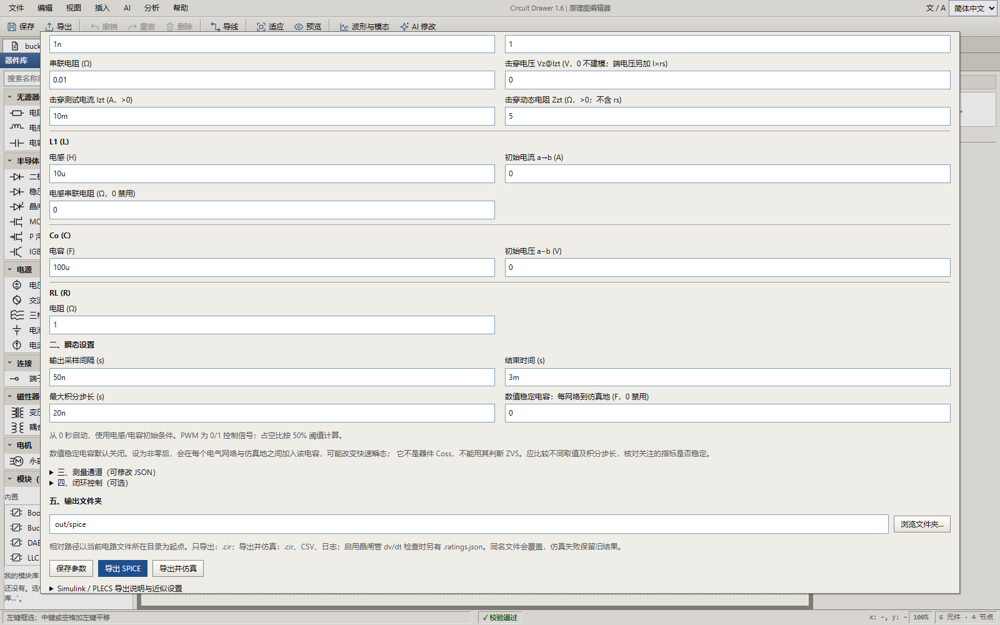

A control diagram table can be connected to the circuit: ngspice then runs the closed loop directly, and the Simulink and PLECS exports turn the controller into native control blocks.

1. In the SPICE window, expand **四、闭环控制（可选）**, tick **启用闭环控制** (Enable closed-loop control), enter the path of the control table (relative to the circuit file) and click **读取控制表** (Read control table).

2. Choose a source for each controller input: a probe, or a constant (with an optional soft-start time; 0 means a step).

3. Tick the switches each output drives. Outputs are duty cycles from 0 to 1, and each switch can be driven by one output only.

4. The corresponding JSON:

```json
"closed_loop": {
  "control": "buck_vmode.control.json",
  "inputs":  {"ref":   {"value": 1.65, "ramp": 5e-4},
              "plant": {"probe": "v_out"}},
  "outputs": {"pwm":   {"switches": ["S1"]}}
}
```

5. A bridge leg is written as `{"switches": ["S1"], "complement": ["S2"], "dead_time": "1u", "model": "average"}`: `complement` is the lower switch, `dead_time` the dead time, and `model` is `average` (switching-period average, the default) or `switching` (individual switching). Probe inputs may add `filter` (first-order filter time constant in seconds). Outputs of function blocks are written `block.output`, for example `sv.da`.

6. In ngspice the controller is simulated in continuous time, without sampling, computation delay or fixed-point rounding; transfer functions with an integrator and an output limit get anti-windup automatically. A single switch uses trailing-edge PWM.

7. Exports offer two controller modes: `continuous` (default, comparable with ngspice) and `discrete` (using the control table's `code.fs` and discretisation method, matching the generated C code). Choose it in the export settings or with `--control discrete`. `average` bridge legs are exported to Simulink / PLECS as individually switched legs.

```bash
circuit-drawer spice examples/closed_loop/buck_vmode.json -o out/closed-loop --run
circuit-drawer plecs examples/closed_loop/buck_vmode.json -o out/plecs/buck_closed
circuit-drawer simulink examples/closed_loop/grid_inverter_dq.json -o out/simulink/grid --control discrete
```

8. Examples: `examples/closed_loop/buck_vmode.json` (voltage-mode Buck with Type III compensation) and `examples/closed_loop/grid_inverter_dq.json` (three-phase grid-connected inverter with PLL and dq current control).

### 18.6 Folded modules as subsystems

Module instances shown folded are exported to Simulink / PLECS as one subsystem block, positioned and sized like the folded box; expanded and partly folded instances are flattened as before. The electrical terminals follow the ports on the folded box (left side first, then right, each from top to bottom), and the subsystem contains the expanded circuit. If the two ends of a voltage probe lie inside two different folded instances, the export refuses and names the probe; show one of the instances expanded instead.

```bash
circuit-drawer simulink examples/modules/llc_single.json -o out/simulink/llc_single
circuit-drawer plecs examples/modules/dab_ipos.json -o out/plecs/dab_ipos
```

---

## 19. Control diagram editor

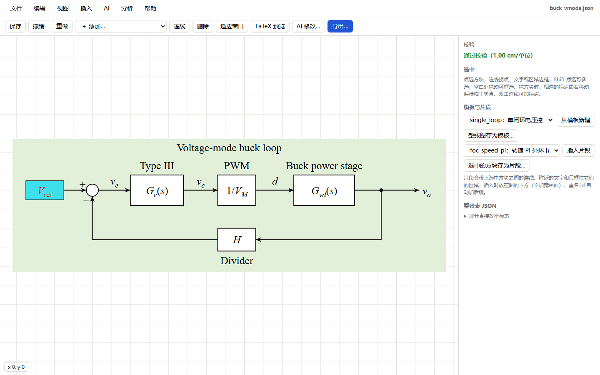

### 19.1 Starting and examples

```bash
circuit-drawer-control list                          # built-in examples and saved templates
circuit-drawer-control edit my.json -t dual_loop     # create my.json from an example if missing
```

| Example | Content |
| --- | --- |
| `single_loop` | Single voltage loop: reference, summing point, PI, limiter, PWM, feedback through an LPF |
| `dual_loop` | Outer voltage loop, inner current loop |
| `buck_charger` | Battery charger Buck controller: CV/CC-CP, multiply and divide points, A/B switch |
| `foc_pmsm` | Field-oriented control of a PMSM |
| `buck_vmode` | Voltage-mode Buck loop with complete loop parameters, ready for loop analysis |
| `mpc_fcs` | Finite-control-set model predictive current control |

The editor uses port 8766 and draws at IEEE double-column width by default.

### 19.2 Interface

1. Menu bar: 文件 (File: Save, Export, New from selected template, Save whole diagram as template, Save selected blocks as snippet), 编辑 (Edit: Undo, Redo, Cut, Copy, Paste, Delete selection, Add L-shaped corner to link), 视图 (View: Fit, Snap step, LaTeX preview), 插入 (Insert: block, limiter, reference tag, measurement tag, summing point, multiply point, divide point, A/B switch, text, background panel, blue dashed frame, link, insert selected snippet), AI (AI interface settings, Describe a new diagram, AI edit of the current diagram), 分析 (Analysis: Loop analysis), 帮助 (Help).

2. Toolbar: 保存 (Save), 撤销 (Undo), 重做 (Redo), ＋ 添加… (Add), 连线 (Link), 删除 (Delete), 适应窗口 (Fit), LaTeX 预览 (LaTeX preview), AI 修改… (AI edit), 导出… (Export).

3. Right panel: check result, properties of the selection (appearance, text and formula, JSON), templates and snippets, and the JSON of the whole table.

### 19.3 Common operations

| Operation | How |
| --- | --- |
| Move blocks and text | Drag; snaps to the snap step (0.05, 0.1, 0.25); arrow keys nudge, Shift plus arrow keys move 5 times as far |
| Multiple selection | Shift-click, or drag a selection box on an empty spot; drag to move the group |
| Links | Click **连线** (Link, or press `L`), click the start port, then the end port; ending on an empty spot gives an open end; starting on a line branches from it (a dot is added) |
| Corners | Select a link to drag its corners; double-click a link to add a corner; select a corner and press `Delete` to remove it; use **给连线加 L 形拐点** for slanted links |
| Copy, cut, paste | `Ctrl+C`, `Ctrl+X`, `Ctrl+V`, including links between the selected blocks, regions enclosing them, transfer functions and code settings; duplicate IDs get a suffix |
| Text and formulas | Type LaTeX directly in the **文字与公式** (Text and formula) box; symbol buttons insert Greek letters, sub- and superscripts, fractions and more, and a LaTeX preview of the snippet appears after a pause |
| Appearance | **外观** (Appearance) sets fill, border and text colours separately; links can be coloured and drawn solid, dashed or dotted |
| Exact editing | The selection's JSON appears on the right; edit it and click **应用修改** (Apply changes) |
| Undo and save | `Ctrl+Z` undo, `Ctrl+Shift+Z` or `Ctrl+Y` redo, `Ctrl+S` save |

### 19.4 Templates and snippets

1. **Templates** store a whole diagram and must pass the checker: **整张图存为模板…** (Save whole diagram as template) or `circuit-drawer-control save-template my.json lab_dual --title "Lab dual loop"`. Afterwards `list`, `export`, `edit -t` and **从模板新建** (New from template) can use it.

2. **Snippets** store part of a diagram, such as one PI loop: select some blocks and click **选中的方块存为片段…** (Save selected blocks as snippet); **插入所选片段** (Insert selected snippet) places it below the current diagram, selected, so you can drag it into place. Built-in snippets are `foc_speed_pi`, `foc_dq_current_pi`, `foc_ipark_svpwm`, `foc_clarke_park` and `mpc_fcs_core`.

3. Templates and snippets are stored in `~/.circuit_drawer/templates/control/` (snippets in its `snippets/` subfolder), or under `CIRCUIT_DRAWER_TEMPLATES` if set.

### 19.5 Loop analysis and compensator design

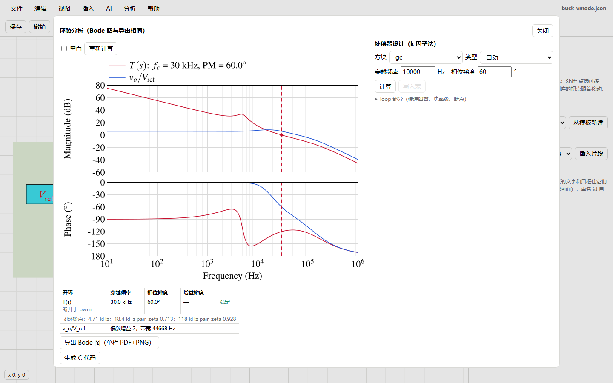

1. Give the blocks transfer functions (the table's `loop` section) and state how the power stage outside the diagram connects the output back to the measurement tags; the open-loop gain, margins and closed-loop response are then computed from the drawing. The structure comes from the drawn links.

2. **分析 → 环路分析** (Analysis > Loop analysis) draws the Bode plot and lists the crossover frequency, phase margin, gain margin and closed-loop poles; tick **黑白** (black and white) if needed, and **导出 Bode 图（单栏 PDF+PNG）** exports the plot.

3. **补偿器设计（k 因子法）** (Compensator design, k-factor method): choose the compensator block and type (automatic, I, II, III), enter the crossover frequency and phase margin, click **计算** (Calculate), and when satisfied **写入表** (Write to table), which can be undone.

4. Transfer function forms: `gain`, `num/den`, `pi`, `pid`, `pr`, `lpf`, `comp` (Type I/II/III), power-stage average models `model: buck/boost/buckboost`, each optionally with a `delay`.

5. Command line:

```bash
circuit-drawer-control loop buck_vmode                       # margins and closed-loop poles (JSON)
circuit-drawer-control bode buck_vmode -o out                # Bode plot
circuit-drawer-control design buck_vmode -b gc --fc 30k --pm 60 -w new.json
```

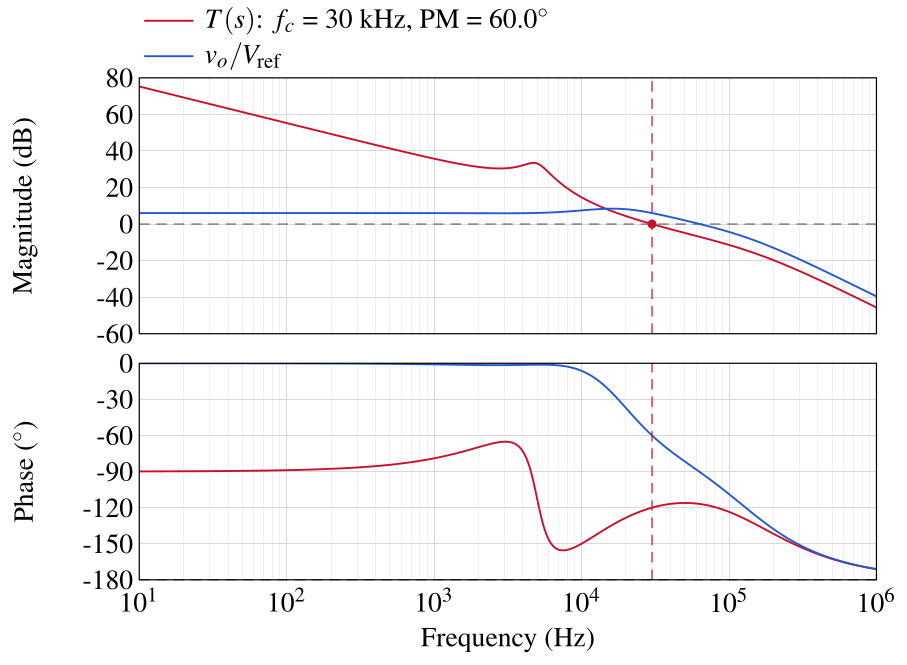

### 19.6 C code generation

1. The table's `code` section sets the sampling frequency `fs`, the discretisation method (`tustin`, `zoh`, `backward`, `forward`), the arithmetic (`fixed` int32 fixed point, `float`, `double`), the fixed-point fraction bits `q`, external blocks and output limits.

2. **生成 C 代码** (Generate C code) in the loop analysis window writes to `<table name>_c/` under the export folder; or use the command line:

```bash
circuit-drawer-control code buck_vmode -o c_out                # <name>.c/.h, cg_lib.h, report
circuit-drawer-control code buck_vmode -o c_out --arith float
circuit-drawer-control code buck_vmode --fs 200k --q 20 --harness   # also a PC test program
```

3. Call the generated `<name>_step()` once per control period. `cg_lib.h` is a header-only runtime with PI, second-order sections, Clarke, Park, inverse Park and SVPWM. The report `<name>_report.json` lists each block's discretisation and the effect of coefficient rounding.

### 19.7 Function blocks

Clarke, inverse Clarke, Park, inverse Park, SVPWM and angle wrapping are declared in the table's `functions` section and used in code generation and closed-loop simulation (floating-point arithmetic required). Their outputs are written `block.output`, for example `sv.da`. Loop analysis is linear and stops at function blocks, saying why. When the controller contains an internal loop (such as a PLL), set `code.blocks.<integrator>.delay` to 1 to break the algebraic loop.

### 19.8 Figures

```bash
circuit-drawer-control check my.json
circuit-drawer-control render my.json -o out          # TeX, PDF, SVG, PNG
circuit-drawer-control render my.json --mono          # black and white
circuit-drawer-control render my.json --grid -f png   # coordinate grid for adjusting coordinates
```


---

<a id="ai"></a>

## 20. AI drawing assistant

The AI drawing assistant is optional. Ordinary drawing, modes and simulation do not need it. It helps in two situations: a topology that has no template, or a one-sentence change to an existing figure.

### 20.1 How it works

1. The model writes a complete coordinate table from your description. Coordinates are still written explicitly; the program never calls an automatic layout.

2. The checker checks the table as usual. If it fails, the report (part IDs, coordinates, reasons) goes back to the model for a rewrite, until the table passes or the rounds are used up (4 by default).

3. A passing table is saved as a new file. If the rounds run out, the version with the fewest problems is saved, and you fix the red marks in the editor.

4. The checker can only ensure that the drawing is tidy and agrees with the netlist the model wrote; it cannot tell whether the topology is the right one, so check the structure first for complex circuits.

### 20.2 You need your own API key

1. The assistant calls the model interface you configure and needs your own API key; usage is billed by your provider. The program does not include any key.

2. Requests send your description and reference images, and for edits the current coordinate table and check report, to the base URL you configured. When you do not use the AI features, nothing is sent to any model interface.

3. Two interface types are supported:

| Interface type | Setting | Notes |
| --- | --- | --- |
| Anthropic-compatible interface | `anthropic` | Needs the `anthropic` Python package; default model `claude-opus-5-5`, default base URL `https://api.anthropic.com` |
| OpenAI-compatible interface | `openai` | No extra package; a model name is required; default base URL `https://api.openai.com/v1`, which can be changed to another compatible service |

### 20.3 Configuring the interface

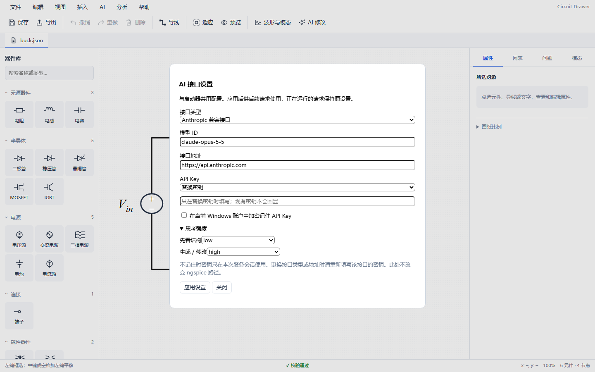

1. **Web settings (recommended):** in the circuit or control diagram editor, choose **AI → AI 接口设置…** (AI > AI interface settings), select the interface type, enter the model ID, base URL and API key, and click **应用设置** (Apply settings).

   - The API key field has three actions: **保留已配置密钥** (Keep the configured key), **替换密钥** (Replace key) and **清除密钥** (Clear key). The page only shows whether a key is configured and never displays it. Choose "keep" when you change only the model or reasoning effort; a new interface type or base URL requires entering the key again.

   - With **在当前 Windows 账户中加密记住 API Key** ticked, the key is stored encrypted and need not be entered again; unticked, it is used only for the current server session. This option is not available on other operating systems.

   - The circuit editor and control diagram editor opened by the same launcher share the settings; they apply to subsequent requests, and requests already running are not affected.

2. **Windows launcher:** enter the same settings under **API 与仿真设置…** (API and simulation settings); see [chapter 2](#2-installation-and-startup).

3. **Environment variables** (PowerShell: `$env:X = "..."`, bash: `export X=...`); restart the editor after setting them:

```powershell
# Anthropic-compatible interface
$env:ANTHROPIC_API_KEY = "<your key>"
$env:ANTHROPIC_BASE_URL = "https://..."          # only for a proxy or gateway

# OpenAI-compatible interface
$env:OPENAI_API_KEY = "<your key>"
$env:OPENAI_BASE_URL = "https://..."             # for another compatible service
$env:CIRCUIT_DRAWER_PROVIDER = "openai"
$env:CIRCUIT_DRAWER_MODEL = "<model name>"
```

If only `OPENAI_API_KEY` is set and there is no Anthropic key, the OpenAI-compatible interface is used automatically.

4. **Reasoning effort:** the structure step and the generate / edit step can each be set to provider default, `low`, `medium`, `high`, `xhigh` or `max`. "Provider default" sends no extra parameter. When nothing is set, the structure step requests `low`, the generate step requests `high` with an Anthropic-compatible interface, and nothing extra with an OpenAI-compatible interface. Which levels are supported depends on the model and provider; if the interface rejects a level, an error is shown, so choose another level or provider default. Higher effort may take longer and use more tokens.

### 20.4 Describing a new topology

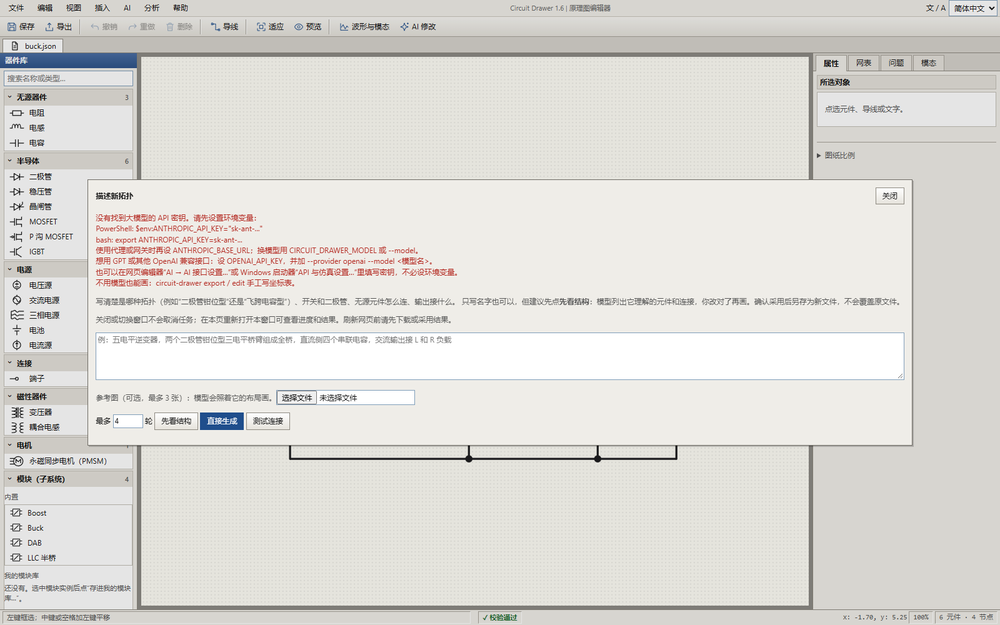

1. Choose **AI → 描述新拓扑…** (AI > Describe a new topology). The top of the dialog shows the interface and model that will be used; a missing key is reported in red straight away. **测试连接** (Test connection) tells you within 10 seconds whether the base URL can be reached.

2. Write a description. A good one covers, in order: the topology and variant (for example diode-clamped or flying-capacitor), device choices (MOSFET or IGBT, whether to draw Lm), inputs and outputs (DC source, AC source, capacitor with resistive load, battery), the annotations you want (current arrows, voltage polarities, part names, colours), and modules and layout (how many modules, how they connect, the colour of each module's region).

3. **Template hint:** when the description contains the name or an alias of an existing template, the dialog offers **已有手画模板……直接载入模板** (a hand-drawn template exists; load it directly), which is faster and more accurate than calling the model. The hint matches by name, so a description of a "four-switch Buck-Boost" also suggests the Boost template; if it is not the topology you want, ignore the hint and generate anyway.

4. **先看结构** (Show the structure first, strongly recommended): the model first lists the parts and connections as it understands them, without drawing. Correct the list in the text box, then click **按这个结构生成** (Generate from this structure). This matters most when you give only a topology name.

5. **直接生成** (Generate now): progress shows the round number, elapsed time, each round's problems and the model's notes, and can be cancelled at any time; the terminal that started the editor prints the same progress.

6. **Reference images:** up to 3 PNG, JPG or WebP images can be attached for the model to follow their layout; the model must support image input.

7. **Rounds:** "最多 N 轮" (at most N rounds) accepts 1–8. For complex topologies (a dozen switches or more), name the exact variant, check the structure first, switch to double column, and allow 6–8 rounds. If the description mentions three-phase or multilevel circuits, the dialog suggests switching to double column first.

8. The result is saved as a new file; the current file is not overwritten. If it fails at single column but passes at double column, a **切到双栏** (Switch to double column) button appears.

### 20.5 AI edit of the current figure

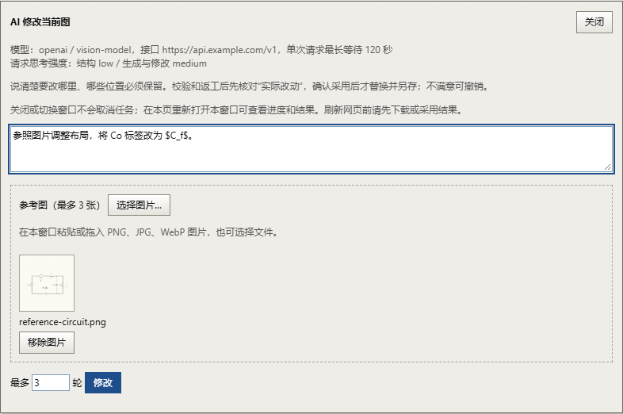

1. Choose **AI → AI 修改当前图…** (or **AI 修改** on the toolbar) and say in one sentence what to change, for example "add an input capacitor Cin", "put the v_sw label above the switching node", "add a green region around the primary full bridge", "move RL right by 0.5".

2. The model receives the current table and changes only what you mention; all other parts and wires are kept. Simulation parameters, waveform settings and other extra data are always taken from the table before the edit.

3. The result is checked and reworked as usual, saved as a new file, and accompanied by a list of the actual changes found by comparing the tables (moves, additions, deletions, labels). Click **撤销** (Undo) to go back if you are not satisfied.

4. With node and branch labels enabled, you can refer to net names and branch numbers, for example "add a 10 Ω resistor between A and B, left of C1". If the project has its own modules, the model receives the module library, so you can say "reuse the project's Boost module, two instances with inputs and outputs in parallel".

### 20.6 AI in the control diagram editor

**AI → 描述新框图…** (Describe a new diagram) and **AI → AI 修改当前图…** in the control diagram editor use the same interface settings. The model returns only the structure (blocks, links, transfer functions); the program places it using templates and the automatic router. It checks for dangling ports, signs, types, algebraic loops and layout, returns errors with hints to the model, and makes at most 3 attempts; **采用结果** (Accept result) appears only when the check passes, accepting can be undone, and **保存** (Save) writes the file.

### 20.7 Command line

```bash
circuit-drawer new "SEPIC converter, low-side MOSFET, input Vin, coupling capacitor C1, inductors L1 and L2, output diode D, Co in parallel with RL" -o sepic.json --edit
circuit-drawer new "five-level inverter" --plan -o plan.txt              # structure only, written to plan.txt
circuit-drawer new "five-level inverter" --structure plan.txt -o inv.json -p double --rounds 8
circuit-drawer new "Boost converter ..." -o boost.json --provider openai --model <model name> --anyway
circuit-drawer tweak buck.json "move D to the right"                     # result in buck_ai.json
```

1. `--anyway`: call the model even when the description matches a template.

2. `--image fig.png`: reference image, repeatable.

3. `--edit`: open the result in the editor.

4. `tweak` leaves the original file untouched and writes `<name>_ai.json` by default; `-o` changes it.

5. Save results you are happy with as templates (see [chapter 3](#3-drawing-from-templates)) so the same topology never needs the model again.

### 20.8 Other settings

`CIRCUIT_DRAWER_TIMEOUT` (seconds without a response before a request is abandoned, default 300), `CIRCUIT_DRAWER_MAX_TOKENS` (output limit, 64000 by default for Anthropic-compatible interfaces), `CIRCUIT_DRAWER_FALLBACK=0` (turn off the fallback parameter for gateways that do not support it). If a reply is cut off by the output limit, the incomplete table is never used; the program asks for one compact rewrite within the remaining rounds.

---

## 21. Export formats, LaTeX and Word

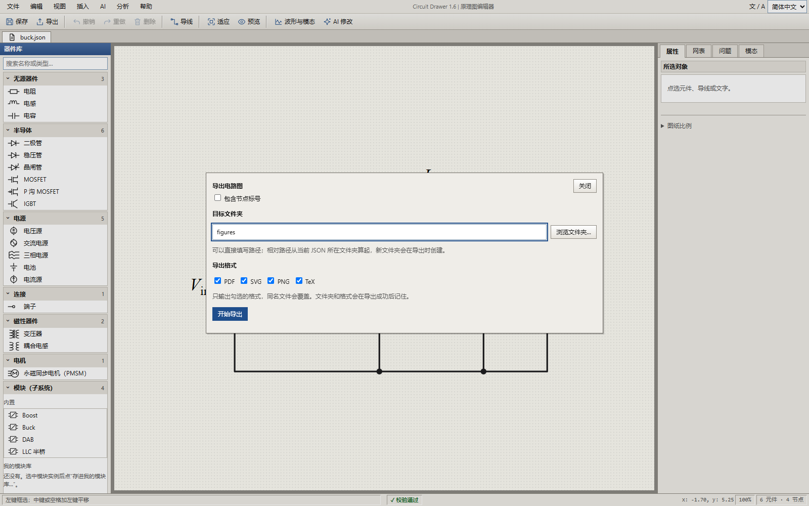

### 21.1 Exporting from the editor

1. Click **导出** (Export) on the toolbar, or **文件 → 导出电路图…** (File > Export circuit figure).

2. **目标文件夹** (Target folder): browse or type a path; relative paths start from the folder of the current JSON, and new folders are created on export.

3. Tick PDF, SVG, PNG and/or TeX; **包含节点标号** (Include node labels) decides whether node and branch labels appear in the figure.

4. Click **开始导出** (Start export). Only the ticked formats are written; files with the same name are overwritten and other files are left alone. The browser remembers, per table, the last folder and formats that exported successfully.

5. **文件 → 导出全部模态…** (File > Export all modes) writes every mode and the overview in one go. With only TeX ticked, the mode sources are written; PDF, SVG and PNG also include the mode overview.

### 21.2 The four formats

| Format | Use |
| --- | --- |
| PDF | First choice for LaTeX papers, vector |
| SVG | First choice for Word and PowerPoint, vector |
| PNG | Bitmap preview, 600 dpi for single figures, 300 dpi for mode overviews |
| TeX | Standalone CircuiTikZ source, for archiving or manual touch-ups |

The command-line `draw`, `render`, `modes` and `circuit-drawer-control render` always leave the `.tex` source in the output folder; `-f` decides which other formats are compiled.

### 21.3 Size and fonts

Single-column figures are at most 8.79 cm wide, double-column figures at most 17.99 cm. Text is 8 pt Times (`mathptmx`), and symbol sizes are absolute. Do not scale the figure in your paper; keep it at 1:1 so the text matches the caption size.

### 21.4 LaTeX

```latex
\begin{figure}[!t]
  \centering
  \includegraphics{figs/llc_fullbridge.pdf}   % no width=, keeps 8 pt text
  \caption{Full-bridge LLC resonant converter.}
  \label{fig:llc}
\end{figure}
```

1. Use `figure*` for double-column figures. The mode overview `<name>_modes.pdf` is already laid out on one page and can be inserted directly as a `figure*`; alternatively insert `<name>_mode1.pdf`, ... separately and arrange them with `subcaption` or a similar package.

2. The exported `.tex` is a complete document with `\documentclass{standalone}` and cannot be `\input` directly. To use the source in a paper, copy its `circuitikz` environment and add the same `\usepackage{circuitikz}` and `\ctikzset{...}` settings to your preamble; using the PDF is usually simpler.

### 21.5 Word

Word versions that support SVG can insert the SVG directly at its original size; otherwise use the PNG.

### 21.6 Chinese text

When any text in a figure contains Chinese, `CJKutf8` (with the Song typeface) is loaded automatically. Full MiKTeX and TeX Live installations include it; minimal installations need the CJK packages (`latex-cjk-chinese` on Ubuntu). Waveform annotations accept only English and maths.

### 21.7 Black-and-white printing

1. Mode figures: `--mono` on the command line, or tick the black-and-white style in the Modes tab.

2. Regions and arrows: `--mono` on the command line, or **视图 → 色块灰度**.

3. Part colours: printed black automatically in black-and-white output.

---

## 22. Command-line reference

Keep template options beside the file/template positional argument, before flags: `circuit-drawer edit fb.json 二极管在下 -t flyback`. Do not place the trailing template option after `-t flyback`.

### 22.1 circuit-drawer

| Command | Purpose | Main options |
| --- | --- | --- |
| `list` | List templates and options | |
| `draw <template> [options...]` | Draw a template | `-p`, `-o`, `-f`, `--name`, `--grid`, `--mono` |
| `export <template> [options...] -o x.json` | Write a template's coordinate table | `-o` (required) |
| `edit x.json [options...]` | Open the web editor | `-t`, `-p`, `--port`, `-o`, `--no-browser`, `--provider`, `--model` |
| `check x.json` | Check only, print a JSON report; exit code 1 on failure | `-p` |
| `render x.json` | Check and draw | `-p`, `-o`, `-f`, `--name`, `--grid`, `--mono` |
| `modes <template or JSON> [options...]` | Mode figures | `--modes`, `--only`, `--list`, `--no-sheet`, `--color`, `--mono`, `--off grey/dashed`, `--arrows`, plus the drawing options |
| `waveforms x.json` | Export waveforms and modes | `--wave-only`, plus the drawing options |
| `spice x.json` | Export SPICE, optionally run | `-o`, `--name`, `-p`, `--run`, `--ngspice` |
| `spice-init x.json --preset buck/boost -o y.json` | Write example simulation parameters | `--force`, `-p` |
| `simulink x.json` | Export a Simulink build script | `-o`, `--name`, `-p`, `--diode-current`, `--control continuous/discrete` |
| `plecs x.json` | Export a PLECS Standalone model | As above, plus `--numerical-resistance` |
| `new "description" -o x.json` | Generate a new topology with AI | `-p`, `--rounds`, `--provider`, `--model`, `--edit`, `--plan`, `--image`, `--anyway`, `--structure`, `--port` |
| `tweak x.json "change"` | Change an existing table with AI | `-o`, `-p`, `--rounds`, `--provider`, `--model`, `--edit`, `--port` |
| `save-template x.json name` | Save as a template | `--title`, `--alias` (repeatable), `-p`, `--dir`, `--force` |

Drawing options: `-p single/double` (or `ieee-single`, `ieee-double`, `单栏`, `双栏`), `-o` output folder, `-f pdf,svg,png,tex`, `--name` file name, `--grid` coordinate grid. Every command accepts `--help` for its full list of options.

### 22.2 circuit-drawer-control

| Command | Purpose |
| --- | --- |
| `list` | List examples and saved templates |
| `export <name> -o x.json` | Write an example as JSON |
| `check x.json` | Check |
| `render x.json` | Draw (`-p`, `-o`, `-f`, `--name`, `--mono`, `--grid`) |
| `edit x.json` | Open the control diagram editor (`-t`, `-p`, `--port`, `-o`, `--no-browser`) |
| `save-template x.json name` | Save as a template (`--title`, `-p`, `--force`) |
| `loop x.json` | Loop gains, margins, closed-loop poles |
| `bode x.json` | Bode plot (`-p`, `-o`, `-f`, `--name`, `--mono`) |
| `design x.json -b block --fc frequency` | Suggest a Type I/II/III compensator (`--pm`, `--type`, `--break`, `--r1`, `-w`) |
| `code x.json` | Generate C code (`-o`, `--arith`, `--fs`, `--method`, `--q`, `--harness`) |

### 22.3 circuit-drawer-launcher

`circuit-drawer-launcher [file]`, with optional `--control` and `--settings settings-file`.

### 22.4 Python interface

```python
from circuit_drawer import from_template, render
lay = from_template("dab", "switch=igbt currents")
res = render(lay, "ieee-single", out_dir="figs")   # raises LayoutRejected if the check fails
```

---

## 23. Environment variables

| Variable | Meaning | Default |
| --- | --- | --- |
| `CIRCUIT_DRAWER_NGSPICE` | ngspice executable | `ngspice_con` or `ngspice` on PATH |
| `CIRCUIT_DRAWER_TEMPLATES` | User template folder (`modules/` inside it is your module library, `control/` holds control diagram templates) | `~/.circuit_drawer/templates/` |
| `CIRCUIT_DRAWER_PROVIDER` | AI interface type: `anthropic` or `openai` | `anthropic`; `openai` when only `OPENAI_API_KEY` is set |
| `CIRCUIT_DRAWER_MODEL` | Model ID | `claude-opus-5-5` for Anthropic-compatible interfaces |
| `ANTHROPIC_API_KEY` (or `ANTHROPIC_AUTH_TOKEN`) | Key for an Anthropic-compatible interface | None |
| `ANTHROPIC_BASE_URL` | Base URL of an Anthropic-compatible interface | `https://api.anthropic.com` |
| `OPENAI_API_KEY` | Key for an OpenAI-compatible interface | None |
| `OPENAI_BASE_URL` | Base URL of an OpenAI-compatible interface | `https://api.openai.com/v1` |
| `CIRCUIT_DRAWER_PLAN_EFFORT` | Reasoning effort for the structure step; `default` sends none | `low` |
| `CIRCUIT_DRAWER_EFFORT` | Reasoning effort for generating / editing; `default` sends none | `high` for Anthropic-compatible, none for OpenAI-compatible |
| `CIRCUIT_DRAWER_TIMEOUT` | Seconds without a response before a request is abandoned | 300 |
| `CIRCUIT_DRAWER_MAX_TOKENS` | Model output limit | 64000 for Anthropic-compatible |
| `CIRCUIT_DRAWER_FALLBACK` | `0` turns off the fallback parameter | On |

The interface type, model ID, base URL, key, reasoning effort and ngspice path in the launcher's API and simulation settings and in the web AI interface settings correspond to these variables. An editor started separately from the command line follows its own environment; you can also apply settings in its own web page.

---

## 24. FAQ and troubleshooting

**1. The shell cannot find the `circuit-drawer` command.**
Python's Scripts folder is not on PATH. Use `python -m circuit_drawer`, or add the folder printed by `python -c "import sysconfig; print(sysconfig.get_path('scripts'))"` to PATH.

**2. The `examples/...` files in this manual are missing.**
The examples are not in the wheel. Download the source archive or clone the repository and run the commands from its root folder; see [section 2.4](#24-getting-the-example-files).

**3. Export is unavailable or reports that it cannot export.**
The check has not passed. Work through the Issues tab as described in [chapter 11](#11-the-checker-and-the-issues-tab). An empty drawing can be saved, but export needs a passing check.

**4. Preview or PDF export cannot find pdflatex.**
LaTeX is not installed or not on PATH. Run `pdflatex --version` in a new terminal. MiKTeX downloads packages on the first figure, which needs a network connection and some patience.

**5. PDF works but SVG / PNG do not.**
Poppler's `pdftocairo` is missing; install it and add its `bin` folder to PATH.

**6. Figures with Chinese text fail to compile.**
`CJKutf8` is missing. MiKTeX installs it automatically; on Ubuntu install `latex-cjk-chinese`.

**7. The drawing does not fit a single column (`too-cramped`).**
Switch to double column (`-p double` or **视图 → 栏宽**). Full-bridge-rectifier LLCs, three-phase and multilevel circuits usually need double column.

**8. A large circuit turns red when reopened.**
The JSON does not store the column width, so it opens at single column. Use `circuit-drawer edit x.json -p double`, or switch in **视图 → 栏宽**.

**9. Port 8765 is in use.**
Start with another port, for example `--port 8766`. The launcher picks a free port automatically.

**10. I closed the browser. Is the editor still running?**
Yes. Open `http://127.0.0.1:8765` again, or click **重新打开浏览器** in the launcher. Stop an editor started from the command line with `Ctrl+C` in its terminal.

**11. "Export and simulate" cannot find ngspice.**
Set `CIRCUIT_DRAWER_NGSPICE` or choose `ngspice_con.exe` in the launcher, then restart the editor. Without ngspice you can still save parameters and export `.cir` files.

**12. The simulation stops with "timestep too small".**
This usually comes from floating nodes or switching discontinuities. Check the initial conditions, the source rise times and the PWM start delays first; you can also set a numerical stabilising capacitance (for example 100p–1n) in the transient settings and compare whether the quantities you care about change with its value.

**13. The PLECS export reports a state constraint between a voltage source and a capacitor.**
An input capacitor sits directly across an ideal voltage source. Give the capacitors a real ESR as described in [section 18.4](#184-differences-from-ngspice).

**14. The AI menu reports a missing key or cannot connect.**
Enter the settings in **AI → AI 接口设置…** or in the launcher and click **应用设置**; if you use environment variables, restart the editor after setting them. Click **测试连接** to confirm the base URL is reachable, and check that the interface type (Anthropic-compatible or OpenAI-compatible) matches your provider.

**15. An AI request returns 403.**
403 means the interface or gateway refused access. Check the interface type, base URL, model permissions and the provider's access rules as described in the server message included in the error; if the error says the fallback parameter is not supported, set `CIRCUIT_DRAWER_FALLBACK=0`.

**16. The AI connects the topology wrongly, or keeps failing the check.**
Use **先看结构** first and correct the connections in the list before generating; raise the rounds to 6–8 and switch to double column; fix the last few problems by dragging in the editor. For common topologies, start from a template and ask the AI for local changes.

**17. The AI takes a long time.**
A request with no response for `CIRCUIT_DRAWER_TIMEOUT` seconds (default 300) fails with an error. Large circuits are slow to generate; check the structure first, or lower the reasoning effort.

**18. After changing the base drawing, a mode is reported as invalid.**
A deleted part or changed wiring broke a loop. Click the notice in the Modes tab to jump there, then click the conducting devices again or edit the mode JSON.

**19. The part colours I set are gone in mode figures.**
That is by design: mode figures colour parts by conducting / idle state. Text colours are kept.

**20. Export overwrote my earlier figures.**
Files with the same name are overwritten. Use a separate output folder for each paper or version.

**21. Are the operating conditions still right after switching to MOSFET / IGBT?**
The program only changes symbols and does not verify the electrical behaviour; confirm it yourself.

**22. Formulas on the canvas look different from the preview.**
Maths on the canvas is an approximation, and unknown commands are shown as written. The preview and exported figures are authoritative.

**23. "用户指南" (User guide) in the Help menu does not open.**
It opens the project's online documentation in the browser and needs a network connection. When offline, open this manual directly.

---

## 25. Keyboard and mouse reference

### 25.1 Circuit editor

| Action | Key or mouse |
| --- | --- |
| Rotate selected part by 90° (transformers included) | `R` |
| Mirror switches and thyristors / reverse two-terminal parts | `F` |
| Enlarge / shrink symbol keeping its aspect ratio | `+` (or `=`) / `-` (or `_`) |
| Cut / copy / paste / duplicate | `Ctrl+X` / `Ctrl+C` / `Ctrl+V` / `Ctrl+D` |
| Undo / redo | `Ctrl+Z` / `Ctrl+Y` or `Ctrl+Shift+Z` |
| Delete selection | `Delete` or `Backspace` |
| Move by one grid step / ten grid steps | Arrow keys / Shift + arrow keys |
| Raise / lower among objects of the same kind | `Ctrl+]` / `Ctrl+[` |
| Bring to front / send to back among objects of the same kind | `Ctrl+Shift+]` / `Ctrl+Shift+[` |
| Previous / next mode | `[` / `]` |
| Finish / cancel the wire, region or arrow being drawn | `Enter` (or double-click) / `Esc` |
| Cancel a group drag in progress | `Esc` |
| Box-select / add to selection | Drag on an empty spot / Shift + drag or Shift + click |
| Pan | Middle-button drag, or hold Space and drag with the left button |
| Zoom | Scroll wheel |
| Snap to the grid only, without smart guides, while dragging | Hold `Alt` |
| Add a corner to a wire | Double-click the segment |
| Expand / fold a module instance | Double-click the instance |
| Open the action menu | Right-click |

These keys do nothing to the canvas while you type in a text field. On macOS `Cmd` can be used in place of `Ctrl`. The circuit editor has no save shortcut.

### 25.2 Control diagram editor

| Action | Key |
| --- | --- |
| Save | `Ctrl+S` |
| Undo / redo | `Ctrl+Z` / `Ctrl+Shift+Z` or `Ctrl+Y` |
| Cut / copy / paste | `Ctrl+X` / `Ctrl+C` / `Ctrl+V` |
| Delete | `Delete` or `Backspace` |
| Link mode | `L` |
| Nudge / faster nudge | Arrow keys / Shift + arrow keys (5 times the step) |

### 25.3 Waveform panel

| Action | Key |
| --- | --- |
| Move the selected annotation by 0.01 cm / 0.1 cm | Arrow keys / Shift + arrow keys |
| Delete the selected annotation | `Delete` |
| Deselect | `Esc` |
| Undo | `Ctrl+Z` |

---

## Appendix A. Coordinate table format

A coordinate table is JSON in layout units (about 1 cm). `circuit-drawer export <template> -o x.json` exports any template as a starting point. The packaged templates in [`src/circuit_drawer/templates/saved_tables/`](../src/circuit_drawer/templates/saved_tables/) are also good format references.

### A.1 Minimal example

```json
{
 "name": "rc",
 "elements": [
  {"id": "V1", "kind": "V", "pins": {"a": [0, 0], "b": [0, 2]}, "label": "$V$", "label_pos": "left"},
  {"id": "R1", "kind": "R", "pins": {"a": [0, 2], "b": [2, 2]}, "label": "$R$"},
  {"id": "C1", "kind": "C", "pins": {"a": [2, 2], "b": [2, 0]}, "label": "$C$"}
 ],
 "wires": [[[2, 0], [0, 0]]],
 "hops": [],
 "annotations": [{"at": [1, 0], "text": "$i$", "arrow": "left", "side": "below"}],
 "netlist": {"V1.b": "N1", "R1.a": "N1", "R1.b": "N2", "C1.a": "N2", "C1.b": "N0", "V1.a": "N0"}
}
```

### A.2 Top-level fields

| Field | Meaning |
| --- | --- |
| `name` | Figure name; `draw` uses it as the default output file name for a template (`render` uses the JSON file name; change it with `--name`) |
| `elements` | List of parts |
| `wires` | Wires, each a list of corners `[[x, y], ...]`, every segment horizontal or vertical |
| `hops` | Crossings that are not connected; each must lie on a horizontal wire |
| `annotations` | Free text and current arrows on wires |
| `netlist` | `"part.pin": "net name"`; optional, but checked pair by pair when present |
| `regions`, `callouts`, `blocks`, `glyphs`, `wave_symbols` | Regions, arrows, blocks, function symbols, standalone waveform marks |
| `modes` | List of modes |
| `waveform` | Waveform and mode settings (CSV reference, channels, intervals), without samples |
| `simulation` | Simulation parameters |
| `closed_loop` | Closed-loop control |
| `model_mapping` | Simulation models for the whole drawing |
| `electrical` | Stable node and branch numbering (maintained by the editor) |
| `no_connect` | Intentionally unconnected pins, such as `["R1.b"]` |
| `stack_usage` | Simulation purpose of stacked panels |
| `modules`, `module_view`, `module_authoring` | Module definitions, instances, and the packaging record kept by the editor |

Other top-level fields are read and written back unchanged. When the AI edits a figure, these extra fields are always taken from the table before the edit.

### A.3 Parts

Each part has an `id` (unique in the drawing), a `kind` and `pins`, and optionally `label`, `label_pos` (`above`, `below`, `left`, `right`) and `opts`. Pin names are listed in [chapter 5](#5-parts-library-and-parts). Without `label_pos`, horizontal two-terminal parts have their label above and vertical ones on the right.

`opts` accepts only the keys below; misspelt keys or keys used on the wrong part are reported as `bad-option` with the allowed values:

| Key | Parts | Values (default) | Effect |
| --- | --- | --- | --- |
| `color` | All | Colour name or `#rrggbb` | Colour of symbol, label and current arrow |
| `scale_length`, `scale_width` | All | 0.5–2 (1) | Symbol size along / across the pins |
| `scale` | All | 0.5–2 (1) | Old uniform size, overridden by the two keys above |
| `label_size` | All | 5–14 pt (8) | Size of label, current and ratio text |
| `current` | Two-terminal parts | Text, such as `"$i_L$"` | Current arrow on the lead |
| `current_side` | Two-terminal parts | `^`, `_` (`^`) | Arrow text on the left or right of the a→b direction |
| `invert` | Two-terminal parts | `true`/`false` | Draws the symbol reversed only; ignored by simulation |
| `wave`, `wave_pos`, `wave_scale` | `V`, `I` | `step-up`, `step-down`, `pulse`; `auto`, `left`, `right`, `above`, `below`; 0.5–2 | Small waveform next to the source |
| `mirror` | `nmos`, `igbt`, `scr` | `true`/`false` | Gate on the other side |
| `battery` | `V` | `true`/`false` | Draw as a battery |
| `zener` | `D` | `true`/`false` | Draw as a Zener diode |
| `diode` | `nmos`, `igbt` | `true`/`false` (`true`) | Body / anti-parallel diode; `false` removes it from drawing and simulation |
| `ratio` | `transformer` | Text, such as `"$1:n$"` | Ratio text, display only |
| `dots` | `transformer` | `same`, `opposite`, `false` (`same`) | Dots; must agree with the simulation polarity |
| `core` | `transformer` | `true`/`false` (`true`) | `false` draws a coupled inductor |
| `bare` | `port` | `true`/`false` | No hollow circle, for wires ending at a block edge |

### A.4 Free text

Each `annotations` entry has `at` and `text`, optionally `size` (5–14 pt) and `color`. Adding `arrow` (`right`, `left`, `up`, `down`) makes it a current arrow on a wire, with `side` (`above`, `below`, `left`, `right`, default `above`) placing the text; `at` must then lie on a wire.

### A.5 Regions, arrows and blocks

Regions:

```json
"regions": [
 {"id": "M1", "from": [-0.75, 5.05], "to": [9.0, 9.65], "fill": "green", "label": "DAB 1"},
 {"id": "arm", "from": [0.75, -0.45], "to": [2.75, 5.45], "fill": "green", "label": "phase $a$",
  "stack": {"count": 2, "dx": 0.3, "dy": 0.3, "fills": ["blue", "teal"]}},
 {"id": "bridge", "fit": "members", "members": ["S1", "S2"], "fill": "green"}
]
```

| Field | Meaning |
| --- | --- |
| `from`, `to` | Two opposite corners; optional with `fit` |
| `fit` | Only `"members"`: fit the boundary to the members |
| `fill` | `green`, `blue`, `orange`, `red`, `purple`, `yellow`, `teal`, `gray` (default), `#rrggbb` or `none` |
| `border`, `border_color` | `none`, `solid`, `dashed`, `dotted`; border colour |
| `label`, `label_pos`, `size` | Label, position (`below`, `above`, `left`, `right`, `inside`), text size |
| `members` | Part IDs of the module members |
| `stack` | Stacked panels: `count` (1–6), `dx`, `dy`, `fills` |

Arrows (`callouts`): `from`, `to`, `style` (`block`, `line`, `wave`), `color`, `label`, `label_pos` (including `inline`), `label_at`, `size`; thin arrows also take `bend` (−120 to 120 degrees), `via` (list of corners), `dash`, `head` (`end`, `start`, `both`, `none`) and `isolation` (position along the line, between 0 and 1); wavy arrows take `wave_amplitude` (cm) and `wave_cycles` (1–8); block arrows take `border_color`, `border_width` (0.1–3 pt), `fill_opacity` (0–1), `foreground` and `over_parts`; `detail: false` means the arrow only points and the region is not a zoomed detail.

```json
"callouts": [
 {"from": [3.2, 4.5], "to": [4.85, 4.5], "style": "block"},
 {"from": [0.6, 2.4], "to": [1.6, 1.2], "style": "line", "bend": 50, "color": "blue",
  "label": "$v_\\mathrm{GS}$", "label_pos": "left"}
]
```

Blocks (`blocks`): `id`, `from`, `to`, `text` (one line, LaTeX allowed), optionally `fill` (`white` default, `none`, a palette colour or `#rrggbb`), `border` (`solid`, `dashed`, `dotted`), `color` and `size`. Function symbols (`glyphs`): `{"kind": "dcdc", "from": [0, 0], "to": [2, 2]}`, with `kind` one of `dcdc`, `acdc`, `dcac`, `mosfet`, `igbt`, `diode`.

### A.6 Standalone waveform marks

```json
"wave_symbols": [{"at": [2, 1], "wave": "step-down", "color": "blue", "scale": 1}]
```

`"on_wire": true` means the mark is drawn on a wire on purpose.

### A.7 Modes

Each `modes` entry: `name`, `caption`, `on`, `loops`, and optionally `arrows` (`{"at": [x, y], "dir": "right"}`) and `condition`. See [chapter 15](#15-operating-mode-figures).

### A.8 Simulation parameters

```json
"simulation": {
  "version": 1,
  "ground": "Vin.a",
  "components": {
    "Vin": {"dc": "24"},
    "L1": {"value": "500u", "initial": "0"},
    "D1": {"model": "generic_diode", "is": "1n", "n": "1", "rs": "0.01"},
    "S1": {"model": "ideal_switch", "ron": "0.01", "roff": "1G", "frequency": "50k",
           "duty": "0.5", "delay": "0", "rise": "10n", "fall": "10n"},
    "Co": {"value": "220u", "initial": "0"},
    "RL": {"value": "30"}
  },
  "transient": {"step": "200n", "stop": "80m", "max_step": "200n"},
  "probes": [
    {"name": "v_out", "kind": "voltage", "positive": "RL.a", "negative": "Vin.a"},
    {"name": "i_L", "kind": "current", "element": "L1"},
    {"name": "pwm", "kind": "drive", "element": "S1"}
  ]
}
```

1. `ground` must name a real pin. `components` must have exactly one entry per part, with nothing missing and no leftovers from deleted parts.

2. Source `wave` examples: `{"kind": "step", "initial": "0", "final": "5", "delay": "1m", "rise": "1u"}`; pulses add `fall`, `width`, `period`; sines are `{"kind": "sine", "offset": "0", "amplitude": "24", "frequency": "50", "delay": "0", "phase": "-120"}`.

3. IGBT: `{"model": "simplified_igbt", "vce0": "1.5", "ron": "0.1", "roff": "1G", ...PWM fields}`. Thyristor: `{"model": "simplified_thyristor", "vf": "1", "ron": "0.01", "roff": "1G", ...PWM fields}`, optionally `holding_current`, `latching_current`, `turn_off_time`.

4. Transformer: `{"model": "ideal_transformer", "ratio": "1", "polarity": "same", "reference_resistance": "1T"}`, optionally `magnetizing_inductance` and `leakage_inductance`; current probes on a transformer need `winding` (`primary`, `secondary`, or `upper`, `lower` for a centre tap).

5. Optional fields: `series_resistance` for L; `series_resistance` and `series_inductance` for V and vac; `snubber_resistance`, `snubber_capacitance`, `output_capacitance`, `diode_is`, `diode_n`, `diode_rs`, `phase_shift` (−180 to 180 degrees, positive lags) and `phase_ramp` (seconds) for switches; `transient.node_capacitance` (numerical stabilising capacitance).

### A.9 Simulation models for the whole drawing

```json
"model_mapping": {
  "switch": {"model": "mosfet", "vto": "3", "kp": "10", "gate_voltage": "10"},
  "L": {"model": "parasitic", "series_resistance": "0.1", "parallel_capacitance": "1p"}
}
```

Switches can use `ideal_switch`, `mosfet` or `igbt`; R, L and C can use `ideal` or `parasitic`. Parameters must be positive.

### A.10 Modules

```json
"modules": {"version": 1,
  "instances": [{"id": "M1", "definition": "llc_halfbridge", "display": "collapsed"},
                {"id": "M2", "definition": "llc_halfbridge", "display": "collapsed"}],
  "parts": [{"id": "Vin", "kind": "V", "label": "$V_{in}$"}, {"id": "RL", "kind": "R", "label": "$R_L$"}],
  "links": [["Vin.b", "M1.P"], ["Vin.a", "M1.N"], ["M1.P", "M2.P"], ["M1.N", "M2.N"],
            ["M1.OP", "RL.a"], ["M1.ON", "M2.OP"], ["M2.ON", "RL.b"]]}
```

1. `definitions` holds each definition's local coordinate table (`layout`), published ports (`ports`, referring to real `port` parts) and default simulation parameters (`defaults`); optionally `port_layout`, `editable` and `source`.

2. Instances: `id`, `definition` (the built-in `buck`, `boost`, `llc_halfbridge` and `dab` can be named directly), optionally `at`, `overrides` (differences only), `display` (`expanded`, `collapsed`, `partial`), `symbol`, `collapsed_size` (`{"w": 3, "h": 4}`, at least 0.8 per side), `appearance`, `group`, `unconnected` and `label`.

3. Each `links` entry holds two names: an instance port `instance.port` or a top-level pin such as `Vin.b`. `routes` stores the corners of hand-drawn link routes, keyed by the two end names joined with `|`. `parts` lists two-terminal parts placed automatically outside the ports.

4. Expanded part IDs look like `M1/S1`.

### A.11 Stable electrical labels

```json
{"electrical": {"version": 1, "nodes": [{"id": "N1", "name": "OP", "pins": ["R1.a"]}, {"id": "N2", "pins": ["R1.b"]}],
                "branches": {"R1": 1}, "next_node": 3, "next_branch": 2}}
```

Maintained by the editor; normally not written by hand. Names start with a letter and have 1–41 ASCII letters, digits and underscores; the prefixes `cd_` and `ctl_` are reserved.

### A.12 Template files

`save-template` writes `{"template": {"name": ..., "title": ..., "aliases": [...], "checked_profile": ...}, "layout": table}`. `template.default_profile` sets the default column width.

---

## Appendix B. Drawing rules

Any error-level problem rejects the table, and no figure is produced. Codes are given in brackets.

### B.1 Source of the layout

1. Coordinates come only from hand-drawn templates or coordinate tables. The program never computes part positions and never uses a general layout algorithm.

2. When fitting a column, the horizontal scale follows the column width (8.79 cm single, 17.99 cm double, enlarged at most 1.4 times for double); the vertical scale stays between 1.0 and 1.2. Symbols and text have absolute sizes.

### B.2 Geometry (`not-orthogonal`, `too-short`, `zero-length`, `bad-order`)

1. Every wire segment, two-terminal part, switch and transformer winding must be horizontal or vertical. The only exception is parts drawn slanted in the standard drawing (such as the X-shaped capacitors of a Z-source network): two-terminal parts may sit at exactly 45°, and wires may only extend along their line.

2. The distance between a two-terminal part's pins must be at least the symbol length plus 0.06 cm of lead on each side; a switch's pins must be at least the body height apart.

3. Transformer windings are each vertical (or each horizontal after rotation), with pins ordered along the winding.

### B.3 Overlap (`body-overlap`, `line-through-body`, `collinear-overlap`, `too-close`)

1. Any two symbol bodies are at least 0.06 cm apart.

2. Wires and other parts' leads may not cross a symbol body, except for standalone waveform marks with `on_wire: true`.

3. Two wires may not run on top of each other; parallel wires are at least 0.18 cm apart.

### B.4 Crossings and joints (`unmarked-crossing`, `bad-hop`, `touches-lead`)

1. Where two wires cross without connecting, the crossing must be listed in `hops`, drawn as a hop on the horizontal wire; undeclared crossings are always rejected so readers never mistake them for connections.

2. A T-joint counts as a connection and gets a solid dot automatically; a wire ending in the middle of a lead is an error.

3. Three or more segments meeting at a point get a dot automatically.

### B.5 Connections (`open-pin`, `dangling-wire`, `shorted-pins`, `netlist-open`, `netlist-short`)

1. Every pin must connect to something (or be listed in `no_connect`); wire ends may not dangle.

2. When a netlist is declared, the checker derives the connections from the geometry and compares them pair by pair: missing connections and unwanted connections are both rejected.

### B.6 Text (`text-on-symbol`, `text-on-line`, `text-overlap`, `arrow-off-wire`, `subscript-braces`)

1. Labels, ratio text and free text may not lie on symbols or wires and keep at least 0.06 cm from each other. Text size is estimated for 8 pt Times.

2. Current reference arrows must lie on wires.

3. Subscripts with several letters need braces (`$V_{in}$`); otherwise a warning is given, which does not block export.

### B.7 Column width (`too-cramped`)

A horizontal scale below 0.55 means the drawing does not fit the column; the command line checks whether double column would work and says so.

### B.8 Annotations and modules

1. Region borders (including visible edges of stacked panels) may not cut through a part's symbol (`region-cuts-symbol`); module members must be inside their region (`member-outside`).

2. Arrows may not cover parts by default (`callout-on-symbol`); zoomed details may not be wired to the main circuit (`detail-wired`).

3. Blocks may not cover parts (`block-on-symbol`), wires may not cross blocks (`line-through-block`), blocks may not overlap (`block-overlap`), block text must fit (`block-text-overflow`), and thin arrows may not cross blocks (`callout-through-block`).

4. Folded boxes may not overlap each other or hide the symbols, leads, labels or pins of visible outside parts (`module-box-overlap`); port links must be routable (`module-route`).

5. Simulation exports (SPICE, Simulink, PLECS) do not refuse known annotation-only problems (arrows and text covering things, region borders, decorative colours and text formatting); drawing previews and PDF still require them to be fixed or explicitly allowed. Electrical connections, the netlist, parameters, model mappings and instance completeness are always checked.
