# Circuit Drawer 使用说明书

简体中文 | [繁體中文](USER_MANUAL.zh-TW.md) | [English](USER_MANUAL.en.md)

本书对应 Circuit Drawer for EE 1.7.0。先读第一、二章完成安装，再按需要查阅后面的章节。命令、菜单名和字段名都按程序中的原样书写。

## 目录

1、[一、简介](#一简介)

2、[二、安装与启动](#二安装与启动)

3、[三、用模板出图](#三用模板出图)

4、[四、编辑器界面导览](#四编辑器界面导览)

5、[五、器件库与全部器件](#五器件库与全部器件)

6、[六、元件属性](#六元件属性)

7、[七、导线、跨线和节点](#七导线跨线和节点)

8、[八、选择与整组编辑](#八选择与整组编辑)

9、[九、右键菜单](#九右键菜单)

10、[十、撤销、重做与方向键微调](#十撤销重做与方向键微调)

11、[十一、校验器与问题栏](#十一校验器与问题栏)

12、[十二、色块、方框、箭头、图层与阶跃脉冲标记](#十二色块方框箭头图层与阶跃脉冲标记)

13、[十三、器件与文字着色](#十三器件与文字着色)

14、[十四、模块](#十四模块)

15、[十五、模态图](#十五模态图)

16、[十六、波形与模态对应](#十六波形与模态对应)

17、[十七、SPICE 仿真](#十七spice-仿真)

18、[十八、Simulink 与 PLECS 导出及闭环控制](#十八simulink-与-plecs-导出及闭环控制)

19、[十九、控制框图编辑器](#十九控制框图编辑器)

20、[二十、AI 画图助手](#二十ai-画图助手)

21、[二十一、导出格式与 LaTeX、Word 用法](#二十一导出格式与-latexword-用法)

22、[二十二、命令行参考](#二十二命令行参考)

23、[二十三、环境变量](#二十三环境变量)

24、[二十四、常见问题与排错](#二十四常见问题与排错)

25、[二十五、快捷键与鼠标操作](#二十五快捷键与鼠标操作)

26、[附录 A、坐标表格式](#附录-a坐标表格式)

27、[附录 B、绘图规则](#附录-b绘图规则)

---

## 一、简介

### 1、它做什么

Circuit Drawer 是给电力电子论文和报告画电路图的工具。你在一张 JSON 坐标表里（或在网页编辑器里）摆放元件和导线，程序检查画得是否规整、是否与网表一致，然后输出符合期刊栏宽的 CircuiTikZ 图。同一张表还能导出 ngspice、Simulink、PLECS 仿真模型，画工作模态图，把波形和模态对齐。控制框图另有一个编辑器。

### 2、三条原则

1、**坐标表是唯一真源。** 元件位置、导线、网表、模态、色块、仿真参数和波形设置都存在同一份 `.json` 里。PDF、SVG、PNG、TeX 和仿真模型都由它生成。要改图就改 JSON 或在编辑器里改，不要去改导出的 TeX。

2、**不做自动布局，不过校验不出图。** 程序不计算元件位置，也不偷偷修补。校验器报出的错误必须先处理；处理办法见[第十一章](#十一校验器与问题栏)。

3、**校验不保证工况正确。** 校验只管连接、几何和文字位置。偏置、电流方向和大小、器件参数、死区、某个模态是否真的出现，需要你按自己的分析确认。仿真模型都是简化模型，不用于损耗、效率或 ZVS 结论。

### 3、坐标与尺寸

坐标单位是“布局单位”，约等于 1 cm。编辑器拖动时对齐到 0.05 网格。出图时横向比例由栏宽决定：单栏不超过 8.79 cm，双栏不超过 17.99 cm；纵向比例在 1.0 到 1.2 之间。符号和字号是绝对尺寸（默认 8 pt Times），适配栏宽时只伸缩元件之间的距离，小电路保留自然宽度，不会被拉满栏宽。横向比例低于 0.55 时判定放不下当前栏宽。

---

## 二、安装与启动

### 1、需要什么

| 组件 | 用途 | 是否必需 |
| --- | --- | --- |
| Python 3.10 或更新版本 | 运行程序 | 必需 |
| LaTeX（MiKTeX 或 TeX Live），含 `circuitikz`、`standalone`、`mathptmx` | 输出 PDF，编辑器“真实预览” | 要 PDF、SVG、PNG 时必需 |
| Poppler 的 `pdftocairo` | PDF 转 SVG、PNG | 要 SVG、PNG 时必需 |
| LaTeX 宏包 `CJKutf8` | 图中有中文 | 只在写中文时需要 |
| ngspice | 运行 SPICE 仿真，得到 CSV | 只在“导出并仿真”时需要 |
| MATLAB、Simulink、Simscape | 运行导出的 Simulink 建模脚本 | 只在使用 Simulink 时需要 |
| PLECS Standalone | 打开导出的 `.plecs` | 只在使用 PLECS 时需要 |
| Python 包 `anthropic` | AI 画图助手走 Anthropic 兼容接口 | 只在选这种接口时需要 |

只编辑、只校验、只导出 TeX 源码或仿真模型文件，不需要 LaTeX、ngspice 或商业软件。

### 2、安装程序

方法一，从 [GitHub Release](https://github.com/ahainur/circuit-drawer-for-ee/releases) 下载 wheel 文件 `circuit_drawer_for_ee-1.7.0-py3-none-any.whl`，在它所在的文件夹运行：

```bash
python -m pip install circuit_drawer_for_ee-1.7.0-py3-none-any.whl
```

方法二，直接从仓库安装：

```bash
python -m pip install "git+https://github.com/ahainur/circuit-drawer-for-ee"
```

要使用 AI 画图助手的 Anthropic 兼容接口，再装一个包（OpenAI 兼容接口不需要）：

```bash
python -m pip install "anthropic>=2.3"
```

安装后得到三个命令：

| 命令 | 作用 |
| --- | --- |
| `circuit-drawer` | 电路：模板出图、编辑器、校验、模态、波形、仿真导出、AI |
| `circuit-drawer-control` | 控制框图：编辑器、出图、环路分析、C 代码 |
| `circuit-drawer-launcher` | 启动器窗口：打开或新建文件、管理编辑器、填写 API 设置 |

如果终端提示找不到命令（Python 的 Scripts 文件夹不在 PATH 中），改用 `python -m circuit_drawer`、`python -m circuit_drawer.control` 和 `python -m circuit_drawer.launcher`，参数完全相同。

### 3、安装可选组件

1、**LaTeX（Windows）**：安装 [MiKTeX](https://miktex.org/download)，安装时把“缺少宏包时自动安装”设为“是”。第一次出图会自动下载 circuitikz 等宏包，需要联网并稍等。也可以用 TeX Live。

2、**Poppler（Windows）**：用 `conda install -c conda-forge poppler`，或下载 Windows 版 Poppler 发行包，把它的 `bin` 文件夹加入 PATH。

3、**Linux（Debian、Ubuntu）**：

```bash
sudo apt-get install texlive-pictures texlive-latex-extra texlive-fonts-recommended poppler-utils
sudo apt-get install latex-cjk-chinese     # 图中需要中文时
```

4、**macOS**：

```bash
brew install --cask mactex-no-gui
brew install poppler
```

5、**ngspice**：从 [ngspice 官网](https://ngspice.sourceforge.io/download.html)下载。Windows 解压后使用 `Spice64\bin\ngspice_con.exe`；Linux 用发行版的包管理器安装。程序按以下顺序查找：命令行 `--ngspice`、环境变量 `CIRCUIT_DRAWER_NGSPICE`、PATH 中的 `ngspice_con` 或 `ngspice`。Windows 启动器的“API 与仿真设置”里也可以选择它。

6、**MATLAB 与 PLECS**：Simulink 导出使用 Simscape Foundation Library，需要 MATLAB、Simulink 和 Simscape；含 PMSM 或闭环控制器用到 Clarke、Park 变换时还需要 Simscape Electrical。PLECS 导出的是 PLECS Standalone 的原生文件，不是 PLECS Blockset 文件。导出本身不需要安装这两个软件。

7、**检查安装**：新开一个终端，运行下面几条命令。前两条只要能执行就说明 LaTeX 和 Poppler 装好了。

```bash
pdflatex --version
pdftocairo -v
circuit-drawer list
```

### 4、获取示例文件

本书引用的 `examples/...` 文件在仓库的 [`examples/`](../examples/) 文件夹里，wheel 安装包不含这些文件。从 Release 页面下载源码压缩包，或者：

```bash
git clone https://github.com/ahainur/circuit-drawer-for-ee
cd circuit-drawer-for-ee
```

之后在这个文件夹里运行本书的示例命令。内置模板随程序安装，不需要示例文件也能用。

### 5、命令行启动电路编辑器

```bash
circuit-drawer edit fb.json -t flyback       # fb.json 不存在时从反激模板创建，然后打开浏览器
circuit-drawer edit fb.json                  # 继续编辑已有的表
circuit-drawer edit inv.json -p double       # 大电路用双栏打开（JSON 不记录栏宽）
circuit-drawer edit fb.json --port 8770      # 默认端口 8765 被占用时换一个
```

1、编辑器在本机运行，浏览器访问 `http://127.0.0.1:8765`。`127.0.0.1` 指这台电脑自己，编辑器只在本机监听；普通绘图不需要联网。

2、文件不存在又没有给 `-t` 时，命令会报错，不会创建文件。想从空白画布开始，可以先写一个最小的表，或者用启动器的“新建电路…”：

```json
{"name": "my_circuit", "elements": [], "wires": []}
```

3、其他参数：`--no-browser` 不自动打开浏览器；`-o` 指定导出文件夹（默认是 JSON 所在文件夹）；`--provider`、`--model` 指定 AI 画图助手使用的接口类型和模型。

4、在终端按 `Ctrl+C` 停止编辑器。关闭浏览器标签页不会停止它，重新访问同一地址即可回到编辑器。

### 6、Windows 启动器

启动器是一个小窗口，让你不开终端也能打开电路、新建电路和管理编辑器。它使用本机已安装的 Python 和本程序，不包含 LaTeX、Poppler 等工具。

1、**打开启动器**：在“运行”或终端输入 `circuit-drawer-launcher`（Windows 上不会出现控制台窗口），或运行 `python -m circuit_drawer.launcher`。想在桌面双击打开，可以先用下面的命令找到 Python 的 Scripts 文件夹，再给其中的 `circuit-drawer-launcher.exe` 创建桌面快捷方式：

```bash
python -c "import sysconfig; print(sysconfig.get_path('scripts'))"
```

2、**打开 / 继续编辑**：在“图纸 / 最近文件”里选择或“浏览…”一个 `.json`，点“打开 / 继续编辑”。勾选“下次双击启动器时，自动打开上次使用的图纸”后，下次启动直接回到上次的图。

3、**新建电路…**：默认“空白电路（自己绘制 / AI 生成）”，也可以选 Buck、LLC 等模板作为起点，然后选择保存位置。新建要求一个还不存在的文件名，不会覆盖已有的图。

4、**新建控制框图…**：同样可以从空白或模板开始，打开控制框图编辑器。

5、**API 与仿真设置…**：填写接口类型（`anthropic` 表示 Anthropic 兼容接口，`openai` 表示 OpenAI 兼容接口）、模型 ID、接口地址、API Key、两档思考强度和 ngspice 路径，点“应用设置”。勾选“在当前 Windows 账户中加密记住 API Key”后，密钥用 Windows DPAPI 加密保存在 `%LOCALAPPDATA%\CircuitDrawer\launcher.json`，不写进项目、电路 JSON 或 Git；不勾选时只在本次启动器会话中使用。绘图、模态和本机仿真不需要 API。

6、**正在运行的编辑器**：列出启动器打开的编辑器。关掉了浏览器，选中它点“重新打开浏览器”；不再需要时点“停止所选编辑器”。退出启动器会停止它启动的所有编辑器，退出前请先在浏览器里保存。

7、启动器为每个文件优先复用上次的端口，这样浏览器记住的导出文件夹等设置仍然有效；端口被占用时改用空闲端口。它不会关闭你在终端里自己启动的编辑器。

8、命令行参数：`circuit-drawer-launcher my.json` 直接打开某个文件；`--control` 启动后直接新建控制框图；`--settings` 指定另一个设置文件。

9、启动器在 Linux 和 macOS 上同样可以运行（需要带 Tk 的 Python），但不提供加密记住密钥。

### 7、启动控制框图编辑器

```bash
circuit-drawer-control edit my_ctrl.json -t dual_loop   # 文件不存在时从示例 dual_loop 创建
```

控制框图编辑器默认使用端口 8766，与电路编辑器互不影响。详见[第十九章](#十九控制框图编辑器)。

---

## 三、用模板出图

### 1、基本命令

```bash
circuit-drawer list                                     # 列出全部模板、选项和中文关键词
circuit-drawer draw llc_fullbridge                      # 默认画法，IEEE 单栏，四种格式写到 out/
circuit-drawer draw llc 全桥整流 switch=igbt -p double  # 只写与默认画法不同的地方
circuit-drawer draw dab output=source currents -o figs --name dab_fig -f pdf,png
```

1、**选项写法**：`key=value`，或直接写关键词（中英文都可以，如 `igbt`、`全桥整流`、`电流`、`二极管在下`）。不认识的词会报错并列出可用词，不会被忽略。

2、**栏宽**：`-p single`（`ieee-single`，IEEE 单栏）或 `-p double`（`ieee-double`，双栏）。放不下单栏时校验报 `too-cramped` 并提示改用双栏。

3、**输出**：`-o` 输出文件夹（默认 `out/`）；`-f` 格式，默认 `pdf,svg,png,tex` 全出；`--name` 文件名；`--grid` 叠加坐标网（只用于检查，不要放进论文）；`--mono` 把色块和箭头换成灰度。

### 2、模板一览

| 模板（别名） | 内容 | 选项 | 默认栏宽 | 内置模态 |
| --- | --- | --- | --- | --- |
| `llc_fullbridge`（`llc`、`全桥llc`） | MOSFET 全桥、Cr–Lr、Lm、1:n、中心抽头整流、Co ∥ RL | `switch=mosfet/igbt`、`rectifier=center_tap/full_bridge`、`currents`、`lm=yes/no`、`fs=below/resonance/above` | 单栏 | fs < fr 6 个，fs = fr 4 个，fs > fr 6 个 |
| `dab` | 两侧全桥、串联电感、1:n、Co ∥ RL | `switch`、`output=load/source`、`currents`、`inductor=文字` | 单栏 | 单移相半周期 4 个 |
| `flyback`（`反激`） | 单管、反向同名端耦合电感、副边二极管 | `switch`、`currents`、`diode=top/bottom` | 单栏 | 3 个（第 3 个为 DCM 空闲段） |
| `zsource_inverter`（`z源`、`阻抗源逆变器` 等） | 二极管、X 形阻抗网络、三相桥、星形负载 | `switch`、`diode=yes/no`、`load=r/rl`、`x=diagonal/orthogonal` | 双栏 | 无 |
| `vienna_rectifier`（`维也纳`、`vienna` 等） | 三相 Vienna PFC 教科书画法 | `switch` | 单栏 | 无 |
| `buck`（`降压变换器` 等） | 二极管续流 Buck | `switch=drawn/mosfet/igbt` | 单栏 | 2 个 CCM |
| `buck_emi`（`传导EMI`、`EMI Buck`） | Buck、双 LISN、机壳寄生及滤波器 | 电气参数在 SPICE 窗口修改 | 双栏 | 无 |
| `buck_impedance` | Buck 平均模型输出阻抗 | AC 扫频、时域注入对照、Bode／Nyquist | 双栏 | 无 |
| `grid_dq_impedance` | 并网逆变器 dq 阻抗 | 两轴扰动、四项矩阵、幅值与步长对照 | 双栏 | 无 |
| `boost`（`升压变换器` 等） | 二极管整流 Boost | `switch=drawn/mosfet/igbt` | 单栏 | 2 个 CCM |
| `llc_halfbridge`（`半桥llc` 等） | 半桥、Cr–Lr、Lm、中心抽头整流 | `switch=drawn/mosfet/igbt` | 单栏 | 无 |
| `cllc`（`clllc` 等） | 双全桥、两侧串联 LC、Lm | `switch=drawn/mosfet/igbt` | 双栏 | 无 |
| `three_phase_inverter`（`三相逆变器` 等） | 两电平六开关、母线电容、星形负载 | `switch=drawn/mosfet/igbt` | 双栏 | 无 |
| `npc_3level`（`npc` 等） | 三相三电平二极管箝位 | `switch=drawn/mosfet/igbt` | 双栏 | 无 |
| `dab_multi`（`多模块dab` 等） | 两个 DAB，输出串联，每个模块一块色块 | `switch=drawn/mosfet/igbt` | 双栏 | 无 |
| `llc_ipos`（`多模块llc` 等） | 两个半桥 LLC，输入并联、输出串联，带色块 | `switch=drawn/mosfet/igbt` | 双栏 | 无 |

1、`switch=drawn` 保持模板原来的器件；换成 MOSFET 或 IGBT 只换符号，不证明换完后的工况成立。

2、`circuit-drawer list` 的输出是最准确的清单，自己保存的模板也会出现在里面。

3、没有内置模态的模板可以在编辑器或 JSON 里定义自己的模态，见[第十五章](#十五模态图)。

4、基础拓扑共 31 个，另有七个分析／数字控制变体。新增同步 Buck／Boost、反相及两／四开关升降压、Ćuk／SEPIC／Zeta、两相交错 Buck／Boost、双管正激、移相全桥、单相半／全桥逆变、单相／三相二极管整流与三相晶闸管整流。“文件 → 打开示例”、空白画布入口、启动器和 `circuit-drawer list` 使用同一份模板清单；模板载入可撤销，默认采用该模板的栏宽。

5、新增 17 个模板都带模态，默认双栏。打开 [配套例子目录](../examples/power_topologies/README.md) 内的同名 JSON，还能查看与区间绑定的关键波形；复制时保留 `waveforms-data` 文件夹。波形标为 **Ideal analytical reference**，是所列工况的理想解析示例，参数、调制或接线改变后需重新计算。同步器件的反向导通、正激复位、移相全桥零电压段和整流换相假设均列在例子说明中。

6、另可打开“三相 MMC（每臂两子模块）”：三相六桥臂、十二个半桥子模块、六个桥臂电感及浮空星形负载。选中子模块后按 Enter 编辑内部；取消返回上层。图纸内保存完整定义，普通导线可继续编辑；若要改变大小，使用“视图 → 整体等比缩放…”。这是拓扑母图，器件数值、调制、均压控制和仿真工况需要另行设置。

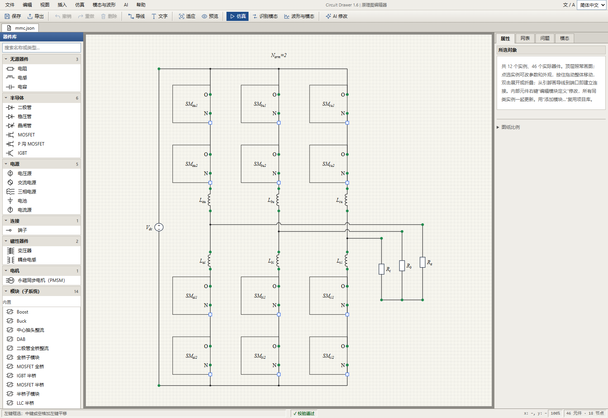

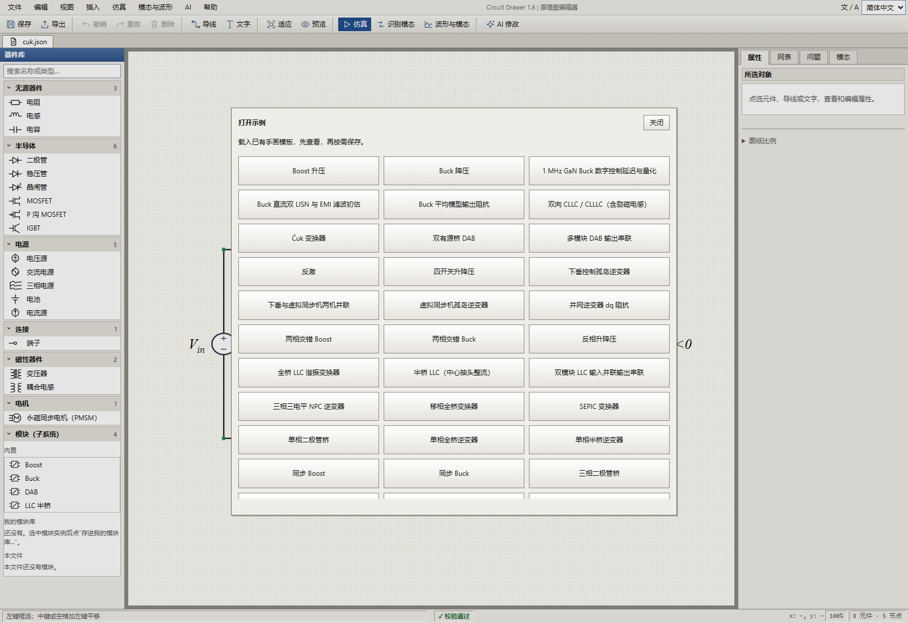

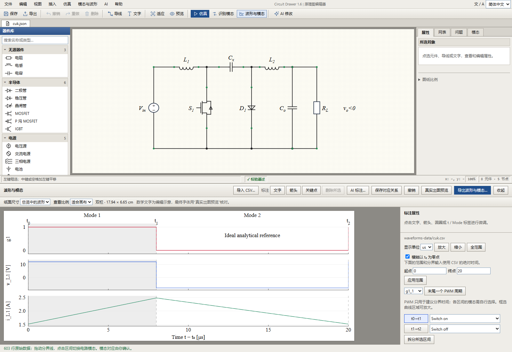

### 3、先导出坐标表再改

```bash
circuit-drawer export llc -o llc.json       # 把模板写成 JSON
circuit-drawer edit llc.json                # 在编辑器里改
circuit-drawer check llc.json               # 只校验，输出 JSON 报告；不通过时返回码为 1
circuit-drawer render llc.json -p single    # 校验通过后出图
```

导出的 JSON 不记录栏宽。大电路重新打开或出图时，记得加 `-p double`。

### 4、存成自己的模板

```bash
circuit-drawer save-template bb.json buck_boost --title "Four-switch buck-boost" --alias 四开关升降压
circuit-drawer draw 四开关升降压 switch=igbt
```

1、模板名只能用小写字母、数字和下划线；只接受校验通过的表；不能与内置模板重名，同名覆盖要加 `--force`。

2、模板保存在 `~/.circuit_drawer/templates/`，或环境变量 `CIRCUIT_DRAWER_TEMPLATES` 指定的文件夹。

3、编辑器 **文件 → 存为模板…** 效果相同。

4、保存后的提示和 `list` 按模板内容列出选项。有开关符号才提供 `switch`，有电流参考箭头才提供 `currents`。名称会去掉首尾空白并转为小写。用 `--dir` 保存到自定义位置后，使用时将 `CIRCUIT_DRAWER_TEMPLATES` 设为同一目录。

5、`circuit-drawer --version` 和 `circuit-drawer-control --version` 可查看当前运行的版本。

---

## 四、编辑器界面导览

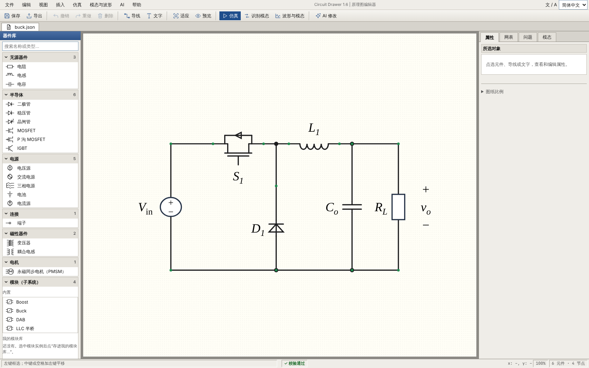

右上角 **文 / A** 选项可立即切换 **简体中文 / 繁體中文 / English**。切换保留未保存的编辑、已打开的窗口和输入值；同一浏览器、地址和端口会记住选择，不同编辑器端口各自保存偏好。翻译随安装包离线提供。图纸文字、自定义名称、JSON 和外部工具原始输出保持原样；命令行与 Windows 启动器沿用原有文字。本书使用简体菜单名。

### 1、整体布局

1、**菜单栏**（第一行）：文件、编辑、视图、插入、仿真、模态与波形、AI、帮助，顺序就是“画图 → 仿真 → 模态与波形 → 导出”的工作顺序。菜单项右侧显示快捷键；带 › 的项点开是子菜单。

2、**常用工具栏**（第二行）：按文件、编辑、绘图、查看、仿真、AI 分成六组，依次是保存、导出、撤销、重做、删除、导线、文字、适应、预览、**仿真**、识别模态、波形与模态、AI 修改。蓝底的“仿真”打开 SPICE 仿真窗口，“识别模态”打开“从仿真识别模态”。不可用的按钮变灰。编辑模块定义时，这里会多出“设置端口并保存…”和“取消编辑定义”。

3、**文件标签**：显示当前文件名，鼠标停在上面显示完整路径；文件名前的圆点表示有未保存的改动。

4、**器件库**（左栏）：分类列表，可搜索、点击或拖入画布，见[第五章](#五器件库与全部器件)。

5、**画布**（中间）：浅色点阵与 0.05 吸附步长一致。滚轮缩放，中键拖动或按住空格加左键拖动平移。**视图 → 坐标刻度** 可显示坐标刻度。

6、**信息栏**（右栏）：四个标签页。

| 标签页 | 内容 |
| --- | --- |
| 属性 | 当前选中对象的属性；选中元件、导线、文字、区域、方框、功能标志、箭头或模块时自动打开。下方“图纸比例”显示当前缩放比例 |
| 网表 | 网络名、引脚和支路编号；展开“SPICE 网表”可看当前实际导出的网表 |
| 问题 | 校验结果和修正按钮，标签上的数字是问题数 |
| 模态 | 模态图的切换、编辑和导出 |

7、**状态栏**（底部）：左边是当前操作提示；中间是校验状态（“未检查”“校验通过”或“有 N 个问题”），点击它会依次选中并居中显示有问题的对象；右边是鼠标坐标、相对“适应窗口”的缩放比例、元件数和节点数。

8、**空画布**：没有任何元件时，画布中央提供“打开示例”和“AI 描述”两个按钮。

9、器件库和信息栏可以滚动，查看未显示的条目和属性。保存成功或出错时，画布角落会短暂显示提示。

10、**提示文字分三级**：状态行只说当前状态或下一步；鼠标停在按钮或输入框上显示简短说明；规则、适用范围和建模假设收在标题旁的 **?** 里，点开查看。输入有误时，红字紧贴输入框，说明哪里不对、怎么改，例如 SPICE 数值写成 `2M` 时提示“M 表示毫，兆请写 Meg”。模态面板、SPICE 仿真、从仿真识别模态、实验功能中的分析（EMI、阻抗、稳定性）和 AI 接口设置窗口都按这一格式显示。

### 2、菜单一览

| 菜单 | 内容 |
| --- | --- |
| 文件 | 保存、另存为… — 存为模板…、存为模块… — 图纸栏宽 — 导出 ›（电路图…、全部模态图…、ngspice 网表…、Simulink 模型…、PLECS 模型…、PSIM 模型…） |
| 编辑 | 撤销、重做 — 剪切、复制、粘贴、创建副本、删除所选 — 顺时针旋转 90°、逆时针旋转 90°、镜像 / 反向、增大符号、缩小符号、同类对象图层 ›（上移一层、下移一层、置顶、置底） — 按图更新网表、合并重叠导线 — 有模块时还有编辑选中模块定义、解散选中实例为普通元件，旧式模块表还有模块定义…、转换为端口连接 |
| 视图 | 适应窗口、放大、缩小、模块显示 › — 画布上显示：节点/支路标号、坐标刻度、实时网表面板 — 预览设置：带坐标网、色块灰度，以及真实预览 |
| 插入 | 画导线、导线交叉方式 — 元件 ›（按无源、半导体、电源、磁性元件与电机、连接分组）、添加模块… — 标注 ›（加文字、画区域、画方框、画箭头、画信号箭头、画功能标志、阶跃 / 脉冲标记） |
| 仿真 | SPICE 仿真…、全图器件模型… — 导出 ngspice 网表…、导出到 Simulink…、导出到 PLECS…、导出到 PSIM… |
| 模态与波形 | 从仿真识别模态… — 上一个模态、下一个模态、在图上改模态、复制为新模态、模态真实预览 — 波形与模态…、导出全部模态图… |
| AI | 描述新拓扑…、AI 修改当前图… — AI 接口设置… |
| 实验功能 | 传导 EMI 估算…、输出阻抗分析…、dq 阻抗矩阵…、源负载稳定性…、dq 互联稳定性… — 参数范围搜索… |
| 帮助 | 用户指南、提示词说明、操作与快捷键… — 关于… |

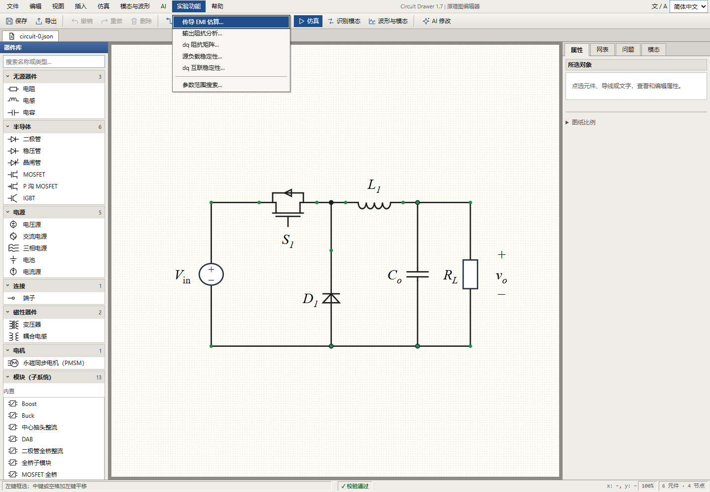

表中“—”表示分隔线。导出到 Simulink、PLECS、PSIM 和 ngspice 网表都与 SPICE 仿真共用同一套参数，所以这些入口会打开 SPICE 仿真窗口并定位到对应的导出按钮。

菜单可以用方向键选择、Enter 执行、Esc 收起，点击画布也会收起。“帮助”里的用户指南和提示词说明在新的浏览器标签中打开项目的在线文档，需要联网。

### 3、保存、预览和导出

1、**保存**：写回当前 JSON。电路编辑器没有保存快捷键，请点工具栏“保存”或 **文件 → 保存**。

   **文件 → 另存为…**：输入新名字，保存在原文件旁边并切换到新文件，后续“保存”写入新文件。自动补 `.json`，空格等符号改为下划线；同名时加 `_2`、`_3` 等序号，不覆盖已有文件。提交前取消不写文件；提交后关闭窗口仍继续保存，期间的新修改仍标为未保存。编辑模块定义时需先保存或取消定义编辑。

2、**预览**（真实预览）：调用 LaTeX 显示最终效果。**视图 → 带坐标网** 决定预览是否叠加坐标网，方便对照坐标。

3、**导出**：见[第二十一章](#二十一导出格式与-latexword-用法)。导出的图一定不带坐标网，并且只有校验通过才能导出。

4、**栏宽**：**文件 → 图纸栏宽** 在 IEEE 单栏和双栏之间切换。下次打开大电路时可在命令行加 `-p double`。如果当前单栏未通过、同图按双栏可通过，问题页会显示“切到双栏”按钮；点击只切换显示和校验栏宽，不移动元件。

---

## 五、器件库与全部器件

### 1、使用器件库

1、**添加**：点卡片，元件放到画面中央；或把卡片拖到画布上，元件放在落点。也可以用 **插入** 菜单底部的元件库，或在画布空白处右键选“在这里插入 ›”。

2、**搜索**：顶部输入中英文名称、器件类型或类别，例如“电感”“L”“igbt”“电源”。搜索时自动展开匹配的分组，清空后恢复原来的折叠状态。

3、**分组**：无源器件、半导体、电源、连接、磁性器件、电机，最下面是“模块（子系统）”（见[第十四章](#十四模块)）。点分组标题可以收起。

### 2、器件清单

| 器件库名称 | 坐标表 `kind` | 引脚 | 说明 |
| --- | --- | --- | --- |
| 电阻 | `R` | `a`、`b` | 两引脚须同 x 或同 y |
| 电感 | `L` | `a`、`b` | 同上 |
| 电容 | `C` | `a`、`b` | 同上 |
| 二极管 | `D` | `a`（阳极）、`b`（阴极） | 通用二极管 |
| 稳压管 | `D`，`opts.zener: true` | 同二极管 | 画成稳压管符号；仿真需另填击穿参数 |
| 晶闸管 | `scr` | `a`（阳极）、`b`（阴极） | 只能水平或竖直；门极引线画在 a→b 的左侧，`F` 键换到右侧；门极由仿真触发脉冲驱动，不是引脚 |
| MOSFET | `nmos` | `d`、`s` | 默认带体二极管（`opts.diode: false` 去掉） |
| P 沟 MOSFET | `pmos` | `d`、`s` | 源极在上、门极带点；体二极管 d→s；逻辑 PWM 1 为导通。在“仿真 → SPICE 仿真…”填写参数。 |
| IGBT | `igbt` | `c`、`e` | 默认带反并联二极管 |
| 电压源 | `V` | `a`（负）、`b`（正） | 直流电压源 |
| 交流电源 | `vac` | `a`（参考端）、`b` | 正弦交流源 |
| 三相电源 | 三个 `vac` | 每个 `a`、`b` | 一次放好星形连接的三个交流源和中性线，标签为 v_a、v_b、v_c |
| 电池 | `V`，`opts.battery: true` | 同电压源 | 长板为正，接 b 端；仿真与电压源相同 |
| 电流源 | `I` | `a`、`b` | 电流从 a 流向 b |
| 端子 | `port` | `p` | 空心圆，一根导线在此结束，如输入 a/b/c、输出 P/O/N |
| 变压器 | `transformer` | `p1`、`p2`（原边，上到下），`s1`、`s2`（副边），可选 `sct`（中心抽头） | 变比文字、同名端可设；可旋转 90° |
| 永磁同步电机（PMSM） | `pmsm` | `a`、`b`、`c` | 三相电机，默认引脚在左侧从上到下排列，内部星点不引出；可旋转，仿真参数见第十七章 |
| 耦合电感 | `transformer`，`opts.core: false` | 同变压器 | 不画铁芯线的变压器，引脚和仿真字段与变压器相同 |

中心抽头变压器在编辑器里没有单独的卡片：可以从 `llc_fullbridge` 等模板复制，或在坐标表里给变压器加 `sct` 引脚（见[附录 A](#附录-a坐标表格式)）。

多绕组变压器（QAB、AQAB 等多端口变换器）：选中变压器，在属性栏“多绕组”一行点“加在原边侧”或“加在副边侧”，同一磁芯上会多出一个绕组（w3～w6，最多 6 个绕组），同名端在它的 a 端；再把它连到对应的桥，并在“SPICE 仿真…”里填它的匝比 `ratio_w3` 等。“删去 w… 绕组”去掉编号最大的附加绕组，并清理其引脚声明、测量通道和匝比，导线保留，可一步撤销。若用于模态、闭环反馈或参考地，请先调整相应设置。示例见 `examples/multiwinding/qab_multiwinding.json`。

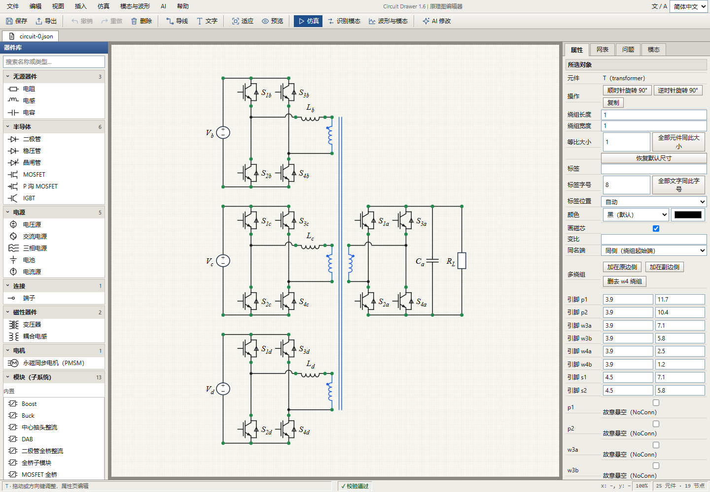

系统级框图的小图标（电池／储能、光伏板、服务器机柜、电网、方波源、直流电容，以及 DC/DC、DC/AC 变换器方框）：用“插入 → 画方框”拖出方框，在属性栏“图标”里选择；选了图标后，“文字”会写在方框下方作说明。它们只是插图，不参与连接和仿真。示例见 `examples/system_icons/dc_bus_system.json`。

图标随方框移动，拉伸方框时保持居中和比例。独立图标可从“插入 → 功能标志”添加。引用控制表的方框展开时仍显示实际控制图，折叠后显示所选图标。

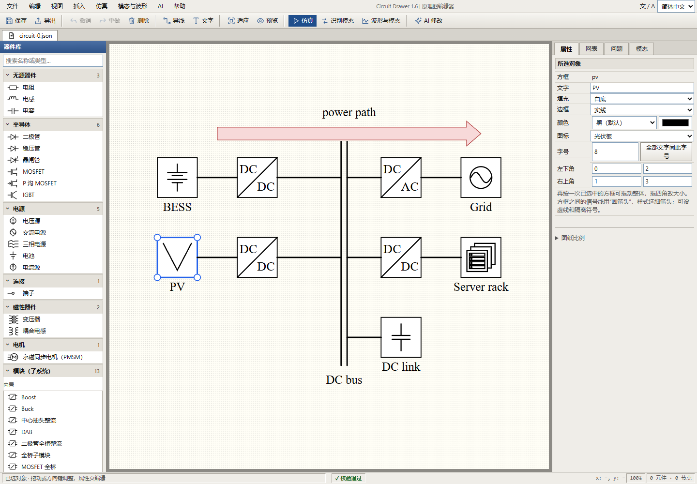

---

## 六、元件属性

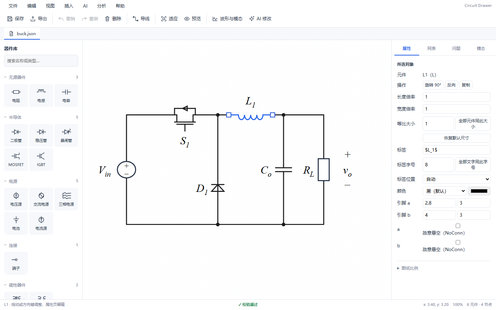

点选元件后，右栏“属性”页显示它的设置。不同器件显示的项目不同。

### 1、操作按钮

“顺时针旋转 90°”“逆时针旋转 90°”“反向”（MOSFET、IGBT 显示为“镜像（门极换边）”，变压器没有这个按钮）“复制”分别对应 `R`、`Shift+R`、`F`、`Ctrl+D`。

1、`R` 顺时针旋转 90°，`Shift+R` 逆时针旋转 90°。变压器也可以旋转，变比文字保持正向。

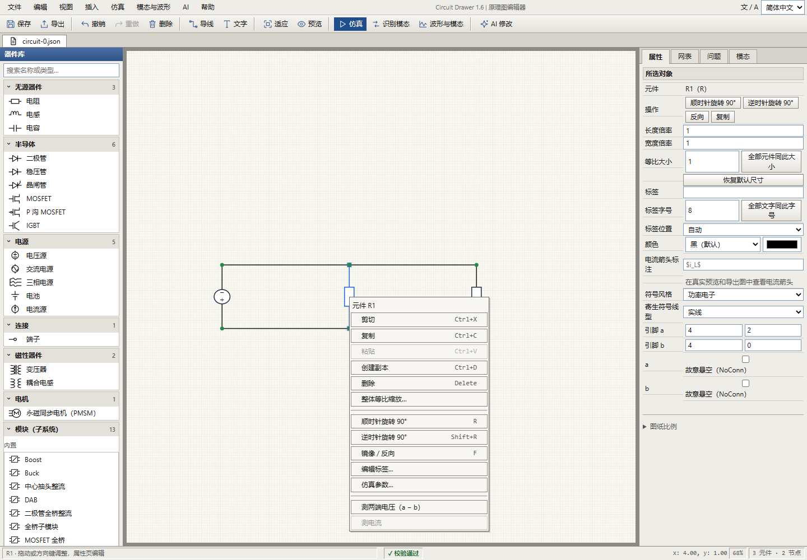

2、`F` 镜像：开关和晶闸管把门极换到另一侧，其他二端元件反向。变压器不支持镜像。注意：二端元件的“反向”只改变画法（`opts.invert`），不交换引脚，仿真不读它；要真正反接，请交换两个引脚的坐标。

### 2、尺寸

1、**长度倍率 / 宽度倍率**：分别调整沿引脚方向和垂直引脚方向的符号尺寸，范围 0.5–2，随元件旋转。变压器显示为“绕组长度 / 绕组宽度”。

2、**等比大小**：两轴设成同一倍率；“全部元件同此大小”把所有元件设成这个倍率。

3、`+` / `-` 键（或 **编辑 → 增大符号 / 缩小符号**）保持当前长宽比缩放；“恢复默认尺寸”回到 1。

4、尺寸只改符号，不移动引脚、导线，也不改网表。校验和导出按新尺寸检查。

### 2a、符号风格

1、选中电阻或 MOSFET，在属性栏选择“功率电子”或“模拟 IC（Razavi）”。统一当前图纸用“视图 → 符号风格预设 → 应用到当前图”，可一步撤销；需要保存后才会写入文件。

2、IC 风格使用锯齿电阻与简画 MOSFET，PMOS 门极为空心圈。体二极管仍参与仿真，导通模态中仍会画出；不改变元件参数或添加门极接线端。

3、预设包括模块内部及自动外部元件。库定义会复制到当前图纸，共享库不变。新放入元件沿用默认风格，可再次应用预设。示例：[analog_ic.json](../examples/styles/analog_ic.json)。

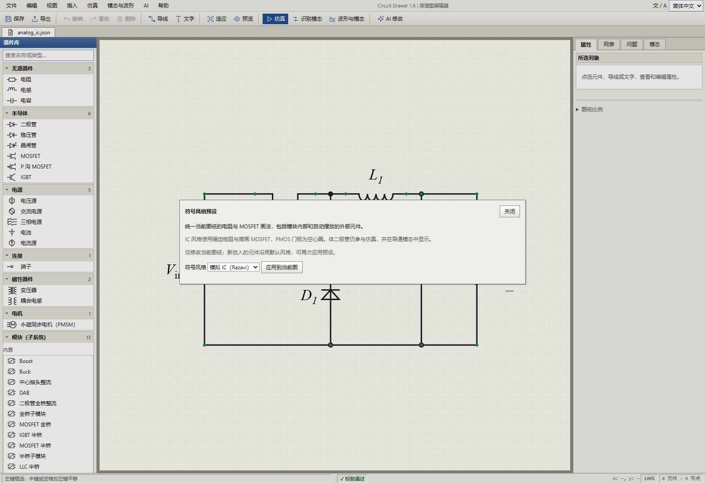

### 6.2b 整体电路缩放

1、左键拖动框选或 Shift+左键多选一组电路，右键选择“整体等比缩放…”。也可打开“视图 → 整体等比缩放…”，将范围改为“整张电路”。

2、输入倍率，例如 `0.8` 缩小到当前的 80%，`1.2` 放大到 120%。元件本体、引脚、导线和间距一起调整；默认勾选“同步缩放字号”，需要保持字号时取消；线宽保持原值。

3、按“预览缩放”，查看实际出图后按“应用到当前图”。选区外的普通元件保持位置，外接导线保持连接；模块完整／部分内部图及外框一起缩放，封装与电气参数保留。缩放一部分同类实例会使用独立的项目定义副本，共享库不变。

4、应用后可一步撤销／重做，需要保存才写入文件。缩放会固定当前图纸比例，避免自动铺满栏宽抵消修改。“恢复自动适配”恢复栏宽换算，不恢复原坐标；恢复原图请撤销。过小、超宽或接线／碰撞检查失败时不会应用，可调整倍率或扩大选区。示例：[boost_scaled.json](../examples/styles/boost_scaled.json)。

5、引用控制表的方框仍按原控制表适配内部图，内部字号不随本次电路缩放改变。需要统一外观时可先折叠控制方框再缩放；展开空间不足时预览会提示增大或折叠。原控制表及控制参数不变。

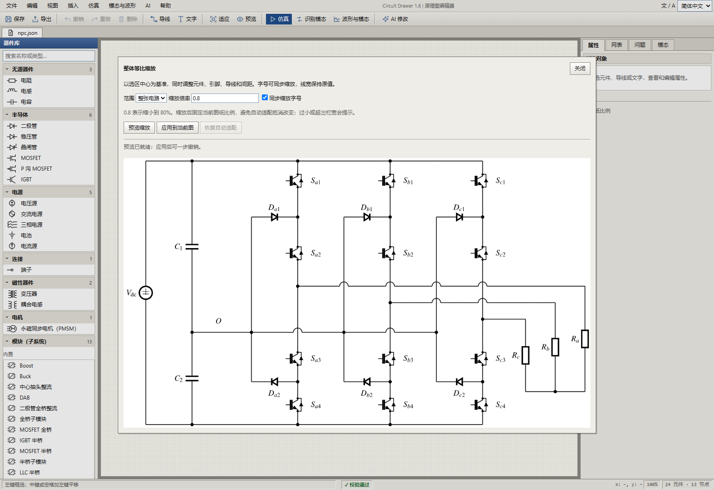

### 3、标签、字号和位置

1、**标签**：直接输入文字，支持 LaTeX，例如 `$L_r$`、`$V_{\mathrm{in}}$`、`$\phi_1$`。画布上的数学文字是近似显示，最终效果以“预览”为准。多字母下标要加花括号，`$V_in$` 会得到警告。

2、**标签字号**：5–14 pt，默认 8 pt，同时作用于该元件的电流箭头文字。“全部文字同此字号”一键统一。

3、**标签位置**：自动、上、下、左、右。开关的标签按画面方向定位。

4、**独立拖动标签**：直接拖动元件标签或变压器变比文字，只调整文字位置，元件和接线不动；属性页“恢复默认标签位置”取消偏移。支持撤销、重做和保存。

5、选中 vo、+、− 这类自由文字时，属性页显示“字号”和“颜色”。

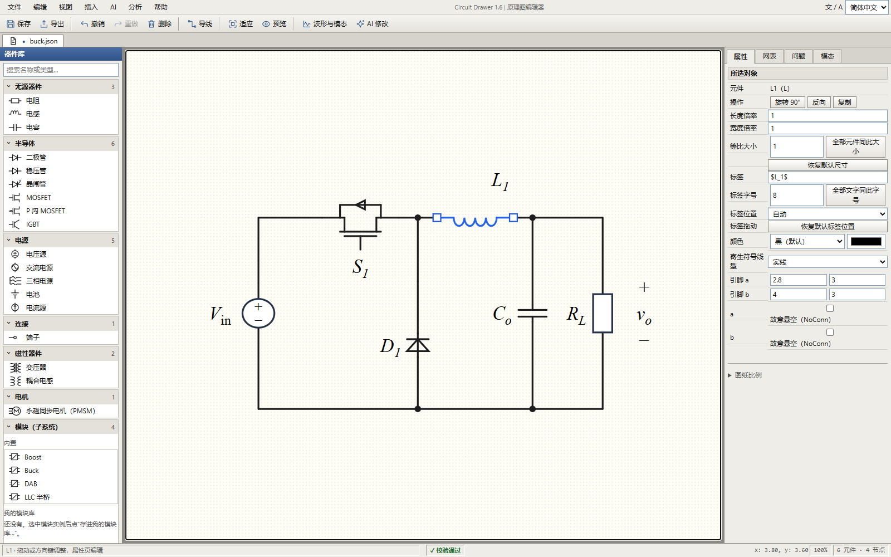

### 4、颜色

“颜色”下拉框和取色器给元件着色，见[第十三章](#十三器件与文字着色)。

### 5、引脚坐标和故意悬空

1、**引脚 a / 引脚 b**（开关为 d/s、c/e，变压器为 p1/p2/s1/s2）可以直接输入坐标。

2、每个引脚下面有“故意悬空（NoConn）”复选框。只给确实不需要连接的端子勾选：勾选后不再报“引脚没接上”，画布和导出图上画一个小叉。它不能掩盖其他接线错误。

### 6、器件专用项

| 器件 | 专用项 |
| --- | --- |
| 电阻、电感、电容 | 线型（实线、虚线、点线）；线型只改显示，不改变参数或接线 |
| 二极管 | 画成稳压管 |
| 电压源 | 画成电池；源旁波形（上升阶跃、下降阶跃、脉冲）、波形位置、波形大小 |
| 电流源 | 源旁波形、波形位置、波形大小 |
| 变压器、耦合电感 | 变比文字、同名端（同侧、反向、不画） |

### 7、电流箭头

选中电感、电阻等二端元件，在属性栏“电流箭头标注”里填写 `$i_L$` 等文字，在真实预览及导出图中查看引线上的箭头。清空该输入框可移除箭头，保存为 `opts.current`。导线上的独立电流箭头使用带 `arrow` 的自由文字，字段见附录 A。

### 8、仿真参数

元件的电气数值不在属性页，而在 **仿真 → SPICE 仿真…** 里，见[第十七章](#十七spice-仿真)。右键元件选“仿真参数…”会直接跳到它所在的行。图上的文字标签只用于绘图，程序不从标签猜数值。

---

## 七、导线、跨线和节点

### 1、画导线

1、点工具栏“导线”或 **插入 → 画导线**，在画布上逐点单击拐点，双击或按 `Enter` 结束，`Esc` 取消。

2、每段必须水平或竖直。从引脚开始、在引脚或另一条导线上结束。

3、直接单击引脚可开始画线。鼠标接近目标引脚或模块端口时，会出现绿色小三角，点击三角附近即可精确连接并结束这根线。途中可点击空白处添加拐点，按住 `Alt` 可暂停端口吸附。

4、导线实际接触引脚时，接触点显示绿色。选中导线后，已接到引脚的端点也显示绿色。问题栏继续显示整张图的短路、断路和其它问题。

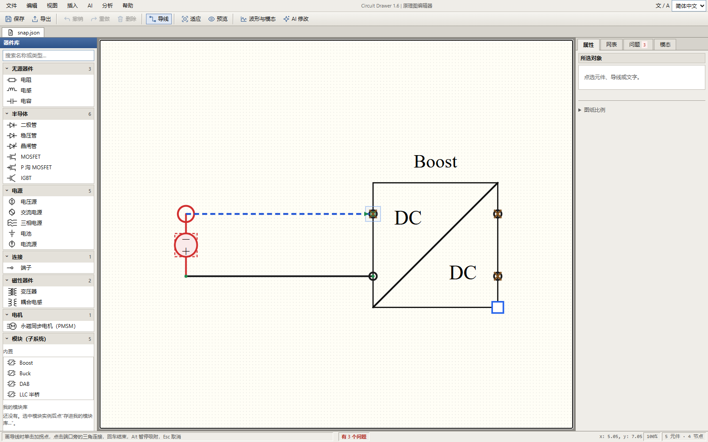

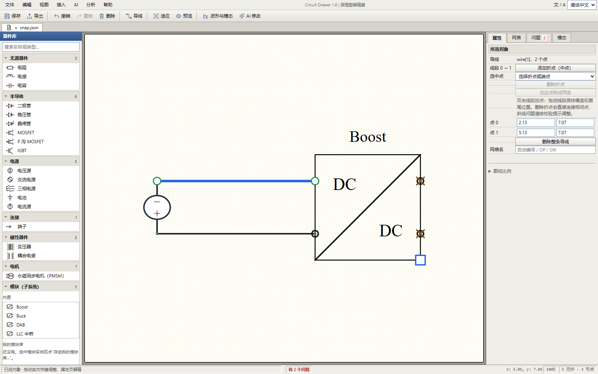

### 2、编辑已有导线

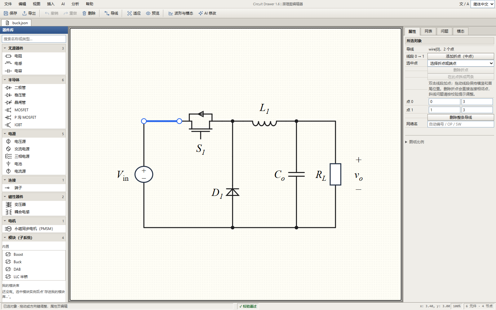

1、**拖动**：选中导线后拖动拐点（小圆点），或直接拖动一段横线或竖线。拖动线段时保持首尾位置不变，必要时在端点附近补横竖折线；一次拖动算一步撤销。

2、**加折点**：双击线段，在点击处加点；或在属性页点“添加折点（中点）”；或右键导线选“在此处加折点”。

3、**删除折点**：点小圆点或在“选中点”下拉框里选择内部折点，按 `Delete` / `Backspace` 或点“删除折点”。删除后直接连接相邻两点，若形成斜线，按校验提示调整。端点不能用这个操作删除。

4、**拆分与合并**：选中内部点后点“在此点拆成两条”，或右键“在此处拆成两条”（不必先加折点）。只有一个公共端点的两条导线，可以在属性页点“合并 wire[编号]”，或右键“和首尾相接的导线合成一条”。跨线处不能直接拆分。

5、**删除整条导线**：属性页“删除整条导线”，或右键“删除这条线”。

6、**重叠处选线**：同一位置再次单击会轮换选中重叠的导线。选中的线显示蓝色，即使它有报错也不会被红色盖住。

7、**合并重叠导线**：点叠线问题旁的“合并重叠导线”，也可用“编辑”菜单、导线右键或属性栏。一次整理当前图中水平或竖直、完全共线的普通导线，包括部分重叠和完全重复，保留分支接点及绝缘跨线；可一步撤销，保存后重开保留。靠得很近的平行线不会合并；模块内部导线先进入定义编辑。连接关系改变或出现新冲突时保留原图；去重后显露的悬空线头仍需处理。整条逐点相同的重复线也保留原来的单条删除按钮。

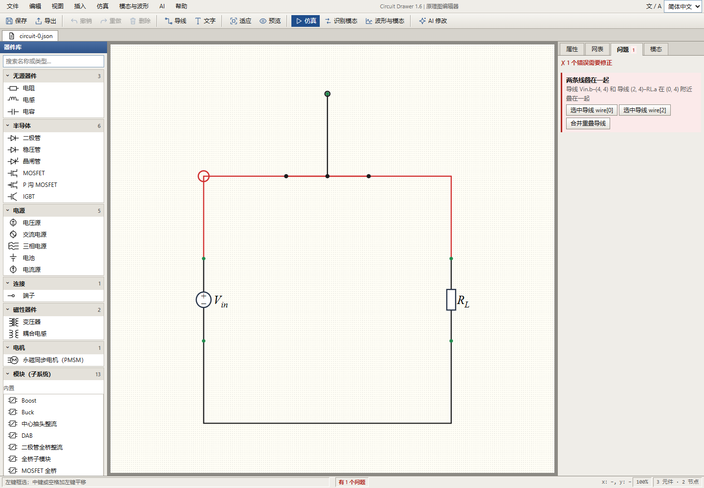

8、鼠标停在点上会显示 `wire[编号] 点 编号`，编号从 0 开始，与 JSON 中的顺序一致。

### 3、交叉：跨线还是节点

1、两条线十字相交时，要么画跨线（半圆，不相连），要么画节点（实心点，相连）。**插入 → 导线交叉** 决定新画导线遇到交叉时用哪种。

2、事后点交叉处的半圆或黑点，或选中导线，在属性页的“交叉点”行切换跨线／节点；右键也可操作。“两线交叉但没标跨线”的问题旁可直接加跨线或改为节点，有模块的图纸中也适用于外部普通导线。模块内部须进入定义编辑。

3、拖动导线、用方向键微调或修改坐标时，已有跨线跟随这两条线的实际交点，拖动中即可看到；两线不再相交就移除多余标记。可撤销，保存后重开保留。

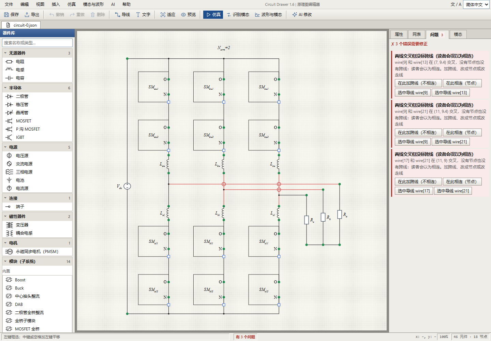

4、T 形相接（导线端点落在另一条导线上）自动算作相连并画节点；三条以上线段汇于一点也自动画节点，不用手写。导线端点落在元件引线中间是错误。

### 4、网络名与节点、支路标号

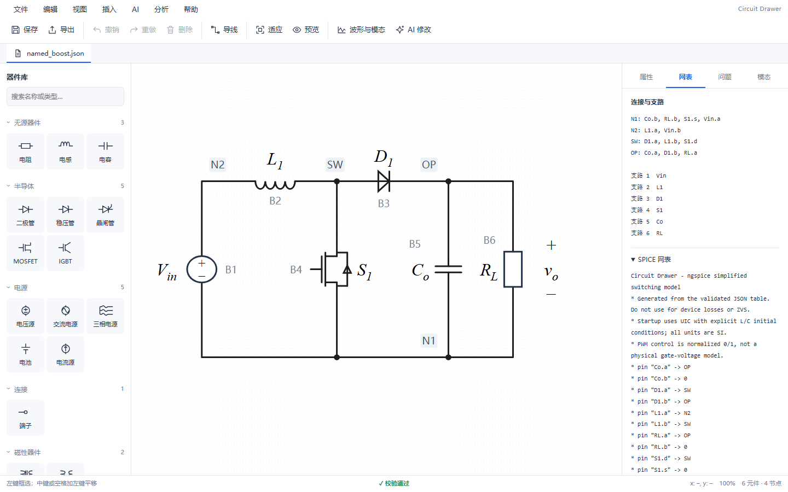

1、**视图 → 节点/支路标号**：画布上显示带浅底色的网络名（N1、N2… 或你起的名字）和灰色小字的支路号 B1、B2…。第一次打开时创建固定编号，之后移动或增删其他元件，已有编号不变；关闭显示也不清除编号。

2、**命名网络**：选中一根导线，在属性页“网络名”里填 OP、SW 等名字；留空恢复自动编号。名字为 1–41 个 ASCII 字母、数字、下划线，以字母开头，不区分大小写时全图唯一。

3、**网表页**：右栏“网表”页（或 **视图 → 实时网表面板**）列出每个网络连接的引脚和支路编号，每次画图后刷新；展开“SPICE 网表”可以看到当前实际网表。仿真参数还没填写时，这里会说明原因。

4、导出电路图时，“包含节点标号”复选框决定图里是否带这些标号，每次打开默认不勾。

5、启用标号后，SPICE 网表使用这些网络名，元件仍使用原编号（如 L1、S1），支路号只写在注释里。没有启用标号的旧文件，网表保持原样。

### 5、按图更新网表

坐标表的 `netlist` 记录哪些引脚应该相连，校验器把实际几何连接与它逐对比较。如果你是有意改接法（比如把二极管挪到回线上），点 **编辑 → 按图更新网表**，把当前几何连接写成新网表；否则校验会报“与网表不符”。不要用它来掩盖误连。

---

## 八、选择与整组编辑

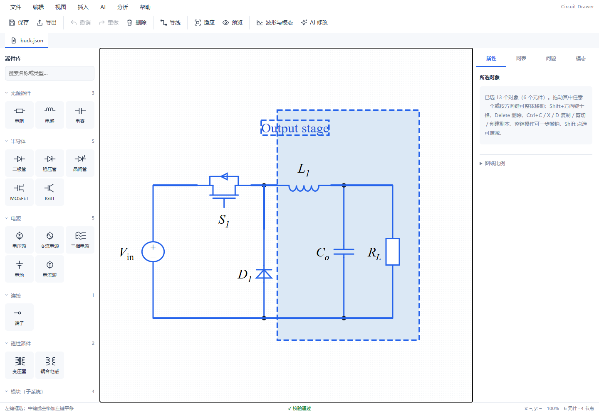

### 1、选择

1、**点选**：单击元件、导线、文字、区域、方框、功能标志、箭头或模块。单击空白处取消选择。

2、**框选**：在空白处或未选中的区域内按住左键拖出矩形，可选中顶层元件、导线、自由文字、区域、方框、功能标志和箭头。元件需所有引脚在框内，导线需所有折点在框内，标注需整个外框在框内。Ctrl+A 全选这七类顶层对象。

3、**追加**：按住 Shift 框选追加；Shift 单击增减对象。模块实例也可与元件、导线和标注一起选中并移动；模块内部保持完整，外连导线跟随。含模块的选区支持移动，复制、删除仍用各自入口。独立波形标记不参加混选。

4、画导线、画区域、画方框、画功能标志、加文字、画箭头或放置模块时，左键用于当前工具，框选暂停；按 `Esc` 退出工具。

### 2、平移和缩放

1、滚轮缩放。

2、按住中键（滚轮）拖动平移；笔记本触控板可按住空格，再用左键拖动。输入框里的空格仍用于输入文字。

3、**视图 → 适应窗口**（或工具栏“适应”）让整张图填满画布；**放大**、**缩小** 按步缩放。

### 3、整组操作

选中多个元件或标注后：

1、拖动其中任意一个，整组移动，按 0.05 网格落点。组内导线一起移动；连到组外的导线按原端点拖动规则伸缩，共用接点保持连接。拖动过程中按 `Esc` 取消。

2、`Delete` 删除整组，`Ctrl+C` 复制，`Ctrl+X` 剪切，`Ctrl+V` 粘贴，`Ctrl+D` 创建副本；macOS 上可用 `Cmd` 代替 `Ctrl`。这些操作也在 **编辑** 菜单和右键菜单里。每次整组操作只需一步撤销。

3、复制会带上组内导线、元件仿真参数和“故意悬空”标记，副本使用新的元件编号和独立的网络；接到组外的导线不复制。剪切后第一次粘贴把元件放回原位并尽量保留原编号，之后的粘贴依次偏移。

4、删除或剪切元件时，相应的仿真参数、引用这些元件的测量通道和模块端口连接也一并删除。

5、方向键整组微调一步，Shift 加方向键移动十格。整组移动不做自动避让，落点造成重叠时由校验器提示。贴合区域需一起选中全部成员才能移动。混选导线或标注时不能存为模块，请先只选元件。

### 4、智能辅助线

拖动单个元件或自由文字时会出现类似演示文稿软件的辅助线并自动吸附（整组拖动按网格移动）：

1、引脚靠近其他元件引脚所在的横线或竖线时优先吸附（这样导线能拉直）；其次是本体中心、本体边缘对齐；再次是同一排或同一列相邻元件等距。

2、自由文字可以对齐其他文字、元件标签和元件本体的中心或边缘，也可与相邻文字等距。对齐时画紫红色虚线，等距时在各段间距两端画短竖标。吸附范围约为屏幕上 6 个像素，与缩放无关；元件引脚始终落在 0.05 网格上，文字可精确对齐标签边缘。

3、按住 `Alt` 拖动只对齐网格，不吸附。

---

## 九、右键菜单

右键菜单只放动作，颜色、字号、大小等数值仍在属性页。菜单内可用上下键选择、`Enter` 执行、`Esc` 关闭，左右键进入或返回子菜单；变灰的项目鼠标停留时会说明原因。正在画导线、标注或放置模块时，先完成或按 `Esc` 取消，再打开右键菜单。

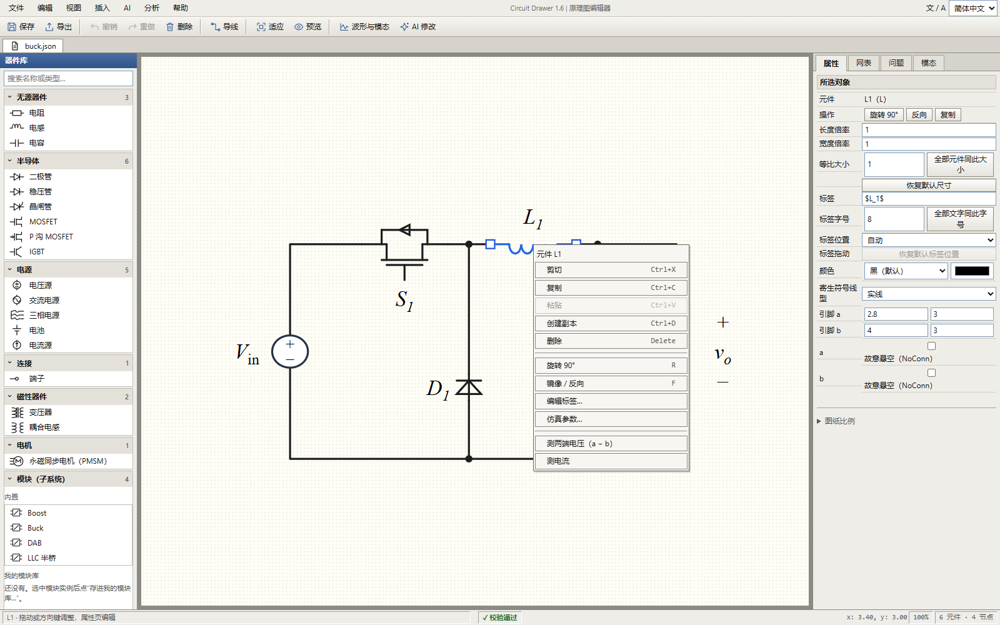

### 1、元件

右键元件会先选中它；右键已经选中的一组元件会保留整组选择。

| 菜单项 | 作用 |
| --- | --- |
| 剪切、复制、粘贴、创建副本、删除 | 与快捷键相同，作用于当前选择 |
| 顺时针／逆时针旋转 90° | 单个元件或多选元件及导线；按 R／Shift+R 绕选区中心旋转，外连接点保留，可一步撤销。含模块或标注时先调整选择 |
| 镜像 / 反向 | 只对单个元件可用 |
| 编辑标签… | 把光标放到属性页的标签框 |
| 仿真参数… | 打开 SPICE 仿真窗口，滚动并高亮这个元件的参数行 |
| 测两端电压、测电流、测驱动 | 增加已有模型支持的测量通道，打开 SPICE 窗口供确认；不支持的类型会说明原因 |
| 存为模块… | 多个元件时可用，见[第十四章](#十四模块) |

### 2、导线

| 菜单项 | 作用 |
| --- | --- |
| 在此处加折点 | 在鼠标位置加一个折点 |
| 删除折点 | 删除内部折点（不能删端点） |
| 在此处拆成两条 | 在鼠标位置拆开，只占一步撤销；跨线处不能拆分 |
| 和首尾相接的导线合成一条 | 有多条可合并的线时，子菜单列出编号供选择 |
| 合并重叠导线 | 整理当前图中共线重叠的普通导线，核对连接，可一步撤销 |
| 删除这条线 | 删除整条导线 |
| 测对地电压 | 增加所在网络的测量通道，需先设置参考地 |

右键引脚可切换“故意悬空”。四路交叉处可切换节点／跨线；T 接和接有元件引脚的位置不能改跨线。“相关问题”复用问题页已有的定位和处理操作。

整条导线只被选中、没有选中折点或线段时，方向键只提示，不会把线挪离引脚。

### 3、画布空白处

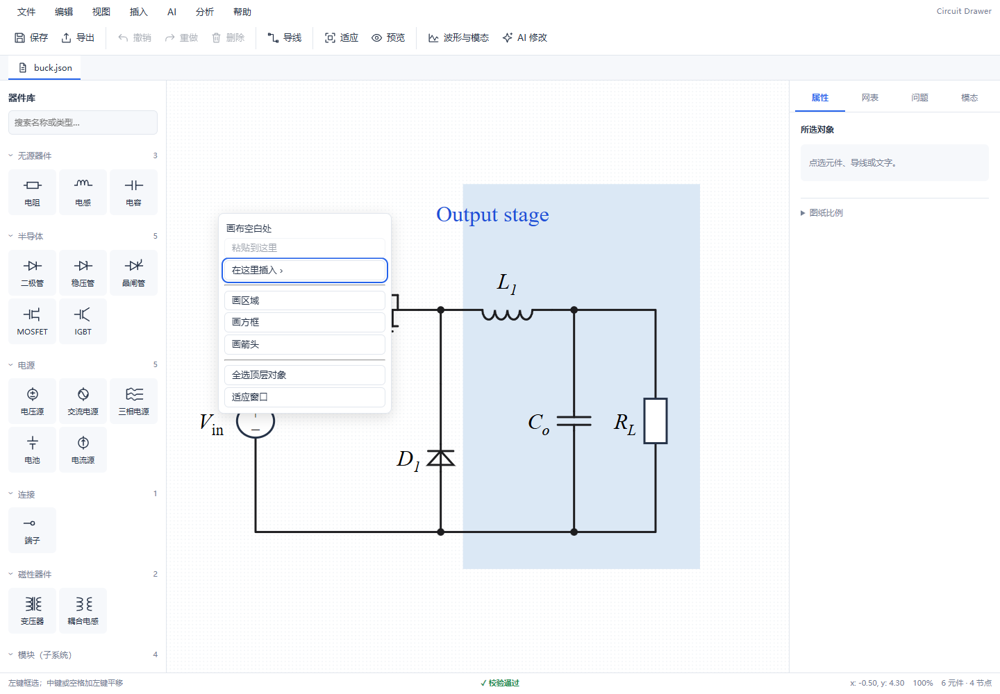

| 菜单项 | 作用 |
| --- | --- |
| 粘贴到这里 | 副本的中心对齐鼠标位置并吸附网格；剪贴板为空时变灰 |
| 在这里插入 › | 在鼠标位置放置器件或模块 |
| 新建空子系统 | 放置一个空模块，进入内部画布逐步搭建电路 |
| 画区域、画方框、画箭头 | 进入相应绘制工具 |
| 全选顶层对象 | 选中顶层元件、导线、文字、区域、方框、功能标志、箭头 |
| 适应窗口 | 整张图填满画布 |

### 4、模块实例

右键模块实例或其内部元件，菜单包括：编辑模块定义、实例参数…、展开 / 折叠、解散为普通元件、存进我的模块库…；模块库里有新版本时还有“从库更新”。详见[第十四章](#十四模块)。

### 5、区域、方框和箭头

| 菜单项 | 作用 |
| --- | --- |
| 上移一层、下移一层、置顶、置底 | 调整在同类对象中的前后顺序，已到顶或到底时变灰 |
| 复制、删除 | 复制后用 `Ctrl+V` 或空白处“粘贴到这里”粘贴 |
| 编辑文字… | 跳到属性页的文字框 |

按成员自动贴合的区域，副本仍跟随原成员；要单独定位，先在属性页“色块贴合成员”固定边界。模块内部的图形需要进入模块定义编辑。

---

## 十、撤销、重做与方向键微调

### 1、撤销和重做

1、工具栏和 **编辑** 菜单都有“撤销”“重做”。`Ctrl+Z` 撤销，`Ctrl+Y` 或 `Ctrl+Shift+Z` 重做；macOS 上可用 `Cmd`。

2、没有可撤销或可重做的记录时按钮变灰。只点选、缩放或平移不会清掉重做记录；实际修改图纸后才开始新的编辑记录。

3、撤销、重做后会取消普通对象的选择，继续微调时重新点选；仍存在的模块实例保留选中。模块共用定义与总图各自保留撤销记录。

### 2、方向键微调

1、选中一个元件、自由文字、固定边界的区域、方框、功能标志、箭头、阶跃 / 脉冲标记或模块实例，按方向键每次移动一个网格（0.05 布局单位），按住 Shift 每次移动 10 格（0.5）。元件相连的导线按拖动时的规则跟随；模块按端口保持连接。

2、导线：选中折点后方向键移动折点；选中线段后只能沿垂直于线段的方向微调，端点位置不变。

3、输入框、可编辑文字、菜单、弹窗和波形面板里的方向键操作这些控件本身，不会移动电路图。

---

## 十一、校验器与问题栏

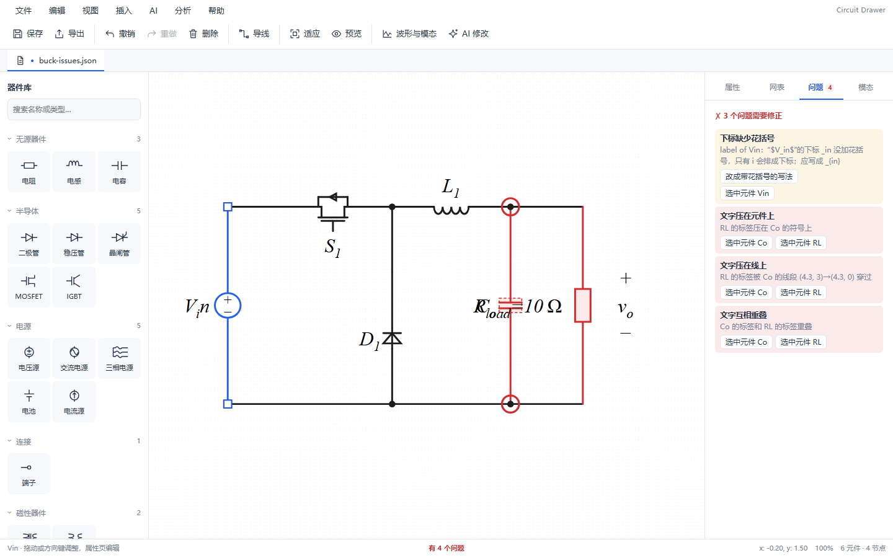

### 1、什么时候校验

每次改动都会立即在后台校验。出问题的元件和位置在画布上标红；右栏“问题”页按当前界面语言说明原因；底部状态栏显示“校验通过”或“有 N 个问题”，点击它会依次定位到问题对象。

### 2、问题页怎么看

1、页首显示“✓ 校验通过，可以导出”或“✗ N 个问题需要修正”。

2、每个问题是一张卡片：标题、具体说明（元件编号和坐标）以及操作按钮。“选中元件 X”跳到相关对象；有自动修法的问题还有修正按钮，例如“改成带花括号的写法”“加跨线”“这是故意的……”。

3、黄色卡片是警告（如下标缺少花括号），不阻止导出；红色卡片是错误，必须修正才能导出；蓝灰色卡片是“已允许”的说明，点“撤回”可以恢复检查。

### 3、它检查什么

| 类别 | 主要规则 | 问题页标题举例 |
| --- | --- | --- |
| 几何 | 导线、元件横平竖直；元件两端距离够画下符号；变压器绕组方向和顺序 | 不是横平竖直；元件两端太近，画不下 |
| 重叠 | 符号之间、导线与符号之间、平行线之间留足间距 | 两个元件符号重叠；导线穿过了元件符号；两条线叠在一起；两条平行线太近 |
| 交叉与接点 | 十字交叉必须声明跨线；导线不能接在元件引线中间 | 两线交叉但没标跨线；导线接在了元件引线中间 |
| 连接 | 引脚都要接上，导线不能悬空；几何连接与网表逐对一致 | 引脚没接上；导线一端悬空；该连的没连上；不该连的连上了 |
| 文字 | 标签不压元件、不压线、不互相重叠；电流箭头在导线上 | 文字压在元件上；文字压在线上；文字互相重叠；电流箭头不在导线上 |
| 栏宽 | 横向比例不低于 0.55 | 按当前栏宽放不下 |
| 色块、方框、箭头 | 区域边框不切元件；箭头不压元件；放大图不接主电路；模块成员在框内 | 区域边框切过了元件；箭头压在元件上；放大图被连到了主电路上；模块成员不在区域框内 |
| 模块 | 折叠框不重叠、不压住元件；端口连线能布通 | 折叠框重叠或压到元件；自动布线失败 |
| 字段 | 选项、颜色、字段名写对 | 颜色名不认识；区域或箭头的设置不对 |

完整规则见[附录 B](#附录-b绘图规则)。

### 4、它不检查什么

偏置是否合理、电流方向和大小是否真的如此、器件参数、死区、某个模态是否符合工况。它只保证“图画得规整，并且和声明的网表一致”。

### 5、常见错误怎么改

| 问题 | 代码 | 修法 |
| --- | --- | --- |
| 不是横平竖直 | `not-orthogonal` | 把两个引脚或两个拐点对齐到同一 x 或 y；拖动时借助辅助线 |
| 元件两端太近，画不下 | `too-short` | 拖动引脚上的蓝色小方块拉长元件，或减小长度倍率 |
| 两个元件符号重叠 | `body-overlap` | 把其中一个挪开 0.1–0.2，或缩小符号 |
| 导线穿过了元件符号 | `line-through-body` | 给导线加折点绕开元件 |
| 两条线叠在一起 / 两条平行线太近 | `collinear-overlap` / `too-close` | 共线重叠可点“合并重叠导线”；平行线间距至少 0.18 cm |
| 两线交叉但没标跨线 | `unmarked-crossing` | 点“加跨线”；本来就该相连时把交叉点改成节点 |
| 导线接在了元件引线中间 | `touches-lead` | 把导线端点移到引脚上 |
| 引脚没接上 | `open-pin` | 接上导线；确实不接时勾选“故意悬空（NoConn）” |
| 导线一端悬空 | `dangling-wire` | 把端点接到引脚或其他导线上，或删除这段线 |
| 该连的没连上 / 不该连的连上了 | `netlist-open` / `netlist-short` | 先判断是不是误连；有意改接法时点 **编辑 → 按图更新网表** |
| 文字压在元件上 / 压在线上 / 互相重叠 | `text-on-symbol` / `text-on-line` / `text-overlap` | 换标签位置、把元件挪开 0.1–0.2，或减小字号 |
| 下标缺少花括号（警告） | `subscript-braces` | 点“改成带花括号的写法”，`$V_in$` 变成 `$V_{in}$` |
| 按当前栏宽放不下 | `too-cramped` | 切到双栏，或收紧间距、减小符号 |
| 区域边框切过了元件 | `region-cuts-symbol` | 拖动区域四角，让元件整个在框内或框外 |
| 放大图被连到了主电路上 | `detail-wired` | 断开穿进放大图的导线；如果那块区域就是真实电路，取消箭头的“指向放大图” |
| 折叠框重叠或压到元件 | `module-box-overlap` | 缩小方框或挪开实例 |
| 标号附近没有空位 | `electrical-label-space` | 挪开附近的元件或文字，或缩短网络名 |
| 字段或取值写错 | `bad-option`、`bad-color`、`bad-region` 等 | 按提示改成列出的允许值 |

### 6、确实要叠在一起：按对象放行

校验器默认拦下重叠，因为大多数重叠是摆错了。确实是有意的，按对象放行，没有全局开关：

1、**标记压在导线上**：独立的阶跃 / 脉冲标记要画在信号线上时，点问题卡片里的“这是故意的：符号压在导线上”，或在标记属性里勾选“压在导线上”。出图时用背后的颜色盖住那一小段线，连接不变。

2、**箭头只是指向，不是放大图**：箭头指着的区域是真实电路的底色而不是放大图时，点“这是故意的：箭头只是指向，不是放大图”，或在箭头属性里取消“指向放大图”。

3、**块箭头覆盖元件或文字**：在块箭头属性里勾选“允许这支箭头覆盖元件／文字”，或在问题卡片里点“这是故意的”。

4、放行后问题页显示一条蓝灰色的“已允许”说明，点“撤回”即可恢复检查。这些设置只影响校验和画法，网表、SPICE、Simulink、PLECS 导出都不受影响。

### 7、命令行校验

```bash
circuit-drawer check my.json             # 输出 JSON 报告，不通过时返回码为 1
circuit-drawer check my.json -p double
```

报告逐条给出元件编号、坐标和原因，例如 `Lr: pins (3.35, 2.5) and (4.5, 2.7) are not on one horizontal or vertical line`。

---

## 十二、色块、方框、箭头、图层与阶跃脉冲标记

这些对象都是绘图辅助，不参与连接和网表。

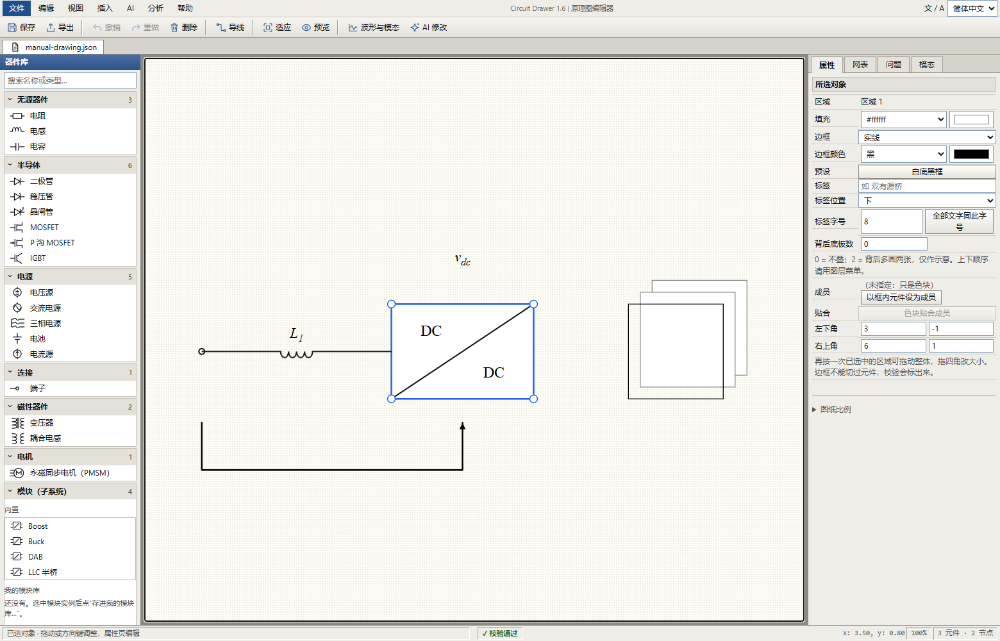

### 1、区域（色块和虚线框）

1、选择 **插入 → 标注 → 画区域**，拖出矩形。点选后可整体拖动或拖四角改大小。新区域沿用上次的填充、边框和边框色，属性栏“白底黑框”可一键设置，浏览器会记住样式。

2、**属性**：填充色（绿、蓝、橙、红、紫、黄、青、灰，或自定义 `#rrggbb`；“无”为不填充）、边框（无、实线、虚线、点线）、边框颜色、标签及位置（下、上、左、右、框内顶部）、标签字号。太深的自定义颜色会自动调淡，保证黑线和文字清晰。

3、**背后底板数**：设为 1–6 时，后面额外叠出几张底板（默认向右上偏移 0.25），常用来示意“只画 a 相，b、c 相用底板代表”。0 表示不叠。它不复制电路，也不是图层位置。

4、**叠面板用途**：需要仿真的图，要在“叠面板用途”里声明：纯装饰，或代表省略的电路（填写包含前面板在内的实例编号）。后者没有真实电路定义时，SPICE 导出会列出缺失实例并停止，不会只导出已画的一相。

5、**模块成员**：点“以框内元件设为成员”，把整个落在框内的元件记为成员。之后校验检查成员都在框内，框内没列出的元件给出提醒。

6、**色块贴合成员**：坐标表里写 `"fit": "members"` 的区域，按成员的符号和标签自动定边界（并集加 0.3 布局单位边距，向外对齐 0.05 网格）。点“色块贴合成员”把当前边界固定成普通矩形，之后可以手动调整；`Ctrl+Z` 恢复自动贴合。示例：`examples/regions/dab_multi_fit.json`。

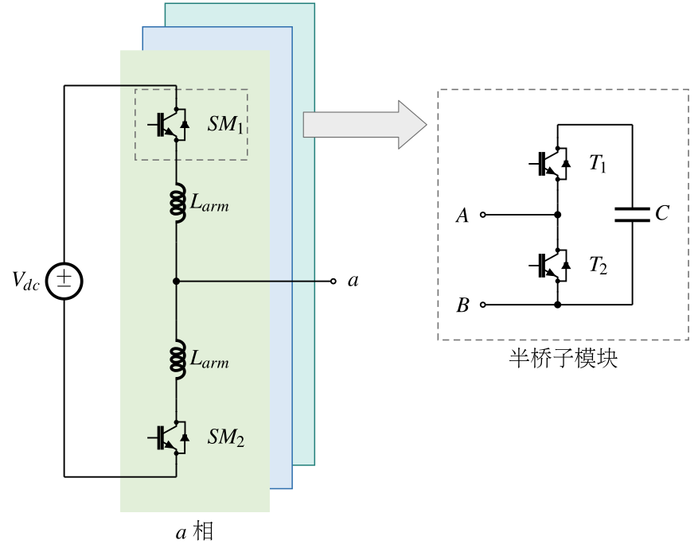

### 2、方框（控制部分）

1、**插入 → 标注 → 画方框**，拖出矩形。右侧可改文字（可写 LaTeX，如 `$f_r$ calculation`）、填充（白底、无、调色板颜色）、边框（实线、虚线、点线）、颜色和字号，以及左下角、右上角坐标。

2、方框之间的信号线用“画箭头”，样式选细箭头，颜色选黑色。

3、校验：方框不能压在元件上，导线不能穿过方框，方框之间不能重叠，文字要放得下（四周各留 0.06 cm），细箭头要在方框边上结束。

4、完整示例：`examples/control_blocks/llc_cells_dsp.json`（多模块 LLC 加 DSP 控制）。

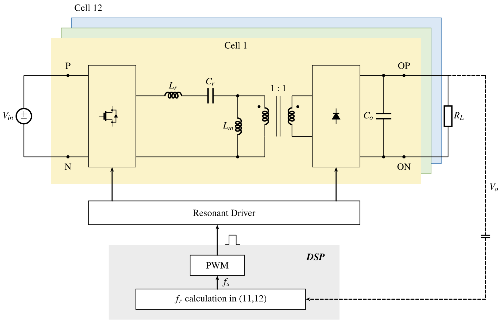

### 3、箭头

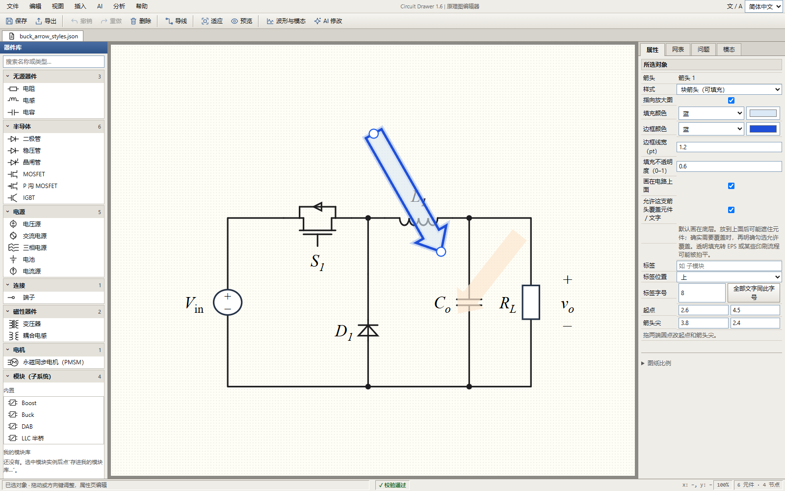

1、选择 **插入 → 标注 → 画箭头**，从起点拖到箭头尖。样式可选块箭头、细箭头 / 弯弧 / 折线或波浪指示箭头。新箭头沿用上次样式，首次使用为块箭头。

1a、选择 **插入 → 标注 → 画信号箭头** 可直接绘制细线。依次单击起点和拐点，再次点击终点或按 Enter 完成，Shift 约束水平或竖直，Esc 取消。也可按住鼠标直接拖出一条直线。

1b、绘制或拖动箭头端点、折点时，接近水平、竖直，或与已有箭头／导线线段平行、垂直的位置，会显示文字辅助线并吸附。按住 Alt 暂停辅助吸附。属性栏的 **拐角** 可选 **直角／圆角**，新箭头记住上次选择。圆角会随短线段缩小，保存、预览与导出都采用所选样式。

2、**细箭头**：选中后拖中部圆点调弯（或在“弯曲（度）”里输入 −120 到 120），“恢复直线”清除弯曲；可以添加、拖动、删除折点让长箭头绕行。可设线型（实线、虚线、点线）、箭头位置（终点、起点、两端、不画）和隔离符号（两条短横线，可调沿线位置）。

3、**波浪箭头**：可改波幅和波数（1–8），不能同时使用弯曲或折点。它是说明标注，不是仿真波形。

4、**标签**：位置可选上、下、左、右，细箭头还可以选“在线”（`inline`），文字放在路径上并断开两侧线条；沿线位置用 0 到 1 之间的数调整。

5、**块箭头外观**：填充颜色、边框颜色（含“无边框”“默认（随填充）”）、边框线宽（0.1–3 pt）、填充不透明度（0 透明、1 实心，只作用于填充）。

6、**画在电路上面**：块箭头默认在电路下面；勾选后画在电路和其他标注上方。确实要遮住元件或文字时，再勾“允许这支箭头覆盖元件／文字”。两项各管一件事：一项管谁在上面，一项记录遮挡是有意的。PDF 保留透明度；转 EPS 或部分印刷流程会拍平透明度，请再检查一次。

7、**放大图**：块箭头的起点在区域外、箭头指进区域时，那块区域被当作放大图，不能有导线从外面穿进去，否则报“放大图被连到了主电路上”。区域只是普通底色时，取消“指向放大图”。

示例：`examples/arrows/paper_arrows.json`、`examples/regions/buck_arrow_styles.json`。

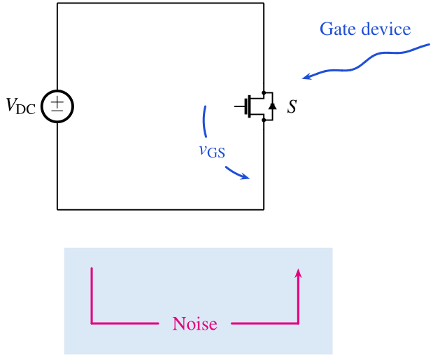

### 4、图层

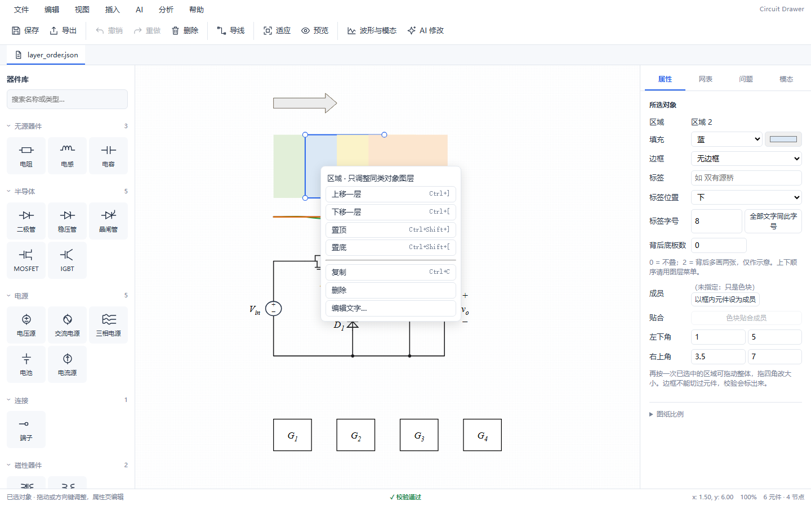

1、右键区域、方框或箭头，选“上移一层”“下移一层”“置顶”“置底”；或选中区域、方框、功能标志或箭头后用 **编辑 → 同类对象图层**；快捷键 `Ctrl+]` 上移、`Ctrl+[` 下移，加 Shift 置顶、置底。

2、只在同类对象之间调整顺序，不同大类之间的固定层次是：区域 → 普通块箭头 → 方框 → 导线 → 元件 → 文字和独立标记 → 功能标志 → 细箭头、波浪箭头；勾选“画在电路上面”的块箭头在最上层。

3、“置顶”不会自动把普通块箭头变成前景箭头。操作可撤销，保存后保留。示例：`examples/regions/layer_order.json`。

### 5、阶跃和脉冲标记

1、**源旁波形**：选中电压源或电流源，在属性页“源旁波形”里选上升阶跃、下降阶跃或脉冲，可改波形位置（标签对侧、左、右、上、下）和大小（0.5–2）。电源本身保留极性或电流方向。

2、**独立标记**：**插入 → 标注 → 阶跃 / 脉冲标记** 放一个没有电气引脚的论文符号，可拖动、改波形、改色、改大小、删除和撤销。

3、这些只是图形。实际激励的初值、终值和时间在 **仿真 → SPICE 仿真…** 里填写，改图不会自动改仿真参数，反之亦然。示例：`examples/source_waves.json`。

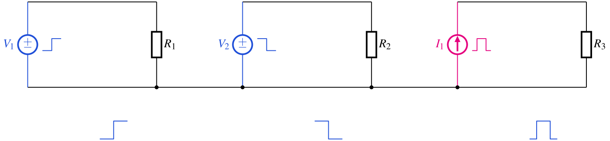

### 6、黑白打印

**视图 → 色块灰度**（命令行 `--mono`）把色块和箭头的颜色换成互相区分的灰度。器件颜色在黑白出图时印成黑色。

### 7、自由文字、功能标志和端子

1、选择 **插入 → 标注 → 加文字**，点击放置位置，输入 `$i_x$`、`$v_{mv,dc}$`、`O'` 或 `$\vdots$` 等文字。选中后可改内容、字号、颜色和位置，支持撤销与保存重开。

2、选择 **插入 → 标注 → 画功能标志**，在已有方框内拖出标志范围，在属性栏“图标”里选 AC/DC、DC/DC、DC/AC、MOSFET、IGBT 或二极管。标志保存为 `glyphs`，可单独移动、缩放、复制和删除。

3、选中端子，勾选“不画圆圈（接在方框边上）”，保存为 `opts.bare`。

4、区域的边框色可选 `black` 等墨色。前层 `fill: none` 时，背后底板默认白色，已有图纸也采用此默认值。`stack.fills` 可逐层指定颜色。

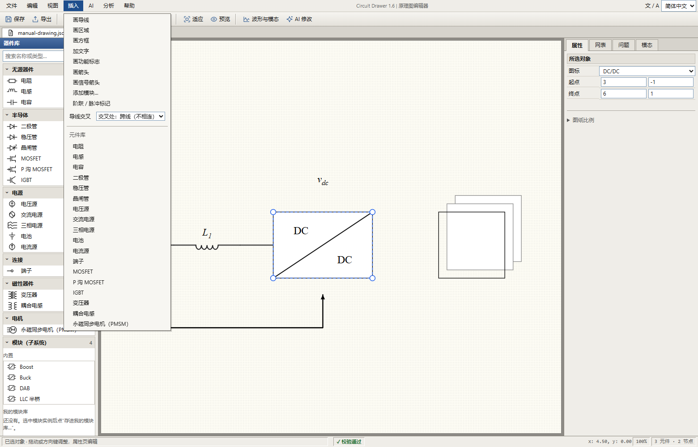

示例可打开 [drawing_marks.json](../examples/editor/drawing_marks.json)。

---

## 十三、器件与文字着色

论文里常把一个器件和与它有关的电流、电压标成品红或蓝色。

1、**编辑器**：选中元件或自由文字，在属性页“颜色”里选，或用取色器自定义 `#rrggbb`；选“黑（默认）”恢复。

2、**效果**：元件着色时，符号连同它的标签和电流箭头一起变色；文字着色时，文字和它的电流箭头一起变色。导线和节点始终是黑色。

3、**可用颜色**：`magenta`（品红）、`blue`、`red`、`green`、`orange`、`purple`、`teal`、`gray`、`black`，或 `#rrggbb`；中文“品红”“洋红”“蓝”“红”等也能读入。这是印在白底上的深色，和色块的浅色调色板是两套。

4、**与其他功能的关系**：`--mono` 黑白出图时一律印成黑色；模态图里元件按导通 / 关断着色，忽略元件颜色，文字颜色保留。

5、**JSON**：元件写 `"opts": {"color": "magenta"}`，文字写 `"color": "blue"`。

---

## 十四、模块

SST 示例提供两级串联输入／并联输出图，以及包含 SM 和谐振 IDC 的单级图。双击方框可查看真实器件，SM 竖向串联使用侧边端口。随附 PDF／PNG、同源模块放大图和独立 DAB 单元启动示例，整机仿真需要补充功率级数值与控制参数。外部电容、电源和负载可直接拖动，移动量相对端口保存，展开和折叠分别计算位置。属性栏可微调水平、竖直偏移和标签，支持方向键、撤销、重做及保存重开。[打开 SST 示例说明](../examples/sst/README.md#简体中文)

模块把重复的变换器单元定义一次、放置多份。所有实例共享一份定义，单个实例的参数差异单独记录。折叠只改画面，仿真始终展开全部真实器件。

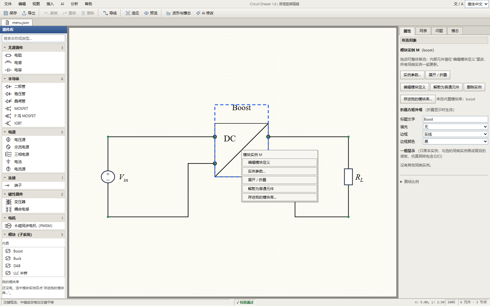

### 1、模块库

左侧器件库最下面的“模块（子系统）”分组有三类：

1、**内置**：共 13 个。包括 Buck、Boost、DAB、LLC 半桥，以及 MOSFET／IGBT 半桥、MOSFET 全桥、NPC 桥臂、LLC 谐振腔、二极管全桥／中心抽头整流、半桥／全桥子模块。鼠标停留时可看端口说明；例如半桥为 P／N／O，NPC 为 P／M／N／O，中心抽头整流的 C 与 ON 共网。

2、**我的模块库**：自己存的模块，所有电路文件都能用。文件放在 `~/.circuit_drawer/templates/modules/`（设置了 `CIRCUIT_DRAWER_TEMPLATES` 时为其下的 `modules` 文件夹），一个模块一个 JSON。右键条目可以删除。

3、**本文件**：当前文件里已有的模块定义。

**插入 → 添加模块…** 列出同样三类。

4、运行 `circuit-drawer blocks` 查看库名、端口及含标签的 1:1 绘图尺寸。开关模型和驱动时序需要明确设置；新谐振腔与子模块电容参数为演示值。打开 [两个 LLC 积木的 IPOS 示例](../examples/modules/llc_ipos_blocks.json)，可切换折叠、展开和部分折叠；顶层文件只引用库模块与端口连接。

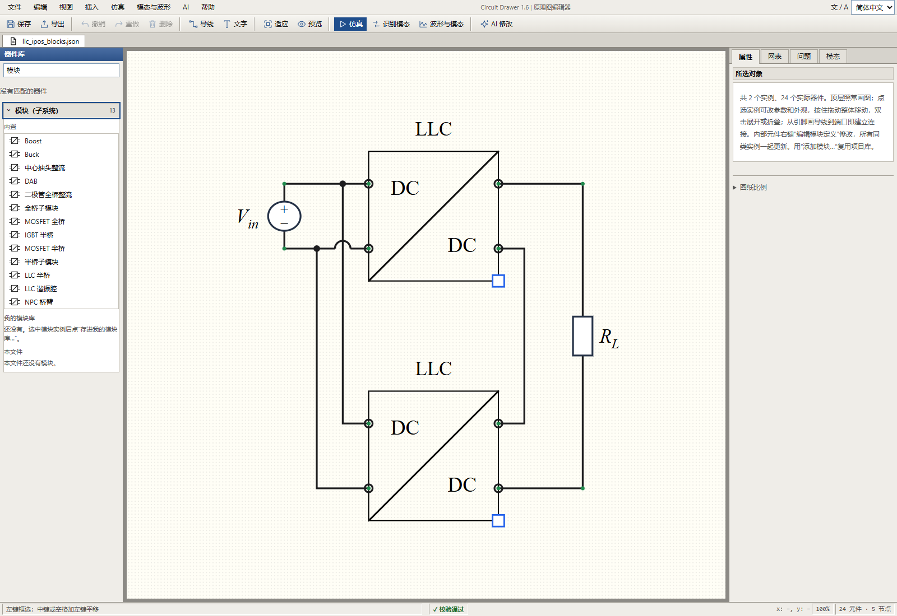

1、左键拖动框选模块，或 Shift＋左键多选至少三个实例，再右键“省略中间实例”。按画面主要排列方向保留首尾，中间显示 ⋮ 或 ⋯；普通散件须先封装成模块，混入选择的普通元件、导线或图形须取消。

2、右键首尾实例或三个点可“恢复全部实例”，省略和恢复均可一步撤销。隐藏实例仍参与完整检查与仿真，外接抽头保持原实例端子。示例：[四子模块桥臂](../examples/modules/mmc_arm_ellipsis.json)。

3、模块 JSON 窗口和过密提示的“尺寸预算”包括展开图的标签与色块，并估算单／双栏横排数量。实际布线仍须校验；栏宽没有限定页面高度，竖排无固定数量上限。

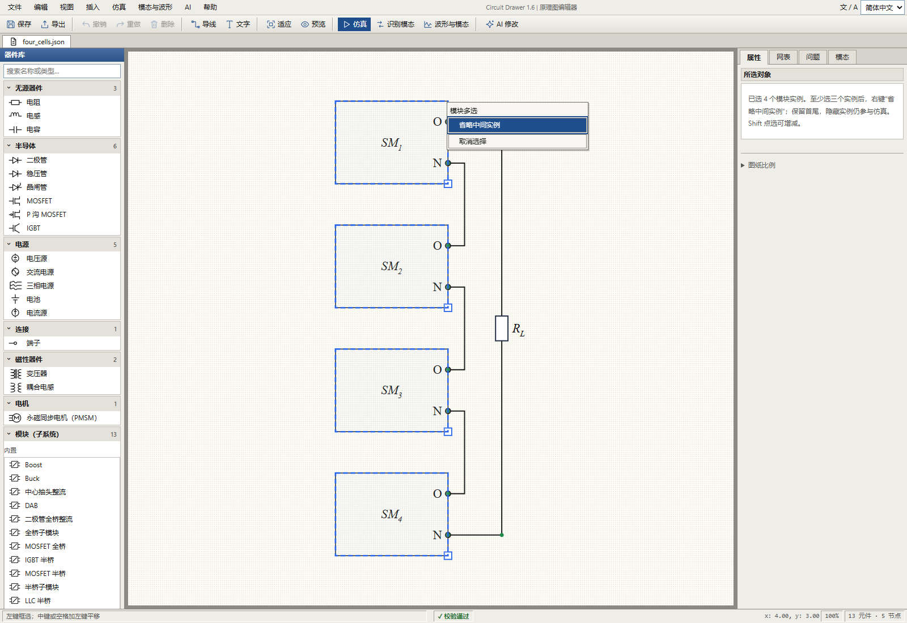

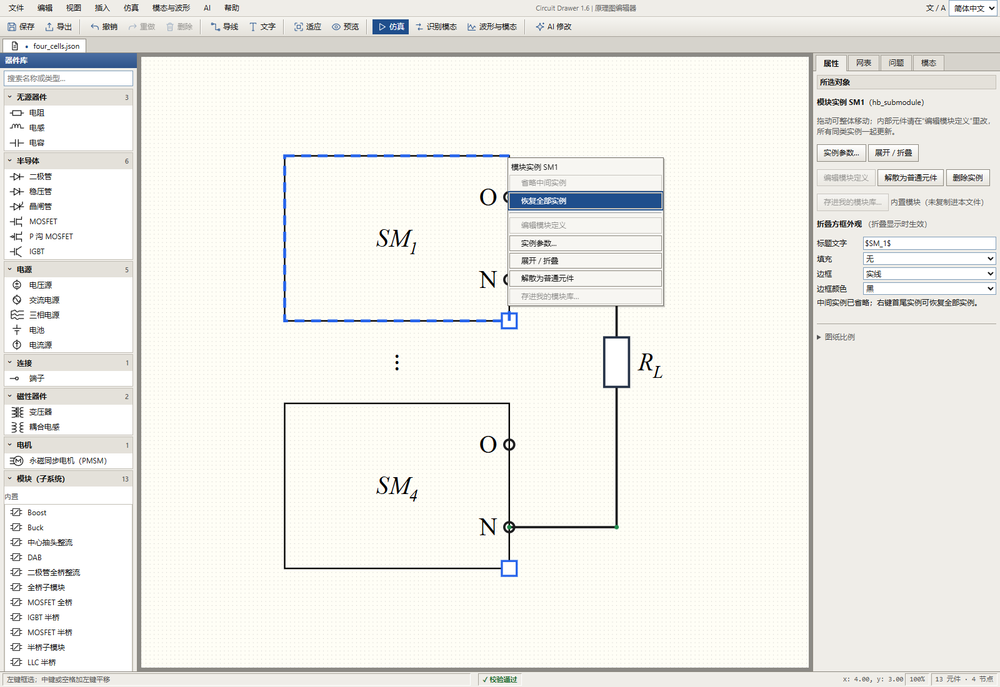

### 2、放置和连接

1、从模块库拖到画布后，松手即放在落点；单击模块条目时，先显示虚线预览框，再在画布上单击放置。

2、放下后直接单击端口开始画线，接近另一端口时点击绿色小三角完成连接。也可用工具栏“导线”逐点画线。支持先画线、先放模块和之后补放元件。

3、拖动模块时，本体、标签、端点和相连导线同步显示，按 Esc 可取消本次拖动；松手后检查连接。画布上的普通导线仍可拖动折点、移动线段、拆分或删除。模块移动、展开／折叠、调整方框大小和标题时，相连线端跟随端口，其他折点尽量保持。若移动使端口引线与相邻导线相碰，会尝试将附近拐点调整到空隙中，保留已有分支节点和跨线位置。

4、“新增引脚待登记”表示引脚尚未登记到已确认的网表。核对接法后点“按当前连接记录新引脚”，保存这次连接用于后续短路与断路检查。已有接线改变时，核对后用“以当前连接更新网表”。跨线标记表示绝缘。

5、从库里放入模块会把定义复制到当前文件。同一库模块的多份实例复用定义，文件包含实际电路，可在另一台电脑打开。

6、旧文件中的 `modules.links` 命名连接可直接在画布上选中、拖动走向或删除。连接属性提供“恢复自动走线”，保存文件时保留名称引用。新接线使用画布上的导线工具。完整示例见[模块普通接线](../examples/editor/module_wiring.json)。

### 3、展开、折叠和外观

1、**双击**或右键选“展开 / 折叠”，在“展开 → 折叠成小方框 → 部分折叠（模块支持时）”之间切换。**视图 → 模块显示** 子菜单可以选择实例、展开或折叠全部实例。

1a、展开时按符号、标签和导线的实际边界自适应留空，必要时推开相邻图形、拉长外连导线，保留定义、参数与完整电气连接。属性栏、“全部展开”和双击共用这一操作，可一步撤销，保存后才写入文件。折叠后保留空白；撤销可恢复展开前的位置。无法安全留空时保留原图并说明原因。若只超出固定栏宽，导出前调整整体缩放或恢复自动图纸比例。

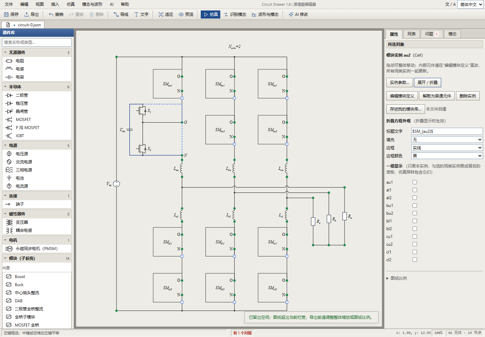

2、**部分折叠**：目前只有 LLC 半桥支持，开关半桥和整流桥各收成一个带器件标志的小框，谐振槽和变压器照常画出。

3、**方框尺寸**：选中折叠框后拖右下角的小方块，松手对齐网格并校验；无法布线时提示原因并保留原尺寸。也可以用 **视图 → 模块显示 → 方框尺寸… / 恢复默认方框尺寸**。

4、**框内标志**：IEC 60617 变流器符号 `dcdc`、`acdc`、`dcac`，器件标志 `mosfet`、`igbt`、`diode`，或只写名字 `text`。

5、选中实例后，属性页可设折叠标题、填充、边框样式和颜色。清空“标题文字”可隐藏标题，直接拖动标题可独立调整位置。标题偏移随模块一起移动，支持撤销、保存和重新打开。

6、**一组显示**：勾选同类实例后，只画本实例，其余画成背后错开的底板；仿真照常包含它们。

7、全部展开、全部折叠、部分折叠导出的 SPICE 网表逐行相同。

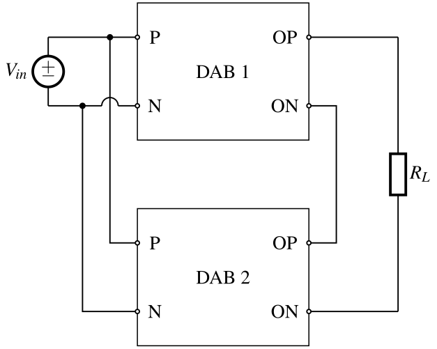

### 4、编辑共用定义和实例参数

1、选中模块按 `Enter`，或右键“编辑模块定义”，进入内部画布。修改元件、导线和标签后，点“设置端口并保存…”，在图中点要引出的节点，填写端口名和左右位置，再点“保存定义并同步所有实例”。最后点工具栏“保存”写入文件；“取消编辑定义”放弃本次定义修改。

2、无需预先放端子元件；已有普通端子时会复用它。一个电位上的两个节点设成不同端口后仍然互通。新增端口最初未接线，已有实例正在使用的端口不能直接删除或改名。

3、窗口上方可修改模块定义名：以英文字母开头，使用字母、数字、下划线或短横线。保存后引用它的实例同步更新，连接和各实例参数差异保留。

4、右键“实例参数…”只改当前实例；取消勾选恢复共用默认值。只有在定义里允许单独修改的参数才可覆盖。

5、“解散为普通元件”将内部元件放回当前画布。新放入的元件可在解散后继续补齐仿真参数。运行仿真或导出仿真模型前，在仿真窗口填写所需数值。

### 5、把现有电路存成模块

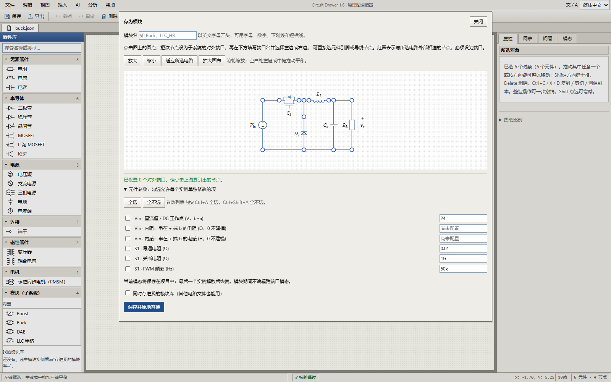

1、框选或 Shift 点选要封装的元件，右键选“存为模块…”（或 **文件 → 存为模块…**）。

2、填写模块名，例如 `Buck`、`LLC_HB`。

3、对话框中的图与原图一致。红圈是仍与外部电路相连的节点：点击它标成端口，填写端口名（如 P、N、OP、ON），选择左边或右边；拖动端口行或点上下箭头排序。漏标外连节点时不能保存。

4、“元件参数”列出内部元件支持的仿真参数，勾选允许每个实例单独修改的项。没有配置的物理值不会被猜测。

5、需要在其他文件中复用时，勾选“同时存进我的模块库（其他电路文件也能用）”。

6、点“保存并原地替换”。原位置变成一个实例，原编号和测量通道保持不变；封装前后的 SPICE 网表逐行一致，出现任何电气变化都会拒绝应用。

7、封装和解散会同步模态里的器件编号，当前模态继续保留并可编辑。旧文件的暂存模态只在最后一个实例解散且没有当前模态时恢复。

### 6、模块库的版本、解散和限制

1、选中实例后点“存进我的模块库…”，同名时先确认再覆盖。

2、库里的模块改了，已用过它的文件不会被悄悄改动。属性页提示“模块库里有新版本”时，点“更新本文件的定义”（或右键“从库更新”）才替换，所有同类实例一起更新；本文件的副本也改过时会先提醒。端口名变了的新版本不能直接更新。

3、右键“解散为普通元件”把这一份展开成普通元件，其他实例和项目库保留。

4、模态可跨模块显示，内部器件用 M/S1、M/T:p 等编号引用。仍只支持一层模块；内部元件的位置在定义里修改，整个实例可以直接拖动。

5、示例：`examples/modules/library_boost_buck.json`（内置 Boost 与 Buck 级联）、`examples/modules/boost_parallel_authored.json`（两路 Boost 并联）、`examples/modules/llc_ipos.json`、`examples/modules/dab_ipos.json`、`examples/modules/llc_partial.json`。


1、**模块模态**：打开 [双 Boost 模态示例](../examples/auto_modes/module_boost_bound.json)，在右侧“模态”页选择工况。展开时显示内部器件与导线；折叠时方框表示内部有器件参与该模态，外部导线按实际回路高亮。一组显示只汇总外框，代表实例内的器件仍显示它自己的状态。

2、先展开实例，再点“在图上改模态”，点内部开关或二极管切换状态，点箭头反转该回路。部分折叠图按方框端口网络对应隐藏器件；不能唯一对应时需展开。画布、编译预览与导出使用同一份结果，来源过期时重新识别。拖动期间显示实时接线，位置确认后恢复模态高亮。

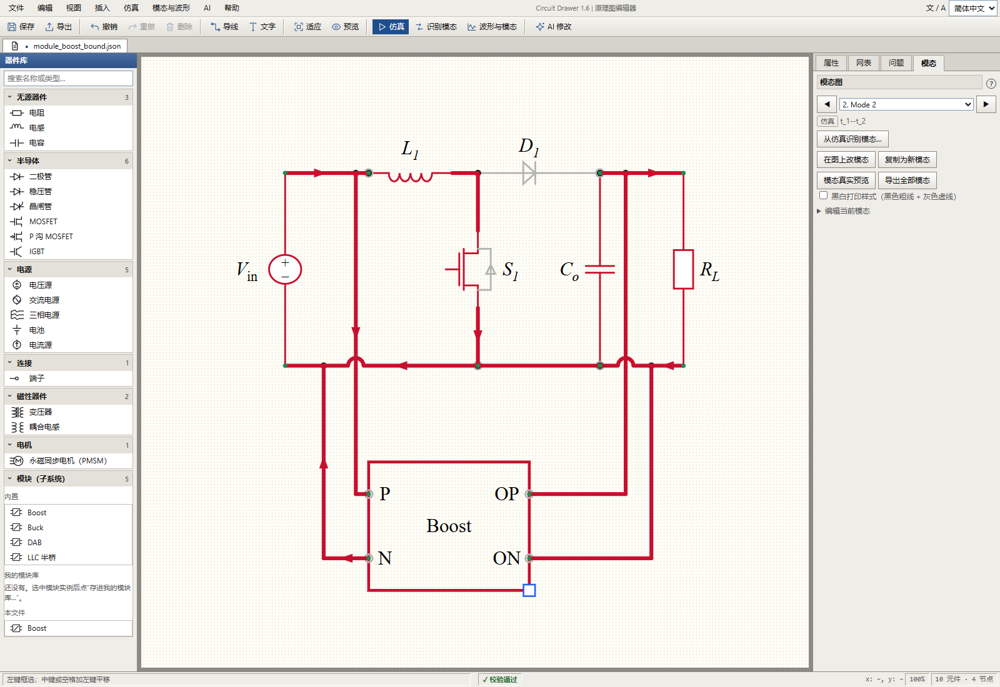

### 7、从空子系统开始

1、右键画布空白处，选“新建空子系统”并放置方框。选中后按 `Enter` 进入内部画布。

2、从器件库添加元件并画导线。需要时按问题栏提示“按当前连接记录新引脚”，再用“设置端口并保存…”登记对外端口和参数。

3、回到上层后用普通导线接入电路。空子系统可保存并重开；在补齐实际电路前，它作为草稿保留，不能导出仿真。当前只支持一层子系统。

---

## 十五、模态图

同一张母图，每个工作模态出一张：导通的元件和它们之间的导线标红加粗，其余变灰，箭头标出电流方向。只换样式，不动坐标，出图前照常校验。

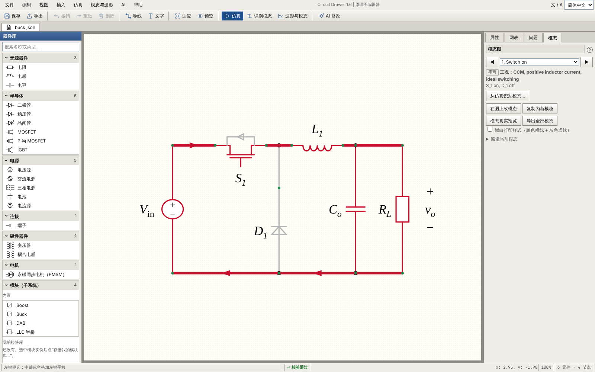

### 1、在编辑器里

1、打开右栏“模态”页，用下拉框或 ◀ ▶（键盘 `[` `]`）切换模态，画布上直接显示高亮和箭头。下拉框第一项“（不显示模态，正常编辑）”回到普通编辑。

2、**在图上改模态**：打开后点开关在“关断 → 沟道导通 → 体二极管续流 → 关断”之间切换，点二极管切换导通 / 关断。新导通的器件不在任何回路里时，工具补上经过它的最短闭合回路（沿它能导通的方向，并联支路自动合并）；不再导通的器件所在回路会去掉。点箭头让那个回路整体反向。改模态时暂停拖动改图。

3、**复制为新模态**：复制当前模态插在后面，只改变化的器件。展开“编辑当前模态”还有“新增空模态”“删除当前模态”，并可直接改 JSON（`on`、`loops`、`caption`、`condition`），点“应用”。

4、**模态真实预览**看 LaTeX 结果；**导出全部模态** 一次导出每个模态和一页总览。勾选“黑白打印样式（黑色粗线 + 灰色虚线）”得到黑白版。

5、模态引用的是元件编号，所以改母图（挪位置、改走线）后所有模态自动跟着变。删了元件或改了接法导致模态失效时，模态页列出“模态 N 已失效”和原因，点一下跳过去修。

6、“模态图”标题旁的 **?** 收着模态的组成、检查范围、在图上改的规则和 JSON 写法，点开查看。工况前的小标签表示来源：“仿真”来自“从仿真识别模态”，“手写”是手写或在图上改的。工具只检查回路连接和器件导通方向，不检查偏置和工况是否允许这个模态。

### 2、命令行

```bash
circuit-drawer modes llc -o figs                 # 全桥 LLC（fs < fr）6 个模态加一页总览
circuit-drawer modes llc fs=above                # fs > fr；fs=resonance 为谐振点
circuit-drawer modes dab --mono                  # 黑白：黑色粗线加灰色虚线
circuit-drawer modes flyback 二极管在下 --only 1,2 -f pdf
circuit-drawer modes llc --list                  # 只列出模态定义
circuit-drawer modes fig.json --modes my_modes.json   # 自己的表、自己的模态
```

1、每个模态写到 `<名字>_mode1.pdf`、`_mode2.pdf`……；`<名字>_modes` 把所有模态排成一页，每张图下有 (a)、(b)… 和模态说明，单栏图两张一行，正好是双栏宽度。`--no-sheet` 不出总览。

2、`--color` 改高亮色（默认 `#c8102e`，也可写 `blue!70!black` 这类 xcolor 名）；`--off dashed` 把空闲导线画成虚线；`--arrows N` 控制每个回路的自动箭头数（默认 3，0 为不画）。

3、亮的部分线宽是普通线的 2 倍，灰色部分是 35% 黑，彩色图印成黑白也分得清。元件标签和 vo、+、− 这些文字保持黑色。

### 3、内置序列

| 模板 | 模态 |
| --- | --- |
| `llc_fullbridge` | `fs=below`（默认，6 个）、`fs=resonance`（4 个）、`fs=above`（6 个），中心抽头和全桥整流两种副边都有 |
| `dab` | 单移相、原边超前、电流连续，半个周期 4 个 |
| `flyback` | S 导通励磁；S 关断经 D 放能；DCM 空闲段（只在 DCM 出现） |
| `buck`、`boost` | 各 2 个理想 CCM 模态 |

开关承受反向电流时，MOSFET 画成沟道导通（同步整流），IGBT 画成反并联二极管导通。内置序列是常见工况的教科书画法，不一定和你的论文一致。

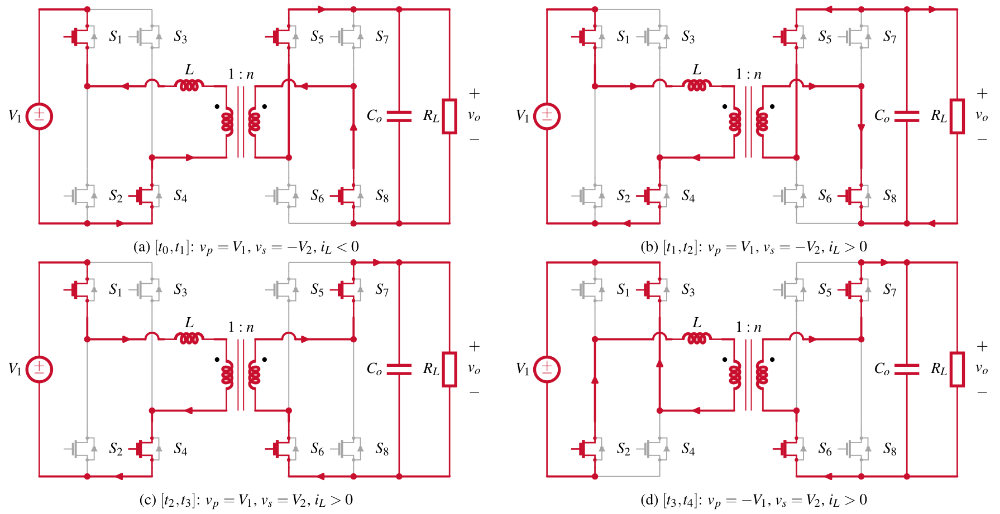

### 4、自己写模态

坐标表的 `modes` 列表，每个模态写导通器件和回路：

```json
{"name": "Mode 1", "caption": "$[t_0, t_1]$: $S_1$, $S_4$ on",
 "on": ["S1", "S4", "D1"],
 "loops": [["Vin", "S1", "Cr", "Lr", "T:p|Lm", "S4"],
           ["T:s1", "D1", "Co|RL"]]}
```

1、回路按电流方向依次写支路，最后一个接回第一个。工具检查相邻支路确实共用一个节点、回路闭合，然后沿真实走线找出两个引脚之间的那段导线来高亮。

2、变压器绕组写 `T:p`、`T:s`（中心抽头写 `T:s1`、`T:s2`）；并联支路写 `Co|RL`；开关靠体二极管导通写 `S2:diode`。

3、只有两个并联元件组成的回路，方向取第一个元件从第一个引脚到第二个引脚。例如 `["RL", "Co"]` 是 Co 放电给 RL。

4、只写 `on` 不写 `loops` 也可以：工具把落在闭合回路上的器件都标亮，但这只是拓扑上的闭合路径，不画箭头，并给出提示让你确认。

5、自动箭头不满意时，写 `"arrows": [{"at": [1.6, 2.5], "dir": "right"}]` 手动指定。

6、`condition` 写适用工况，如 `"$f_s < f_r$"`，在 `--list` 和编辑器里显示。

### 5、检查范围

工具检查回路连接（名字存在、相邻支路共用节点、回路闭合、开关导通方式一致），并提示二极管或 IGBT 沟道被反向使用。不检查器件偏置、电流大小，以及这个模态在你的工况下是否真的出现。

---

### 5、从仿真识别模态

1、先在“仿真 → SPICE 仿真…”填写器件数值、PWM 和瞬态参数，再打开右侧“模态”页，点击“从仿真识别模态…”。当前支持普通电路和模块电路的定频开环理想 MOS 开关、正向二极管、RLC 与理想变压器，示例包含 Buck／Boost 的 CCM、DCM，以及 LLC 三种频率工况和 DAB。移相软启动须在分析窗口之前结束。

2、点击“运行仿真并识别”。程序检查末尾八个完整周期中同相位的电感、绕组及内置励磁电流、电容电压、状态顺序和分界。出现漂移提示时，延长仿真或核对初始条件后重新运行。电流阈值取填写的绝对下限与相对峰值阈值中的较大值。电感和各绕组可按正、负、近零区分状态。绕组 p 为原边 p1→p2，s 为整段副边 s1→s2，中心抽头的 s1、s2 分别为 s1→sct、sct→s2。

3、每项显示时间区间、周期占比、开关状态、支路电流及已有模态对照。点击“预览导通路径”查看真实出图。短暂换流与阈值附近的区间完整列出，标为“短区间”的候选可自行勾选。DCM 的“全部关断”候选仍可显示电容向负载供电的回路。换流时若提示闭合回路未覆盖仍有电流的支路，请结合实测电流核对模型中的数值电容、输出电容或吸收支路。若电感或绕组电流与图中回路方向相反，候选会隐藏方向箭头并提示冲突支路；可展开实测电流核对，再手动调整模态。

4、勾选需要的候选，改名称和标题，选择“追加”或“替换现有模态”，再点“确认写入选中模态”。名称须唯一。勾选“同时写入本次波形及区间绑定”后，会使用同一次仿真的 CSV、完整周期分界与选中模态的名称；可先点“预览波形与分界”。未选中的候选保留对应空区间，不自动并入相邻模态。模态和波形一起写入、一起撤销，点“保存”后才写文件。已有波形时默认不替换；主动勾选会替换原波形设置和标注。不替换波形时，有既有绑定的模态只能追加。

4a、改变电路、器件模型或仿真参数后，顶部持续提示已有结果过期，模态来源也标为“仿真（已过期）”；旧结果保留供对照。点“重新识别…”会带回原识别设置，重新运行并核对后再采用。撤销参数改动会恢复对应来源状态。波形区间全部绑定后可导出组合图，过期波形或已绑定的过期仿真模态须先更新。

5、示例位于 `examples/auto_modes`。其中四个 Buck／Boost 示例均运行 80 ms，DCM 示例给电容明确的初始电压，Buck 为 14.8 V，Boost 为 67 V。命令行 `circuit-drawer modes-from-sim examples/auto_modes/buck_ccm.json -o output/modes` 在独立的 run 子目录中输出候选 JSON、原用户探针 CSV、隐藏探针窗口、网表和仿真日志，供查阅。

6、`trial/cases` 中的 `llc_below.json`、`llc_resonance.json`、`llc_above.json` 与 `dab.json` 保留原有二十个手写模态，并提供 25 ms、最大积分步长 100 ns 的工况。LLC 分别为 80／100／130 kHz，谐振频率 100 kHz，负载 12 Ω。DAB 为 50 kHz、30° 移相、7.2 Ω 负载，各开关含 47 Ω／2.2 nF 串联 RC。四例均为 48 V 输入、200 ns 死区和 1 nF 数值节点电容。候选包含完整周期、过零及短暂换流区间，可与每个手写模态的导通集合和方向对照。

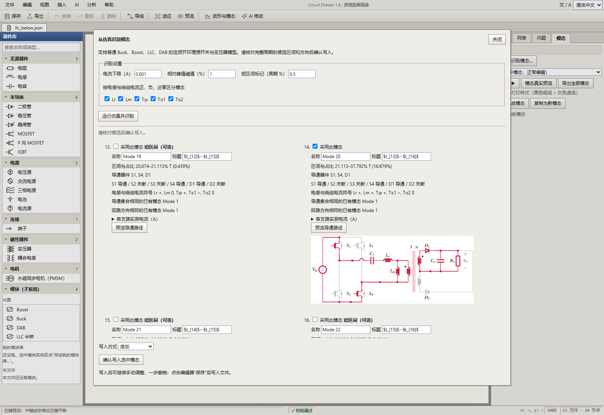

7、分界密集时，图上以 t0–t8 这样的编号范围显示相邻标签，全部分界线和区间仍保留。可打开 `examples/auto_modes/buck_bound.json` 查看已确认并绑定的示例。

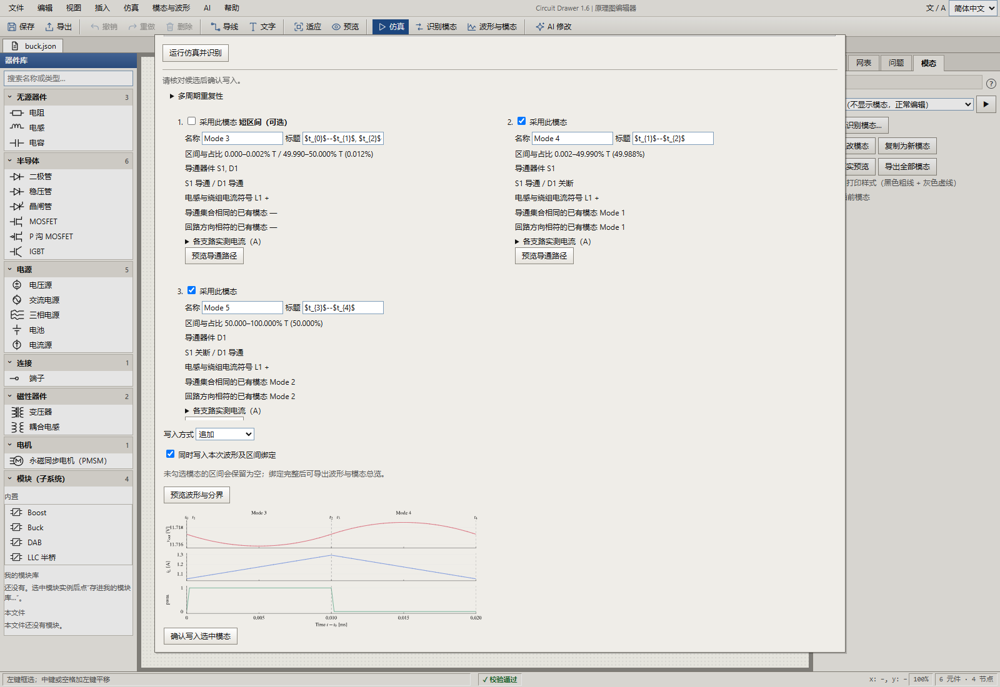

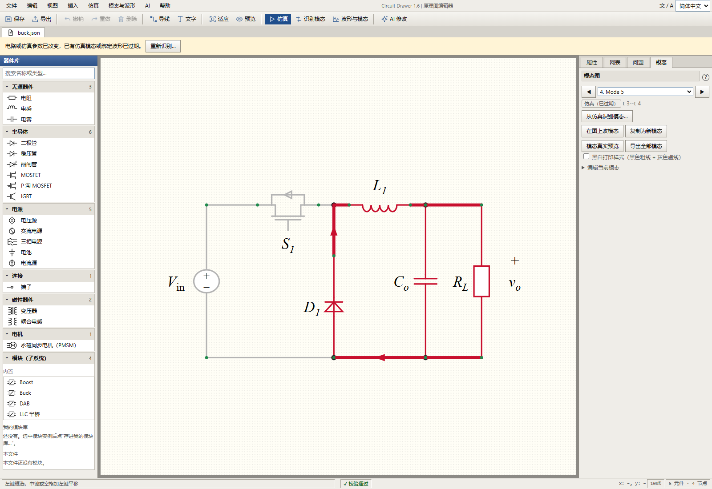

## 十六、波形与模态对应

把仿真或实测波形与模态图对齐：波形上标 t₀、t₁…，每个区间对应一个模态。

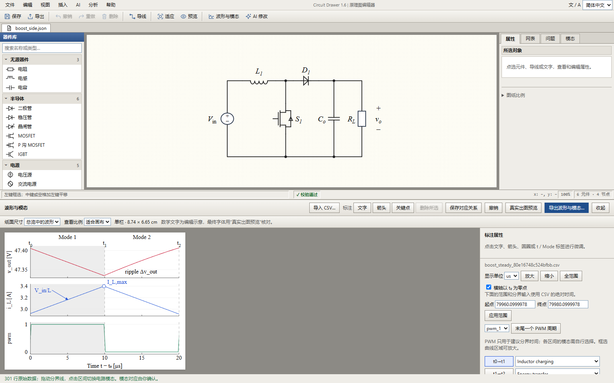

### 1、打开示例

```bash
circuit-drawer edit examples/waveforms/boost.json
```

点工具栏“波形与模态”（或 **模态与波形 → 波形与模态…**）。示例已经绑定两个区间，不需要安装仿真器。点 `t0→t1`，上方母图切换到电感充电模态；点 `t1→t2`，切换到向输出传递能量的模态。

### 2、导入 CSV

1、点“导入 CSV…”，选择本机文件或填写路径，并指定时间列和单位。

2、格式要求：第一行是列名，其后为数值；UTF-8（可带 BOM），逗号、分号或制表符分隔；最多 64 MiB、100 万行、32 列；时间严格递增。缺列、非数值、NaN、无穷大和重复时间会报错。

3、在“通道、标签和单位”里选择 1–6 条要显示的曲线，设置标签和单位。标签建议写 `i_L`、`v_out` 这类英文数学记号，下标自动排版。

4、导入的 CSV 会复制到 JSON 旁边的 `waveforms-data/` 文件夹，文件名带内容校验码。分享时把 JSON 和这个文件夹一起复制。JSON 里只保存路径、通道和区间，不保存采样值。

4a、在“纵轴分组”把同单位通道设为相同组号并应用，可共用纵轴；图例按栏宽换行，真实幅值与 CSV 不变。单位不同会提示分开显示，不自动换算。选“独立纵轴”恢复分行，可撤销和保存。

### 3、选择时间范围和分界

1、输入起止时间并点“应用范围”，或在曲线上框选放大，或用“放大 / 缩小 / 全范围”。显示单位可选 s、ms、us；默认横轴以 t₀ 为零点，范围和分界输入始终使用 CSV 的绝对时间。

2、选择 PWM 通道后点“末尾一个 PWM 周期”，程序按最后两个上升沿和中间的下降沿建议分界时间。PWM 只帮助选区，不识别模态。

3、拖动分界线，或展开“精确设置分界时间”填写数值；“拆分所选区间”增加边界。分界线不能重合或交叉。

4、为每个区间在下拉框里选一个模态。点区间时母图显示对应的电流路径。点“保存对应关系”写入 JSON。

### 4、标注

1、面板上方“标注”有四个按钮：“文字”点一下放文字；“箭头”从箭尾按住拖到要指的点；“关键点”在峰值、过零等位置放小空心圆，可带文字。

2、文字只能写英文或 `$数学$`（如 `$i_L$ peak`、`$I_{L,\max}$`），不能写中文。

3、点选标注后可拖动整体、拖箭头两端或单独拖文字；双击改文字；“删除所选”或 `Delete` 删除；“撤销”恢复。t₀、t₁… 和 `Mode k` 标签也能拖开，分界线不动。

4、“标注属性”可修改颜色、字号（5–20 pt）、线宽（0.1–2 pt）、圆圈半径（0.02–0.3 cm）和文字偏移，点“应用属性”生效。选中标注后方向键每次移动 0.01 cm，Shift 加方向键 0.1 cm。

5、面板按纸面比例显示；“纸面尺寸”可在“总览中的波形”和“独立波形图”之间切换，“查看比例”只改变查看倍率。数学文字的最终效果用“真实出图预览”核对。

6、点击“AI 标注…”，输入“在 i_L 峰值标 $I_{L,\max}$，在第一区间上升段画箭头标 $V_{in}/L$”。程序从当前 CSV、所选通道和时间区间计算候选点，使用当前 AI 设置生成标注。核对预览后点“采用标注”，新标注追加到已有标注，整批可撤销。点击“保存对应关系”写入文件。

7、AI 收到候选点摘要，包含区间边界、峰谷、过零点和最长连续上升／下降段的中点与斜率。每区间最多保留 8 个过零候选，标注总数最多 40 条。生成期间改变通道、区间或标注后，需要重新生成。文字使用英文或数学记号，可继续在“标注属性”中微调。

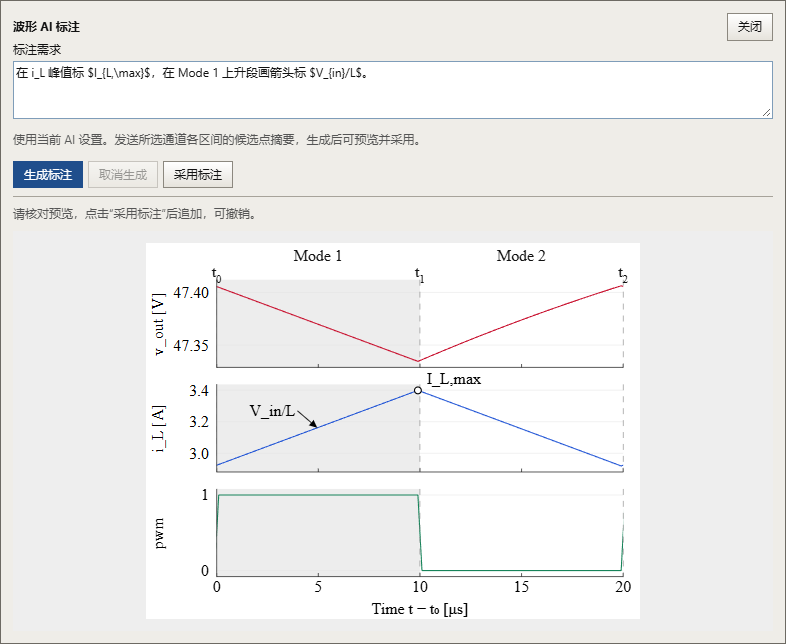

8、“区间尺寸线”按住起点拖到终点，始终保持水平，可标 `$D T_s$`。拖动端点修改区间，拖动整体保留长度，短区间的箭头移至外侧；文字、线宽、偏移、删除和撤销沿用标注操作。AI 尺寸线的起止时间必须取同一通道的真实候选点。

9、`examples/waveforms/interleaved_axes.json` 展示同轴电感电流和尺寸线；CSV 为理想解析参考，不是新增的开关仿真或实测数据。

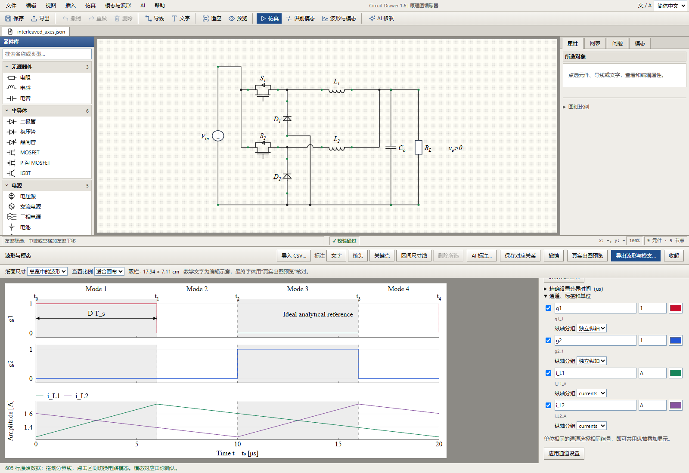

### 4a、XY／状态平面

1、点“XY / 状态平面…”，选横轴与纵轴通道；两坐标来自同一时刻，范围和分界沿用波形面板。箭头表示时间方向，起点实心、终点空心；未绑定模态的区间为灰色。可关闭箭头或模态着色，数值和单位保持原样。

2、预览不改图。点“应用到当前图”后可撤销，再点“保存对应关系”写文件。导出会多一份 `_xy` 图，也可勾选“仅导出 XY 图”；“移除 XY 图”保留时间波形和 CSV。图幅始终按当前独立图宽度，原时间标注不会画在 XY 图上。

3、`examples/waveforms/boost_state_plane.json` 引用原 Boost 仿真数据，可直接查看。此图不自动判断稳定性，不人为闭合轨迹，也不自动归一化。

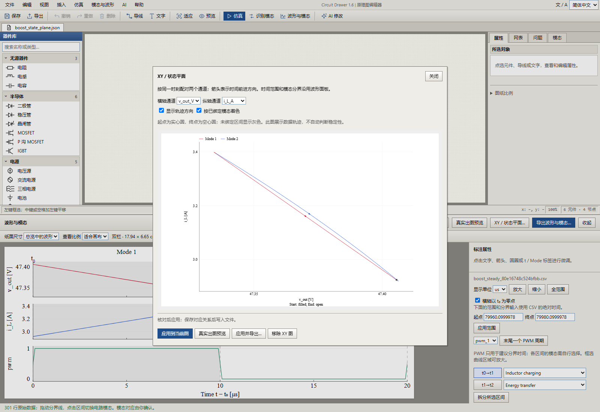

### 5、导出

1、点“导出波形与模态…”，选择输出文件夹和格式（默认只选 SVG；Word 用 SVG 或 PNG，LaTeX 用 PDF，另可勾选 TeX 源码）。

2、以 `boost` 为例，输出：

| 文件 | 内容 |
| --- | --- |
| `boost_waveforms.<格式>` | 独立波形图，含 t₀、t₁… 分界线 |
| `boost_mode1.<格式>` 等 | 每个用到的模态各一份 |
| `boost_waveform_modes.<格式>` | 波形与模态总览 |

3、“波形按模态切片”（默认勾选）在波形上按区间交替加浅灰底，并标 `Mode 1`、`Mode 2`……（编号即模态列表顺序，与 `_mode1` 等文件一致）。取消勾选只画虚线分界与 t₀、t₁…。

4、“总览排版”：竖排（默认，单栏、双栏都可）、并排（左波形右模态，只能双栏）、两列（波形在上，下面模态图每行两张）。后两种每个模态只画一次，图注列出它对应的全部区间。

5、取消“包含对应模态与总览”只输出波形。全部编译成功后才写入目标文件夹，失败时保留旧输出。

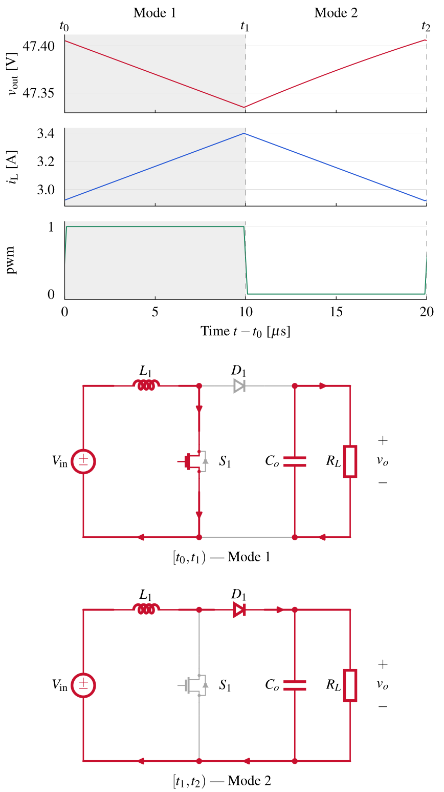

### 6、命令行

```bash
circuit-drawer waveforms examples/waveforms/boost.json -o out/boost-waveforms -f svg,pdf
circuit-drawer waveforms examples/waveforms/boost.json -o out/boost-waveforms -f png --wave-only
circuit-drawer waveforms examples/waveforms/boost_side.json -p double -o out/boost-side -f png
```

### 7、重新仿真后

1、重新导入 CSV 后，仍适用的通道和区间绑定会保留；之前用了“末尾一个 PWM 周期”时会重新计算边界。

2、只改母图标签、位置和符号尺寸后可以直接重新出图。连接、元件类别或仿真参数改变时，程序提示重新导入对应工况的数据；CSV 快照被改写也会拒绝出图。

3、显示和导出时，大文件按分桶保留首点、最小值、最大值和末点，不会滤掉峰值；原始数据不修改。

---

## 十七、SPICE 仿真

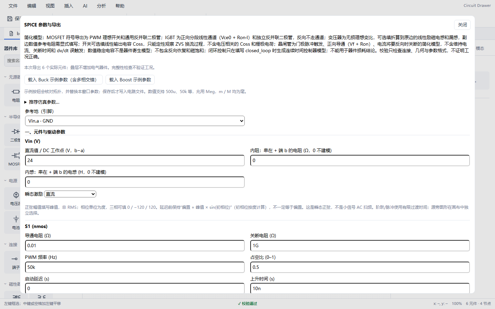

### 1、准备

1、仅生成 `.cir` 不需要 ngspice。运行仿真需要安装 ngspice（见[第二章](#二安装与启动)），并在启动编辑器之前设置好路径。

2、参数保存在当前坐标表的 `simulation` 字段里。程序不从文字标签猜数值，每个元件都要有参数。

### 2、窗口操作

点 **仿真 → SPICE 仿真…** 打开“SPICE 参数与导出”窗口：

1、**载入 Buck 示例参数（含多相交错）/ 载入 Boost 示例参数**：核对拓扑后填入一组示例参数。多相交错 Buck 每相 50 kHz、占空比 0.5，第 k 相启动延迟 k/N 个周期。只改窗口表单，点“保存参数”后才写入电路文件。

2、**推荐仿真参数…**：见本章第 6 节。

3、**参考地（引脚）**：选择一个真实引脚，它所在的网络作为 SPICE 地。

4、**一、元件与驱动参数**：每个元件一组参数，见本章第 3 节。

5、**二、瞬态设置**：输出采样间隔、结束时间、最大积分步长、数值稳定电容（每个网络到仿真地，默认 0 关闭；它不是器件寄生电容）。要求 0 < 最大积分步长 ≤ 采样间隔 < 结束时间，每个 PWM 周期至少 50 个采样点，导通和关断段至少各 10 个积分步长。仿真从 0 秒开始，使用电感、电容的初始条件，不先求直流工作点。

6、**三、测量通道（可修改 JSON）**：电压通道写正负两个引脚；电流通道写元件（D、L、scr 为 a→b，V、vac 为 b→a，igbt 为 c→e 总端口电流；变压器还要指定绕组）；驱动通道写开关，输出归一化 0/1 PWM。通道名用英文、数字和下划线，以字母开头，最多 32 个。

7、**四、闭环控制（可选）**：见[第十八章](#十八simulink-与-plecs-导出及闭环控制)。

8、**五、输出文件夹**：可浏览或填写；相对路径以当前电路文件所在文件夹为起点。

9、**保存参数** 只保存；**导出 SPICE** 只生成 `.cir`；**导出并仿真** 生成 `.cir`、`.csv`（列名带单位）和运行日志。导出前照常校验。

10、仿真成功后会直接打开波形面板并载入本次的 CSV，接着可以做[第十六章](#十六波形与模态对应)的对应。

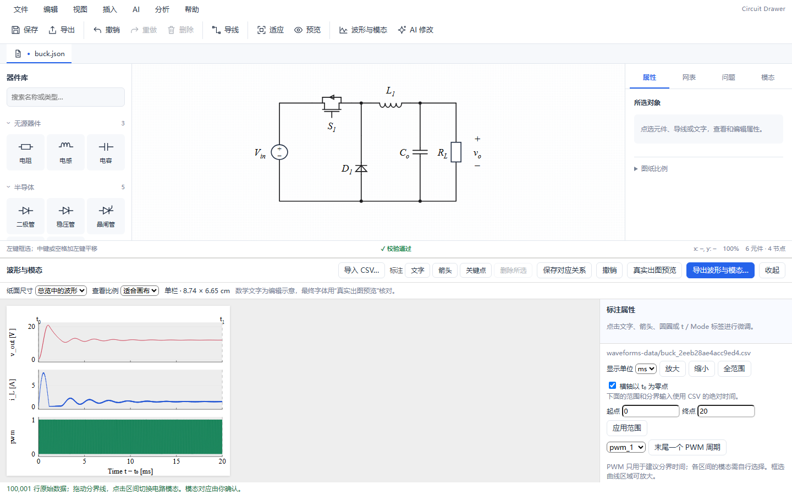

### 3、器件与参数

| 器件 | 模型 | 主要参数 |
| --- | --- | --- |
| R、L、C | 线性 | 数值；L、C 必须写初始值（L 电流 a→b，C 电压 a−b）；L 可选串联电阻 |
| V、vac | 电压源 | 直流值（b−a）；可选内阻、内感（串在 + 端 b）；瞬态激励见下节 |
| I | 电流源 | 直流值（a→b）；瞬态激励 |
| D | `generic_diode` | Is、N、Rs；稳压管另填击穿电压 Vz@Izt、测试电流 Izt、动态电阻 Zzt |
| nmos、pmos | `ideal_switch` | Ron、Roff、PWM 频率、占空比、启动延迟、上升 / 下降时间；可选跨开关 RC、附加移相与移相爬升时长、线性输出电容 Coss、体二极管参数 |
| igbt | `simplified_igbt` | Vce0、Ron、Roff 和 PWM；正向通道 c→e，反向电流由反并联二极管承担 |
| scr | `simplified_thyristor` | Vf、Ron、Roff，触发脉冲沿用 PWM 字段（`delay` 为首次触发时刻）；可选维持电流、擎住电流、关断时间 |
| transformer | `ideal_transformer` | 全副边匝比 Ns/Np（中心抽头每半边为一半）、同名端极性、参考电阻（至少 1 GΩ）；可选折算到原边的励磁电感和漏感 |

1、数值用 SI 单位，可写 `500u`、`50k`、`20m`、`1Meg`。按 SPICE 约定，`m` 和 `M` 都是毫，兆要写 `Meg`。

2、PWM 占空比按上升沿和下降沿 50% 阈值之间的时间计算。CSV 里的 PWM 是归一化 0/1 控制信号，不是物理门极电压。

3、三相电源：窗口里的“三相统一设置”按线电压有效值、频率、A 相初相和相序填三个源的正弦参数（峰值 = 线电压 × √2 / √3），点“保存参数”才写入。

### 4、激励

电压源和电流源可选直流、阶跃（可上升或下降）、重复脉冲和正弦交流；`vac` 必须是正弦。

1、阶跃：初值、终值、延迟、过渡时间（必须大于零），导出为 `PWL`。

2、脉冲：另填返回时间、平台宽度和周期，导出为 `PULSE`。

3、正弦：偏置、峰值（不是有效值）、频率、延迟、相位（度，三相可填 0、−120、120）。延迟前输出保持“偏置 + 峰值 × sin(初相位)”。这是时域瞬态正弦，不是小信号 AC 扫频。

### 5、输出文件和命令行

```bash
circuit-drawer spice examples/spice/buck.json -o out/spice/buck            # 只生成 .cir
circuit-drawer spice examples/spice/buck.json -o out/spice/buck --run      # 运行，生成 CSV
circuit-drawer spice-init my_boost.json --preset boost -o my_boost_sim.json
```

1、CSV 第一列是 `time_s`，其余列名带单位，如 `v_out_V`、`i_L_A`、`pwm_1`。时间轴转换为指定的均匀采样间隔。

2、只有仿真成功才写出这一组文件；引擎失败、超时（最长 120 秒）或波形不完整时保留已有结果并报告错误。

3、`spice-init` 按真实网表核对基础结构（V、L、C、R、D、nmos 各一个），把 Buck 或 Boost 示例参数写进一份新 JSON，输入文件保持不动；输出文件已存在时需加 `--force`。

4、命令行不指定 `-p` 时，先按单栏校验，单栏通不过而双栏能通过时按双栏校验并提示；明确写了 `-p` 就严格按它校验。栏宽不影响导出的模型。

5、可运行的示例在 `examples/spice/`：`buck.json`、`boost.json`、`llc_fullbridge.json`、`dab.json`、`igbt_ac.json`、`three_phase_ac.json`、`zener_regulator.json`、`thyristor_rectifier.json`、`thyristor_bridge_3ph.json`、`battery_internal_resistance.json` 等。

### 6、推荐仿真参数

在 SPICE 窗口展开“推荐仿真参数…”：

1、不填需求时，基础 Buck 和交错 Buck 用 24 V 输入、12 V 输出、24 W、50 kHz；Boost 用 24 V 输入、48 V 输出、24 W、50 kHz；电感纹波取每相平均电流的 30%，输出纹波取输出电压的 1%。只填输入电压时，Buck 按 Vout = Vin/2、Boost 按 Vout = 2 × Vin 推算。

2、也可以填写输入、输出电压、功率、开关频率和纹波，或用一段文字描述需求（文字需求要用到 AI 画图助手的接口配置）。其他已展开的开环电路由 AI 提议参数。

3、点“生成推荐并检查”：结果逐项列出原值、建议值、理由和假设，并在临时文件夹做一次不超过 10 ms 的短 ngspice 检查。

4、核对后点“采用到参数表”，再点“保存参数”或导出才写入文件，可撤销。推荐读取本窗口当前参数；没有 ngspice、校验失败、生成后图纸或窗口参数变化、取消时不能采用。

5、这是基于理想 CCM 公式的初稿，不自动补偿压降，也不选器件额定值；短仿真完成不等于指标达标。

6、支持已有可运行工况的模块实例与闭环控制器调参，复用现有 AI 配置。模块只改允许调整的实例数值，共用默认值和其他实例保持不变；闭环只改已有数值，保留连接、公式和测量绑定。外部控制表调参后保存为本电路内嵌副本，原控制文件不动，副本不再随原文件更新。

7、可打开 `examples/modules/boost_parallel_authored.json`，输入“只把模块 M 的 L1 调到 600u，其余参数保持不变”。闭环示例 `examples/closed_loop/buck_vmode.json` 可输入“只把 Type III 的 fi 调到 14000 Hz”。先看建议和短仿真，再采用、保存。闭环会显示已有环路模型的分析；该模型是否与功率级一致仍需核对，短检查不证明稳态或离散稳定性。

### 6.1、参数范围搜索


1、选择“实验功能 → 参数范围搜索…”，或在正在编辑的 SPICE 窗口中展开同名区域，读取当前可调参数，填写上下限、点数和线性／对数间隔。同一行按 Ctrl 多选可同步改变多个开关频率；各行取所有组合，最多 32 组。模块只改允许编辑的实例数值。

2、选择输出电压通道和非零直流目标，填写输出误差上限，可另填纹波、启动过冲上限。每组跑完整瞬态，末尾八个完整周期通过重复性检查后才比较。纹波取最后完整周期，过冲取整个仿真过程，百分数均相对于目标电压绝对值。

3、未填写损耗数据时比较纹波与过冲；填写已验证的 powerdesignkit 器件、磁件和辅助损耗数据后，比较估算效率与磁件整件包络体积。蓝色点是 Pareto 候选，表格保留失败与超限原因。体积不代表整台变换器，效率是手册模型后处理估算，不是实物结论。

4、选点后点击“采用选中参数到窗口”，核对后再保存或导出；采用本身不写文件。修改图纸、窗口参数、搜索设置或数据文件后须重新搜索。关闭窗口会请求取消。可从 `examples/parameter_search/buck.json` 开始，示例的器件、磁件及损耗数据均为合成演示数据。完整格式、命令行与模型限制见 [参数搜索说明](PARAMETER_SEARCH.md)。

### 7、全图器件模型

**仿真 → 全图器件模型…** 可以给整张图统一选择仿真模型，图形不变：

| 类别 | 可选模型 | 参数 |
| --- | --- | --- |
| 开关管 | 理想开关、MOSFET（Level 1）、IGBT（分段线性） | MOSFET 需 vto、kp、gate_voltage；IGBT 需 vce0 |
| 电阻 | 理想、带寄生参数 | 串联电感、并联电容 |
| 电感 | 理想、带寄生参数 | 串联电阻、并联电容 |
| 电容 | 理想、带寄生参数 | 串联电阻、串联电感 |

填写参数后点“应用到全图”；选“沿用各器件设置”恢复原行为。电感已有单独的非零串联电阻时，再选全图电感寄生模型会提示冲突，请明确选择一种。

### 8、限制

模型都是简化模型：不含反向恢复、磁饱和、温度特性、尾电流、厂商子电路。`.cir` 使用 ngspice 控制语法，不保证兼容其他 SPICE。单独的 SPICE 波形不包含手册损耗模型，不能据此给出真实器件损耗、效率或 ZVS 结论。参数范围搜索中的估算另需明确损耗与磁件数据。

### 9、传导 EMI 估算


从 `buck_emi` 模板或 [Buck LISN 示例](../examples/emi/buck_lisn.json) 开始。电路中须显式画出两条供电线的 LISN、50 Ω 接收机端口和机壳回路。在 **仿真 → SPICE 仿真…** 设置电源与采样参数，再打开 **实验功能 → 传导 EMI 估算…**。

选择正、负线 LISN 电压通道和分析时间窗，点“运行当前参数”执行 ngspice，显示各线及共模／差模频谱。寄生电容部分支持几何公式或实测／Q3D CSV；“初算滤波器并重跑对比”会在候选中修改指定滤波元件并重新仿真，核对比较结果后再明确采用，采用可撤销。

结果是使用 Hann 窗与正弦 RMS 幅值的工程估算，不是准峰值／平均值接收机读数。CISPR 32 曲线只作指定 AC 电源端口参考，不构成 DC 端口合规结论。结果受开关边沿、寄生、接线、机壳回路、时间窗漂移与采样步长影响，须比较更小步长并结合实测；示例候选仍高于参考线。


命令行：`circuit-drawer emi examples/emi/buck_lisn.json -p double --compare -o out/emi`。输出频谱、数值结果和仿真数据；采用参数后再保存当前图纸。

### 10、PMSM 与 FOC


1、从“电机”器件库添加永磁同步电机，a、b、c 接三相输出。按 `R` 旋转；标签可以独立拖动，内部星点不引出。

2、在 SPICE 窗口填每相定子电阻、d/q 轴电感、永磁磁链、极对数和总转动惯量；可补摩擦、恒定负载转矩及初值。极对数不是总极数；速度用机械 rad/s，角度用电角度 rad。

3、展开“测量通道”，选择电机与测量量，再点“添加电机测量”。支持三相电流、dq 电流、机械转速、电角度和电磁转矩。FOC 输入绑定相应测量通道，速度环用机械转速，Park 变换用电角度。


4、示例为 [三相电源带电机](../examples/spice/pmsm.json) 和 [闭环 FOC](../examples/closed_loop/pmsm_foc.json)。修改 FOC 示例母线额定电压时，同时修改控制器输入 `vdc` 的定值。

5、模型为定参数正弦 PMSM，不含磁饱和、铁损或温升。Simulink 中的 PMSM 需要 Simscape Electrical；PLECS 使用 Standalone 模型。

---

### 11、Buck 输出阻抗


1、载入 `buck_impedance` 模板或打开 `examples/impedance/buck_output.json`。示例采用 12 V 输入、3.3 V 输出、同步平均桥臂和内嵌 PI 控制器。在“实验功能 → 输出阻抗分析…”选择 `v_out`。

2、默认扫描 10 Hz～10 kHz，时域注入峰值 10 mA，初始稳定时间 200 ms。“扫频并对照时域注入”选取至多三个频点做正弦电流注入。工作点漂移时，增加稳定时间或检查闭环参数。“一致”表示复阻抗相对误差 ≤2%、相邻整周期窗口漂移 ≤1%。可减小幅值重复计算，检查小信号结果。

3、定义为 `Zout = −ΔV/ΔI`，电流从测量正端流向负端，图中负载参与计算。Bode 幅值以 dBΩ 表示，Nyquist 展示正频率复阻抗轨迹。源负载稳定性判断还需相应阻抗比和开环极点信息。

4、支持直流 RLC 电路与显式 `average` 上下桥臂，最高频率取最低开关频率的十分之一以内。电源填固定 `dc`，控制参考取启动斜坡的最终值。每次运行独立保存设置、CSV、SVG、JSON、源图快照及原始仿真文件，窗口提供数据下载。

```sh
circuit-drawer impedance examples/impedance/buck_output.json --probe v_out --compare -o out/impedance
```

### 12、并网逆变器 dq 阻抗矩阵


1、载入 `grid_dq_impedance` 模板或打开 `examples/impedance/grid_dq.json`，进入“实验功能 → dq 阻抗矩阵…”。按 A、B、C 顺序选择 `Va`、`Vb`、`Vc`。示例包含 300 V 直流母线、50 Hz 三相电网、PLL 和 dq 电流 PI，参考电流为 id=10 A、iq=0 A。

2、每个频点分别运行基线、d 轴电压扰动和 q 轴电压扰动，扣除基线后计算完整 2×2 导纳矩阵，再求逆得到阻抗。频率表示 dq 坐标系中的扰动频率。测量坐标按电网频率固定旋转，d 轴由 A 相源的基准相位定义，原控制表的 PLL 动态参与计算。电流从变流器流向电网，定义 `ΔVdq = −Zdq·ΔIdq`。

3、默认 10 Hz～1 kHz、每十倍频程 3 点，共 7 个频点，注入峰值 2 V、初始稳定时间 300 ms、最大步长 20 μs。积分使用 Gear 二阶，按扰动和电网频率进一步约束步长。频点增加时会增加仿真次数，窗口关闭后可重新打开查看完成结果。

4、“扫频并对照减半幅值与步长”在首、中、末频点重复测量。表中“一致”要求所有矩阵项的相对差 ≤2%，每次测量的相邻整周期窗口漂移 ≤1%。接近零的分量以矩阵范数的 0.1% 作为相对差分母下限。可继续减小幅值与步长检查收敛，工作点波动时增加稳定时间或检查 PLL 和电流环。

5、电网须为同频同幅的 ABC 正序正弦源，三相共用负端中性点，`offset`、`delay` 均为 0。电路采用 RLC 滤波器和 `average` 桥臂，其他独立电源使用固定 `dc`。分析频率上限为最低开关频率的十分之一，注入峰值上限为电网相电压峰值的 5%。

6、“矩阵项”切换 `Zdd`、`Zdq`、`Zqd`、`Zqq`，行表示电压轴、列表示电流轴。下载 CSV 可取得四项阻抗和导纳的实部、虚部，四张 SVG 包含 Bode 与正频率 Nyquist 轨迹。JSON 记录参数、工作点、漂移和对照结果，独立结果目录同时保存图纸与控制表快照、网表及原始波形。稳定性判断还需系统连接下的阻抗比矩阵和开环极点信息。

```sh
circuit-drawer dq-impedance examples/impedance/grid_dq.json --sources Va Vb Vc --compare -o out/dq-impedance
```

### 13、直流源负载稳定性


1、打开“实验功能 → 源负载稳定性…”，选择 48 V 母线示例，点“载入示例”，再点“计算阻抗比与极点”。也可用“读取模型 JSON”载入独立的端口模型文件，编辑参数后重新计算。源阻抗 `Zs` 和负载导纳 `Yl` 由这个文件提供，当前画布可继续用于绘图。

2、电流正向流入负载，源端定义 `Δv = −Zs·Δi`，负载端定义 `Δi = Yl·Δv`。两端应对应同一工作点、同一分界端口，电容和控制环各自归入对应子系统一次。阻抗比为 `Tm = Zs·Yl = Zs/Zl`，闭环特征多项式为 `Ds·Dl + Ns·Nl`。源阻抗单位 Ω，负载导纳单位 S，阻抗比无量纲。

| 字段 | 填写方法 |
| --- | --- |
| `params` | 可选参数对象，数值或公式，按出现顺序引用已定义参数 |
| `source_impedance` | 源阻抗的 `num`、`den` 系数数组，按 s 降幂排列 |
| `load_admittance` | 负载导纳的 `num`、`den` 系数数组，按 s 降幂排列 |
| `freq` | 图表的起止频率，单位 Hz，默认 `[1, 10000]`，正数递增，最多六个十倍频程 |
| `points` | 每十倍频程点数，默认 80，整数 5～200 |

3、每个端口支持最高八阶、实系数、连续时间正则有理模型，分子阶数不超过分母。系数可写 `"L*C"`、`"-P/V^2"` 等公式。程序保留提供的分子、分母公共因子，将其包含的内部模态计入极点。稳定性结论覆盖模型中表达的动态，纯延迟、离散控制与 dq 矩阵互联需要相应模型方法。

4、窗口显示开环右半平面极点数 `P`、顺时针绕数 `N`、闭环右半平面极点数 `Z`，核对 `Z=P+N`。完整右移闭合轮廓按模型根的位置取界并逐级细分，绕数独立于图表频带。图表实线与虚线分别显示所选频带的正、负频率轨迹，红叉标记 −1。`频带采样最小 |1+Tm|` 仅覆盖显示采样点。临界或数值边界结果需结合极点表检查，重根精度不足、数值求解或绕数核对失败会返回错误。

5、示例使用 `Zs=(R+sL)/(LCs²+RCs+1)`、`Yl=−P/V²`，参数为 48 V、0.2 Ω、2 mH 和 470 μF。V 表示母线工作点，对应理想电源电压为 `E=V+RP/V`。60 W 的闭环极点约为 `−22.2961 ± j1028.4901 rad/s`，200 W 约为 `+42.3463 ± j1021.5514 rad/s`。两个可编辑文件分别位于 [60 W 示例](../examples/impedance/source_load_stable.json) 和 [200 W 示例](../examples/impedance/source_load_unstable.json)。

6、下载 `model.json` 可保留输入，`result.json` 保存求值后的系数、极点、绕数与频率响应，CSV 保存复数数据，SVG 保存图表。命令行每次运行写入独立目录。已有 Buck／dq 扫频输出可用于核对端口模型，完整稳定性判断还依赖模型的内部动态与开环极点信息。

```sh
circuit-drawer impedance-ratio examples/impedance/source_load_stable.json -o out/impedance-ratio
```

### 14、dq 互联稳定性


1、打开“实验功能 → dq 互联稳定性…”，载入 1500 W 或 6000 W 示例，点“计算阻抗比与极点”。也可读取独立端口模型 JSON，填写同一工作点、同一固定 dq 坐标下的源阻抗 `Zs` 与负载导纳 `Yl`。电流和电压均按 d、q 排列，矩阵行表示输出轴，列表示输入轴。

2、每个端口用连续时间状态方程 `dx/dt=A·x+B·u`、`y=C·x+D·u` 表达，传递矩阵为 `C·(sI−A)⁻¹·B+D`。源端取 `u=Δi`、`y=−Δv`，负载端取 `u=Δv`、`y=Δi`，电流正向流入负载。两个模型须使用一致的坐标方向、角度基准、额定频率、单位及功率归一化，控制器与线路各归入相应端口一次。PLL、控制环和频率变化的影响需体现在提供的状态模型中。

| 字段 | 填写方法 |
| --- | --- |
| `params` | 可选参数对象，按出现顺序引用已定义参数，支持数值和公式 |
| `source_impedance`、`load_admittance` | 各含实矩阵 `A`、`B`、`C`、`D`，表示源阻抗和负载导纳 |
| `A`、`B`、`C`、`D` | 每端口状态数 n 为 0～8，尺寸分别为 n×n、n×2、2×n、2×2，元素可引用 params |
| 静态端口 | `A=[]`、`B=[]`、`C=[[],[]]`，由 2×2 的 D 提供响应 |
| `freq`、`points` | 显示频率范围 Hz，默认 `[1,10000]`，正数递增且最多六个十倍频程。每程默认 80 点，整数 5～200 |

3、阻抗比采用完整矩阵 `T=Zs·Yl`。广义 Nyquist 计算 `det(I+T)` 绕原点的顺时针绕数 N，保留两端全部内部状态，核对开环右半平面极点数 P 与闭环右半平面极点数 Z 的关系 `Z=P+N`。绕数使用按模型极点取界的完整右移轮廓。闭环状态矩阵和开闭环极点保存在结果 JSON，可检查端口响应中隐藏的内部模态。

4、“曲线”可选择 `det(I+T)`、`Tdd`、`Tdq`、`Tqd`、`Tqq`。行列式图的红叉在原点，实线与虚线分别表示显示频带内的正、负频率，四个 T 项显示正频率响应。`频带采样最小 |det(I+T)|` 只描述当前采样点。虚轴或近虚轴闭环极点显示临界状态。直接通道 `I+Ds·Dl` 接近奇异、求根精度不足或绕数与内部极点不一致时，窗口显示计算错误。

5、示例使用 50 Hz 同步坐标下的 RLC 电源与理想恒功率负载，`R=0.2 Ω`、`L=2 mH`、`Cbus=470 μF`。采用幅值不变 dq 变换，工作点 `vd=100 V`、`vq=0`，100 V 为相电压峰值，P 为三相总有功功率，Q=0。负载导纳为 `diag(−G,+G)`，其中 `G=2P/(3V²)`。1500 W 模型渐近稳定，6000 W 模型有两个右半平面极点。可编辑文件见 [1500 W 示例](../examples/impedance/dq_source_load_stable.json) 和 [6000 W 示例](../examples/impedance/dq_source_load_unstable.json)。

6、下载 `model.json` 保存输入，`result.json` 保存求值矩阵、内部极点、轮廓和复数频率响应。CSV 包含 Zs、Yl、T 四项及行列式，五个 SVG 分别保存行列式与四项 T 曲线。已有 dq 扫频数据可用来比较模型频率响应，使用此入口时需另行提供完整状态空间模型。

```sh
circuit-drawer dq-stability examples/impedance/dq_source_load_stable.json -o out/dq-stability
```

### 15、下垂、虚拟同步机与两机并联


1、空白画布点“打开示例”，选择下垂控制、虚拟同步机或两机并联案例。也可打开 `examples/grid_forming/gfm_droop.json`、`gfm_vsm.json`、`gfm_parallel.json`。进入“仿真 → SPICE 仿真…”后点“导出并仿真”。额外三相电阻负载在 0.5 s 投入、1.1 s 切除。

2、运行下面的配套命令，再从“波形与模态”导入生成的 CSV。在“通道、标签和单位”中勾选 `u1_P_W`、`u2_P_W`、`u1_f_Hz`、`u2_f_Hz` 并应用通道。P/Q 为桥臂端三相总功率，f 为控制器频率，E 为相电压峰值。脚本同时保存可打开的 `control.json`。两机负载投入后的展示窗口中，有功约为 921 W 和 1846 W，频率约为 49.707 Hz。

```sh
python examples/grid_forming/run.py --case parallel --out out/grid-forming
circuit-drawer-control edit out/grid-forming/parallel/control.json
```

3、案例使用连续一次调频、Q/V 下垂、理想电压内环及平均桥臂。两机通过成比例的输出阻抗和下垂参数实现约 1∶2 分配，频率保留负载相关静差。下垂的功率滤波时间为 0.03 s，VSM 的 M/D 为 0.16 s。限流、内环带宽、开关纹波与硬件保护需相应模型。

4、控制框图模板 `gfm_sync` 提供固定幅值、相同稳态相角、准稳态 RL 网络下的相对相角分析。载入模板后打开环路分析可查看 Bode 图与极点。工作点默认 E=98 V、Rload=5 Ω。其极点与裕度适用于该降阶模型，完整系统还需计入电压/无功、线路电磁状态及公共相角模态。参数、公式及三语操作说明见 [构网案例说明](../examples/grid_forming/README.md)。

### 16、数字控制延迟与量化


1、载入 `buck_digital` 模板，在“仿真 → SPICE 仿真…”的闭环控制区域展开数字设置。控制框图编辑器的环路分析窗口也有相同设置，点“应用数字设置”可更新 Bode 图和极点。修改支持撤销与保存重开。

2、ADC 量程按测量输入的物理数值填写，PWM 位数控制占空比步长。计算延迟按整拍设置，定点字长与小数位数一起填写，留空则使用双精度状态。控制器从零开始，第一拍在 Ts。

3、示例采用 1 MHz 采样与 PWM、12 位 ADC、14 位 PWM、24 位状态字长。依次比较 0／1／3 拍延迟和 8 位 PWM。时域输出附有逐拍 CSV，尾段重复振荡会提示疑似量化极限环。

4、Bode 计算使用零阶保持功率级与量化系数，极点按单位圆判断。逐拍仿真支持标量控制器，Simulink／PLECS 原生量化模型仍待接入。GaN 示例使用理想开关与有限导通电阻近似，器件损耗需要具体模型。[参数、量化规则与操作命令](../examples/digital_control/README.md)

## 十八、Simulink 与 PLECS 导出及闭环控制

同一份电路和仿真参数也能导出为 Simulink 和 PLECS 模型。程序带走实际接线、元件参数、PWM 和测量通道，并按原图排版。


### 1、在编辑器里导出

1、打开 **仿真 → SPICE 仿真…**，核对参数、参考地和测量通道，选择输出文件夹。

2、展开“外部仿真导出说明与近似设置”：二极管线性化参考电流（默认 1 A）、PLECS 数值稳定电容串联电阻（默认 1 mΩ）、闭环控制器模式（连续或离散）。这些只影响本次导出，不写进电路的仿真参数。

3、点“导出 Simulink”或“导出 PLECS 独立版”。按钮会先保存窗口里的仿真参数；校验失败时不保存、不写文件。

4、到对应软件打开并运行。编辑器显示“已导出”只表示文件写入成功，求解由目标软件完成；编辑器不会启动商业软件。

### 2、Simulink

```bash
circuit-drawer simulink examples/spice/buck.json -o out/simulink
```

1、输出 `build_cd_buck.m`、清单 `cd_buck_simulink.manifest.json` 和说明文件。

2、在 MATLAB 中切换到输出文件夹：

```matlab
model = build_cd_buck;
result = sim(model);
```

3、建模脚本先连接和编译，再保存 `cd_buck.slx`。测量量接到 Scope 和按原顺序排列的输出端口，结果在 `result.yout`，单位与顺序见清单的 `columns`。保存后的 SLX 不再依赖 Python 或原 JSON。

4、同名模型已经打开时不会重建；已有 SLX 默认也不覆盖。确实要重新生成时，先关闭模型，再运行 `build_cd_buck(true)`。

5、需要 MATLAB、Simulink 和 Simscape（Foundation Library）；含 PMSM 或闭环控制器用到 Clarke、Park 变换时还需要 Simscape Electrical。

### 3、PLECS Standalone

```bash
circuit-drawer plecs examples/spice/buck.json -o out/plecs
```

1、输出原生模型 `cd_buck.plecs`、清单和说明文件。用 PLECS Standalone 打开，运行后查看 Scope；测量量同时接到顶层输出端口。

2、模型使用 Radau 求解器和扩展矩阵精度，保留原最大积分步长。

3、模型名使用 `cd_` 前缀；含空格、中文或过长的文件名会转为安全名称。

### 3a、PSIM

1、从 **仿真 → 导出到 PSIM…** 打开同一参数窗口，点击 **导出 PSIM**。命令行使用 `circuit-drawer psim examples/spice/buck.json -o out/psim`。生成 Python 建模脚本、清单和说明；运行脚本需要 PSIM 2026 与官方 Python API。

2、执行 `python out/psim/build_cd_buck.py --psim-home "PSIM安装目录"` 生成 `.psimsch`；加 `--run` 可原生求解并输出测量 CSV。已有同名模型或结果会阻止覆盖，确认替换时才加 `--overwrite`。临时文件位于结果目录下。

3、支持开环 RLC、二极管、电阻开关、源和理想多绕组变压器。闭环、折叠子系统、IGBT 模型、晶闸管与 PMSM 暂不支持，会显示原因并保留原图。网络标签保留已检查的连接，CSV 按设置的输出间隔保存。近似与限制详见 [PSIM 导出](PSIM_EXPORT.md)。

### 4、与 ngspice 的差异

1、**二极管**：两个目标软件使用分段线性二极管，取 27 °C、参考电流 I₀ 处的切线（默认 1 A，命令行 `--diode-current 2` 改为 2 A），与 ngspice 的指数模型不完全等价。稳压管反向支路使用器件自己的测试电流 Izt。

2、**数值稳定电容**：PLECS 为每个数值电容串联一个电阻（默认 1 mΩ，`--numerical-resistance 2m` 修改），以解除理想电压源与电容状态的约束。

3、**输入电容直接并在理想电压源上**：PLECS 无法把它当作独立状态，导出会报错并说明原因。请在 **仿真 → 全图器件模型…** 把电容改为“带寄生参数”并填写实际 ESR，再导出。注意这会作用于全图所有电容，也会改变 SPICE 结果。

4、全图 MOSFET（Level 1）默认不直接导出。若接受电路级电阻开关近似，在导出设置勾选“按导通电阻近似 LEVEL=1 开关”，明确使用当前 Ron/Roff 与逻辑 PWM；命令行加 `--approximate-mosfet`。重新打开窗口需重新确认，原 SPICE 模型保留。

5、每个驱动信号最多 200,000 个时间点，超出时请缩短时长或降低频率。

### 5、闭环控制


把控制框图表接到电路上，ngspice 直接闭环运行，导出 Simulink / PLECS 时控制器变成目标软件的原生控制方块。

1、在 SPICE 窗口展开“四、闭环控制（可选）”，勾选“启用闭环控制”，填写控制表路径（相对于电路文件），点“读取控制表”。

2、为控制器的每个输入选择来源：测量通道，或定值（可设软启动时间，0 为阶跃）。

3、为每个输出勾选要驱动的开关，并选择调制方式。PWM 使用占空比 0–1；VCO 使用频率 Hz，须填写最低、最高频率，可编辑互补组的死区秒数。一个开关只能由一个输出驱动。

3a、LLC 可打开 [llc_vco.json](../examples/closed_loop/llc_vco.json)，保留同目录控制表。互补组共享连续相位，所有开关 delay 相同，原 frequency/duty 不参与驱动。可运行 ngspice 或导出 Simulink／PLECS；选择连续或离散控制器后，相位仍连续，死区仍按秒保持。原生模型使用理想边沿；带 digital 延迟量化的表仍只在 ngspice 运行，VCO 须关闭 PWM 量化。示例显式画出电容串联电阻 Rc，并设数值节点电容，修改这些参数或步长后应重新核对波形。


3b、要在电路图中展示同一个控制器，用“插入 → 标注 → 画方框”画出区域，选中后在属性栏点“引用闭环控制表”。“控制器显示”可切换折叠文字与展开框图。展开前可拖四角放大；控制图保持打印字号。移动、折叠和取消方框引用都保留控制器及仿真绑定。

3c、可打开 [buck_control_view.json](../examples/closed_loop/buck_control_view.json)，保留同目录 `buck_vmode.control.json`。仿真与图中展示读取同一个文件；修改控制表后重新检查或刷新页面，复制图纸时同时携带控制文件。展开预览使用本机 LaTeX。文件缺失或框图放不下时拒绝出图，保留已有导出文件。


4、对应的 JSON：

```json
"closed_loop": {
  "control": "buck_vmode.control.json",
  "inputs":  {"ref":   {"value": 1.65, "ramp": 5e-4},
              "plant": {"probe": "v_out"}},
  "outputs": {"pwm":   {"switches": ["S1"]}}
}
```

5、桥臂驱动写成 `{"switches": ["S1"], "complement": ["S2"], "dead_time": "1u", "model": "average"}`：`complement` 是下管，`dead_time` 是死区，`model` 为 `average`（周期平均模型，默认）或 `switching`（逐开关）。测量输入可加 `filter`（一阶滤波时间常数，秒）。函数方块的输出写成 `方块.输出`，如 `sv.da`。

6、ngspice 默认采用连续时间控制器，带积分且有输出限幅的传递函数自动加抗饱和。启用数字设置后按采样周期计算，计入整拍延迟及量化，参见第十七节的数字控制说明。单个开关用后沿 PWM。

7、导出时控制器有两种模式：`continuous`（默认，与 ngspice 对照）和 `discrete`（按控制表的 `code.fs` 和离散化方法，与生成的 C 代码一致）。编辑器在导出设置里选，命令行用 `--control discrete`。`average` 桥臂在 Simulink / PLECS 中按逐开关模型导出。

```bash
circuit-drawer spice examples/closed_loop/buck_vmode.json -o out/closed-loop --run
circuit-drawer plecs examples/closed_loop/buck_vmode.json -o out/plecs/buck_closed
circuit-drawer simulink examples/closed_loop/grid_inverter_dq.json -o out/simulink/grid --control discrete
```

8、示例：`examples/closed_loop/buck_vmode.json`（Buck 电压模式，Type III 补偿）和 `examples/closed_loop/grid_inverter_dq.json`（三相并网逆变器，锁相环加 dq 电流控制）。

### 6、折叠模块导出为子系统

显示为折叠的模块实例在 Simulink / PLECS 中导出为一个子系统方块，位置和大小按折叠框；展开和部分折叠的实例照常展平。电气端子顺序与折叠框上的端口一致（先左侧后右侧，每侧自上而下），内部保留展开后的电路。电压测量的两端分别在两个折叠实例内部时，导出会拒绝并指出测量名，把其中一个实例改为展开显示即可。

```bash
circuit-drawer simulink examples/modules/llc_single.json -o out/simulink/llc_single
circuit-drawer plecs examples/modules/dab_ipos.json -o out/plecs/dab_ipos
```

---

## 十九、控制框图编辑器


### 1、启动和示例

```bash
circuit-drawer-control list                          # 内置示例和已存的模板
circuit-drawer-control edit my.json -t dual_loop     # my.json 不存在时从示例新建
```

| 示例 | 内容 |
| --- | --- |
| `single_loop` | 单闭环电压控制：参考、求和、PI、限幅、PWM，输出经 LPF 反馈 |
| `dual_loop` | 电压外环、电流内环 |
| `buck_charger` | 充电机 Buck 控制器：CV/CC-CP、乘除点、A/B 切换 |
| `foc_pmsm` | 永磁同步电机磁场定向控制 |
| `buck_vmode` | Buck 电压模式单环，带完整环路参数，可直接做环路分析 |
| `mpc_fcs` | 有限控制集模型预测电流控制 |

编辑器默认端口 8766，默认按 IEEE 双栏出图。

### 2、界面

1、菜单栏：文件（保存、导出…、从所选模板新建、整张图存为模板…、选中的方块存为片段…）、编辑（撤销、重做、剪切、复制、粘贴、删除所选、给连线加 L 形拐点）、视图（适应窗口、吸附步长、LaTeX 预览）、插入（方框、限幅器、参考量标签、测量量标签、求和点、乘法点、除法点、A/B 开关、文字、底板、蓝色虚线框、连线、插入所选片段）、AI（AI 接口设置…、描述新框图…、AI 修改当前图…）、实验功能（环路分析）、帮助。

2、工具栏：保存、撤销、重做、＋ 添加…、连线、删除、适应窗口、LaTeX 预览、AI 修改…、导出…。

3、右栏：校验结果、选中对象的属性（外观、文字与公式、JSON）、模板与片段、整张表 JSON。

### 3、常用操作

| 操作 | 做法 |
| --- | --- |
| 移动方块、文字 | 直接拖动，按吸附步长（0.05、0.1、0.25）对齐；方向键微调，Shift 加方向键步长 ×5 |
| 多选 | Shift 点选，或在空白处拖出选框；选中多个可整体拖动 |
| 连线 | 点“连线”（或按 `L`），先点起点端口，再点终点端口；终点点在空白处得到开口端；起点点在一条线上就从那里分支（自动加黑点） |
| 拐点 | 点选连线后拖动拐点；双击连线加拐点；选中拐点按 `Delete` 删除；斜线可用“给连线加 L 形拐点” |
| 复制、剪切、粘贴 | `Ctrl+C`、`Ctrl+X`、`Ctrl+V`，带上选中方块之间的连线、框住它们的区域、传递函数和代码设置；重名编号自动加后缀 |
| 文字与公式 | 右栏“文字与公式”框直接输入 LaTeX，符号按钮插入希腊字母、上下标、分数等，停顿后用 LaTeX 预览这一段 |
| 外观 | 右栏“外观”分别设置填充、边框、文字颜色；连线可设颜色和实线、虚线、点线 |
| 精确修改 | 选中对象后右栏显示它的 JSON，改完点“应用修改” |
| 撤销、保存 | `Ctrl+Z` 撤销，`Ctrl+Shift+Z` 或 `Ctrl+Y` 重做，`Ctrl+S` 保存 |

### 4、模板与片段

1、**模板**存整张图，必须通过校验：“整张图存为模板…”或 `circuit-drawer-control save-template my.json lab_dual --title "实验室双环"`。之后 `list`、`export`、`edit -t` 和“从模板新建”都能使用。

2、**片段**存图的一部分，比如一个 PI 环：选中几个方块，点“选中的方块存为片段…”；“插入所选片段”放在当前图下方，插入后处于选中状态，拖到需要的位置即可。内置片段有 `foc_speed_pi`、`foc_dq_current_pi`、`foc_ipark_svpwm`、`foc_clarke_park`、`mpc_fcs_core`。

3、模板和片段保存在 `~/.circuit_drawer/templates/control/`（片段在其下的 `snippets/`），设置了 `CIRCUIT_DRAWER_TEMPLATES` 时在该文件夹下。

### 5、环路分析和补偿器设计


1、给方块填上传递函数（表中的 `loop` 部分），说明图外的功率级怎样从输出接回测量标签，就能直接算开环增益、裕度和闭环响应。结构取自画好的连线。

2、**实验功能 → 环路分析**：画 Bode 图，列出穿越频率、相位裕度、增益裕度和闭环极点；可勾选黑白，“导出 Bode 图（单栏 PDF+PNG）”。

3、**补偿器设计（k 因子法）**：选择补偿器方块和类型（自动、I、II、III），填穿越频率和相位裕度，点“计算”，满意后“写入表”（可撤销）。

4、传递函数写法：`gain`、`num/den`、`pi`、`pid`、`pr`、`lpf`、`comp`（Type I/II/III）、功率级平均模型 `model: buck/boost/buckboost`，可加 `delay`。

5、命令行：

```bash
circuit-drawer-control loop buck_vmode                       # 裕度、闭环极点（JSON）
circuit-drawer-control bode buck_vmode -o out                # Bode 图
circuit-drawer-control design buck_vmode -b gc --fc 30k --pm 60 -w new.json
```


### 6、C 代码生成

1、表的 `code` 部分设置采样频率 `fs`、离散化方法（`tustin`、`zoh`、`backward`、`forward`）、算术（`fixed` int32 定点、`float`、`double`）、定点小数位 `q`、外部方块和输出限幅。

2、环路分析窗口点“生成 C 代码”写到导出文件夹下的 `<表名>_c/`，或用命令行：

```bash
circuit-drawer-control code buck_vmode -o c_out                # <名字>.c/.h、cg_lib.h、报告
circuit-drawer-control code buck_vmode -o c_out --arith float
circuit-drawer-control code buck_vmode --fs 200k --q 20 --harness   # 另写 PC 测试程序
```

3、生成的 `<名字>_step()` 每个控制周期调用一次；`cg_lib.h` 是只有头文件的运行库，含 PI、二阶节、Clarke、Park、反 Park 和 SVPWM。报告 `<名字>_report.json` 列出每个方块的离散化结果和系数舍入影响。

### 7、函数方块

Clarke、反 Clarke、Park、反 Park、SVPWM、角度取模在表的 `functions` 部分声明，用于代码生成和闭环仿真（需要浮点算术）。函数方块的输出写成 `方块.输出`，例如 `sv.da`。环路分析是线性的，到函数方块会停下并说明原因。控制器内部有环（如锁相环）时，在 `code.blocks.<积分器>.delay` 写 1 断开代数环。

### 7a、C 代码方块


1、在控制框图中选中普通方框，点击“设置 C 代码…”。输入／输出 JSON 把变量名对应到已有端口（如 `{"u":"w"}`、`{"y":"e"}`）；填写状态初值和每拍 C 语句。输入与旧状态只读，给输出赋值，用 `next_状态名` 更新状态。修改可撤销，点保存后写入文件。转换方框或给同一端口的输出改名时，控制表中的代码输出选择同步更新；电路页的闭环设置仍需重新选择对应输出。

2、整张控制表使用 `code.fs` 固定采样和 double 算术。应用会取代此方块的传递函数与逐块限幅；限幅写在代码内。使用纯计算与明确状态，不使用 static 状态、外部副作用或提前 return。程序检查字段和接线，目标编译器检查 C 语法；读取、编辑和画图不会执行 C。

3、电路页引用同一控制表，导出 PLECS／Simulink 时选择“离散”。PLECS 使用 C-Script，Simulink 使用 C Function 与一拍状态存储。也可生成 C 源码，每个控制周期调用一次 step。ngspice、Python 波形计算、Bode 和 digital 延迟／量化暂不支持自定义 C。

4、打开 [buck_c_mpc.json](../examples/closed_loop/buck_c_mpc.json)，保留同目录 [控制表](../examples/closed_loop/buck_c_mpc.control.json)。示例以 100 kHz 采样，枚举占空比并预测八拍；12→9 V 扰动时输出约 5.08～5.09 V，简化模型有稳态偏差。改变 L、C、负载或采样率时，也要核对代码内的模型常数；示例不代替硬件整定。

### 8、出图

```bash
circuit-drawer-control check my.json
circuit-drawer-control render my.json -o out          # TeX、PDF、SVG、PNG
circuit-drawer-control render my.json --mono          # 黑白
circuit-drawer-control render my.json --grid -f png   # 叠加坐标网，方便改坐标
```


---

<a id="ai"></a>

## 二十、AI 画图助手

AI 画图助手是可选功能。普通绘图、模态、仿真都不需要它。它适合两种情况：模板库里没有的拓扑，或想用一句话修改现有的图。

### 1、它怎样工作

1、模型按你的描述写出完整的坐标表。坐标仍是“手写”的，程序不调用自动布局。

2、校验器照常检查。不通过就把报告（元件编号、坐标、原因）交回模型重写，直到通过或用完轮数（默认 4 轮）。

3、通过就保存为新文件；用完轮数仍不过，保存问题最少的一版，你在编辑器里把标红处改完即可。

4、校验只能保证图规整、与模型自己写的网表一致，判断不了拓扑选得对不对，所以复杂电路建议先看结构。

### 2、你需要自己的 API Key

1、AI 画图助手调用你自己配置的大模型接口，需要你自己的 API Key，费用按服务商的规则计算。程序本身不附带任何密钥。

2、请求会把你的描述、参考图，以及修改时的当前坐标表和校验报告发送到你配置的接口地址。不使用 AI 功能时，程序不会向任何模型接口发送内容。

3、支持两类接口：

| 接口类型 | 设置值 | 说明 |
| --- | --- | --- |
| Anthropic 兼容接口 | `anthropic` | 需要安装 `anthropic` Python 包；默认模型 `claude-opus-5-5`，默认地址 `https://api.anthropic.com` |
| OpenAI 兼容接口 | `openai` | 不需要额外安装；必须指定模型名；默认地址 `https://api.openai.com/v1`，可改为其他兼容服务的地址 |

### 3、配置接口


1、**网页设置（推荐）**：在电路或控制框图编辑器点 **AI → AI 接口设置…**，选择接口类型，填写模型 ID、接口地址和 API Key，点“应用设置”。

   A、API Key 一栏有“保留已配置密钥”“替换密钥”“清除密钥”三种操作。页面只显示密钥是否已配置，从不回显已有密钥。只改模型或思考强度时选“保留”；更换接口类型或地址时必须重新填写密钥。

   B、勾选“在当前 Windows 账户中加密记住 API Key”后，密钥加密保存，下次不用再输；不勾选时只在本次服务会话中使用。非 Windows 系统不提供这一项。

   C、同一启动器打开的电路编辑器和控制框图编辑器共用配置；应用后对之后的请求生效，正在进行的请求不受影响。

2、**Windows 启动器**：“API 与仿真设置…”里填写同一组参数，见[第二章](#二安装与启动)。

3、**环境变量**（PowerShell 写 `$env:X = "..."`，bash 写 `export X=...`），设置后重新启动编辑器：

```powershell
# Anthropic 兼容接口
$env:ANTHROPIC_API_KEY = "<你的密钥>"
$env:ANTHROPIC_BASE_URL = "https://..."          # 使用代理或网关时才设置

# OpenAI 兼容接口
$env:OPENAI_API_KEY = "<你的密钥>"
$env:OPENAI_BASE_URL = "https://..."             # 使用其他兼容服务时设置
$env:CIRCUIT_DRAWER_PROVIDER = "openai"
$env:CIRCUIT_DRAWER_MODEL = "<模型名>"
```

只设置了 `OPENAI_API_KEY`、没有 Anthropic 密钥时，自动使用 OpenAI 兼容接口。

4、**思考强度**：“先看结构”和“生成 / 修改”两档分别可选服务商默认、`low`、`medium`、`high`、`xhigh`、`max`。“服务商默认”不发送额外参数。没有设置时，结构阶段请求 `low`，Anthropic 兼容接口的生成阶段请求 `high`，OpenAI 兼容接口不额外指定。支持哪些档位由模型和服务商决定；接口拒绝所选档位时会报错，请换档或选服务商默认。提高强度可能增加等待时间和用量。

### 4、描述新拓扑


1、点 **AI → 描述新拓扑…**。窗口顶部显示将使用的接口和模型；没有配置密钥会立即用红字提示。“测试连接”在 10 秒内告诉你接口地址能否连上。

2、写一段描述。好的描述按这个顺序：拓扑与变体（如“二极管钳位型”还是“飞跨电容型”）、器件选择（MOSFET 或 IGBT、是否画 Lm）、输入输出（直流源、交流源、电容加电阻负载或电池）、需要的标注（电流箭头、电压极性、元件名、颜色）、模块和画法（几个模块、怎样连接、每个模块的色块颜色）。

3、**模板提示**：描述里出现已有模板的名称或别名时，窗口提示“已有手画模板……直接载入模板”，载入模板比调用模型更快、更准。提示按名称匹配，例如描述“四开关 Buck-Boost”时也会提示 Boost 模板；不是你要的拓扑时忽略提示，继续生成即可。

4、**先看结构**（强烈建议）：模型先列出它理解的元件和连接，不画图。你在文本框里改对后点“按这个结构生成”。只写拓扑名时尤其要走这一步。

5、**直接生成**：生成过程中显示第几轮、已用时间、每轮的问题清单和模型说明，可以随时取消；启动编辑器的终端里也同步打印进度。

6、在窗口内用 **Ctrl+V**（macOS 用 **⌘V**）粘贴参考图，或拖入 PNG、JPG、WebP 文件，也可点“选择图片…”。每个 AI 窗口最多保留 3 张，缩略图下的“移除图片”可逐张删除。大图会等比例缩小至最长边 2048 像素，缩小后仍超限或无法读取的图片会显示原因。纯文字可以照常粘贴。模型需要支持图片输入。

6a、同一网页中关闭、切换并重新打开窗口会保留已选图片。新增或移除参考图后，已确认的结构失效，需要重新看结构或直接生成。

7、**轮数**：“最多 N 轮”可设 1–8。复杂拓扑（十几个开关以上）建议写明具体类型、先看结构、切到双栏，轮数给到 6–8。描述里有“三相”“多电平”等字样时，窗口会提示先切到双栏。

8、结果另存为新文件，不覆盖当前文件。没通过但双栏能通过时给出“切到双栏”按钮。

### 5、AI 修改当前图


1、点 **AI → AI 修改当前图…**（或工具栏“AI 修改”），用一句话说要改什么，例如“输入侧加一个电容 Cin”“把 v_sw 标签放到开关节点上方”“给原边全桥加绿色色块”“RL 右移 0.5 格”。

2、模型拿到当前坐标表，只改提到的部分，其余元件和导线原样保留。仿真参数、波形设置等附加数据一律从修改前的表里保留。

3、完成后先显示候选和“实际改动”，当前图不会自动替换。可以下载候选，或核对后点“确认采用并另存…”。请求期间的手工编辑会保留；采用时若图纸已变化，会再次提示确认。采用后可撤销，原文件保留。

4、打开了节点/支路标号时，可以按网络名和支路号指明位置，例如“在 A、B 之间加 10 Ω 电阻，放在 C1 左边”。项目里有自定义模块时，模型会收到模块库，可以说“复用项目里的 Boost 模块，两个实例输入并联、输出并联”。

5、“AI 修改当前图”也提供同样的参考图区域，可把期望的布局或标注截图与修改说明一起发送给模型。

### 5a、出图后自查


1、两个电路 AI 窗口都可勾选“出图后自查”，默认关闭。通过当前栏宽的校验后，程序把实际出图与坐标表发给已配置的模型，检查导线绕远、重复结构间距和标注拥挤。建议在原要求中写清关注点及必须保留的位置。

2、模型有明确意见时最多再修改一次；修改必须通过校验，且完整引脚连接、器件和仿真参数不变。隐藏模块也参与比较。失败时保留自查前的图纸与意见，最终仍须你核对候选后采用。

3、此选项会增加出图和模型请求时间。没有 LaTeX、模型不支持图片或请求失败时会说明原因并保留原图；单栏未通过时先切换双栏。它只检查排版，不运行仿真，也不保证找出所有问题。命令行 `new`、`tweak` 使用 `--review` 启用。

### 6、控制框图里的 AI

控制框图编辑器的 **AI → 描述新框图…** 和 **AI → AI 修改当前图…** 使用同一套接口设置。模型只返回结构（方块、连线、传递函数），坐标由程序复用模板和自动布线器安排。程序检查悬空端口、正负号、类型、代数环和排版，出错时连同修改提示交回模型，最多生成 3 次；只有通过校验才显示“采用结果”，采用后可以撤销，点“保存”才写入文件。

### 7、命令行

```bash
circuit-drawer new "SEPIC 变换器，低侧 MOSFET，输入 Vin，耦合电容 C1，电感 L1、L2，输出二极管 D，Co 并联 RL" -o sepic.json --edit
circuit-drawer new "五电平逆变器" --plan -o plan.txt                    # 只看结构，写到 plan.txt
circuit-drawer new "五电平逆变器" --structure plan.txt -o inv.json -p double --rounds 8
circuit-drawer new "Boost 变换器……" -o boost.json --provider openai --model <模型名> --anyway
circuit-drawer tweak buck.json "把 D 挪到右边"                           # 结果写到 buck_ai.json
```

1、`--anyway`：描述匹配到模板时也调用模型。

2、`--image fig.png`：参考图，可重复。

3、`--edit`：生成后在编辑器中打开。

4、`tweak` 不修改原文件，默认写到 `<名字>_ai.json`，`-o` 可改。

5、满意的结果可以存成模板（见[第三章](#三用模板出图)），以后同一拓扑不再调用模型。

### 8、其他设置

`CIRCUIT_DRAWER_TIMEOUT`（单次请求无响应多少秒后放弃，默认 300）、`CIRCUIT_DRAWER_MAX_TOKENS`（输出上限，Anthropic 兼容接口默认 64000）、`CIRCUIT_DRAWER_FALLBACK=0`（网关不支持 fallback 参数时关闭）。模型回复被输出上限截断时，残缺的坐标表不会被采用，程序在剩余轮数内要求紧凑重写一次。

---

## 二十一、导出格式与 LaTeX、Word 用法


### 1、在编辑器里导出

1、点工具栏“导出”或 **文件 → 导出电路图…**。

2、“目标文件夹”可以浏览，也可以直接填写；相对路径以当前 JSON 所在文件夹为起点，新文件夹在导出时创建。

3、勾选 PDF、SVG、PNG、TeX（可多选）；“包含节点标号”决定图中是否带节点和支路标号。

4、点“开始导出”。只输出勾选的格式，同名文件会覆盖，其他文件保留。浏览器按每张表记住最近一次成功导出的文件夹和格式。

5、**文件 → 导出全部模态…** 一次导出每个模态和总览。仅选 TeX 时导出各模态的源文件，PDF、SVG、PNG 还包含模态总览。

### 2、四种格式

| 格式 | 用途 |
| --- | --- |
| PDF | LaTeX 论文首选，矢量 |
| SVG | Word、PowerPoint 首选，矢量 |
| PNG | 位图预览，单图 600 dpi，模态总览 300 dpi |
| TeX | standalone 独立 CircuiTikZ 源码，留档或手工微调用 |

命令行用 `-f` 选择输出格式；需要保留 TeX 源码时，把 `tex` 明确写入格式列表，例如 `-f pdf,tex`。

### 3、尺寸与字体

单栏图宽度不超过 8.79 cm，双栏不超过 17.99 cm。文字为 8 pt Times（`mathptmx`），符号尺寸是绝对值。放进论文时不要再缩放，保持 1:1 才能与正文图注的字号一致。

### 4、LaTeX

```latex
\begin{figure}[!t]
  \centering
  \includegraphics{figs/llc_fullbridge.pdf}   % 不加 width=，保持 8 pt 字号
  \caption{Full-bridge LLC resonant converter.}
  \label{fig:llc}
\end{figure}
```

1、双栏图用 `figure*`。模态总览 `<名字>_modes.pdf` 已经排成一页，可以直接作为 `figure*` 插入；也可以分别插入 `<名字>_mode1.pdf`……再用 `subcaption` 等宏包排版。

2、导出的 `.tex` 是带 `\documentclass{standalone}` 的完整文档，不能直接 `\input`。要在论文中使用源码，复制其中的 `circuitikz` 环境，并在导言区加入同样的 `\usepackage{circuitikz}` 和 `\ctikzset{...}` 设置；一般直接用 PDF 更省事。

### 5、Word

支持 SVG 的 Word 版本直接插入 SVG，保持原始大小；无法插入 SVG 时用 PNG。

### 6、中文

图中任何文字含中文时，出图自动加载 `CJKutf8`（宋体）。MiKTeX 和 TeX Live 完整版自带；精简安装需要另装 CJK 宏包（Ubuntu 为 `latex-cjk-chinese`）。波形图的标注只能写英文和数学。

### 7、黑白打印

1、模态图：命令行 `--mono`，或模态页勾选“黑白打印样式”。

2、色块、箭头：命令行 `--mono`，或 **视图 → 色块灰度**。

3、器件颜色：黑白出图时自动印成黑色。

---

## 二十二、命令行参考

1、`draw`、`modes`、`export`、`edit` 的模板附加选项可放在 `-t`、`-o` 等开关前后。例如 `circuit-drawer edit fb.json -t flyback 二极管在下` 与 `edit fb.json 二极管在下 -t flyback` 等价；拼错的命令开关仍会报错。

2、`circuit-drawer export` 自动创建输出父目录；已有 JSON 必须换文件名或明确加 `--force` 才覆盖。

3、`-f pdf` 等未包含 `tex` 的出图不再额外生成或覆盖同名 `.tex`。需要源码时把 `tex` 写进格式列表。

4、`check` 单栏失败但双栏通过时，在错误输出给出 `--profile double` 建议；JSON 报告和失败退出码不变，不自动改图。

5、`waveforms` 需要先在编辑器“模态与波形 → 波形与模态”导入 CSV、核对曲线与模态对应关系并保存。

6、`new --image` 按文件头识别 PNG、JPEG、GIF、WebP，不靠扩展名猜测。图片和 `--structure` 的读取错误会先报告，再判断模板或检查密钥；结构文件须为 UTF-8 文本。图片只识别格式，完整性由模型服务进一步检查。

### 1、circuit-drawer

| 命令 | 作用 | 主要参数 |
| --- | --- | --- |
| `list` | 列出模板和选项 | |
| `draw <模板> [选项…]` | 模板出图 | `-p`、`-o`、`-f`、`--name`、`--grid`、`--mono` |
| `export <模板> [选项…] -o x.json` | 导出模板的坐标表 | `-o`（必填）、`--force`（覆盖已有 JSON） |
| `edit x.json [选项…]` | 打开网页编辑器 | `-t`、`-p`、`--port`、`-o`、`--no-browser`、`--provider`、`--model` |
| `check x.json` | 只校验，输出 JSON 报告；不通过时返回 1 | `-p` |
| `render x.json` | 校验并出图 | `-p`、`-o`、`-f`、`--name`、`--grid`、`--mono` |
| `modes <模板或 JSON> [选项…]` | 模态图 | `--modes`、`--only`、`--list`、`--no-sheet`、`--color`、`--mono`、`--off grey/dashed`、`--arrows` 以及出图参数 |
| `waveforms x.json` | 导出波形与模态 | `--wave-only` 以及出图参数 |
| `spice x.json` | 导出 SPICE，可运行 | `-o`、`--name`、`-p`、`--run`、`--ngspice` |
| `emi x.json` | 传导 EMI 估算与滤波前后对比 | `-o`、`-p`、`--compare`、`--ngspice` |
| `impedance x.json` | Buck 平均模型输出阻抗 | `--probe`、`--f-min`、`--f-max`、`--points`、`--amplitude`、`--settle`、`--compare`、`-o` |
| `dq-impedance x.json` | 并网逆变器 dq 阻抗 | `--sources A B C`、`--f-min`、`--f-max`、`--points`、`--amplitude`、`--settle`、`--max-step`、`--compare`、`-o` |
| `impedance-ratio model.json` | 直流源负载阻抗比与稳定性 | `-o` |
| `dq-stability model.json` | dq 矩阵互联稳定性 | `-o` |
| `spice-init x.json --preset buck/boost -o y.json` | 写入示例仿真参数 | `--force`、`-p` |
| `simulink x.json` | 导出 Simulink 建模脚本 | `-o`、`--name`、`-p`、`--diode-current`、`--control continuous/discrete`、`--approximate-mosfet` |
| `plecs x.json` | 导出 PLECS Standalone 模型 | 同上，另有 `--numerical-resistance` |
| `psim x.json` | 导出 PSIM 2026 开环建模脚本 | `-o`、`--name`、`-p`、`--diode-current`、`--approximate-mosfet` |
| `new "描述" -o x.json` | AI 生成新拓扑 | `-p`、`--rounds`、`--provider`、`--model`、`--edit`、`--plan`、`--image`、`--anyway`、`--structure`、`--port` |
| `tweak x.json "要改的地方"` | AI 修改已有的表 | `-o`、`-p`、`--rounds`、`--provider`、`--model`、`--edit`、`--port` |
| `save-template x.json 名字` | 存成模板 | `--title`、`--alias`（可重复）、`-p`、`--dir`、`--force` |

出图类参数：`-p single/double`（或 `ieee-single`、`ieee-double`、`单栏`、`双栏`），`-o` 输出文件夹，`-f pdf,svg,png,tex`，`--name` 文件名，`--grid` 坐标网。每个命令都可用 `--help` 查看完整参数。

### 2、circuit-drawer-control

| 命令 | 作用 |
| --- | --- |
| `list` | 列出示例和已存模板 |
| `export <名字> -o x.json` | 导出示例为 JSON |
| `check x.json` | 校验 |
| `render x.json` | 出图（`-p`、`-o`、`-f`、`--name`、`--mono`、`--grid`） |
| `edit x.json` | 打开控制框图编辑器（`-t`、`-p`、`--port`、`-o`、`--no-browser`） |
| `save-template x.json 名字` | 存为模板（`--title`、`-p`、`--force`） |
| `loop x.json` | 环路增益、裕度、闭环极点 |
| `bode x.json` | Bode 图（`-p`、`-o`、`-f`、`--name`、`--mono`） |
| `design x.json -b 方块 --fc 频率` | 建议 Type I/II/III 补偿器（`--pm`、`--type`、`--break`、`--r1`、`-w`） |
| `code x.json` | 生成 C 代码（`-o`、`--arith`、`--fs`、`--method`、`--q`、`--harness`） |

### 3、circuit-drawer-launcher

`circuit-drawer-launcher [文件]`，可选 `--control`、`--settings 设置文件`。

### 4、Python 接口

```python
from circuit_drawer import from_template, render
lay = from_template("dab", "switch=igbt currents")
res = render(lay, "ieee-single", out_dir="figs")   # 不合格时抛出 LayoutRejected
```

---

## 二十三、环境变量

| 变量 | 含义 | 默认 |
| --- | --- | --- |
| `CIRCUIT_DRAWER_NGSPICE` | ngspice 可执行文件 | 从 PATH 查找 `ngspice_con` 或 `ngspice` |
| `PSIM_HOME` | 导出后的 PSIM 建模脚本所用安装目录 | 无；也可用脚本的 `--psim-home` 指定 |
| `CIRCUIT_DRAWER_TEMPLATES` | 用户模板文件夹（其下 `modules/` 为我的模块库，`control/` 为控制框图模板） | `~/.circuit_drawer/templates/` |
| `CIRCUIT_DRAWER_PROVIDER` | AI 接口类型：`anthropic` 或 `openai` | `anthropic`；只有 `OPENAI_API_KEY` 时为 `openai` |
| `CIRCUIT_DRAWER_MODEL` | 模型 ID | Anthropic 兼容接口为 `claude-opus-5-5` |
| `ANTHROPIC_API_KEY`（或 `ANTHROPIC_AUTH_TOKEN`） | Anthropic 兼容接口的密钥 | 无 |
| `ANTHROPIC_BASE_URL` | Anthropic 兼容接口地址 | `https://api.anthropic.com` |
| `OPENAI_API_KEY` | OpenAI 兼容接口的密钥 | 无 |
| `OPENAI_BASE_URL` | OpenAI 兼容接口地址 | `https://api.openai.com/v1` |
| `CIRCUIT_DRAWER_PLAN_EFFORT` | “先看结构”的思考强度；`default` 表示不指定 | `low` |
| `CIRCUIT_DRAWER_EFFORT` | 生成 / 修改的思考强度；`default` 表示不指定 | Anthropic 兼容接口为 `high`，OpenAI 兼容接口不指定 |
| `CIRCUIT_DRAWER_TIMEOUT` | 单次请求无响应的超时秒数 | 300 |
| `CIRCUIT_DRAWER_MAX_TOKENS` | 模型输出上限 | Anthropic 兼容接口 64000 |
| `CIRCUIT_DRAWER_FALLBACK` | 设为 `0` 关闭 fallback 参数 | 开启 |

启动器“API 与仿真设置”和网页“AI 接口设置”中的接口类型、模型 ID、接口地址、密钥、思考强度和 ngspice 路径分别对应上表的变量。由命令行独立启动的编辑器以它自己的启动环境为准，也可以在它的网页里单独应用设置。

---

## 二十四、常见问题与排错

**1、终端提示找不到 `circuit-drawer` 命令。**
Python 的 Scripts 文件夹不在 PATH 中。改用 `python -m circuit_drawer`，或把 `python -c "import sysconfig; print(sysconfig.get_path('scripts'))"` 显示的文件夹加入 PATH。

**2、本书里的 `examples/...` 文件找不到。**
示例不在 wheel 里。下载源码压缩包或克隆仓库，在仓库根目录运行命令，见[第二章第 4 节](#4获取示例文件)。

**3、导出按钮不能用，或提示不能导出。**
校验没通过。看右栏“问题”页，按[第十一章](#十一校验器与问题栏)逐条处理。空白图也可以保存，但要通过校验才能导出。

**4、“预览”或导出 PDF 时报错找不到 pdflatex。**
LaTeX 没装或不在 PATH 中。新开终端运行 `pdflatex --version` 检查。MiKTeX 第一次出图会下载宏包，需要联网并等待。

**5、能出 PDF，但没有 SVG / PNG。**
缺 Poppler 的 `pdftocairo`，安装后把它的 `bin` 加入 PATH。

**6、图里有中文就编译失败。**
缺 `CJKutf8`。MiKTeX 会自动安装；Ubuntu 安装 `latex-cjk-chinese`。

**7、单栏放不下（`too-cramped`）。**
切到双栏（`-p double` 或 **文件 → 图纸栏宽**）。全桥整流版 LLC、三相、多电平电路通常需要双栏。

**8、重新打开大电路时一片红。**
JSON 不记录栏宽，默认按单栏打开。用 `circuit-drawer edit x.json -p double`，或在 **文件 → 图纸栏宽** 切到双栏。

**9、端口 8765 被占用。**
用 `--port 8766` 等其他端口启动。启动器会自动改用空闲端口。

**10、关掉了浏览器，编辑器还在吗？**
在。重新访问 `http://127.0.0.1:8765`，或在启动器里点“重新打开浏览器”。命令行启动的编辑器在终端按 `Ctrl+C` 停止。

**11、“导出并仿真”报找不到 ngspice。**
设置 `CIRCUIT_DRAWER_NGSPICE` 或在启动器里选择 `ngspice_con.exe`，然后重新启动编辑器。没有 ngspice 时仍可保存参数和导出 `.cir`。

**12、仿真报积分步长过小（timestep too small）。**
通常来自浮空节点或开关不连续。先核对初始条件、电源上升沿和 PWM 启动延迟；也可以在瞬态设置中填写数值稳定电容（如 100p–1n），并比较不同取值下关注的指标是否一致。

**13、PLECS 导出报电压源与电容构成状态约束。**
输入电容直接并在理想电压源上。按[第十八章第 4 节](#4与-ngspice-的差异)给电容配置实际 ESR。

**14、AI 菜单提示没有密钥或连不上。**
在 **AI → AI 接口设置…** 或启动器里填写并“应用设置”；使用环境变量时设置后要重新启动编辑器。点“测试连接”确认地址可达，并检查接口类型（Anthropic 兼容或 OpenAI 兼容）是否与服务商一致。

**15、AI 请求返回 403。**
403 表示接口或网关拒绝访问。按错误中服务端的说明检查接口类型、地址、模型权限和服务商的访问限制；错误明确提示不支持 fallback 参数时，设置 `CIRCUIT_DRAWER_FALLBACK=0`。

**16、AI 生成的拓扑连接不对，或反复不过校验。**
先点“先看结构”，在清单里改正连接再生成；轮数调到 6–8、切双栏；剩下的少量问题在编辑器里拖动修正。常用拓扑先用模板，再让 AI 局部修改。

**17、AI 等了很久没反应。**
单次请求超过 `CIRCUIT_DRAWER_TIMEOUT` 秒（默认 300）无响应会报错。大电路生成本来就慢，可以先看结构确认，或降低思考强度。

**18、改了母图后模态提示“已失效”。**
删了元件或改了接法导致回路断开。点模态页的失效提示跳过去，重新点选导通器件或编辑模态 JSON。

**19、模态图里我设的器件颜色不见了。**
设计如此：模态图里元件按导通 / 关断着色，文字颜色会保留。

**20、导出覆盖了以前的图。**
同名文件会被覆盖。不同论文或版本请用不同的输出文件夹。

**21、换成 MOSFET / IGBT 后工况还对吗？**
程序只换符号，不验证电气工况，需要你自己确认。

**22、画布上的公式和预览不一样。**
画布上的数学文字是近似显示，认不出的命令会原样显示。以“预览”或导出结果为准。

**23、帮助菜单里的“用户指南”打不开。**
它在浏览器中打开项目的在线文档，需要联网。离线时直接打开本书。

---

## 二十五、快捷键与鼠标操作

### 1、电路编辑器

| 操作 | 快捷键或鼠标 |
| --- | --- |
| 顺时针／逆时针旋转所选元件 90°（含变压器） | `R` / `Shift+R` |
| 开关和晶闸管镜像 / 二端元件反向 | `F` |
| 按当前长宽比放大 / 缩小符号 | `+`（或 `=`）/ `-`（或 `_`） |
| 剪切 / 复制 / 粘贴 / 创建副本 | `Ctrl+X` / `Ctrl+C` / `Ctrl+V` / `Ctrl+D` |
| 撤销 / 重做 | `Ctrl+Z` / `Ctrl+Y` 或 `Ctrl+Shift+Z` |
| 删除所选 | `Delete` 或 `Backspace` |
| 移动一个网格 / 十个网格 | 方向键 / Shift + 方向键 |
| 同类对象上移一层 / 下移一层 | `Ctrl+]` / `Ctrl+[` |
| 同类对象置顶 / 置底 | `Ctrl+Shift+]` / `Ctrl+Shift+[` |
| 上一个 / 下一个模态 | `[` / `]` |
| 结束 / 取消正在画的导线、区域或箭头 | `Enter`（或双击）/ `Esc` |
| 取消正在进行的整组拖动 | `Esc` |
| 框选 / 追加选择 | 空白处左键拖动 / Shift + 拖动或 Shift + 单击 |
| 平移 | 中键拖动，或按住空格加左键拖动 |
| 缩放 | 滚轮 |
| 拖动时只对齐网格，不吸附辅助线 | 按住 `Alt` |
| 在导线上加折点 | 双击线段 |
| 展开 / 折叠模块实例 | 双击实例 |
| 打开动作菜单 | 右键 |

在输入框中输入时，这些键不会触发画布操作。macOS 上可用 `Cmd` 代替 `Ctrl`。电路编辑器没有保存快捷键。

### 2、控制框图编辑器

| 操作 | 快捷键 |
| --- | --- |
| 保存 | `Ctrl+S` |
| 撤销 / 重做 | `Ctrl+Z` / `Ctrl+Shift+Z` 或 `Ctrl+Y` |
| 剪切 / 复制 / 粘贴 | `Ctrl+X` / `Ctrl+C` / `Ctrl+V` |
| 删除 | `Delete` 或 `Backspace` |
| 连线模式 | `L` |
| 微调 / 加速微调 | 方向键 / Shift + 方向键（步长 ×5） |

### 3、波形面板

| 操作 | 快捷键 |
| --- | --- |
| 移动所选标注 0.01 cm / 0.1 cm | 方向键 / Shift + 方向键 |
| 删除所选标注 | `Delete` |
| 取消选择 | `Esc` |
| 撤销 | `Ctrl+Z` |

---

## 附录 A、坐标表格式

坐标表是 JSON，单位为布局单位（约 1 cm）。`circuit-drawer export <模板> -o x.json` 可以导出任何模板作为起点。随包模板在 [`src/circuit_drawer/templates/saved_tables/`](../src/circuit_drawer/templates/saved_tables/) 中，也可作格式参考。

### 1、最小例子

```json
{
 "name": "rc",
 "elements": [
  {"id": "V1", "kind": "V", "pins": {"a": [0, 0], "b": [0, 2]}, "label": "$V$", "label_pos": "left"},
  {"id": "R1", "kind": "R", "pins": {"a": [0, 2], "b": [2, 2]}, "label": "$R$"},
  {"id": "C1", "kind": "C", "pins": {"a": [2, 2], "b": [2, 0]}, "label": "$C$"}
 ],
 "wires": [[[2, 0], [0, 0]]],
 "hops": [],
 "annotations": [{"at": [1, 0], "text": "$i$", "arrow": "left", "side": "below"}],
 "netlist": {"V1.b": "N1", "R1.a": "N1", "R1.b": "N2", "C1.a": "N2", "C1.b": "N0", "V1.a": "N0"}
}
```

### 2、顶层字段

| 字段 | 含义 |
| --- | --- |
| `name` | 图名；`draw` 用模板出图时默认用它作文件名（`render` 默认用 JSON 文件名，`--name` 可改） |
| `elements` | 元件列表 |
| `wires` | 导线，每条是一串拐点 `[[x, y], ...]`，每段水平或竖直 |
| `hops` | 十字交叉而不相连的交点，必须位于一条水平导线上 |
| `annotations` | 自由文字和导线上的电流箭头 |
| `netlist` | `"元件.引脚": "网络名"`；可省略，写了就逐对核对 |
| `regions`、`callouts`、`blocks`、`glyphs`、`wave_symbols` | 区域、箭头、方框、功能标志、独立波形标记 |
| `modes` | 模态列表 |
| `waveform` | 波形与模态的设置（CSV 引用、通道、区间），不含采样值 |
| `simulation` | 仿真参数 |
| `closed_loop` | 闭环控制 |
| `emi` | 传导 EMI 测量通道、分析时间窗、滤波器和寄生参数 |
| `model_mapping` | 全图仿真模型 |
| `electrical` | 稳定的节点与支路编号（由编辑器维护） |
| `no_connect` | 故意悬空的引脚列表，如 `["R1.b"]` |
| `stack_usage` | 叠放面板的仿真用途 |
| `modules`、`module_view`、`module_authoring` | 模块定义、实例和编辑器维护的封装记录 |

上面以外的顶层字段会原样读入、原样写回。AI 修改图时，这些附加字段一律从修改前的表里保留。

### 3、元件

每个元件有 `id`（全图唯一）、`kind`、`pins`，可选 `label`、`label_pos`（`above`、`below`、`left`、`right`）和 `opts`。引脚名见[第五章](#五器件库与全部器件)的表。二端元件省略 `label_pos` 时，水平元件标签在上方，竖直元件在右侧。

`opts` 只接受下表的键，拼错或用在不适用的元件上会报 `bad-option`，并写明允许值：

| 键 | 适用元件 | 取值（默认） | 作用 |
| --- | --- | --- | --- |
| `color` | 全部 | 颜色名或 `#rrggbb` | 符号、标签和电流箭头的颜色 |
| `scale_length`、`scale_width` | 全部 | 0.5–2（1） | 沿 / 垂直引脚方向的符号尺寸 |
| `scale` | 全部 | 0.5–2（1） | 旧的等比大小，被上面两项覆盖 |
| `label_size` | 全部 | 5–14 pt（8） | 标签、电流和变比文字的字号 |
| `label_offset` | 全部 | `[dx, dy]` | 标签或变压器变比文字相对默认位置的偏移 |
| `dash` | `R`、`L`、`C` | `solid`、`dashed`、`dotted` | 元件线型，不改变接线或仿真 |
| `current` | 二端元件 | 文字，如 `"$i_L$"` | 引线上的电流箭头 |
| `current_side` | 二端元件 | `^`、`_`（`^`） | 箭头文字在 a→b 行进方向的左侧或右侧 |
| `invert` | 二端元件 | `true`/`false` | 只把符号反向画，仿真不读 |
| `wave`、`wave_pos`、`wave_scale` | `V`、`I` | `step-up`、`step-down`、`pulse`；`auto`、`left`、`right`、`above`、`below`；0.5–2 | 源旁小波形 |
| `mirror` | `nmos`、`pmos`、`igbt`、`scr` | `true`/`false` | 门极换到另一侧 |
| `battery` | `V` | `true`/`false` | 画成电池 |
| `zener` | `D` | `true`/`false` | 画成稳压管 |
| `diode` | `nmos`、`pmos`、`igbt` | `true`/`false`（`true`） | 体二极管 / 反并联二极管，`false` 时绘图和仿真都去掉 |
| `ratio` | `transformer` | 文字，如 `"$1:n$"` | 变比文字，只用于显示 |
| `dots` | `transformer` | `same`、`opposite`、`false`（`same`） | 同名端，须与仿真极性一致 |
| `core` | `transformer` | `true`/`false`（`true`） | `false` 画成耦合电感 |
| `bare` | `port` | `true`/`false` | 不画空心圆，用于导线接到方框边 |

### 4、自由文字

`annotations` 每项有 `at`、`text`，可选 `size`（5–14 pt）、`color`；加 `arrow`（`right`、`left`、`up`、`down`）即为导线上的电流箭头，`side`（`above`、`below`、`left`、`right`，默认 `above`）决定文字在箭头哪一侧，此时 `at` 必须落在导线上。

### 5、区域、箭头和方框

区域：

```json
"regions": [
 {"id": "M1", "from": [-0.75, 5.05], "to": [9.0, 9.65], "fill": "green", "label": "双有源桥 1"},
 {"id": "arm", "from": [0.75, -0.45], "to": [2.75, 5.45], "fill": "green", "label": "$a$ 相",
  "stack": {"count": 2, "dx": 0.3, "dy": 0.3, "fills": ["blue", "teal"]}},
 {"id": "bridge", "fit": "members", "members": ["S1", "S2"], "fill": "green"}
]
```

| 字段 | 含义 |
| --- | --- |
| `from`、`to` | 两个对角；使用 `fit` 时可省略 |
| `fit` | 只接受 `"members"`，按成员自动贴合 |
| `fill` | `green`、`blue`、`orange`、`red`、`purple`、`yellow`、`teal`、`gray`（默认）、`#rrggbb` 或 `none` |
| `border`、`border_color` | `none`、`solid`、`dashed`、`dotted`；边框颜色 |
| `label`、`label_pos`、`size` | 标签、位置（`below`、`above`、`left`、`right`、`inside`）、字号 |
| `members` | 模块成员的元件编号 |
| `stack` | 叠放面板：`count`（1–6）、`dx`、`dy`、`fills` |

箭头 `callouts`：`from`、`to`、`style`（`block`、`line`、`wave`）、`color`、`label`、`label_pos`（含 `inline`）、`label_at`、`size`；细箭头另有 `bend`（−120 到 120 度）、`via`（折点列表）、`dash`、`head`（`end`、`start`、`both`、`none`）、`isolation`（0 到 1 之间的沿线位置）；波浪箭头有 `wave_amplitude`（cm）、`wave_cycles`（1–8）；块箭头有 `border_color`、`border_width`（0.1–3 pt）、`fill_opacity`（0–1）、`foreground`、`over_parts`；`detail: false` 表示只是指向、不是放大图。

```json
"callouts": [
 {"from": [3.2, 4.5], "to": [4.85, 4.5], "style": "block"},
 {"from": [0.6, 2.4], "to": [1.6, 1.2], "style": "line", "bend": 50, "color": "blue",
  "label": "$v_\\mathrm{GS}$", "label_pos": "left"}
]
```

方框 `blocks`：`id`、`from`、`to`、`text`（一行，可写 LaTeX），可选 `fill`（`white` 默认、`none`、调色板颜色或 `#rrggbb`）、`border`（`solid`、`dashed`、`dotted`）、`color`、`size`。功能标志 `glyphs`：`{"kind": "dcdc", "from": [0, 0], "to": [2, 2]}`，`kind` 可为 `dcdc`、`acdc`、`dcac`、`mosfet`、`igbt`、`diode`。

### 6、独立波形标记

```json
"wave_symbols": [{"at": [2, 1], "wave": "step-down", "color": "blue", "scale": 1}]
```

写 `"on_wire": true` 表示故意画在导线上。

### 7、模态

`modes` 每项：`name`、`caption`、`on`、`loops`、可选 `arrows`（`{"at": [x, y], "dir": "right"}`）和 `condition`。写法见[第十五章](#十五模态图)。

### 8、仿真参数

```json
"simulation": {
  "version": 1,
  "ground": "Vin.a",
  "components": {
    "Vin": {"dc": "24"},
    "L1": {"value": "500u", "initial": "0"},
    "D1": {"model": "generic_diode", "is": "1n", "n": "1", "rs": "0.01"},
    "S1": {"model": "ideal_switch", "ron": "0.01", "roff": "1G", "frequency": "50k",
           "duty": "0.5", "delay": "0", "rise": "10n", "fall": "10n"},
    "Co": {"value": "220u", "initial": "0"},
    "RL": {"value": "30"}
  },
  "transient": {"step": "200n", "stop": "80m", "max_step": "200n"},
  "probes": [
    {"name": "v_out", "kind": "voltage", "positive": "RL.a", "negative": "Vin.a"},
    {"name": "i_L", "kind": "current", "element": "L1"},
    {"name": "pwm", "kind": "drive", "element": "S1"}
  ]
}
```

1、`ground` 必须引用一个真实引脚。`components` 必须为每个元件提供恰好一项参数，不允许漏项或残留已删除的元件。

2、电源的 `wave` 例：`{"kind": "step", "initial": "0", "final": "5", "delay": "1m", "rise": "1u"}`；脉冲另加 `fall`、`width`、`period`；正弦为 `{"kind": "sine", "offset": "0", "amplitude": "24", "frequency": "50", "delay": "0", "phase": "-120"}`。

3、IGBT：`{"model": "simplified_igbt", "vce0": "1.5", "ron": "0.1", "roff": "1G", ...PWM 字段}`。晶闸管：`{"model": "simplified_thyristor", "vf": "1", "ron": "0.01", "roff": "1G", ...PWM 字段}`，可选 `holding_current`、`latching_current`、`turn_off_time`。

4、变压器：`{"model": "ideal_transformer", "ratio": "1", "polarity": "same", "reference_resistance": "1T"}`，可选 `magnetizing_inductance`、`leakage_inductance`；变压器电流测量需写 `winding`（`primary`、`secondary`，中心抽头为 `upper`、`lower`）。

5、可选项：L 的 `series_resistance`；V、vac 的 `series_resistance`、`series_inductance`；开关的 `snubber_resistance`、`snubber_capacitance`、`output_capacitance`、`diode_is`、`diode_n`、`diode_rs`、`phase_shift`（−180 到 180 度，正值滞后）、`phase_ramp`（秒）；`transient.node_capacitance`（数值稳定电容）。

### 9、全图仿真模型

```json
"model_mapping": {
  "switch": {"model": "mosfet", "vto": "3", "kp": "10", "gate_voltage": "10"},
  "L": {"model": "parasitic", "series_resistance": "0.1", "parallel_capacitance": "1p"}
}
```

开关可选 `ideal_switch`、`mosfet`、`igbt`；R、L、C 可选 `ideal`、`parasitic`。参数必须为正。

### 10、模块

```json
"modules": {"version": 1,
  "instances": [{"id": "M1", "definition": "llc_halfbridge", "display": "collapsed"},
                {"id": "M2", "definition": "llc_halfbridge", "display": "collapsed"}],
  "parts": [{"id": "Vin", "kind": "V", "label": "$V_{in}$"}, {"id": "RL", "kind": "R", "label": "$R_L$"}],
  "links": [["Vin.b", "M1.P"], ["Vin.a", "M1.N"], ["M1.P", "M2.P"], ["M1.N", "M2.N"],
            ["M1.OP", "RL.a"], ["M1.ON", "M2.OP"], ["M2.ON", "RL.b"]]}
```

1、`definitions` 保存每个定义的局部坐标表（`layout`）、公开端口（`ports`，引用真实 `port` 元件）和默认仿真参数（`defaults`）；可选 `port_layout`、`editable`、`source`。

2、实例：`id`、`definition`（可直接写内置的 `buck`、`boost`、`llc_halfbridge`、`dab`），可选 `at`、`overrides`（只写差异）、`display`（`expanded`、`collapsed`、`partial`）、`symbol`、`collapsed_size`（`{"w": 3, "h": 4}`，每边至少 0.8）、`appearance`、`group`、`unconnected`、`label`。

3、`links` 每项两个名字：实例端口 `实例.端口` 或顶层引脚 `Vin.b`。`routes` 保存手画走线的拐点，键为一条连接两端名字用 `|` 连接。`parts` 是自动摆放在端口外侧的二端元件。

4、新绘制的模块接线保存在顶层 `wires` 中，可直接连接实例端口坐标；`modules.links`／`routes` 继续用于旧式命名连接。展开后的元件编号形如 `M1/S1`。

### 11、稳定电气标号

```json
{"electrical": {"version": 1, "nodes": [{"id": "N1", "name": "OP", "pins": ["R1.a"]}, {"id": "N2", "pins": ["R1.b"]}],
                "branches": {"R1": 1}, "next_node": 3, "next_branch": 2}}
```

由编辑器维护，一般不必手写。名称以字母开头，1–41 个 ASCII 字母、数字和下划线；`cd_`、`ctl_` 前缀保留。

### 12、模板文件

`save-template` 写出 `{"template": {"name": ..., "title": ..., "aliases": [...], "checked_profile": ...}, "layout": 坐标表}`。`template.default_profile` 可指定默认栏宽。

---

## 附录 B、绘图规则

错误级问题出现任何一条，坐标表即被退回，不出图。括号里是问题代码。

### 1、布局来源

1、坐标只来自人工模板或坐标表。程序不计算元件位置，也不调用任何通用布局算法。

2、适配栏宽时，横向比例由栏宽决定（单栏 8.79 cm，双栏 17.99 cm，双栏最多放大到 1.4 倍）；纵向比例在 1.0 到 1.2 之间。符号和字号是绝对尺寸。

### 2、几何（`not-orthogonal`、`too-short`、`zero-length`、`bad-order`）

1、每段导线、每个二端元件、每个开关、每个变压器绕组都必须水平或竖直。唯一例外是标准画法本身就斜放的元件（如 Z 源网络的 X 形电容）：二端元件可以精确 45° 斜放，导线只能沿它所在的直线延长。

2、二端元件两引脚间距不小于符号长度加两侧 0.06 cm 引线；开关上下引脚间距不小于器件本体高度。

3、变压器两侧绕组分别竖直（或旋转后分别水平），引脚沿绕组方向排列。

### 3、重叠（`body-overlap`、`line-through-body`、`collinear-overlap`、`too-close`）

1、任意两个符号本体之间至少留 0.06 cm。

2、导线和其他元件的引线不得穿过符号本体。独立波形标记写了 `on_wire: true` 时例外。

3、两条线不得重叠走线；平行线间距不小于 0.18 cm。

### 4、交叉与接点（`unmarked-crossing`、`bad-hop`、`touches-lead`）

1、两条线十字相交而不连接时，交点必须写进 `hops`，由水平导线画跨线弧；未声明的十字交叉一律拒绝，避免读者误判为连接。

2、T 形相接视为连接，自动画实心接点；端点落在元件引线中段视为错误。

3、三条及以上线段汇于一点时自动画接点。

### 5、连接（`open-pin`、`dangling-wire`、`shorted-pins`、`netlist-open`、`netlist-short`）

1、每个元件引脚都必须接到别的东西（或列入 `no_connect`）；导线端点不得悬空。

2、声明了网表时，校验器从几何推出连接关系，与网表逐对比较：该连的没连、不该连的连上都拒绝。

### 6、文字（`text-on-symbol`、`text-on-line`、`text-overlap`、`arrow-off-wire`、`subscript-braces`）

1、元件标签、变比、自由文字不得压在符号或线上，彼此之间至少 0.06 cm。文字尺寸按 8 pt Times 估算。

2、电流参考箭头必须落在导线上。

3、多个字母的下标要加花括号（`$V_{in}$`），否则给出警告；警告不阻止导出。

### 7、栏宽（`too-cramped`）

横向比例低于 0.55 时判定放不下该栏宽，命令行会检查双栏是否可行并提示。

### 8、标注与模块

1、区域边框（包括露出的叠放面板边）不能切过元件符号（`region-cuts-symbol`）；模块成员必须在框内（`member-outside`）。

2、箭头默认不能压在元件上（`callout-on-symbol`）；放大图不能接到主电路（`detail-wired`）。

3、方框不能压在元件上（`block-on-symbol`），导线不能穿过方框（`line-through-block`），方框之间不能重叠（`block-overlap`），文字要放得下（`block-text-overflow`），细箭头不能穿过方框（`callout-through-block`）。

4、折叠框不能互相重叠，也不能遮住可见外部元件的符号、引线、标签或引脚（`module-box-overlap`）；端口连线要能布通（`module-route`）。

5、仿真导出（SPICE、Simulink、PLECS）对已知的纯标注问题（箭头和文字遮挡、区域边框、装饰颜色与文字格式）不拒绝导出；绘图预览和 PDF 仍要求修好或明确允许。电气连接、网表、参数、模型映射和实例完整性照常检查。
