# Circuit Drawer 使用說明書

[简体中文](USER_MANUAL.zh-CN.md) | 繁體中文 | [English](USER_MANUAL.en.md)

本書對應 Circuit Drawer for EE 1.7.0。先讀第一、二章完成安裝，再按需要查閱後面的章節。命令、選單名和欄位名都按程式中的原樣書寫。

## 目錄

1、[一、簡介](#一簡介)

2、[二、安裝與啟動](#二安裝與啟動)

3、[三、用模板出圖](#三用模板出圖)

4、[四、編輯器介面導覽](#四編輯器介面導覽)

5、[五、器件庫與全部器件](#五器件庫與全部器件)

6、[六、元件屬性](#六元件屬性)

7、[七、導線、跨線和節點](#七導線跨線和節點)

8、[八、選擇與整組編輯](#八選擇與整組編輯)

9、[九、右鍵選單](#九右鍵選單)

10、[十、撤銷、重做與方向鍵微調](#十撤銷重做與方向鍵微調)

11、[十一、校驗器與問題欄](#十一校驗器與問題欄)

12、[十二、色塊、方框、箭頭、圖層與階躍脈衝標記](#十二色塊方框箭頭圖層與階躍脈衝標記)

13、[十三、器件與文字著色](#十三器件與文字著色)

14、[十四、模組](#十四模組)

15、[十五、模態圖](#十五模態圖)

16、[十六、波形與模態對應](#十六波形與模態對應)

17、[十七、SPICE 模擬](#十七spice-模擬)

18、[十八、Simulink 與 PLECS 匯出及閉環控制](#十八simulink-與-plecs-匯出及閉環控制)

19、[十九、控制框圖編輯器](#十九控制框圖編輯器)

20、[二十、AI 畫圖助手](#二十ai-畫圖助手)

21、[二十一、匯出格式與 LaTeX、Word 用法](#二十一匯出格式與-latexword-用法)

22、[二十二、命令列參考](#二十二命令列參考)

23、[二十三、環境變數](#二十三環境變數)

24、[二十四、常見問題與排錯](#二十四常見問題與排錯)

25、[二十五、快捷鍵與滑鼠操作](#二十五快捷鍵與滑鼠操作)

26、[附錄 A、座標表格式](#附錄-a座標表格式)

27、[附錄 B、繪圖規則](#附錄-b繪圖規則)

---

## 一、簡介

### 1、它做什麼

Circuit Drawer 是給電力電子論文和報告畫電路圖的工具。你在一張 JSON 座標表裡（或在網頁編輯器裡）擺放元件和導線，程式檢查畫得是否規整、是否與網表一致，然後輸出符合期刊欄寬的 CircuiTikZ 圖。同一張表還能匯出 ngspice、Simulink、PLECS 模擬模型，畫工作模態圖，把波形和模態對齊。控制框圖另有一個編輯器。

### 2、三條原則

1、**座標表是唯一真源。** 元件位置、導線、網表、模態、色塊、模擬參數和波形設定都存在同一份 `.json` 裡。PDF、SVG、PNG、TeX 和模擬模型都由它生成。要改圖就改 JSON 或在編輯器裡改，不要去改匯出的 TeX。

2、**不做自動佈局，不過校驗不出圖。** 程式不計算元件位置，也不偷偷修補。校驗器報出的錯誤必須先處理；處理辦法見[第十一章](#十一校驗器與問題欄)。

3、**校驗不保證工況正確。** 校驗只管連線、幾何和文字位置。偏置、電流方向和大小、器件參數、死區、某個模態是否真的出現，需要你按自己的分析確認。模擬模型都是簡化模型，不用於損耗、效率或 ZVS 結論。

### 3、座標與尺寸

座標單位是“佈局單位”，約等於 1 cm。編輯器拖動時對齊到 0.05 網格。出圖時橫向比例由欄寬決定：單欄不超過 8.79 cm，雙欄不超過 17.99 cm；縱向比例在 1.0 到 1.2 之間。符號和字號是絕對尺寸（預設 8 pt Times），適配欄寬時只伸縮元件之間的距離，小電路保留自然寬度，不會被拉滿欄寬。橫向比例低於 0.55 時判定放不下當前欄寬。

---

## 二、安裝與啟動

### 1、需要什麼

| 元件 | 用途 | 是否必需 |
| --- | --- | --- |
| Python 3.10 或更新版本 | 執行程式 | 必需 |
| LaTeX（MiKTeX 或 TeX Live），含 `circuitikz`、`standalone`、`mathptmx` | 輸出 PDF，編輯器“真實預覽” | 要 PDF、SVG、PNG 時必需 |
| Poppler 的 `pdftocairo` | PDF 轉 SVG、PNG | 要 SVG、PNG 時必需 |
| LaTeX 宏包 `CJKutf8` | 圖中有中文 | 只在寫中文時需要 |
| ngspice | 執行 SPICE 模擬，得到 CSV | 只在“匯出並模擬”時需要 |
| MATLAB、Simulink、Simscape | 執行匯出的 Simulink 建模指令碼 | 只在使用 Simulink 時需要 |
| PLECS Standalone | 開啟匯出的 `.plecs` | 只在使用 PLECS 時需要 |
| Python 包 `anthropic` | AI 畫圖助手走 Anthropic 相容介面 | 只在選這種介面時需要 |

只編輯、只校驗、只匯出 TeX 原始碼或模擬模型檔案，不需要 LaTeX、ngspice 或商業軟體。

### 2、安裝程式

方法一，從 [GitHub Release](https://github.com/ahainur/circuit-drawer-for-ee/releases) 下載 wheel 檔案 `circuit_drawer_for_ee-1.7.0-py3-none-any.whl`，在它所在的資料夾執行：

```bash
python -m pip install circuit_drawer_for_ee-1.7.0-py3-none-any.whl
```

方法二，直接從倉庫安裝：

```bash
python -m pip install "git+https://github.com/ahainur/circuit-drawer-for-ee"
```

要使用 AI 畫圖助手的 Anthropic 相容介面，再裝一個包（OpenAI 相容介面不需要）：

```bash
python -m pip install "anthropic>=2.3"
```

安裝後得到三個命令：

| 命令 | 作用 |
| --- | --- |
| `circuit-drawer` | 電路：模板出圖、編輯器、校驗、模態、波形、模擬匯出、AI |
| `circuit-drawer-control` | 控制框圖：編輯器、出圖、環路分析、C 程式碼 |
| `circuit-drawer-launcher` | 啟動器視窗：開啟或新建檔案、管理編輯器、填寫 API 設定 |

如果終端提示找不到命令（Python 的 Scripts 資料夾不在 PATH 中），改用 `python -m circuit_drawer`、`python -m circuit_drawer.control` 和 `python -m circuit_drawer.launcher`，參數完全相同。

### 3、安裝可選元件

1、**LaTeX（Windows）**：安裝 [MiKTeX](https://miktex.org/download)，安裝時把“缺少宏包時自動安裝”設為“是”。第一次出圖會自動下載 circuitikz 等宏包，需要聯網並稍等。也可以用 TeX Live。

2、**Poppler（Windows）**：用 `conda install -c conda-forge poppler`，或下載 Windows 版 Poppler 發行包，把它的 `bin` 資料夾加入 PATH。

3、**Linux（Debian、Ubuntu）**：

```bash
sudo apt-get install texlive-pictures texlive-latex-extra texlive-fonts-recommended poppler-utils
sudo apt-get install latex-cjk-chinese     # 图中需要中文时
```

4、**macOS**：

```bash
brew install --cask mactex-no-gui
brew install poppler
```

5、**ngspice**：從 [ngspice 官網](https://ngspice.sourceforge.io/download.html)下載。Windows 解壓後使用 `Spice64\bin\ngspice_con.exe`；Linux 用發行版的包管理器安裝。程式按以下順序查詢：命令列 `--ngspice`、環境變數 `CIRCUIT_DRAWER_NGSPICE`、PATH 中的 `ngspice_con` 或 `ngspice`。Windows 啟動器的“API 與模擬設定”裡也可以選擇它。

6、**MATLAB 與 PLECS**：Simulink 匯出使用 Simscape Foundation Library，需要 MATLAB、Simulink 和 Simscape；含 PMSM 或閉環控制器用到 Clarke、Park 變換時還需要 Simscape Electrical。PLECS 匯出的是 PLECS Standalone 的原生檔案，不是 PLECS Blockset 檔案。匯出本身不需要安裝這兩個軟體。

7、**檢查安裝**：新開一個終端，執行下面幾條命令。前兩條只要能執行就說明 LaTeX 和 Poppler 裝好了。

```bash
pdflatex --version
pdftocairo -v
circuit-drawer list
```

### 4、獲取示例檔案

本書引用的 `examples/...` 檔案在倉庫的 [`examples/`](../examples/) 資料夾裡，wheel 安裝包不含這些檔案。從 Release 頁面下載原始碼壓縮包，或者：

```bash
git clone https://github.com/ahainur/circuit-drawer-for-ee
cd circuit-drawer-for-ee
```

之後在這個資料夾裡執行本書的示例命令。內建模板隨程式安裝，不需要示例檔案也能用。

### 5、命令列啟動電路編輯器

```bash
circuit-drawer edit fb.json -t flyback       # fb.json 不存在时从反激模板创建，然后打开浏览器
circuit-drawer edit fb.json                  # 继续编辑已有的表
circuit-drawer edit inv.json -p double       # 大电路用双栏打开（JSON 不记录栏宽）
circuit-drawer edit fb.json --port 8770      # 默认端口 8765 被占用时换一个
```

1、編輯器在本機執行，瀏覽器訪問 `http://127.0.0.1:8765`。`127.0.0.1` 指這臺電腦自己，編輯器只在本機監聽；普通繪圖不需要聯網。

2、檔案不存在又沒有給 `-t` 時，命令會報錯，不會建立檔案。想從空白畫布開始，可以先寫一個最小的表，或者用啟動器的“新建電路…”：

```json
{"name": "my_circuit", "elements": [], "wires": []}
```

3、其他參數：`--no-browser` 不自動開啟瀏覽器；`-o` 指定匯出資料夾（預設是 JSON 所在資料夾）；`--provider`、`--model` 指定 AI 畫圖助手使用的介面型別和模型。

4、在終端按 `Ctrl+C` 停止編輯器。關閉瀏覽器標籤頁不會停止它，重新訪問同一地址即可回到編輯器。

### 6、Windows 啟動器

啟動器是一個小視窗，讓你不開終端也能開啟電路、新建電路和管理編輯器。它使用本機已安裝的 Python 和本程式，不包含 LaTeX、Poppler 等工具。

1、**開啟啟動器**：在“執行”或終端輸入 `circuit-drawer-launcher`（Windows 上不會出現控制台視窗），或執行 `python -m circuit_drawer.launcher`。想在桌面雙擊開啟，可以先用下面的命令找到 Python 的 Scripts 資料夾，再給其中的 `circuit-drawer-launcher.exe` 建立桌面快捷方式：

```bash
python -c "import sysconfig; print(sysconfig.get_path('scripts'))"
```

2、**開啟 / 繼續編輯**：在“圖紙 / 最近檔案”裡選擇或“瀏覽…”一個 `.json`，點“開啟 / 繼續編輯”。勾選“下次雙擊啟動器時，自動開啟上次使用的圖紙”後，下次啟動直接回到上次的圖。

3、**新建電路…**：預設“空白電路（自己繪製 / AI 生成）”，也可以選 Buck、LLC 等模板作為起點，然後選擇儲存位置。新建要求一個還不存在的檔名，不會覆蓋已有的圖。

4、**新建控制框圖…**：同樣可以從空白或模板開始，開啟控制框圖編輯器。

5、**API 與模擬設定…**：填寫介面型別（`anthropic` 表示 Anthropic 相容介面，`openai` 表示 OpenAI 相容介面）、模型 ID、介面地址、API Key、兩檔思考強度和 ngspice 路徑，點“應用設定”。勾選“在當前 Windows 賬戶中加密記住 API Key”後，金鑰用 Windows DPAPI 加密儲存在 `%LOCALAPPDATA%\CircuitDrawer\launcher.json`，不寫進專案、電路 JSON 或 Git；不勾選時只在本次啟動器會話中使用。繪圖、模態和本機模擬不需要 API。

6、**正在執行的編輯器**：列出啟動器開啟的編輯器。關掉了瀏覽器，選中它點“重新開啟瀏覽器”；不再需要時點“停止所選編輯器”。退出啟動器會停止它啟動的所有編輯器，退出前請先在瀏覽器裡儲存。

7、啟動器為每個檔案優先複用上次的埠，這樣瀏覽器記住的匯出資料夾等設定仍然有效；埠被佔用時改用空閒埠。它不會關閉你在終端裡自己啟動的編輯器。

8、命令列參數：`circuit-drawer-launcher my.json` 直接開啟某個檔案；`--control` 啟動後直接新建控制框圖；`--settings` 指定另一個設定檔案。

9、啟動器在 Linux 和 macOS 上同樣可以執行（需要帶 Tk 的 Python），但不提供加密記住金鑰。

### 7、啟動控制框圖編輯器

```bash
circuit-drawer-control edit my_ctrl.json -t dual_loop   # 文件不存在时从示例 dual_loop 创建
```

控制框圖編輯器預設使用埠 8766，與電路編輯器互不影響。詳見[第十九章](#十九控制框圖編輯器)。

---

## 三、用模板出圖

### 1、基本命令

```bash
circuit-drawer list                                     # 列出全部模板、选项和中文关键词
circuit-drawer draw llc_fullbridge                      # 默认画法，IEEE 单栏，四种格式写到 out/
circuit-drawer draw llc 全桥整流 switch=igbt -p double  # 只写与默认画法不同的地方
circuit-drawer draw dab output=source currents -o figs --name dab_fig -f pdf,png
```

1、**選項寫法**：`key=value`，或直接寫關鍵詞（中英文都可以，如 `igbt`、`全桥整流`、`电流`、`二极管在下`）。不認識的詞會報錯並列出可用詞，不會被忽略。

2、**欄寬**：`-p single`（`ieee-single`，IEEE 單欄）或 `-p double`（`ieee-double`，雙欄）。放不下單欄時校驗報 `too-cramped` 並提示改用雙欄。

3、**輸出**：`-o` 輸出資料夾（預設 `out/`）；`-f` 格式，預設 `pdf,svg,png,tex` 全出；`--name` 檔名；`--grid` 疊加座標網（只用於檢查，不要放進論文）；`--mono` 把色塊和箭頭換成灰度。

### 2、模板一覽

| 模板（別名） | 內容 | 選項 | 預設欄寬 | 內建模態 |
| --- | --- | --- | --- | --- |
| `llc_fullbridge`（`llc`、`全桥llc`） | MOSFET 全橋、Cr–Lr、Lm、1:n、中心抽頭整流、Co ∥ RL | `switch=mosfet/igbt`、`rectifier=center_tap/full_bridge`、`currents`、`lm=yes/no`、`fs=below/resonance/above` | 單欄 | fs < fr 6 個，fs = fr 4 個，fs > fr 6 個 |
| `dab` | 兩側全橋、串聯電感、1:n、Co ∥ RL | `switch`、`output=load/source`、`currents`、`inductor=文字` | 單欄 | 單移相半週期 4 個 |
| `flyback`（`反激`） | 單管、反向同名端耦合電感、副邊二極體 | `switch`、`currents`、`diode=top/bottom` | 單欄 | 3 個（第 3 個為 DCM 空閒段） |
| `zsource_inverter`（`z源`、`阻抗源逆变器` 等） | 二極體、X 形阻抗網路、三相橋、星形負載 | `switch`、`diode=yes/no`、`load=r/rl`、`x=diagonal/orthogonal` | 雙欄 | 無 |
| `vienna_rectifier`（`维也纳`、`vienna` 等） | 三相 Vienna PFC 教科書畫法 | `switch` | 單欄 | 無 |
| `buck`（`降压变换器` 等） | 二極體續流 Buck | `switch=drawn/mosfet/igbt` | 單欄 | 2 個 CCM |
| `buck_emi`（`传导EMI`、`EMI Buck`） | Buck、雙 LISN、機殼寄生及濾波器 | 電氣參數在 SPICE 視窗修改 | 雙欄 | 無 |
| `buck_impedance` | Buck 平均模型輸出阻抗 | AC 掃頻、時域注入對照、Bode／Nyquist | 雙欄 | 無 |
| `grid_dq_impedance` | 併網逆變器 dq 阻抗 | 兩軸擾動、四項矩陣、幅值與步長對照 | 雙欄 | 無 |
| `boost`（`升压变换器` 等） | 二極體整流 Boost | `switch=drawn/mosfet/igbt` | 單欄 | 2 個 CCM |
| `llc_halfbridge`（`半桥llc` 等） | 半橋、Cr–Lr、Lm、中心抽頭整流 | `switch=drawn/mosfet/igbt` | 單欄 | 無 |
| `cllc`（`clllc` 等） | 雙全橋、兩側串聯 LC、Lm | `switch=drawn/mosfet/igbt` | 雙欄 | 無 |
| `three_phase_inverter`（`三相逆变器` 等） | 兩電平六開關、母線電容、星形負載 | `switch=drawn/mosfet/igbt` | 雙欄 | 無 |
| `npc_3level`（`npc` 等） | 三相三電平二極體箝位 | `switch=drawn/mosfet/igbt` | 雙欄 | 無 |
| `dab_multi`（`多模块dab` 等） | 兩個 DAB，輸出串聯，每個模組一塊色塊 | `switch=drawn/mosfet/igbt` | 雙欄 | 無 |
| `llc_ipos`（`多模块llc` 等） | 兩個半橋 LLC，輸入並聯、輸出串聯，帶色塊 | `switch=drawn/mosfet/igbt` | 雙欄 | 無 |

1、`switch=drawn` 保持模板原來的器件；換成 MOSFET 或 IGBT 只換符號，不證明換完後的工況成立。

2、`circuit-drawer list` 的輸出是最準確的清單，自己儲存的模板也會出現在裡面。

3、沒有內建模態的模板可以在編輯器或 JSON 裡定義自己的模態，見[第十五章](#十五模態圖)。

4、基礎拓撲共 31 個，另有七個分析／數位控制變體。新增同步 Buck／Boost、反相及兩／四開關升降壓、Ćuk／SEPIC／Zeta、兩相交錯 Buck／Boost、雙管正激、移相全橋、單相半／全橋逆變、單相／三相二極體整流與三相晶閘管整流。「檔案 → 開啟示例」、空白畫布入口、啟動器和 `circuit-drawer list` 使用同一份模板清單；載入可復原，預設採用該模板的欄寬。

5、新增 17 個模板都帶模態，預設雙欄。開啟 [配套範例目錄](../examples/power_topologies/README.md) 內的同名 JSON，還能查看與區間綁定的關鍵波形；複製時保留 `waveforms-data` 資料夾。波形標為 **Ideal analytical reference**，是所列工況的理想解析範例，參數、調變或接線改變後需重新計算。同步器件反向導通、正激復位、移相全橋零電壓段和整流換相假設均列於範例說明。

6、另可開啟「三相 MMC（每臂兩子模組）」：三相六橋臂、十二個半橋子模組、六個橋臂電感及浮接星形負載。選取子模組後按 Enter 編輯內部；取消返回上層。圖紙內儲存完整定義，一般導線可繼續編輯；若要改變大小，使用「檢視 → 整體等比縮放…」。這是拓撲母圖，元件數值、調變、均壓控制及模擬工況需另行設定。

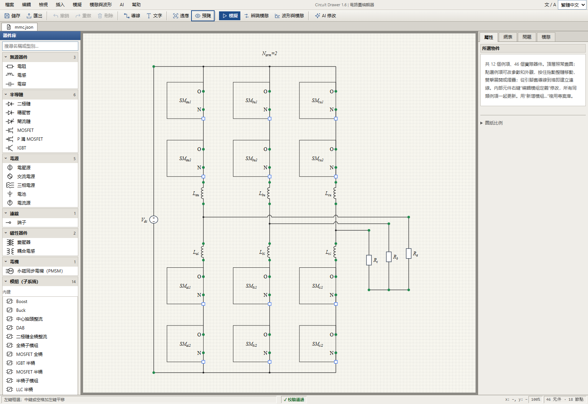

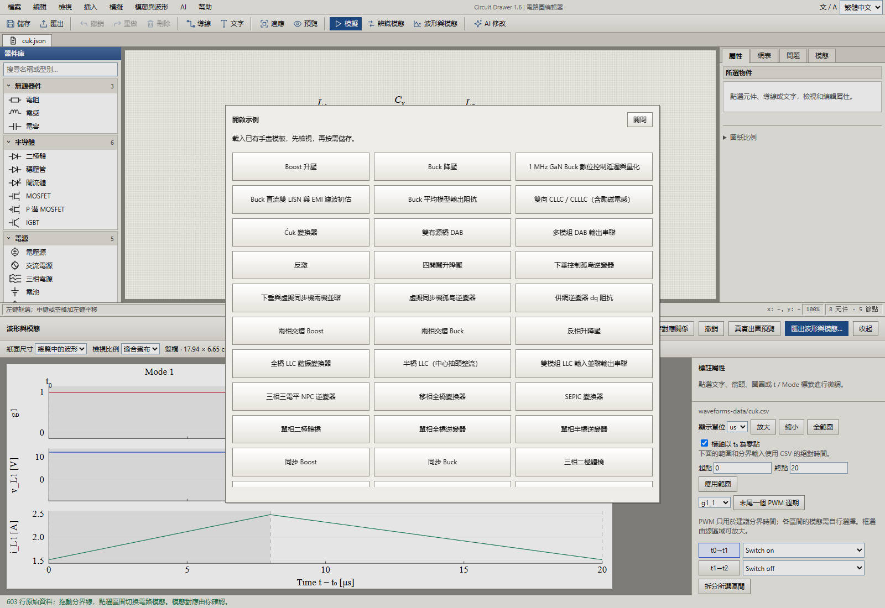

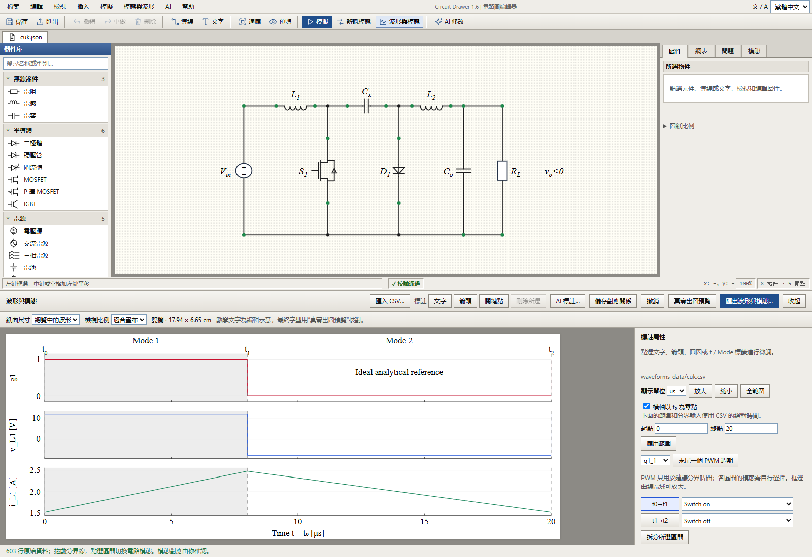

### 3、先匯出座標表再改

```bash
circuit-drawer export llc -o llc.json       # 把模板写成 JSON
circuit-drawer edit llc.json                # 在编辑器里改
circuit-drawer check llc.json               # 只校验，输出 JSON 报告；不通过时返回码为 1
circuit-drawer render llc.json -p single    # 校验通过后出图
```

匯出的 JSON 不記錄欄寬。大電路重新開啟或出圖時，記得加 `-p double`。

### 4、存成自己的模板

```bash
circuit-drawer save-template bb.json buck_boost --title "Four-switch buck-boost" --alias 四开关升降压
circuit-drawer draw 四开关升降压 switch=igbt
```

1、模板名只能用小寫字母、數字和下劃線；只接受校驗通過的表；不能與內建模板重名，同名覆蓋要加 `--force`。

2、模板儲存在 `~/.circuit_drawer/templates/`，或環境變數 `CIRCUIT_DRAWER_TEMPLATES` 指定的資料夾。

3、編輯器 **檔案 → 存為模板…** 效果相同。

4、儲存後的提示和 `list` 按模板內容列出選項。有開關符號才提供 `switch`，有電流參考箭頭才提供 `currents`。名稱會去掉首尾空白並轉為小寫。用 `--dir` 儲存到自定義位置後，使用時將 `CIRCUIT_DRAWER_TEMPLATES` 設為同一目錄。

5、`circuit-drawer --version` 和 `circuit-drawer-control --version` 可檢視當前執行的版本。

---

## 四、編輯器介面導覽

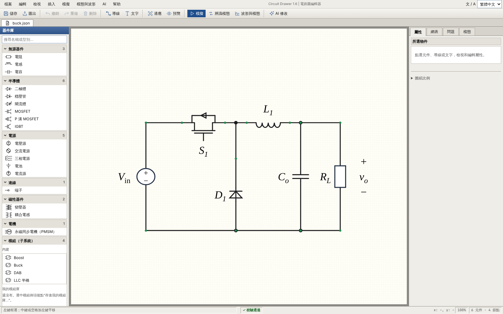

右上角 **文 / A** 選項可立即切換 **簡體中文 / 繁體中文 / English**。切換保留未儲存的編輯、已開啟的視窗和輸入值；同一瀏覽器、地址和埠會記住選擇，不同編輯器埠各自儲存偏好。翻譯隨安裝包離線提供。圖紙文字、自定義名稱、JSON 和外部工具原始輸出保持原樣；命令列與 Windows 啟動器沿用原有文字。本書使用繁體選單名；命令、程式碼與 JSON 欄位保留原文，以便直接複製使用。

### 1、整體佈局

1、**選單欄**（第一行）：檔案、編輯、檢視、插入、模擬、模態與波形、AI、幫助，順序就是“畫圖 → 模擬 → 模態與波形 → 匯出”的工作順序。選單項右側顯示快捷鍵；帶 › 的項點開是子選單。

2、**常用工具欄**（第二行）：按檔案、編輯、繪圖、檢視、模擬、AI 分成六組，依次是儲存、匯出、撤銷、重做、刪除、導線、文字、適應、預覽、**模擬**、辨識模態、波形與模態、AI 修改。藍底的“模擬”開啟 SPICE 模擬視窗，“辨識模態”開啟“從模擬辨識模態”。不可用的按鈕變灰。編輯模組定義時，這裡會多出“設定埠並儲存…”和“取消編輯定義”。

3、**檔案標籤**：顯示當前檔名，滑鼠停在上面顯示完整路徑；檔名前的圓點表示有未儲存的改動。

4、**器件庫**（左欄）：分類列表，可搜尋、點選或拖入畫布，見[第五章](#五器件庫與全部器件)。

5、**畫布**（中間）：淺色點陣與 0.05 吸附步長一致。滾輪縮放，中鍵拖動或按住空格加左鍵拖動平移。**檢視 → 座標刻度** 可顯示座標刻度。

6、**資訊欄**（右欄）：四個標籤頁。

| 標籤頁 | 內容 |
| --- | --- |
| 屬性 | 當前選中物件的屬性；選中元件、導線、文字、區域、方框、功能標誌、箭頭或模組時自動開啟。下方“圖紙比例”顯示當前縮放比例 |
| 網表 | 網路名、引腳和支路編號；展開“SPICE 網表”可看當前實際匯出的網表 |
| 問題 | 校驗結果和修正按鈕，標籤上的數字是問題數 |
| 模態 | 模態圖的切換、編輯和匯出 |

7、**狀態列**（底部）：左邊是當前操作提示；中間是校驗狀態（“未檢查”“校驗通過”或“有 N 個問題”），點選它會依次選中並居中顯示有問題的物件；右邊是滑鼠座標、相對“適應視窗”的縮放比例、元件數和節點數。

8、**空畫布**：沒有任何元件時，畫布中央提供“開啟示例”和“AI 描述”兩個按鈕。

9、器件庫和資訊欄可以滾動，檢視未顯示的條目和屬性。儲存成功或出錯時，畫布角落會短暫顯示提示。

10、**提示文字分三級**：狀態行只說當前狀態或下一步；滑鼠停在按鈕或輸入框上顯示簡短說明；規則、適用範圍和建模假設收在標題旁的 **?** 裡，點開檢視。輸入有誤時，紅字緊貼輸入框，說明哪裡不對、怎麼改，例如 SPICE 數值寫成 `2M` 時提示“M 表示毫，兆請寫 Meg”。模態面板、SPICE 模擬、從模擬辨識模態、實驗功能中的分析（EMI、阻抗、穩定性）和 AI 介面設定視窗都按這一格式顯示。

### 2、選單一覽

| 選單 | 內容 |
| --- | --- |
| 檔案 | 儲存、另存為… — 存為模板…、存為模組… — 圖紙欄寬 — 匯出 ›（電路圖…、全部模態圖…、ngspice 網表…、Simulink 模型…、PLECS 模型…、PSIM 模型…） |
| 編輯 | 撤銷、重做 — 剪下、複製、貼上、建立副本、刪除所選 — 順時針旋轉 90°、逆時針旋轉 90°、映象 / 反向、增大符號、縮小符號、同類物件圖層 ›（上移一層、下移一層、置頂、置底） — 按圖更新網表、合併重疊導線 — 有模組時還有編輯選中模組定義、解散選中例項為普通元件，舊式模組表還有模組定義…、轉換為埠連線 |
| 檢視 | 適應視窗、放大、縮小、模組顯示 › — 畫布上顯示：節點/支路標號、座標刻度、即時網表面板 — 預覽設定：帶座標網、色塊灰度，以及真實預覽 |
| 插入 | 畫導線、導線交叉方式 — 元件 ›（按無源、半導體、電源、磁性元件與電機、連線分組）、新增模組… — 標註 ›（加入文字、畫區域、畫方框、畫箭頭、繪製訊號箭頭、繪製功能標誌、階躍 / 脈衝標記） |
| 模擬 | SPICE 模擬…、全圖器件模型… — 匯出 ngspice 網表…、匯出到 Simulink…、匯出到 PLECS…、匯出到 PSIM… |
| 模態與波形 | 從模擬辨識模態… — 上一個模態、下一個模態、在圖上改模態、複製為新模態、模態真實預覽 — 波形與模態…、匯出全部模態圖… |
| AI | 描述新拓撲…、AI 修改當前圖… — AI 介面設定… |
| 實驗功能 | 傳導 EMI 估算…、輸出阻抗分析…、dq 阻抗矩陣…、源負載穩定性…、dq 互聯穩定性… — 參數範圍搜尋… |
| 幫助 | 使用者指南、提示詞說明、操作與快捷鍵… — 關於… |

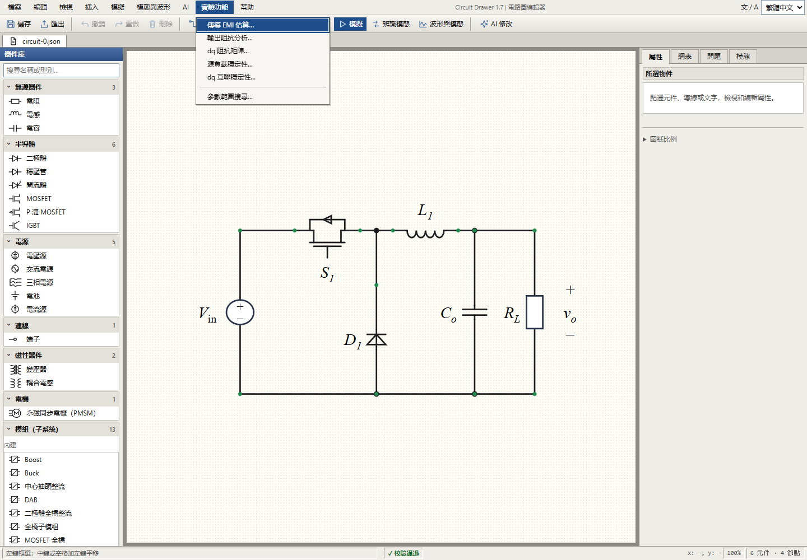

表中“—”表示分隔線。匯出到 Simulink、PLECS、PSIM 和 ngspice 網表都與 SPICE 模擬共用同一套參數，所以這些入口會開啟 SPICE 模擬視窗並定位到對應的匯出按鈕。

選單可以用方向鍵選擇、Enter 執行、Esc 收起，點選畫布也會收起。“幫助”裡的使用者指南和提示詞說明在新的瀏覽器標籤中開啟專案的線上文件，需要聯網。

### 3、儲存、預覽和匯出

1、**儲存**：寫回當前 JSON。電路編輯器沒有儲存快捷鍵，請點工具欄“儲存”或 **檔案 → 儲存**。

   **檔案 → 另存為…**：輸入新名字，儲存在原檔案旁邊並切換到新檔案，後續“儲存”寫入新檔案。自動補 `.json`，空格等符號改為下劃線；同名時加 `_2`、`_3` 等序號，不覆蓋已有檔案。提交前取消不寫檔案；提交後關閉視窗仍繼續儲存，期間的新修改仍標為未儲存。編輯模組定義時需先儲存或取消定義編輯。

2、**預覽**（真實預覽）：呼叫 LaTeX 顯示最終效果。**檢視 → 帶座標網** 決定預覽是否疊加座標網，方便對照座標。

3、**匯出**：見[第二十一章](#二十一匯出格式與-latexword-用法)。匯出的圖一定不帶座標網，並且只有校驗通過才能匯出。

4、**欄寬**：**檔案 → 圖紙欄寬** 在 IEEE 單欄和雙欄之間切換。下次開啟大電路時可在命令列加 `-p double`。如果當前單欄未通過、同圖按雙欄可通過，問題頁會顯示“切到雙欄”按鈕；點選只切換顯示和校驗欄寬，不移動元件。

---

## 五、器件庫與全部器件

### 1、使用器件庫

1、**新增**：點卡片，元件放到畫面中央；或把卡片拖到畫布上，元件放在落點。也可以用 **插入** 選單底部的元件庫，或在畫布空白處右鍵選“在這裡插入 ›”。

2、**搜尋**：頂部輸入中英文名稱、器件型別或類別，例如“電感”“L”“igbt”“電源”。搜尋時自動展開匹配的分組，清空後恢復原來的摺疊狀態。

3、**分組**：無源器件、半導體、電源、連線、磁性器件、電機，最下面是“模組（子系統）”（見[第十四章](#十四模組)）。點分組標題可以收起。

### 2、器件清單

| 器件庫名稱 | 座標表 `kind` | 引腳 | 說明 |
| --- | --- | --- | --- |
| 電阻 | `R` | `a`、`b` | 兩引腳須同 x 或同 y |
| 電感 | `L` | `a`、`b` | 同上 |
| 電容 | `C` | `a`、`b` | 同上 |
| 二極體 | `D` | `a`（陽極）、`b`（陰極） | 通用二極體 |
| 穩壓管 | `D`，`opts.zener: true` | 同二極體 | 畫成穩壓管符號；模擬需另填擊穿參數 |
| 閘流體 | `scr` | `a`（陽極）、`b`（陰極） | 只能水平或豎直；門極引線畫在 a→b 的左側，`F` 鍵換到右側；門極由模擬觸發脈衝驅動，不是引腳 |
| MOSFET | `nmos` | `d`、`s` | 預設帶體二極體（`opts.diode: false` 去掉） |
| P 溝 MOSFET | `pmos` | `d`、`s` | 源極在上、門極帶點；體二極體 d→s；邏輯 PWM 1 為導通。在“模擬 → SPICE 模擬…”填寫參數。 |
| IGBT | `igbt` | `c`、`e` | 預設帶反並聯二極體 |
| 電壓源 | `V` | `a`（負）、`b`（正） | 直流電壓源 |
| 交流電源 | `vac` | `a`（參考端）、`b` | 正弦交流源 |
| 三相電源 | 三個 `vac` | 每個 `a`、`b` | 一次放好星形連線的三個交流源和中性線，標籤為 v_a、v_b、v_c |
| 電池 | `V`，`opts.battery: true` | 同電壓源 | 長板為正，接 b 端；模擬與電壓源相同 |
| 電流源 | `I` | `a`、`b` | 電流從 a 流向 b |
| 端子 | `port` | `p` | 空心圓，一根導線在此結束，如輸入 a/b/c、輸出 P/O/N |
| 變壓器 | `transformer` | `p1`、`p2`（原邊，上到下），`s1`、`s2`（副邊），可選 `sct`（中心抽頭） | 變比文字、同名端可設；可旋轉 90° |
| 永磁同步電機（PMSM） | `pmsm` | `a`、`b`、`c` | 三相電機，預設引腳在左側從上到下排列，內部星點不引出；可旋轉，模擬參數見第十七章 |
| 耦合電感 | `transformer`，`opts.core: false` | 同變壓器 | 不畫鐵芯線的變壓器，引腳和模擬欄位與變壓器相同 |

中心抽頭變壓器在編輯器裡沒有單獨的卡片：可以從 `llc_fullbridge` 等模板複製，或在座標表裡給變壓器加 `sct` 引腳（見[附錄 A](#附錄-a座標表格式)）。

多繞組變壓器（QAB、AQAB 等多端口變換器）：選中變壓器，在屬性欄「多繞組」一行點「加在原邊側」或「加在副邊側」，同一磁芯上會多出一個繞組（w3～w6，最多 6 個繞組），同名端在它的 a 端；再把它連到對應的橋，並在「SPICE 模擬…」裡填它的匝比 `ratio_w3` 等。「刪去 w… 繞組」去掉編號最大的附加繞組，並清理其引腳宣告、測量通道和匝比，導線保留，可一步撤銷。若用於模態、閉環回授或參考地，請先調整相應設定。範例見 `examples/multiwinding/qab_multiwinding.json`。

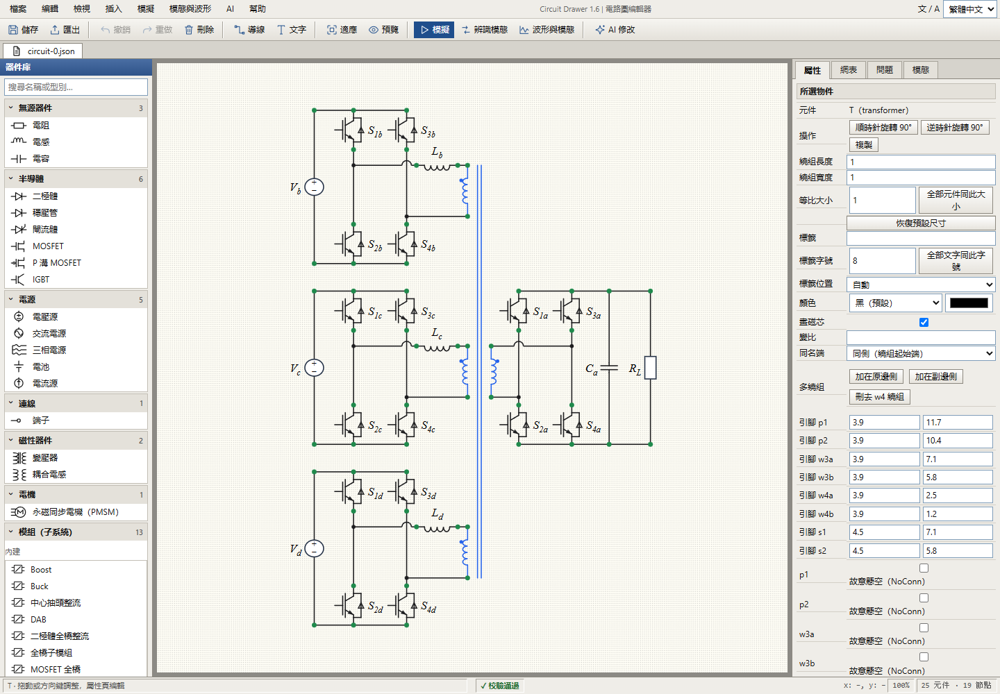

系統級框圖的小圖標（電池／儲能、光伏板、伺服器機櫃、電網、方波源、直流電容，以及 DC/DC、DC/AC 變換器方框）：用「插入 → 畫方框」拖出方框，在屬性欄「圖標」裡選擇；選了圖標後，「文字」會寫在方框下方作說明。它們只是插圖，不參與連接和模擬。範例見 `examples/system_icons/dc_bus_system.json`。

圖標隨方框移動，拉伸方框時保持置中和比例。獨立圖標可從「插入 → 功能標誌」新增。引用控制表的方框展開時仍顯示實際控制圖，摺疊後顯示所選圖標。

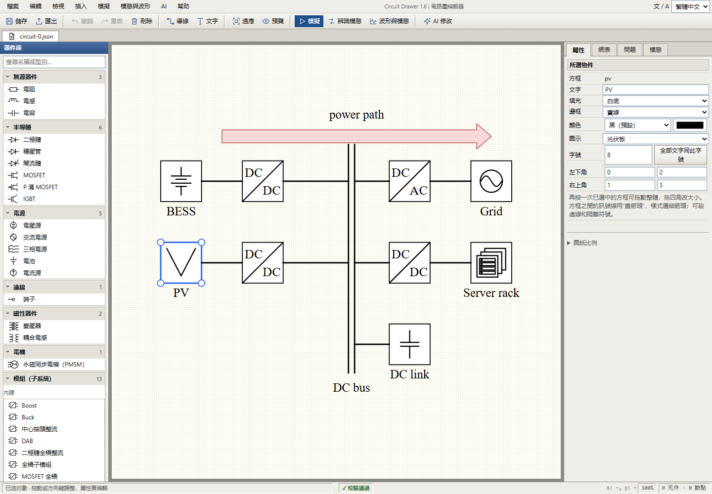

---

## 六、元件屬性


點選元件後，右欄“屬性”頁顯示它的設定。不同器件顯示的專案不同。

### 1、操作按鈕

「順時針旋轉 90°」「逆時針旋轉 90°」「反向」（MOSFET、IGBT 顯示為「映象（門極換邊）」，變壓器沒有這個按鈕）「複製」分別對應 `R`、`Shift+R`、`F`、`Ctrl+D`。

1、`R` 順時針旋轉 90°，`Shift+R` 逆時針旋轉 90°。變壓器也可以旋轉，變比文字保持正向。

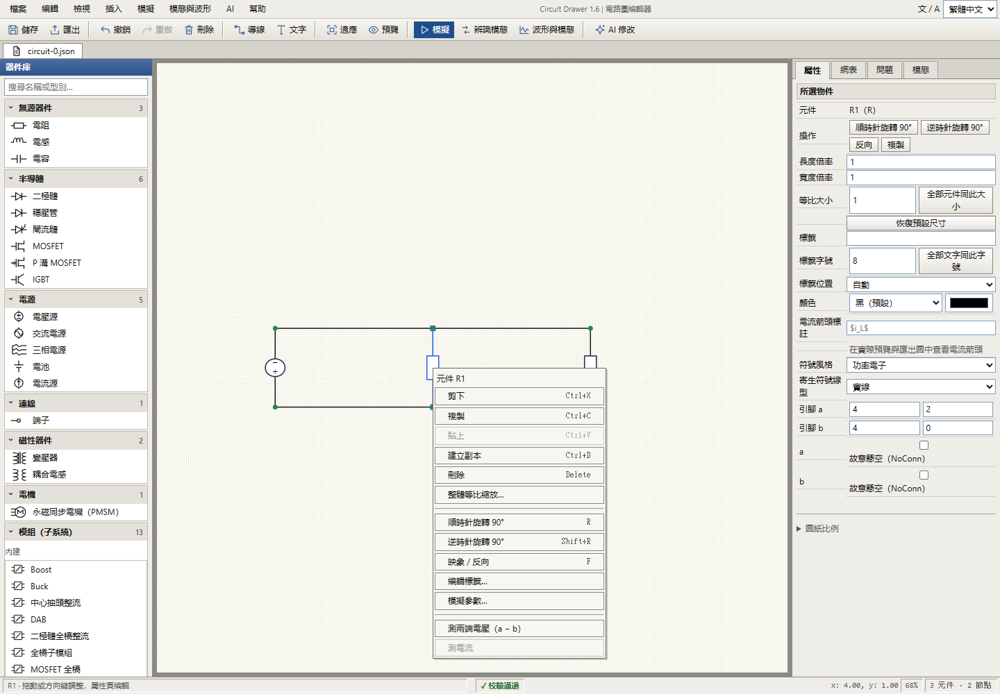

2、`F` 映象：開關和閘流體把門極換到另一側，其他二端元件反向。變壓器不支援映象。注意：二端元件的“反向”只改變畫法（`opts.invert`），不交換引腳，模擬不讀它；要真正反接，請交換兩個引腳的座標。

### 2、尺寸

1、**長度倍率 / 寬度倍率**：分別調整沿引腳方向和垂直引腳方向的符號尺寸，範圍 0.5–2，隨元件旋轉。變壓器顯示為“繞組長度 / 繞組寬度”。

2、**等比大小**：兩軸設成同一倍率；“全部元件同此大小”把所有元件設成這個倍率。

3、`+` / `-` 鍵（或 **編輯 → 增大符號 / 縮小符號**）保持當前長寬比縮放；“恢復預設尺寸”回到 1。

4、尺寸只改符號，不移動引腳、導線，也不改網表。校驗和匯出按新尺寸檢查。

### 2a、符號風格

1、選中電阻或 MOSFET，在屬性欄選擇「功率電子」或「類比 IC（Razavi）」。統一目前圖紙用「檢視 → 符號風格預設 → 套用到目前圖紙」，可一步撤銷；需要儲存後才會寫入檔案。

2、IC 風格使用鋸齒電阻與簡畫 MOSFET，PMOS 門極為空心圈。體二極體仍參與模擬，導通模態中仍會畫出；不改變元件參數或新增門極接線端。

3、預設包括模組內部及自動外部元件。庫定義會複製到目前圖紙，共用庫不變。新放入元件沿用預設風格，可再次套用預設。範例：[analog_ic.json](../examples/styles/analog_ic.json)。

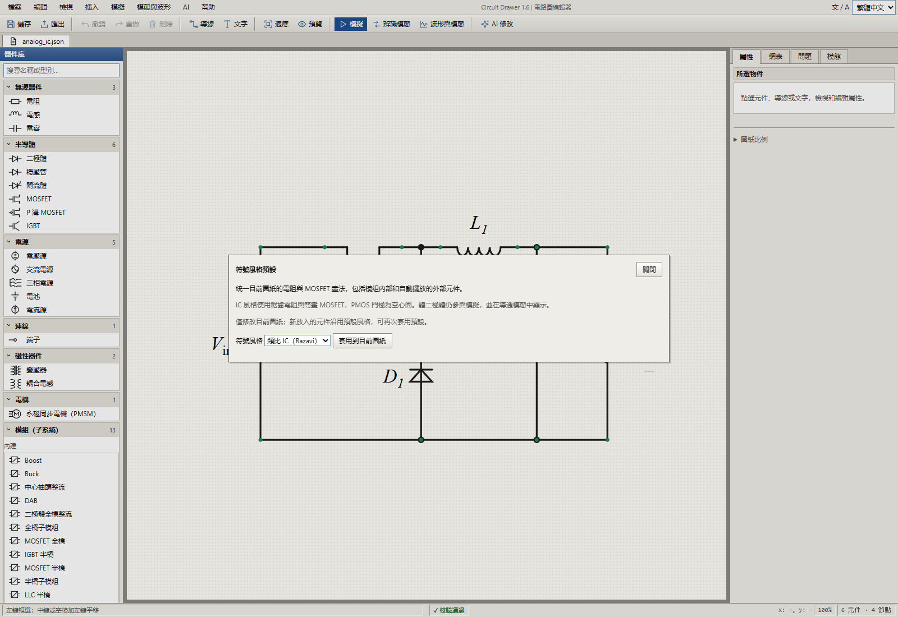

### 6.2b 整體電路縮放

1、左鍵拖動框選或 Shift+左鍵多選一組電路，右鍵選擇「整體等比縮放…」。也可開啟「檢視 → 整體等比縮放…」，將範圍改為「整張電路」。

2、輸入倍率，例如 `0.8` 縮小到目前的 80%，`1.2` 放大到 120%。元件本體、引腳、導線和間距一起調整；預設勾選「同步縮放字號」，需要保持字號時取消；線寬保持原值。

3、按「預覽縮放」，查看實際出圖後按「套用到目前圖紙」。選區外的普通元件保持位置，外接導線保持連接；模組完整／部分內部圖及外框一起縮放，封裝與電氣參數保留。縮放部分同類實例會使用獨立的專案定義副本，共用庫不變。

4、套用後可一步復原／重做，需要儲存才寫入檔案。縮放會固定目前圖紙比例，避免自動鋪滿欄寬抵消修改。「恢復自動適配」恢復欄寬換算，不恢復原座標；恢復原圖請復原。過小、超寬或接線／碰撞檢查失敗時不會套用，可調整倍率或擴大選區。範例：[boost_scaled.json](../examples/styles/boost_scaled.json)。

5、引用控制表的方框仍依原控制表調整內部圖，內部字號不隨本次電路縮放改變。需要統一外觀時可先摺疊控制方框再縮放；展開空間不足時預覽會提示增大或摺疊。原控制表與控制參數不變。

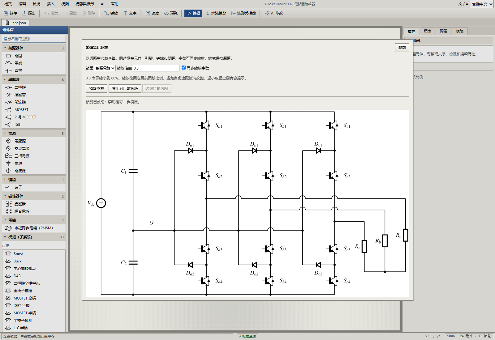

### 3、標籤、字號和位置

1、**標籤**：直接輸入文字，支援 LaTeX，例如 `$L_r$`、`$V_{\mathrm{in}}$`、`$\phi_1$`。畫布上的數學文字是近似顯示，最終效果以“預覽”為準。多字母下標要加花括號，`$V_in$` 會得到警告。

2、**標籤字號**：5–14 pt，預設 8 pt，同時作用於該元件的電流箭頭文字。“全部文字同此字號”一鍵統一。

3、**標籤位置**：自動、上、下、左、右。開關的標籤按畫面方向定位。

4、**獨立拖動標籤**：直接拖動元件標籤或變壓器變比文字，只調整文字位置，元件和接線不動；屬性頁“恢復預設標籤位置”取消偏移。支援撤銷、重做和儲存。

5、選中 vo、+、− 這類自由文字時，屬性頁顯示“字號”和“顏色”。

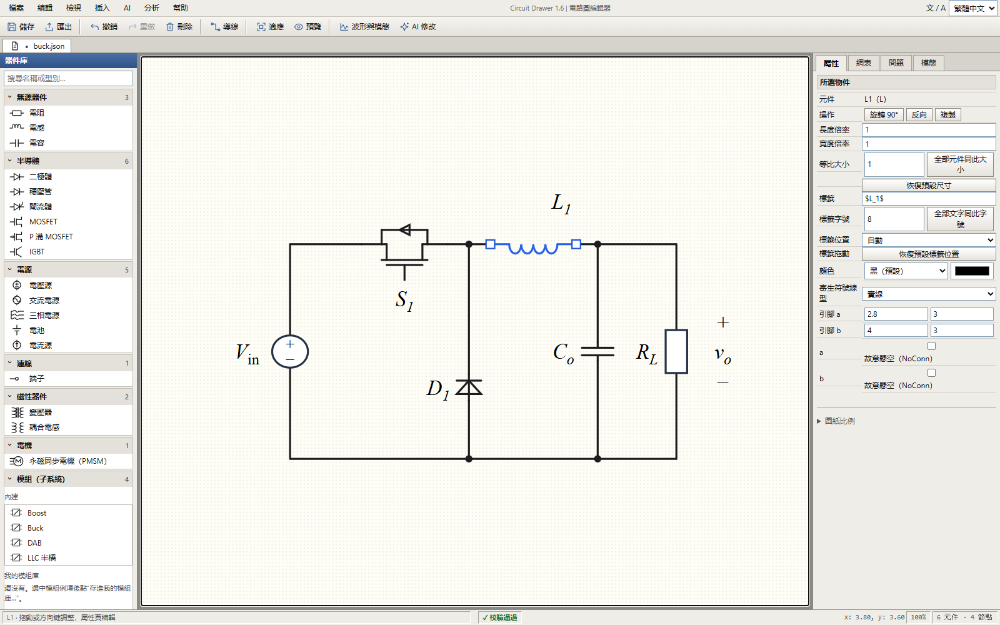

### 4、顏色

“顏色”下拉框和取色器給元件著色，見[第十三章](#十三器件與文字著色)。

### 5、引腳座標和故意懸空

1、**引腳 a / 引腳 b**（開關為 d/s、c/e，變壓器為 p1/p2/s1/s2）可以直接輸入座標。

2、每個引腳下面有“故意懸空（NoConn）”核取方塊。只給確實不需要連線的端子勾選：勾選後不再報“引腳沒接上”，畫布和匯出圖上畫一個小叉。它不能掩蓋其他接線錯誤。

### 6、器件專用項

| 器件 | 專用項 |
| --- | --- |
| 電阻、電感、電容 | 線型（實線、虛線、點線）；線型只改顯示，不改變參數或接線 |
| 二極體 | 畫成穩壓管 |
| 電壓源 | 畫成電池；源旁波形（上升階躍、下降階躍、脈衝）、波形位置、波形大小 |
| 電流源 | 源旁波形、波形位置、波形大小 |
| 變壓器、耦合電感 | 變比文字、同名端（同側、反向、不畫） |

### 7、電流箭頭

選取電感、電阻等二端元件，在屬性欄「電流箭頭標註」填入 `$i_L$` 等文字，在實際預覽與匯出圖中查看引線上的箭頭。清空輸入框可移除箭頭，儲存為 `opts.current`。導線上的獨立電流箭頭使用帶有 `arrow` 的自由文字，欄位見附錄 A。

### 8、模擬參數

元件的電氣數值不在屬性頁，而在 **模擬 → SPICE 模擬…** 裡，見[第十七章](#十七spice-模擬)。右鍵元件選“模擬參數…”會直接跳到它所在的行。圖上的文字標籤只用於繪圖，程式不從標籤猜數值。

---

## 七、導線、跨線和節點

### 1、畫導線

1、點工具欄“導線”或 **插入 → 畫導線**，在畫布上逐點單擊拐點，雙擊或按 `Enter` 結束，`Esc` 取消。

2、每段必須水平或豎直。從引腳開始、在引腳或另一條導線上結束。

3、直接單擊引腳可開始畫線。滑鼠接近目標引腳或模組端口時，會出現綠色小三角，點擊三角附近即可精確連線並結束這根線。途中可點擊空白處新增轉折點，按住 `Alt` 可暫停端口吸附。

4、導線實際接觸引腳時，接觸點顯示綠色。選中導線後，已接到引腳的端點也顯示綠色。問題欄繼續顯示整張圖的短路、斷路和其它問題。

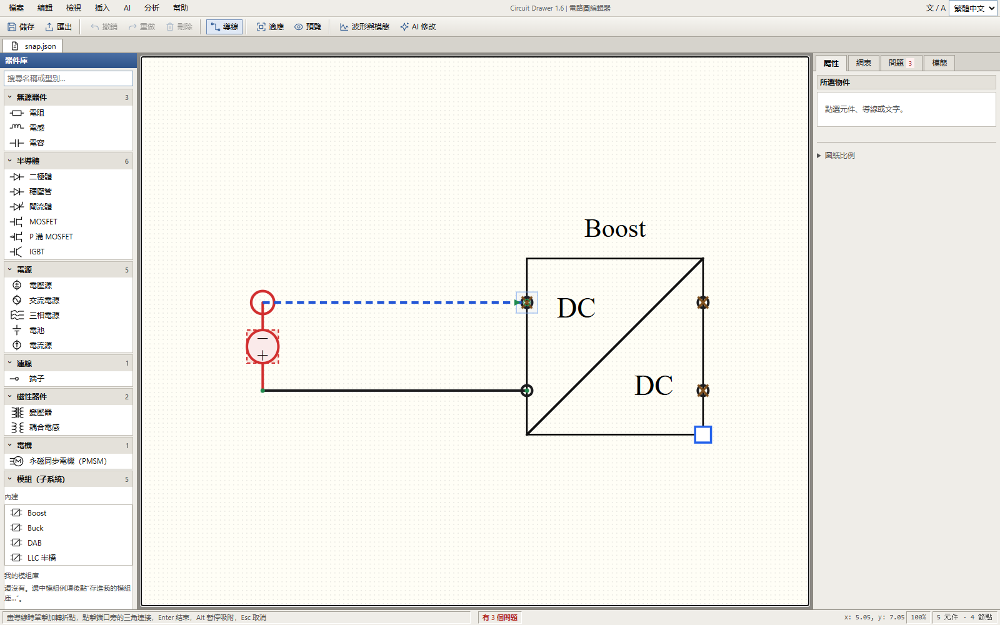

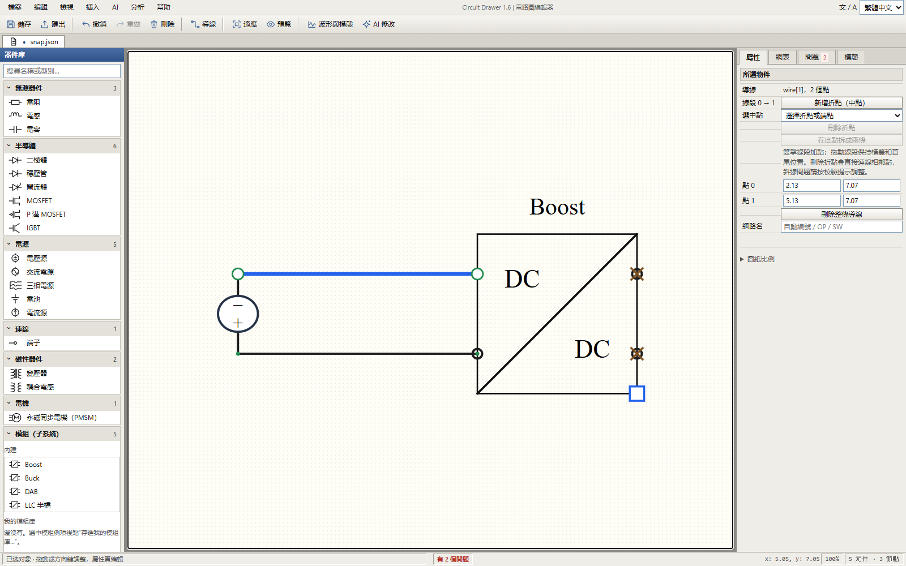

### 2、編輯已有導線

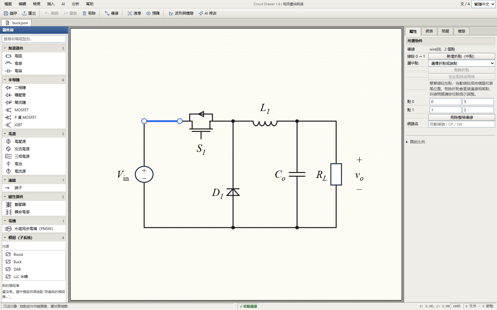

1、**拖動**：選中導線後拖動拐點（小圓點），或直接拖動一段橫線或豎線。拖動線段時保持首尾位置不變，必要時在端點附近補橫豎折線；一次拖動算一步撤銷。

2、**加折點**：雙擊線段，在點選處加點；或在屬性頁點“新增折點（中點）”；或右鍵導線選“在此處加折點”。

3、**刪除折點**：點小圓點或在“選中點”下拉框裡選擇內部折點，按 `Delete` / `Backspace` 或點“刪除折點”。刪除後直接連線相鄰兩點，若形成斜線，按校驗提示調整。端點不能用這個操作刪除。

4、**拆分與合併**：選中內部點後點“在此點拆成兩條”，或右鍵“在此處拆成兩條”（不必先加折點）。只有一個公共端點的兩條導線，可以在屬性頁點“合併 wire[編號]”，或右鍵“和首尾相接的導線合成一條”。跨線處不能直接拆分。

5、**刪除整條導線**：屬性頁“刪除整條導線”，或右鍵“刪除這條線”。

6、**重疊處選線**：同一位置再次單擊會輪換選中重疊的導線。選中的線顯示藍色，即使它有報錯也不會被紅色蓋住。

7、**合併重疊導線**：點重疊問題旁的「合併重疊導線」，也可用「編輯」選單、導線右鍵或屬性欄。一次整理目前圖紙中水平或垂直、完全共線的普通導線，包括部分重疊和完全重複，保留分支接點及絕緣跨線；可一步撤銷，儲存後重開保留。靠得很近的平行線不會合併；模組內部導線先進入定義編輯。連接關係改變或出現新衝突時保留原圖；去重後顯露的懸空線頭仍需處理。整條逐點相同的重複線也保留原來的單條刪除按鈕。

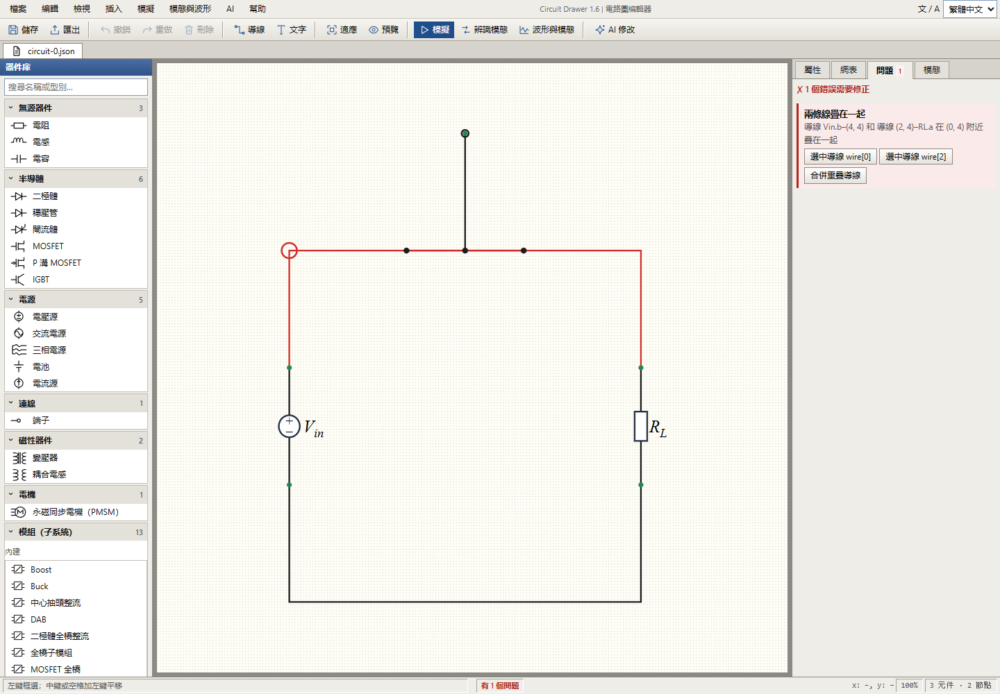

8、滑鼠停在點上會顯示 `wire[编号] 点 编号`，編號從 0 開始，與 JSON 中的順序一致。

### 3、交叉：跨線還是節點

1、兩條線十字相交時，要麼畫跨線（半圓，不相連），要麼畫節點（實心點，相連）。**插入 → 導線交叉** 決定新畫導線遇到交叉時用哪種。

2、事後點交叉處的半圓或黑點，或選中導線，在屬性頁的「交叉點」列切換跨線／節點；右鍵也可操作。「兩線交叉但沒標跨線」的問題旁可直接加跨線或改為節點，有模組的圖紙中也適用於外部普通導線。模組內部須進入定義編輯。

3、拖動導線、用方向鍵微調或修改座標時，已有跨線跟隨這兩條線的實際交點，拖動中即可看到；兩線不再相交就移除多餘標記。可撤銷，儲存後重開保留。

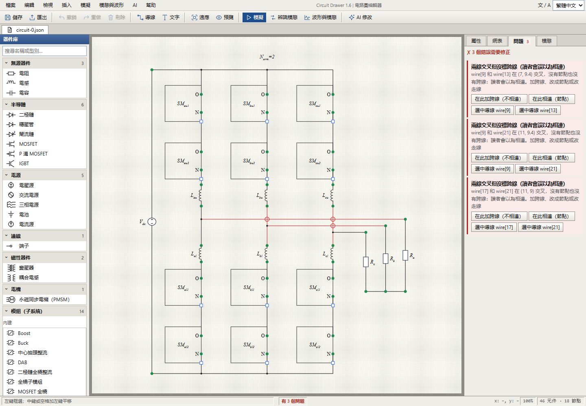

4、T 形相接（導線端點落在另一條導線上）自動算作相連並畫節點；三條以上線段匯於一點也自動畫節點，不用手寫。導線端點落在元件引線中間是錯誤。

### 4、網路名與節點、支路標號

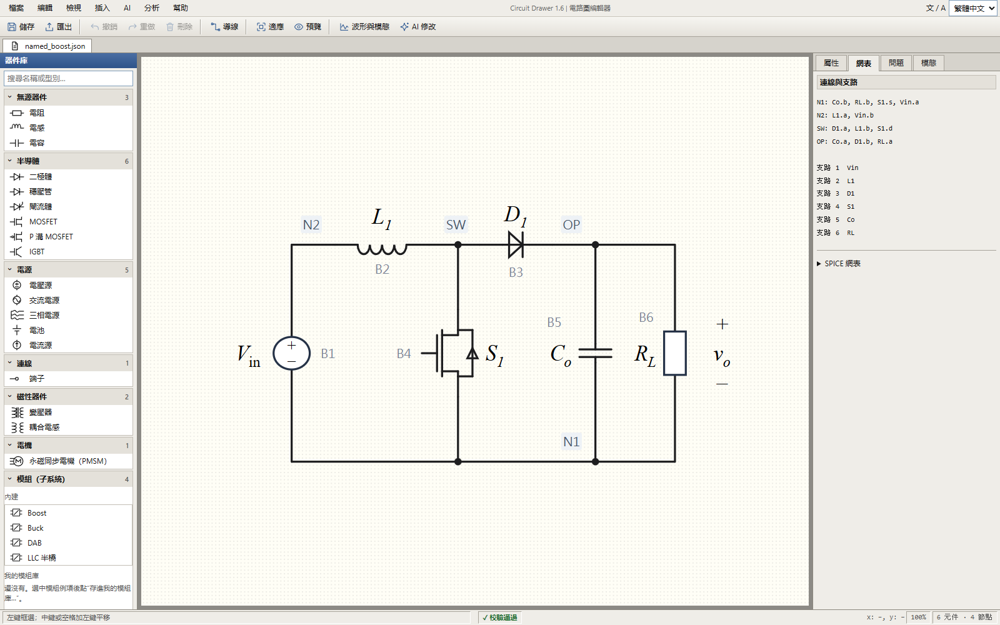

1、**檢視 → 節點/支路標號**：畫布上顯示帶淺底色的網路名（N1、N2… 或你起的名字）和灰色小字的支路號 B1、B2…。第一次開啟時建立固定編號，之後移動或增刪其他元件，已有編號不變；關閉顯示也不清除編號。

2、**命名網路**：選中一根導線，在屬性頁“網路名”裡填 OP、SW 等名字；留空恢復自動編號。名字為 1–41 個 ASCII 字母、數字、下劃線，以字母開頭，不區分大小寫時全圖唯一。

3、**網表頁**：右欄“網表”頁（或 **檢視 → 即時網表面板**）列出每個網路連線的引腳和支路編號，每次畫圖後重新整理；展開“SPICE 網表”可以看到當前實際網表。模擬參數還沒填寫時，這裡會說明原因。

4、匯出電路圖時，“包含節點標號”核取方塊決定圖裡是否帶這些標號，每次開啟預設不勾。

5、啟用標號後，SPICE 網表使用這些網路名，元件仍使用原編號（如 L1、S1），支路號只寫在註釋裡。沒有啟用標號的舊檔案，網表保持原樣。

### 5、按圖更新網表

座標表的 `netlist` 記錄哪些引腳應該相連，校驗器把實際幾何連線與它逐對比較。如果你是有意改接法（比如把二極體挪到回線上），點 **編輯 → 按圖更新網表**，把當前幾何連線寫成新網表；否則校驗會報“與網表不符”。不要用它來掩蓋誤連。

---

## 八、選擇與整組編輯

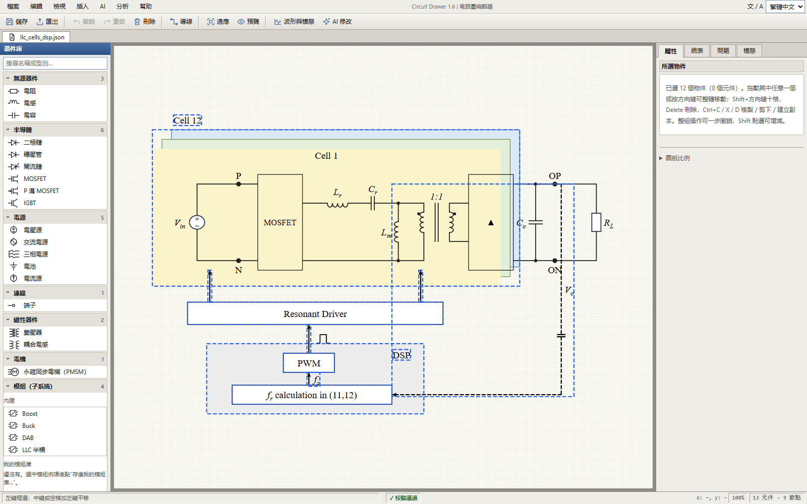

### 1、選擇

1、**點選**：單擊元件、導線、文字、區域、方框、功能標誌、箭頭或模組。單擊空白處取消選擇。

2、**框選**：在空白處或未選中的區域內按住左鍵拖出矩形，可選中頂層元件、導線、自由文字、區域、方框、功能標誌和箭頭。元件需所有引腳在框內，導線需所有折點在框內，標註需整個外框在框內。Ctrl+A 全選這七類頂層物件。

3、**追加**：按住 Shift 框選追加；Shift 單擊增減物件。模組實例也可與元件、導線和標註一起選中並移動；模組內部保持完整，外連導線跟隨。含模組的選區支援移動，複製、刪除仍用各自入口。獨立波形標記不參加混選。

4、畫導線、畫區域、畫方框、繪製功能標誌、加入文字、畫箭頭或放置模組時，左鍵用於當前工具，框選暫停；按 `Esc` 退出工具。

### 2、平移和縮放

1、滾輪縮放。

2、按住中鍵（滾輪）拖動平移；筆記本觸控板可按住空格，再用左鍵拖動。輸入框裡的空格仍用於輸入文字。

3、**檢視 → 適應視窗**（或工具欄“適應”）讓整張圖填滿畫布；**放大**、**縮小** 按步縮放。

### 3、整組操作

選中多個元件或標註後：

1、拖動其中任意一個，整組移動，按 0.05 網格落點。組內導線一起移動；連到組外的導線按原端點拖動規則伸縮，共用接點保持連線。拖動過程中按 `Esc` 取消。

2、`Delete` 刪除整組，`Ctrl+C` 複製，`Ctrl+X` 剪下，`Ctrl+V` 貼上，`Ctrl+D` 建立副本；macOS 上可用 `Cmd` 代替 `Ctrl`。這些操作也在 **編輯** 選單和右鍵選單裡。每次整組操作只需一步撤銷。

3、複製會帶上組內導線、元件模擬參數和“故意懸空”標記，副本使用新的元件編號和獨立的網路；接到組外的導線不復制。剪下後第一次貼上把元件放回原位並儘量保留原編號，之後的貼上依次偏移。

4、刪除或剪下元件時，相應的模擬參數、引用這些元件的測量通道和模組埠連線也一併刪除。

5、方向鍵整組微調一步，Shift 加方向鍵移動十格。整組移動不做自動避讓，落點造成重疊時由校驗器提示。貼合區域需一起選中全部成員才能移動。混選導線或標註時不能存為模組，請先只選元件。

### 4、智慧輔助線

拖動單個元件或自由文字時會出現類似簡報軟體的輔助線並自動吸附（整組拖動按網格移動）：

1、引腳靠近其他元件引腳所在的橫線或豎線時優先吸附（這樣導線能拉直）；其次是本體中心、本體邊緣對齊；再次是同一排或同一列相鄰元件等距。

2、自由文字可以對齊其他文字、元件標籤和元件本體的中心或邊緣，也可與相鄰文字等距。對齊時畫紫紅色虛線，等距時在各段間距兩端畫短豎標。吸附範圍約為螢幕上 6 個畫素，與縮放無關；元件引腳始終落在 0.05 網格上，文字可精確對齊標籤邊緣。

3、按住 `Alt` 拖動只對齊網格，不吸附。

---

## 九、右鍵選單

右鍵菜單隻放動作，顏色、字號、大小等數值仍在屬性頁。選單內可用上下鍵選擇、`Enter` 執行、`Esc` 關閉，左右鍵進入或返回子選單；變灰的專案滑鼠停留時會說明原因。正在畫導線、標註或放置模組時，先完成或按 `Esc` 取消，再開啟右鍵選單。

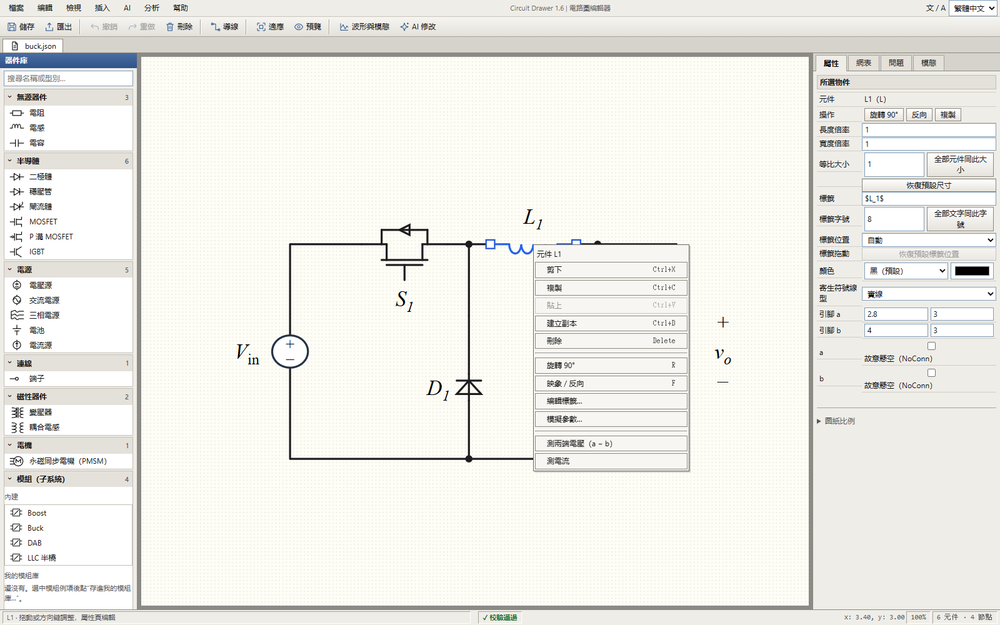

### 1、元件

右鍵元件會先選中它；右鍵已經選中的一組元件會保留整組選擇。

| 選單項 | 作用 |
| --- | --- |
| 剪下、複製、貼上、建立副本、刪除 | 與快捷鍵相同，作用於當前選擇 |
| 順時針／逆時針旋轉 90° | 單個元件或多選元件及導線；按 R／Shift+R 繞選區中心旋轉，外連接點保留，可一步撤銷。含模組或標註時先調整選擇 |
| 映象 / 反向 | 只對單個元件可用 |
| 編輯標籤… | 把游標放到屬性頁的標籤框 |
| 模擬參數… | 開啟 SPICE 模擬視窗，滾動並高亮這個元件的參數行 |
| 測兩端電壓、測電流、測驅動 | 增加已有模型支援的測量通道，開啟 SPICE 視窗供確認；不支援的型別會說明原因 |
| 存為模組… | 多個元件時可用，見[第十四章](#十四模組) |

### 2、導線

| 選單項 | 作用 |
| --- | --- |
| 在此處加折點 | 在滑鼠位置加一個折點 |
| 刪除折點 | 刪除內部折點（不能刪端點） |
| 在此處拆成兩條 | 在滑鼠位置拆開，只佔一步撤銷；跨線處不能拆分 |
| 和首尾相接的導線合成一條 | 有多條可合併的線時，子選單列出編號供選擇 |
| 合併重疊導線 | 整理目前圖紙中共線重疊的普通導線，核對連接，可一步撤銷 |
| 刪除這條線 | 刪除整條導線 |
| 測對地電壓 | 增加所在網路的測量通道，需先設定參考地 |

右鍵引腳可切換“故意懸空”。四路交叉處可切換節點／跨線；T 接和接有元件引腳的位置不能改跨線。“相關問題”複用問題頁已有的定位和處理操作。

整條導線只被選中、沒有選中折點或線段時，方向鍵只提示，不會把線挪離引腳。

### 3、畫布空白處

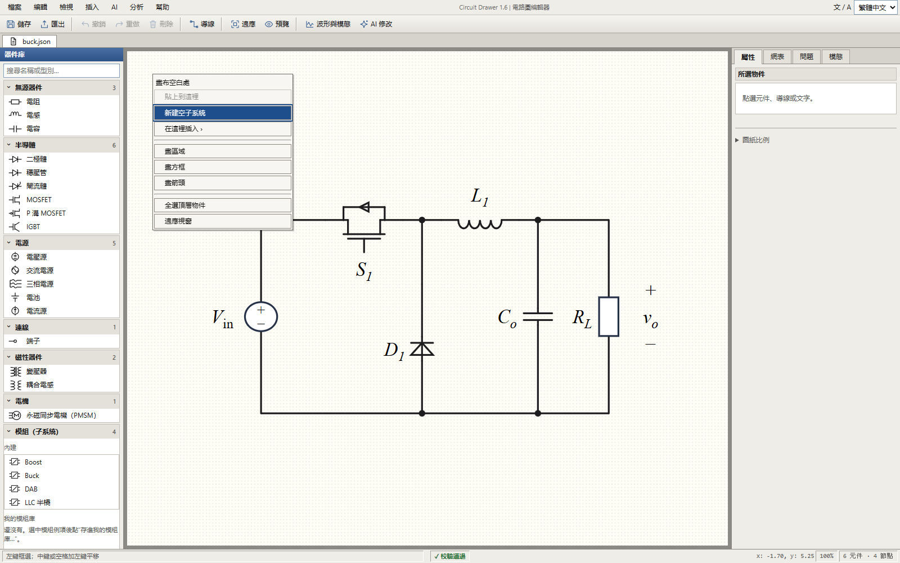

| 選單項 | 作用 |
| --- | --- |
| 貼上到這裡 | 副本的中心對齊滑鼠位置並吸附網格；剪貼簿為空時變灰 |
| 在這裡插入 › | 在滑鼠位置放置器件或模組 |
| 新建空子系統 | 放置一個空模組，進入內部畫布逐步搭建電路 |
| 畫區域、畫方框、畫箭頭 | 進入相應繪製工具 |
| 全選頂層物件 | 選中頂層元件、導線、文字、區域、方框、功能標誌、箭頭 |
| 適應視窗 | 整張圖填滿畫布 |

### 4、模組例項

右鍵模組例項或其內部元件，選單包括：編輯模組定義、例項參數…、展開 / 摺疊、解散為普通元件、存進我的模組庫…；模組庫裡有新版本時還有“從庫更新”。詳見[第十四章](#十四模組)。

### 5、區域、方框和箭頭

| 選單項 | 作用 |
| --- | --- |
| 上移一層、下移一層、置頂、置底 | 調整在同類物件中的前後順序，已到頂或到底時變灰 |
| 複製、刪除 | 複製後用 `Ctrl+V` 或空白處“貼上到這裡”貼上 |
| 編輯文字… | 跳到屬性頁的文字框 |

按成員自動貼合的區域，副本仍跟隨原成員；要單獨定位，先在屬性頁“色塊貼合成員”固定邊界。模組內部的圖形需要進入模組定義編輯。

---

## 十、撤銷、重做與方向鍵微調

### 1、撤銷和重做

1、工具欄和 **編輯** 選單都有“撤銷”“重做”。`Ctrl+Z` 撤銷，`Ctrl+Y` 或 `Ctrl+Shift+Z` 重做；macOS 上可用 `Cmd`。

2、沒有可撤銷或可重做的記錄時按鈕變灰。只點選、縮放或平移不會清掉重做記錄；實際修改圖紙後才開始新的編輯記錄。

3、撤銷、重做後會取消普通物件的選擇，繼續微調時重新點選；仍存在的模組例項保留選中。模組共用定義與總圖各自保留撤銷記錄。

### 2、方向鍵微調

1、選中一個元件、自由文字、固定邊界的區域、方框、功能標誌、箭頭、階躍 / 脈衝標記或模組例項，按方向鍵每次移動一個網格（0.05 佈局單位），按住 Shift 每次移動 10 格（0.5）。元件相連的導線按拖動時的規則跟隨；模組按埠保持連線。

2、導線：選中折點後方向鍵移動折點；選中線段後只能沿垂直於線段的方向微調，端點位置不變。

3、輸入框、可編輯文字、選單、彈窗和波形面板裡的方向鍵操作這些控制元件本身，不會移動電路圖。

---

## 十一、校驗器與問題欄

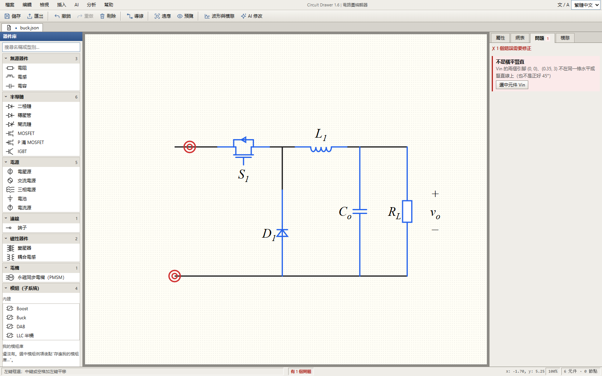

### 1、什麼時候校驗

每次改動都會立即在後臺校驗。出問題的元件和位置在畫布上標紅；右欄“問題”頁按當前介面語言說明原因；底部狀態列顯示“校驗通過”或“有 N 個問題”，點選它會依次定位到問題物件。

### 2、問題頁怎麼看

1、頁首顯示“✓ 校驗通過，可以匯出”或“✗ N 個問題需要修正”。

2、每個問題是一張卡片：標題、具體說明（元件編號和座標）以及操作按鈕。“選中元件 X”跳到相關物件；有自動修法的問題還有修正按鈕，例如“改成帶花括號的寫法”“加跨線”“這是故意的……”。

3、黃色卡片是警告（如下標缺少花括號），不阻止匯出；紅色卡片是錯誤，必須修正才能匯出；藍灰色卡片是“已允許”的說明，點“撤回”可以恢復檢查。

### 3、它檢查什麼

| 類別 | 主要規則 | 問題頁標題舉例 |
| --- | --- | --- |
| 幾何 | 導線、元件橫平豎直；元件兩端距離夠畫下符號；變壓器繞組方向和順序 | 不是橫平豎直；元件兩端太近，畫不下 |
| 重疊 | 符號之間、導線與符號之間、平行線之間留足間距 | 兩個元件符號重疊；導線穿過了元件符號；兩條線疊在一起；兩條平行線太近 |
| 交叉與接點 | 十字交叉必須宣告跨線；導線不能接在元件引線中間 | 兩線交叉但沒標跨線；導線接在了元件引線中間 |
| 連線 | 引腳都要接上，導線不能懸空；幾何連線與網表逐對一致 | 引腳沒接上；導線一端懸空；該連的沒連上；不該連的連上了 |
| 文字 | 標籤不壓元件、不壓線、不互相重疊；電流箭頭在導線上 | 文字壓在元件上；文字壓在線上；文字互相重疊；電流箭頭不在導線上 |
| 欄寬 | 橫向比例不低於 0.55 | 按當前欄寬放不下 |
| 色塊、方框、箭頭 | 區域邊框不切元件；箭頭不壓元件；放大圖不接主電路；模組成員在框內 | 區域邊框切過了元件；箭頭壓在元件上；放大圖被連到了主電路上；模組成員不在區域框內 |
| 模組 | 摺疊框不重疊、不壓住元件；埠連線能布通 | 摺疊框重疊或壓到元件；自動佈線失敗 |
| 欄位 | 選項、顏色、欄位名寫對 | 顏色名不認識；區域或箭頭的設定不對 |

完整規則見[附錄 B](#附錄-b繪圖規則)。

### 4、它不檢查什麼

偏置是否合理、電流方向和大小是否真的如此、器件參數、死區、某個模態是否符合工況。它只保證“圖畫得規整，並且和宣告的網表一致”。

### 5、常見錯誤怎麼改

| 問題 | 程式碼 | 修法 |
| --- | --- | --- |
| 不是橫平豎直 | `not-orthogonal` | 把兩個引腳或兩個拐點對齊到同一 x 或 y；拖動時藉助輔助線 |
| 元件兩端太近，畫不下 | `too-short` | 拖動引腳上的藍色小方塊拉長元件，或減小長度倍率 |
| 兩個元件符號重疊 | `body-overlap` | 把其中一個挪開 0.1–0.2，或縮小符號 |
| 導線穿過了元件符號 | `line-through-body` | 給導線加折點繞開元件 |
| 兩條線疊在一起 / 兩條平行線太近 | `collinear-overlap` / `too-close` | 共線重疊可點「合併重疊導線」；平行線間距至少 0.18 cm |
| 兩線交叉但沒標跨線 | `unmarked-crossing` | 點“加跨線”；本來就該相連時把交叉點改成節點 |
| 導線接在了元件引線中間 | `touches-lead` | 把導線端點移到引腳上 |
| 引腳沒接上 | `open-pin` | 接上導線；確實不接時勾選“故意懸空（NoConn）” |
| 導線一端懸空 | `dangling-wire` | 把端點接到引腳或其他導線上，或刪除這段線 |
| 該連的沒連上 / 不該連的連上了 | `netlist-open` / `netlist-short` | 先判斷是不是誤連；有意改接法時點 **編輯 → 按圖更新網表** |
| 文字壓在元件上 / 壓在線上 / 互相重疊 | `text-on-symbol` / `text-on-line` / `text-overlap` | 換標籤位置、把元件挪開 0.1–0.2，或減小字號 |
| 下標缺少花括號（警告） | `subscript-braces` | 點“改成帶花括號的寫法”，`$V_in$` 變成 `$V_{in}$` |
| 按當前欄寬放不下 | `too-cramped` | 切到雙欄，或收緊間距、減小符號 |
| 區域邊框切過了元件 | `region-cuts-symbol` | 拖動區域四角，讓元件整個在框內或框外 |
| 放大圖被連到了主電路上 | `detail-wired` | 斷開穿進放大圖的導線；如果那塊區域就是真實電路，取消箭頭的“指向放大圖” |
| 摺疊框重疊或壓到元件 | `module-box-overlap` | 縮小方框或挪開例項 |
| 標號附近沒有空位 | `electrical-label-space` | 挪開附近的元件或文字，或縮短網路名 |
| 欄位或取值寫錯 | `bad-option`、`bad-color`、`bad-region` 等 | 按提示改成列出的允許值 |

### 6、確實要疊在一起：按物件放行

校驗器預設攔下重疊，因為大多數重疊是擺錯了。確實是有意的，按物件放行，沒有全域性開關：

1、**標記壓在導線上**：獨立的階躍 / 脈衝標記要畫在訊號線上時，點問題卡片裡的“這是故意的：符號壓在導線上”，或在標記屬性裡勾選“壓在導線上”。出圖時用背後的顏色蓋住那一小段線，連線不變。

2、**箭頭只是指向，不是放大圖**：箭頭指著的區域是真實電路的底色而不是放大圖時，點“這是故意的：箭頭只是指向，不是放大圖”，或在箭頭屬性裡取消“指向放大圖”。

3、**塊箭頭覆蓋元件或文字**：在塊箭頭屬性裡勾選“允許這支箭頭覆蓋元件／文字”，或在問題卡片裡點“這是故意的”。

4、放行後問題頁顯示一條藍灰色的“已允許”說明，點“撤回”即可恢復檢查。這些設定隻影響校驗和畫法，網表、SPICE、Simulink、PLECS 匯出都不受影響。

### 7、命令列校驗

```bash
circuit-drawer check my.json             # 输出 JSON 报告，不通过时返回码为 1
circuit-drawer check my.json -p double
```

報告逐條給出元件編號、座標和原因，例如 `Lr: pins (3.35, 2.5) and (4.5, 2.7) are not on one horizontal or vertical line`。

---

## 十二、色塊、方框、箭頭、圖層與階躍脈衝標記

這些物件都是繪圖輔助，不參與連線和網表。

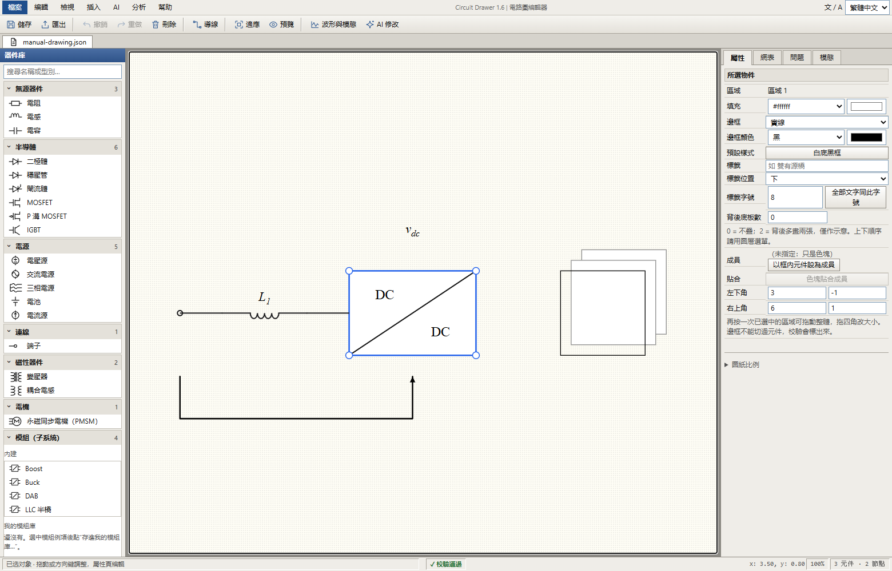

### 1、區域（色塊和虛線框）

1、選擇 **插入 → 標註 → 畫區域**，拖出矩形。選取後可整體拖動或拖曳四角調整大小。新區域沿用上次的填充、邊框及邊框色，屬性欄「白底黑框」可一鍵設定，瀏覽器會記住樣式。

2、**屬性**：填充色（綠、藍、橙、紅、紫、黃、青、灰，或自定義 `#rrggbb`；“無”為不填充）、邊框（無、實線、虛線、點線）、邊框顏色、標籤及位置（下、上、左、右、框內頂部）、標籤字號。太深的自定義顏色會自動調淡，保證黑線和文字清晰。

3、**背後底板數**：設為 1–6 時，後面額外疊出幾張底板（預設向右上偏移 0.25），常用來示意“只畫 a 相，b、c 相用底板代表”。0 表示不疊。它不復制電路，也不是圖層位置。

4、**疊面板用途**：需要模擬的圖，要在“疊面板用途”裡宣告：純裝飾，或代表省略的電路（填寫包含前面板在內的例項編號）。後者沒有真實電路定義時，SPICE 匯出會列出缺失例項並停止，不會只匯出已畫的一相。

5、**模組成員**：點“以框內元件設為成員”，把整個落在框內的元件記為成員。之後校驗檢查成員都在框內，框內沒列出的元件給出提醒。

6、**色塊貼合成員**：座標表裡寫 `"fit": "members"` 的區域，按成員的符號和標籤自動定邊界（並集加 0.3 佈局單位邊距，向外對齊 0.05 網格）。點“色塊貼合成員”把當前邊界固定成普通矩形，之後可以手動調整；`Ctrl+Z` 恢復自動貼合。示例：`examples/regions/dab_multi_fit.json`。

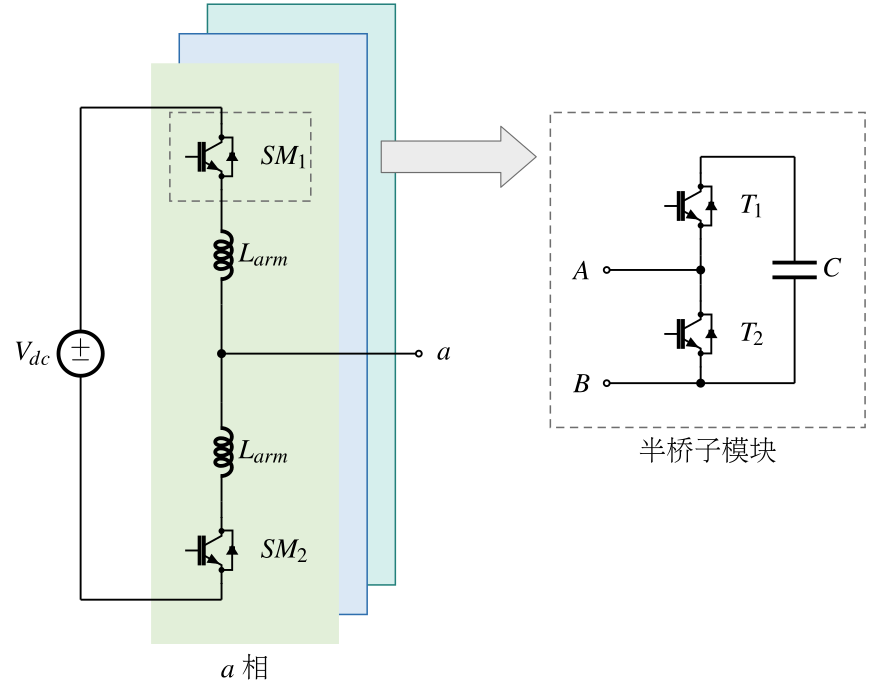

### 2、方框（控制部分）

1、**插入 → 標註 → 畫方框**，拖出矩形。右側可改文字（可寫 LaTeX，如 `$f_r$ calculation`）、填充（白底、無、調色盤顏色）、邊框（實線、虛線、點線）、顏色和字號，以及左下角、右上角座標。

2、方框之間的訊號線用“畫箭頭”，樣式選細箭頭，顏色選黑色。

3、校驗：方框不能壓在元件上，導線不能穿過方框，方框之間不能重疊，文字要放得下（四周各留 0.06 cm），細箭頭要在方框邊上結束。

4、完整示例：`examples/control_blocks/llc_cells_dsp.json`（多模組 LLC 加 DSP 控制）。

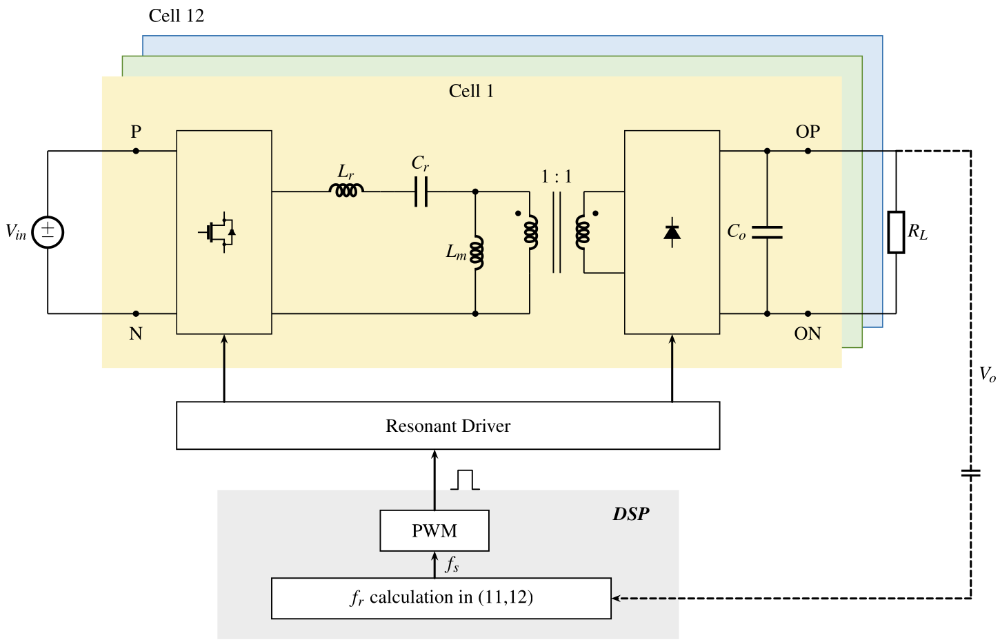

### 3、箭頭

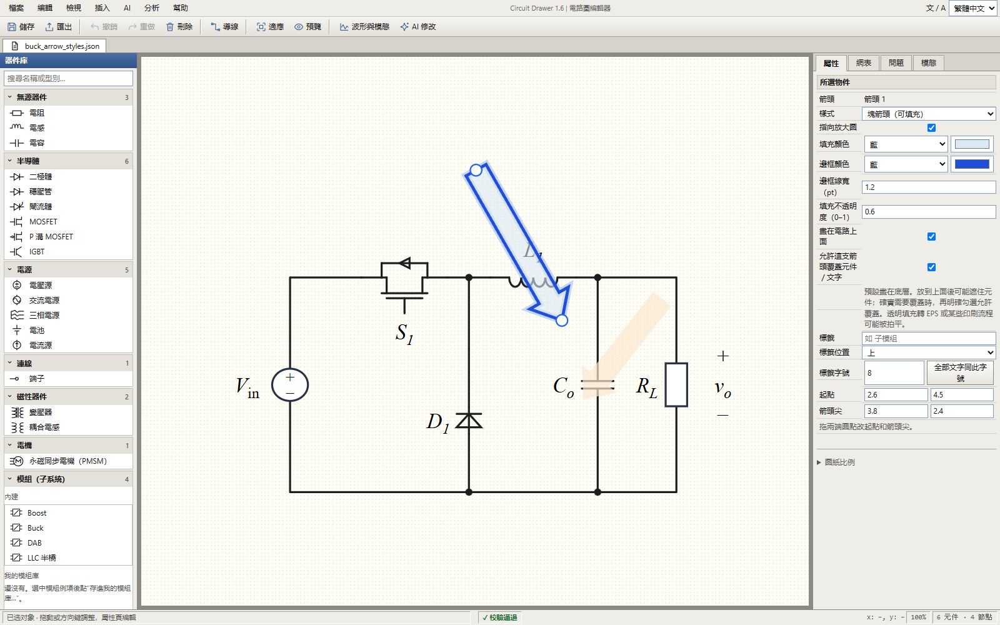

1、選擇 **插入 → 標註 → 畫箭頭**，從起點拖到箭頭尖。樣式可選塊箭頭、細箭頭 / 彎弧 / 折線或波浪指示箭頭。新箭頭沿用上次樣式，首次使用為塊箭頭。

1a、選擇 **插入 → 標註 → 繪製訊號箭頭** 可直接繪製細線。依序點選起點與轉折點，再次點選終點或按 Enter 完成，Shift 限制水平或垂直，Esc 取消。也可按住滑鼠直接拖出直線。

1b、繪製或拖曳箭頭端點、轉折點時，接近水平、豎直，或與既有箭頭／導線線段平行、垂直的位置，會顯示文字輔助線並吸附。按住 Alt 暫停輔助吸附。屬性欄的 **轉角** 可選 **直角／圓角**，新箭頭記住上次選擇。圓角會隨短線段縮小，儲存、預覽與匯出都採用所選樣式。

2、**細箭頭**：選中後拖中部圓點調彎（或在“彎曲（度）”裡輸入 −120 到 120），“恢復直線”清除彎曲；可以新增、拖動、刪除折點讓長箭頭繞行。可設線型（實線、虛線、點線）、箭頭位置（終點、起點、兩端、不畫）和隔離符號（兩條短橫線，可調沿線位置）。

3、**波浪箭頭**：可改波幅和波數（1–8），不能同時使用彎曲或折點。它是說明標註，不是模擬波形。

4、**標籤**：位置可選上、下、左、右，細箭頭還可以選“線上”（`inline`），文字放在路徑上並斷開兩側線條；沿線位置用 0 到 1 之間的數調整。

5、**塊箭頭外觀**：填充顏色、邊框顏色（含“無邊框”“預設（隨填充）”）、邊框線寬（0.1–3 pt）、填充不透明度（0 透明、1 實心，只作用於填充）。

6、**畫在電路上面**：塊箭頭預設在電路下面；勾選後畫在電路和其他標註上方。確實要遮住元件或文字時，再勾“允許這支箭頭覆蓋元件／文字”。兩項各管一件事：一項管誰在上面，一項記錄遮擋是有意的。PDF 保留透明度；轉 EPS 或部分印刷流程會拍平透明度，請再檢查一次。

7、**放大圖**：塊箭頭的起點在區域外、箭頭指進區域時，那塊區域被當作放大圖，不能有導線從外面穿進去，否則報“放大圖被連到了主電路上”。區域只是普通底色時，取消“指向放大圖”。

示例：`examples/arrows/paper_arrows.json`、`examples/regions/buck_arrow_styles.json`。

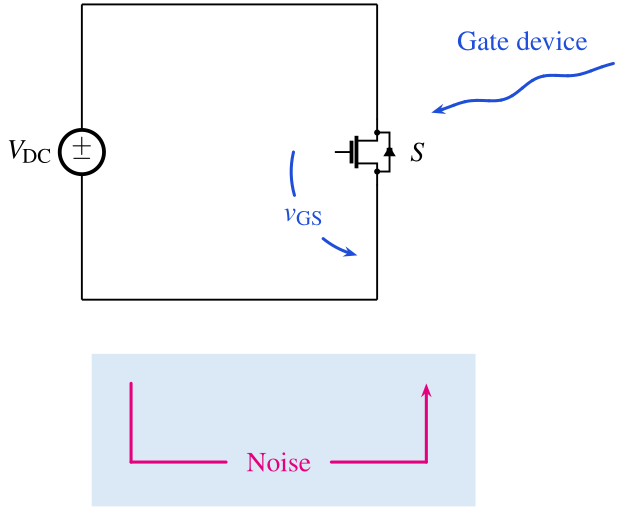

### 4、圖層

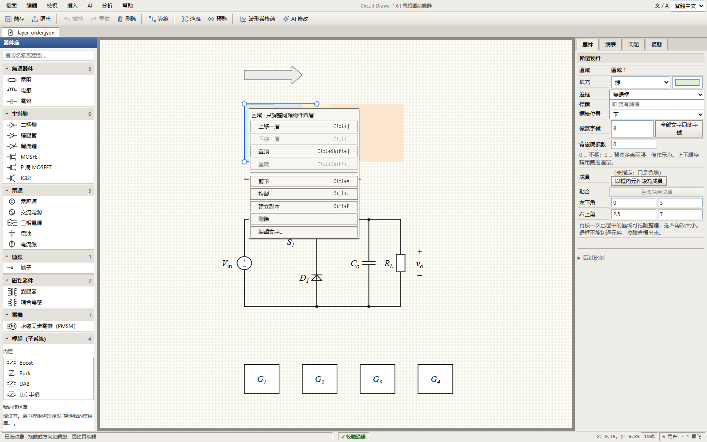

1、右鍵區域、方框或箭頭，選“上移一層”“下移一層”“置頂”“置底”；或選取區域、方框、功能標誌或箭頭後用 **編輯 → 同類物件圖層**；快捷鍵 `Ctrl+]` 上移、`Ctrl+[` 下移，加 Shift 置頂、置底。

2、只在同類物件之間調整順序，不同大類之間的固定層次是：區域 → 普通塊箭頭 → 方框 → 導線 → 元件 → 文字和獨立標記 → 功能標誌 → 細箭頭、波浪箭頭；勾選“畫在電路上面”的塊箭頭在最上層。

3、“置頂”不會自動把普通塊箭頭變成前景箭頭。操作可撤銷，儲存後保留。示例：`examples/regions/layer_order.json`。

### 5、階躍和脈衝標記

1、**源旁波形**：選中電壓源或電流源，在屬性頁“源旁波形”裡選上升階躍、下降階躍或脈衝，可改波形位置（標籤對側、左、右、上、下）和大小（0.5–2）。電源本身保留極性或電流方向。

2、**獨立標記**：**插入 → 標註 → 階躍 / 脈衝標記** 放一個沒有電氣引腳的論文符號，可拖動、改波形、改色、改大小、刪除和撤銷。

3、這些只是圖形。實際激勵的初值、終值和時間在 **模擬 → SPICE 模擬…** 裡填寫，改圖不會自動改模擬參數，反之亦然。示例：`examples/source_waves.json`。

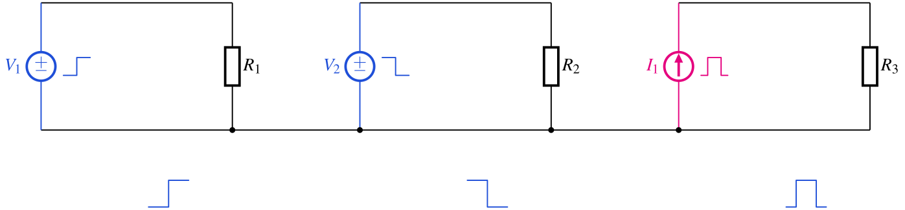

### 6、黑白列印

**檢視 → 色塊灰度**（命令列 `--mono`）把色塊和箭頭的顏色換成互相區分的灰度。器件顏色在黑白出圖時印成黑色。

### 7、自由文字、功能標誌及端子

1、選擇 **插入 → 標註 → 加入文字**，點選放置位置，輸入 `$i_x$`、`$v_{mv,dc}$`、`O'` 或 `$\vdots$` 等文字。選取後可修改內容、字級、顏色與位置，支援復原及儲存後重新開啟。

2、選擇 **插入 → 標註 → 繪製功能標誌**，在既有方框內拖出標誌範圍，在屬性欄「圖示」選 AC/DC、DC/DC、DC/AC、MOSFET、IGBT 或二極體。標誌儲存為 `glyphs`，可單獨移動、縮放、複製與刪除。

3、選取端子，勾選「隱藏圓圈（接在方框邊上）」，儲存為 `opts.bare`。

4、區域邊框色可選 `black` 等墨色。前層 `fill: none` 時，背後底板預設為白色，既有圖紙也採用此預設值。`stack.fills` 可逐層指定顏色。

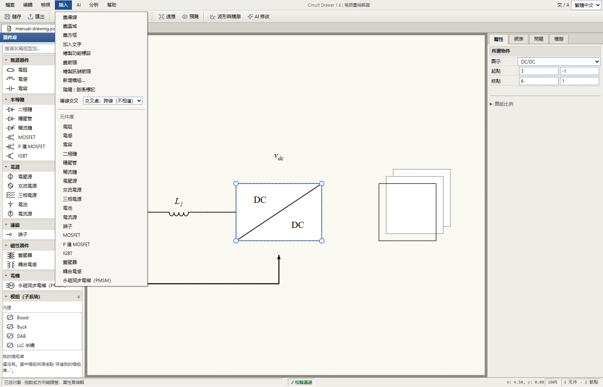

範例可開啟 [drawing_marks.json](../examples/editor/drawing_marks.json)。

---

## 十三、器件與文字著色

論文裡常把一個器件和與它有關的電流、電壓標成品紅或藍色。

1、**編輯器**：選中元件或自由文字，在屬性頁“顏色”裡選，或用取色器自定義 `#rrggbb`；選“黑（預設）”恢復。

2、**效果**：元件著色時，符號連同它的標籤和電流箭頭一起變色；文字著色時，文字和它的電流箭頭一起變色。導線和節點始終是黑色。

3、**可用顏色**：`magenta`（品紅）、`blue`、`red`、`green`、`orange`、`purple`、`teal`、`gray`、`black`，或 `#rrggbb`；中文“品紅”“洋紅”“藍”“紅”等也能讀入。這是印在白底上的深色，和色塊的淺色調色盤是兩套。

4、**與其他功能的關係**：`--mono` 黑白出圖時一律印成黑色；模態圖裡元件按導通 / 關斷著色，忽略元件顏色，文字顏色保留。

5、**JSON**：元件寫 `"opts": {"color": "magenta"}`，文字寫 `"color": "blue"`。

---

## 十四、模組

SST 範例提供兩級串聯輸入／並聯輸出圖，以及含 SM 與諧振 IDC 的單級圖。雙擊方框可查看實際元件，SM 垂直串聯使用側邊埠。隨附 PDF／PNG、同源模組放大圖與獨立 DAB 單元啟動範例，整機模擬需要補充功率級數值及控制參數。外部電容、電源及負載可直接拖曳，移動量相對連接埠儲存，展開與折疊分別計算位置。屬性欄可微調水平、垂直偏移和標籤，支援方向鍵、復原、重做與儲存後重開。[開啟 SST 範例說明](../examples/sst/README.md#繁體中文)

模組把重複的變換器單元定義一次、放置多份。所有例項共享一份定義，單個例項的參數差異單獨記錄。摺疊只改畫面，模擬始終展開全部真實器件。

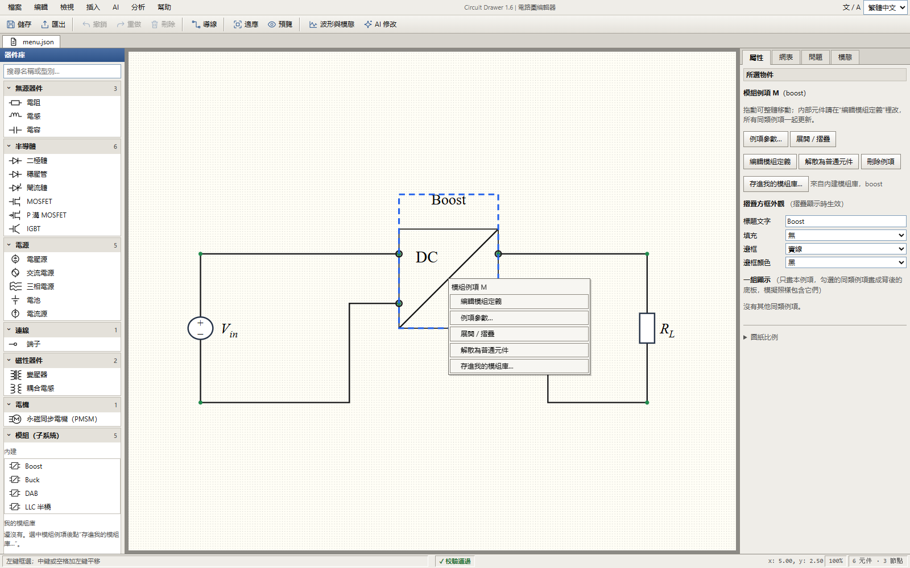

### 1、模組庫

左側器件庫最下面的“模組（子系統）”分組有三類：

1、**內建**：共 13 個。包括 Buck、Boost、DAB、LLC 半橋，以及 MOSFET／IGBT 半橋、MOSFET 全橋、NPC 橋臂、LLC 諧振腔、二極體全橋／中心抽頭整流、半橋／全橋子模組。滑鼠停留時可看埠說明；例如半橋為 P／N／O，NPC 為 P／M／N／O，中心抽頭整流的 C 與 ON 共網。

2、**我的模組庫**：自己存的模組，所有電路檔案都能用。檔案放在 `~/.circuit_drawer/templates/modules/`（設定了 `CIRCUIT_DRAWER_TEMPLATES` 時為其下的 `modules` 資料夾），一個模組一個 JSON。右鍵條目可以刪除。

3、**本檔案**：當前檔案裡已有的模組定義。

**插入 → 新增模組…** 列出同樣三類。

4、執行 `circuit-drawer blocks` 查看庫名、埠及含標籤的 1:1 繪圖尺寸。開關模型和驅動時序需要明確設定；新諧振腔與子模組電容參數為示範值。開啟 [兩個 LLC 積木的 IPOS 範例](../examples/modules/llc_ipos_blocks.json)，可切換摺疊、展開和部分摺疊；頂層檔案只引用庫模組與埠連線。

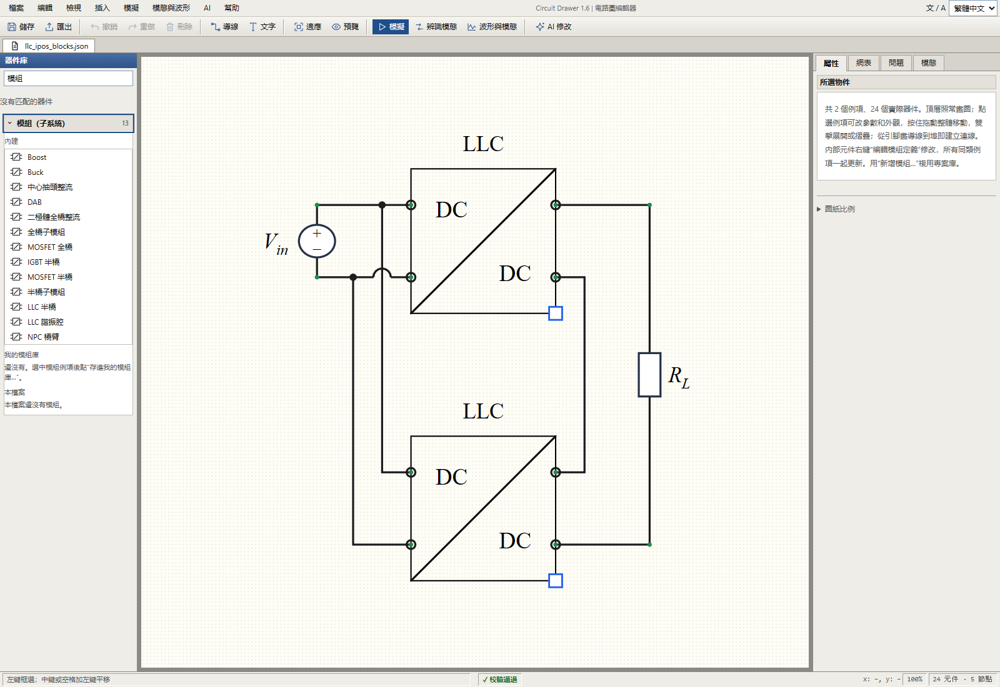

1、左鍵拖曳框選模組，或 Shift＋左鍵多選至少三個實例，再右鍵「省略中間實例」。依畫面主要排列方向保留首尾，中間顯示 ⋮ 或 ⋯；普通元件須先封裝成模組，混入選擇的普通元件、導線或圖形須取消。

2、右鍵首尾實例或三個點可「恢復全部實例」，省略與恢復均可一步復原。隱藏實例仍參與完整檢查與模擬，外接抽頭保持原實例端子。範例：[四子模組橋臂](../examples/modules/mmc_arm_ellipsis.json)。

3、模組 JSON 視窗和過密提示的「尺寸預算」包括展開圖的標籤與色塊，並估算單／雙欄橫排數量。實際佈線仍須校驗；欄寬沒有限定頁面高度，直排無固定數量上限。

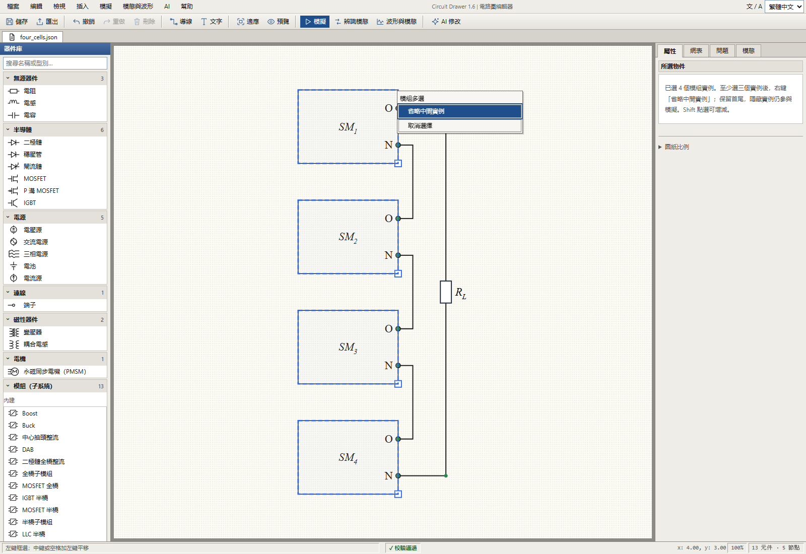

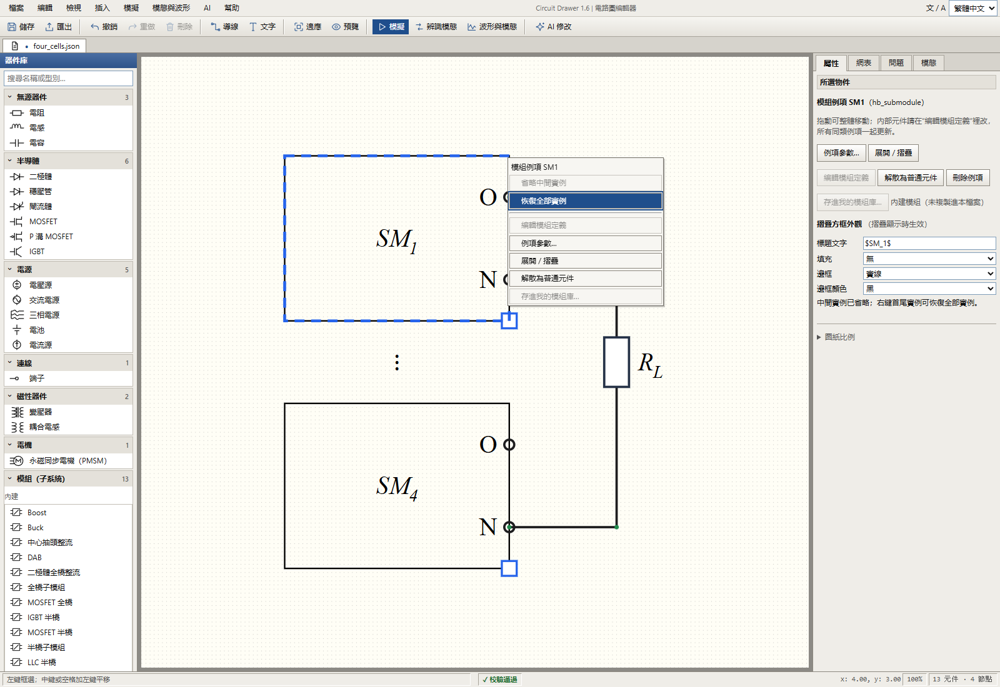

### 2、放置和連線

1、從模組庫拖到畫布後，鬆手即放在落點；單擊模組條目時，先顯示虛線預覽框，再在畫布上單擊放置。

2、放下後直接單擊端口開始畫線，接近另一端口時點擊綠色小三角完成連線。也可用工具欄“導線”逐點畫線。支援先畫線、先放模組和之後補放元件。

3、拖曳模組時，本體、標籤、端點和相連導線同步顯示，按 Esc 可取消本次拖曳；放開滑鼠後檢查連線。畫布上的普通導線仍可拖動折點、移動線段、拆分或刪除。模組移動、展開／摺疊、調整方框大小和標題時，相連線端跟隨埠，其他折點儘量保持。若移動使端口引線與相鄰導線相碰，會嘗試將附近轉折點調整到空隙中，保留既有分支節點和跨線位置。

4、“新增引腳待登記”表示引腳尚未登記到已確認的網表。核對接法後點“按當前連線記錄新引腳”，儲存這次連線用於後續短路與斷路檢查。已有接線改變時，核對後用“以當前連線更新網表”。跨線標記表示絕緣。

5、從庫裡放入模組會把定義複製到當前檔案。同一庫模組的多份例項複用定義，檔案包含實際電路，可在另一臺電腦開啟。

6、舊檔案中的 `modules.links` 命名連線可直接在畫布上選中、拖動走向或刪除。連線屬性提供“恢復自動走線”，儲存檔案時保留名稱引用。新接線使用畫布上的導線工具。完整示例見[模組普通接線](../examples/editor/module_wiring.json)。

### 3、展開、摺疊和外觀

1、**雙擊**或右鍵選“展開 / 摺疊”，在“展開 → 摺疊成小方框 → 部分摺疊（模組支援時）”之間切換。**檢視 → 模組顯示** 子選單可以選擇例項、展開或摺疊全部例項。

1a、展開時按符號、標籤和導線的實際邊界自適應留空，必要時推開相鄰圖形、拉長外連導線，保留定義、參數與完整電氣連接。屬性欄、「全部展開」和雙擊共用這一操作，可一步撤銷，儲存後才寫入檔案。摺疊後保留空白；撤銷可恢復展開前的位置。無法安全留空時保留原圖並說明原因。若只超出固定欄寬，匯出前調整整體縮放或恢復自動圖紙比例。

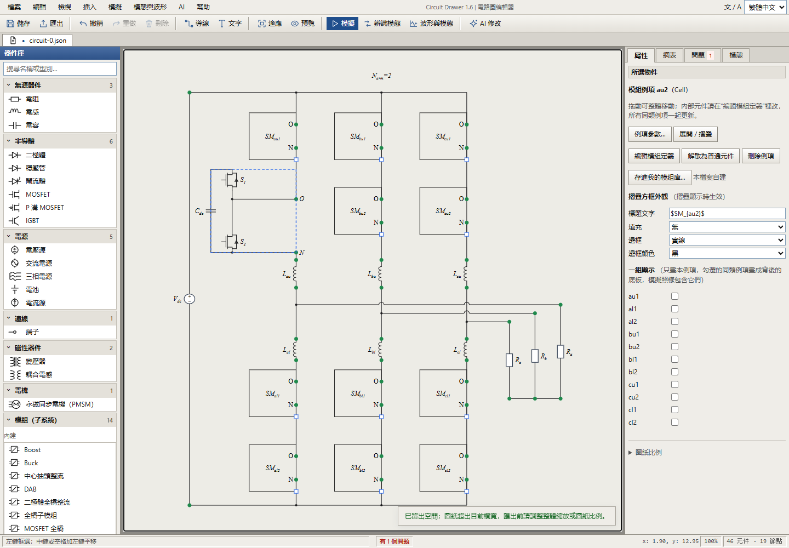

2、**部分摺疊**：目前只有 LLC 半橋支援，開關半橋和整流橋各收成一個帶器件標誌的小框，諧振槽和變壓器照常畫出。

3、**方框尺寸**：選中摺疊框後拖右下角的小方塊，鬆手對齊網格並校驗；無法佈線時提示原因並保留原尺寸。也可以用 **檢視 → 模組顯示 → 方框尺寸… / 恢復預設方框尺寸**。

4、**框內標誌**：IEC 60617 變流器符號 `dcdc`、`acdc`、`dcac`，器件標誌 `mosfet`、`igbt`、`diode`，或只寫名字 `text`。

5、選中實例後，屬性頁可設摺疊標題、填充、邊框樣式和顏色。清空“標題文字”可隱藏標題，直接拖動標題可獨立調整位置。標題偏移隨模組一起移動，支援復原、儲存和重新開啟。

6、**一組顯示**：勾選同類例項後，只畫本例項，其餘畫成背後錯開的底板；模擬照常包含它們。

7、全部展開、全部摺疊、部分摺疊匯出的 SPICE 網表逐行相同。

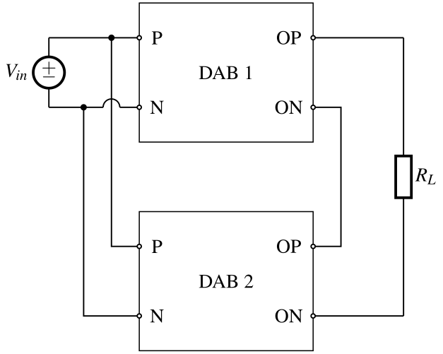

### 4、編輯共用定義和例項參數

1、選中模組按 `Enter`，或右鍵“編輯模組定義”，進入內部畫布。修改元件、導線和標籤後，點“設定埠並儲存…”，在圖中點要引出的節點，填寫埠名和左右位置，再點“儲存定義並同步所有例項”。最後點工具欄“儲存”寫入檔案；“取消編輯定義”放棄本次定義修改。

2、無需預先放端子元件；已有普通端子時會複用它。一個電位上的兩個節點設成不同埠後仍然互通。新增埠最初未接線，已有例項正在使用的埠不能直接刪除或改名。

3、視窗上方可修改模組定義名：以英文字母開頭，使用字母、數字、下劃線或短橫線。儲存後引用它的例項同步更新，連線和各例項參數差異保留。

4、右鍵“例項參數…”只改當前例項；取消勾選恢復共用預設值。只有在定義裡允許單獨修改的參數才可覆蓋。

5、“解散為普通元件”將內部元件放回目前畫布。新放入的元件可在解散後繼續補齊模擬參數。執行模擬或匯出模擬模型前，在模擬視窗填寫所需數值。

### 5、把現有電路存成模組

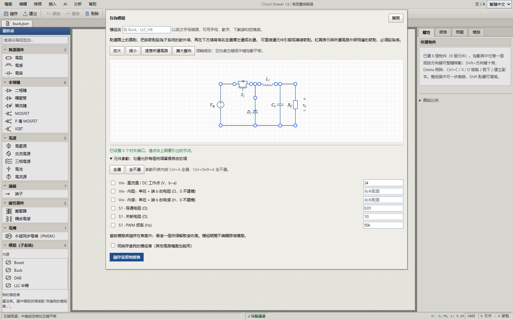

1、框選或 Shift 點選要封裝的元件，右鍵選“存為模組…”（或 **檔案 → 存為模組…**）。

2、填寫模組名，例如 `Buck`、`LLC_HB`。

3、對話方塊中的圖與原圖一致。紅圈是仍與外部電路相連的節點：點選它標成埠，填寫埠名（如 P、N、OP、ON），選擇左邊或右邊；拖動埠行或點上下箭頭排序。漏標外連節點時不能儲存。

4、“元件參數”列出內部元件支援的模擬參數，勾選允許每個例項單獨修改的項。沒有配置的物理值不會被猜測。

5、需要在其他檔案中複用時，勾選“同時存進我的模組庫（其他電路檔案也能用）”。

6、點“儲存並原地替換”。原位置變成一個例項，原編號和測量通道保持不變；封裝前後的 SPICE 網表逐行一致，出現任何電氣變化都會拒絕應用。

7、封裝和解散會同步模態裡的器件編號，目前模態繼續保留並可編輯。舊檔案的暫存模態只在最後一個例項解散且沒有目前模態時恢復。

### 6、模組庫的版本、解散和限制

1、選中例項後點“存進我的模組庫…”，同名時先確認再覆蓋。

2、庫裡的模組改了，已用過它的檔案不會被悄悄改動。屬性頁提示“模組庫裡有新版本”時，點“更新本檔案的定義”（或右鍵“從庫更新”）才替換，所有同類例項一起更新；本檔案的副本也改過時會先提醒。埠名變了的新版本不能直接更新。

3、右鍵“解散為普通元件”把這一份展開成普通元件，其他例項和專案庫保留。

4、模態可跨模組顯示，內部器件用 M/S1、M/T:p 等編號引用。仍只支援一層模組；內部元件的位置在定義裡修改，整個例項可以直接拖動。

5、示例：`examples/modules/library_boost_buck.json`（內建 Boost 與 Buck 級聯）、`examples/modules/boost_parallel_authored.json`（兩路 Boost 並聯）、`examples/modules/llc_ipos.json`、`examples/modules/dab_ipos.json`、`examples/modules/llc_partial.json`。


1、**模組模態**：開啟 [雙 Boost 模態範例](../examples/auto_modes/module_boost_bound.json)，在右側「模態」頁選擇工況。展開時顯示內部器件與導線；摺疊時方框表示內部有器件參與該模態，外部導線按實際迴路高亮。一組顯示只彙總外框，代表例項內的器件仍顯示它自己的狀態。

2、先展開例項，再點「在圖上改模態」，點內部開關或二極體切換狀態，點箭頭反轉該迴路。部分摺疊圖按方框埠網路對應隱藏器件；無法唯一對應時需展開。畫布、編譯預覽與匯出使用同一份結果，來源過期時重新辨識。拖動期間顯示即時接線，位置確認後恢復模態高亮。

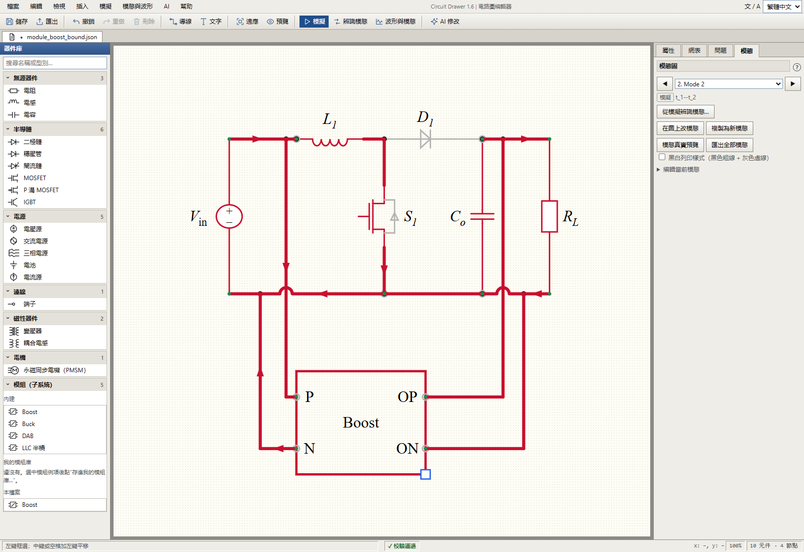

### 7、從空子系統開始

1、右鍵畫布空白處，選“新建空子系統”並放置方框。選中後按 `Enter` 進入內部畫布。

2、從器件庫新增元件並畫導線。需要時按問題欄提示“按當前連線記錄新引腳”，再用“設定埠並儲存…”登記對外埠和參數。

3、回到上層後用普通導線接入電路。空子系統可儲存並重開；在補齊實際電路前，它作為草稿保留，不能匯出模擬。當前只支援一層子系統。

---

## 十五、模態圖

同一張母圖，每個工作模態出一張：導通的元件和它們之間的導線標紅加粗，其餘變灰，箭頭標出電流方向。只換樣式，不動座標，出圖前照常校驗。

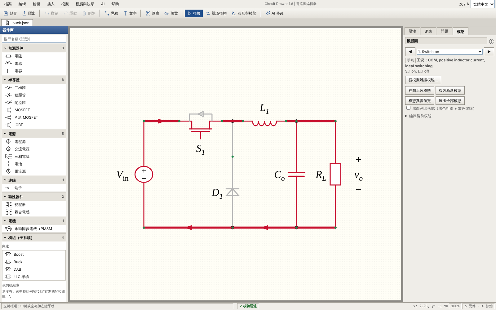

### 1、在編輯器裡

1、開啟右欄“模態”頁，用下拉框或 ◀ ▶（鍵盤 `[` `]`）切換模態，畫布上直接顯示高亮和箭頭。下拉框第一項“（不顯示模態，正常編輯）”回到普通編輯。

2、**在圖上改模態**：開啟後點開關在“關斷 → 溝道導通 → 體二極體續流 → 關斷”之間切換，點二極體切換導通 / 關斷。新導通的器件不在任何迴路裡時，工具補上經過它的最短閉合迴路（沿它能導通的方向，並聯支路自動合併）；不再導通的器件所在迴路會去掉。點箭頭讓那個迴路整體反向。改模態時暫停拖動改圖。

3、**複製為新模態**：複製當前模態插在後面，只改變化的器件。展開“編輯當前模態”還有“新增空模態”“刪除當前模態”，並可直接改 JSON（`on`、`loops`、`caption`、`condition`），點“應用”。

4、**模態真實預覽**看 LaTeX 結果；**匯出全部模態** 一次匯出每個模態和一頁總覽。勾選“黑白列印樣式（黑色粗線 + 灰色虛線）”得到黑白版。

5、模態引用的是元件編號，所以改母圖（挪位置、改走線）後所有模態自動跟著變。刪了元件或改了接法導致模態失效時，模態頁列出“模態 N 已失效”和原因，點一下跳過去修。

6、“模態圖”標題旁的 **?** 收著模態的組成、檢查範圍、在圖上改的規則和 JSON 寫法，點開檢視。工況前的小標籤表示來源：“模擬”來自“從模擬辨識模態”，“手寫”是手寫或在圖上改的。工具只檢查迴路連線和器件導通方向，不檢查偏置和工況是否允許這個模態。

### 2、命令列

```bash
circuit-drawer modes llc -o figs                 # 全桥 LLC（fs < fr）6 个模态加一页总览
circuit-drawer modes llc fs=above                # fs > fr；fs=resonance 为谐振点
circuit-drawer modes dab --mono                  # 黑白：黑色粗线加灰色虚线
circuit-drawer modes flyback 二极管在下 --only 1,2 -f pdf
circuit-drawer modes llc --list                  # 只列出模态定义
circuit-drawer modes fig.json --modes my_modes.json   # 自己的表、自己的模态
```

1、每個模態寫到 `<名字>_mode1.pdf`、`_mode2.pdf`……；`<名字>_modes` 把所有模態排成一頁，每張圖下有 (a)、(b)… 和模態說明，單欄圖兩張一行，正好是雙欄寬度。`--no-sheet` 不出總覽。

2、`--color` 改高亮色（預設 `#c8102e`，也可寫 `blue!70!black` 這類 xcolor 名）；`--off dashed` 把空閒導線畫成虛線；`--arrows N` 控制每個迴路的自動箭頭數（預設 3，0 為不畫）。

3、亮的部分線寬是普通線的 2 倍，灰色部分是 35% 黑，彩色圖印成黑白也分得清。元件標籤和 vo、+、− 這些文字保持黑色。

### 3、內建序列

| 模板 | 模態 |
| --- | --- |
| `llc_fullbridge` | `fs=below`（預設，6 個）、`fs=resonance`（4 個）、`fs=above`（6 個），中心抽頭和全橋整流兩種副邊都有 |
| `dab` | 單移相、原邊超前、電流連續，半個週期 4 個 |
| `flyback` | S 導通勵磁；S 關斷經 D 放能；DCM 空閒段（只在 DCM 出現） |
| `buck`、`boost` | 各 2 個理想 CCM 模態 |

開關承受反向電流時，MOSFET 畫成溝道導通（同步整流），IGBT 畫成反並聯二極體導通。內建序列是常見工況的教科書畫法，不一定和你的論文一致。

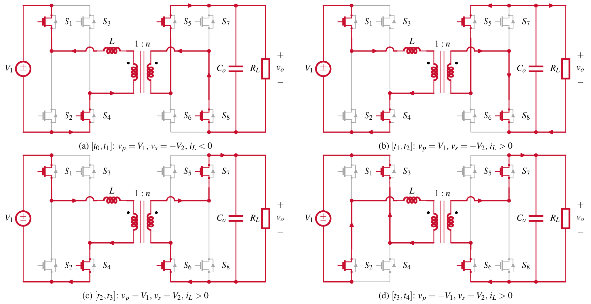

### 4、自己寫模態

座標表的 `modes` 列表，每個模態寫導通器件和迴路：

```json
{"name": "Mode 1", "caption": "$[t_0, t_1]$: $S_1$, $S_4$ on",
 "on": ["S1", "S4", "D1"],
 "loops": [["Vin", "S1", "Cr", "Lr", "T:p|Lm", "S4"],
           ["T:s1", "D1", "Co|RL"]]}
```

1、迴路按電流方向依次寫支路，最後一個接回第一個。工具檢查相鄰支路確實共用一個節點、迴路閉合，然後沿真實走線找出兩個引腳之間的那段導線來高亮。

2、變壓器繞組寫 `T:p`、`T:s`（中心抽頭寫 `T:s1`、`T:s2`）；並聯支路寫 `Co|RL`；開關靠體二極體導通寫 `S2:diode`。

3、只有兩個並聯元件組成的迴路，方向取第一個元件從第一個引腳到第二個引腳。例如 `["RL", "Co"]` 是 Co 放電給 RL。

4、只寫 `on` 不寫 `loops` 也可以：工具把落在閉合迴路上的器件都標亮，但這只是拓撲上的閉合路徑，不畫箭頭，並給出提示讓你確認。

5、自動箭頭不滿意時，寫 `"arrows": [{"at": [1.6, 2.5], "dir": "right"}]` 手動指定。

6、`condition` 寫適用工況，如 `"$f_s < f_r$"`，在 `--list` 和編輯器裡顯示。

### 5、檢查範圍

工具檢查回路連線（名字存在、相鄰支路共用節點、迴路閉合、開關導通方式一致），並提示二極體或 IGBT 溝道被反向使用。不檢查器件偏置、電流大小，以及這個模態在你的工況下是否真的出現。

---

### 5、從模擬辨識模態

1、先在「模擬 → SPICE 模擬…」填寫元件數值、PWM 和暫態參數，再開啟右側「模態」頁，點擊「從模擬辨識模態…」。目前支援普通電路和模組電路的定頻開迴路理想 MOS 開關、正向二極體、RLC 與理想變壓器，範例包含 Buck／Boost 的 CCM、DCM，以及 LLC 三種頻率工況和 DAB。移相軟啟動須在分析視窗之前結束。

2、點擊「執行模擬並辨識」。程式檢查末尾八個完整週期中同相位的電感、繞組及內建勵磁電流、電容電壓、狀態順序和分界。出現漂移提示時，延長模擬或核對初始條件後重新執行。電流閾值取填寫的絕對下限與相對峰值閾值中的較大值。電感和各繞組可按正、負、近零區分狀態。繞組 p 為原邊 p1→p2，s 為整段副邊 s1→s2，中心抽頭的 s1、s2 分別為 s1→sct、sct→s2。

3、每項顯示時間區間、週期占比、開關狀態、支路電流及已有模態對照。點擊「預覽導通路徑」查看實際出圖。短暫換流與閾值附近的區間完整列出，標為「短區間」的候選可自行勾選。DCM 的「全部關斷」候選仍可顯示電容向負載供電的迴路。換流時若提示閉合迴路未覆蓋仍有電流的支路，請結合實測電流核對模型中的數值電容、輸出電容或吸收支路。若電感或繞組電流與圖中迴路方向相反，候選會隱藏方向箭頭並提示衝突支路；可展開實測電流核對，再手動調整模態。

4、勾選需要的候選，改名稱和標題，選擇「追加」或「取代現有模態」，再點「確認寫入選中模態」。名稱須唯一。勾選「同時寫入本次波形及區間綁定」後，會使用同一次模擬的 CSV、完整週期分界與選中模態的名稱；可先點「預覽波形與分界」。未選中的候選保留對應空區間，不自動併入相鄰模態。模態和波形一起寫入、一起復原，點「儲存」後才寫入檔案。已有波形時預設不取代；主動勾選會取代原波形設定和標註。不取代波形時，有既有綁定的模態只能追加。

4a、改變電路、元件模型或模擬參數後，頂部持續提示既有結果過期，模態來源也標為「模擬（已過期）」；舊結果保留供對照。點「重新辨識…」會帶回原辨識設定，重新執行並核對後再採用。復原參數變更會恢復對應來源狀態。波形區間全部綁定後可匯出組合圖，過期波形或已綁定的過期模擬模態須先更新。

5、範例位於 `examples/auto_modes`。其中四個 Buck／Boost 範例均執行 80 ms，DCM 範例給電容明確的初始電壓，Buck 為 14.8 V，Boost 為 67 V。命令列 `circuit-drawer modes-from-sim examples/auto_modes/buck_ccm.json -o output/modes` 在獨立的 run 子目錄中輸出候選 JSON、原使用者探針 CSV、隱藏探針視窗、網表和模擬日誌，供查閱。

6、`trial/cases` 中的 `llc_below.json`、`llc_resonance.json`、`llc_above.json` 與 `dab.json` 保留原有二十個手寫模態，並提供 25 ms、最大積分步長 100 ns 的工況。LLC 分別為 80／100／130 kHz，諧振頻率 100 kHz，負載 12 Ω。DAB 為 50 kHz、30° 移相、7.2 Ω 負載，各開關含 47 Ω／2.2 nF 串聯 RC。四例均為 48 V 輸入、200 ns 死區和 1 nF 數值節點電容。候選包含完整週期、過零及短暫換流區間，可與每個手寫模態的導通集合和方向對照。

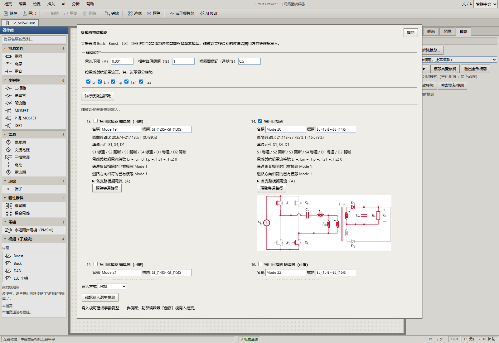

7、分界密集時，圖上以 t0–t8 這樣的編號範圍顯示相鄰標籤，全部分界線與區間仍保留。可開啟 `examples/auto_modes/buck_bound.json` 查看已確認並綁定的範例。

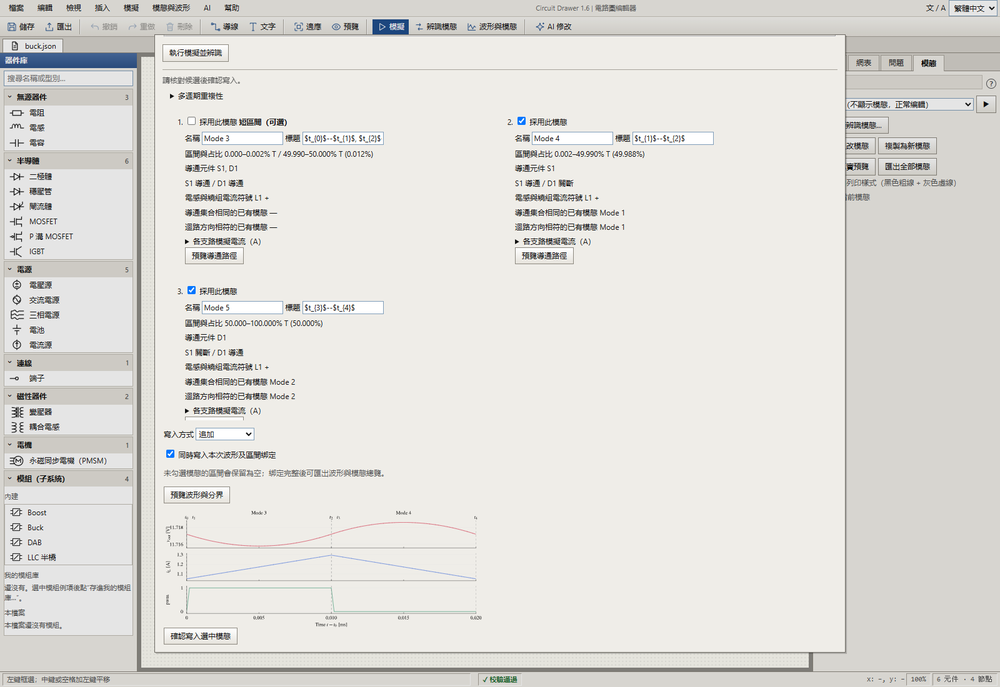

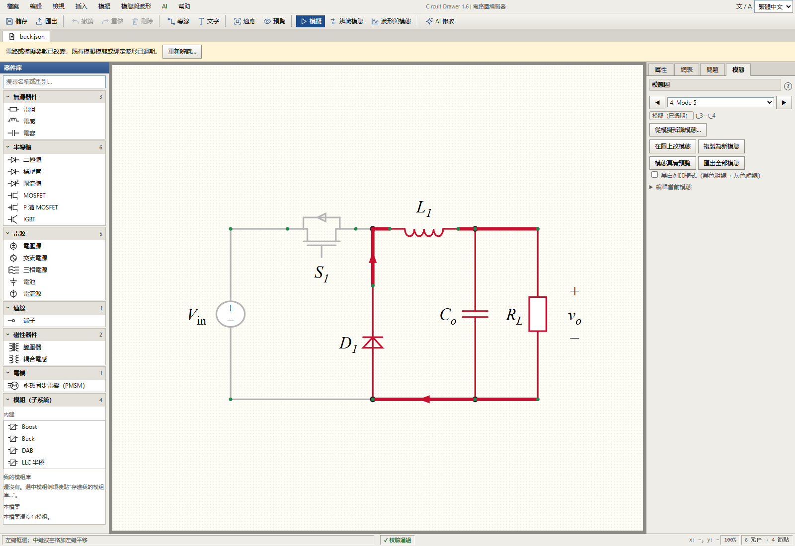

## 十六、波形與模態對應

把模擬或實測波形與模態圖對齊：波形上標 t₀、t₁…，每個區間對應一個模態。

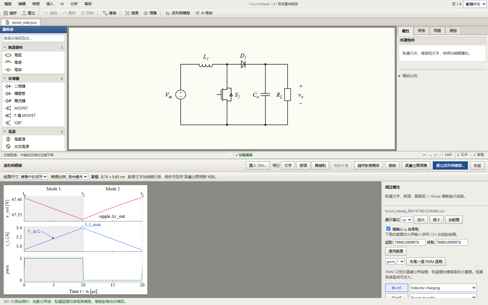

### 1、開啟示例

```bash
circuit-drawer edit examples/waveforms/boost.json
```

點工具欄“波形與模態”（或 **模態與波形 → 波形與模態…**）。示例已經繫結兩個區間，不需要安裝模擬器。點 `t0→t1`，上方母圖切換到電感充電模態；點 `t1→t2`，切換到向輸出傳遞能量的模態。

### 2、匯入 CSV

1、點“匯入 CSV…”，選擇本機檔案或填寫路徑，並指定時間列和單位。

2、格式要求：第一行是列名，其後為數值；UTF-8（可帶 BOM），逗號、分號或製表符分隔；最多 64 MiB、100 萬行、32 列；時間嚴格遞增。缺列、非數值、NaN、無窮大和重複時間會報錯。

3、在“通道、標籤和單位”裡選擇 1–6 條要顯示的曲線，設定標籤和單位。標籤建議寫 `i_L`、`v_out` 這類英文數學記號，下標自動排版。

4、匯入的 CSV 會複製到 JSON 旁邊的 `waveforms-data/` 資料夾，檔名帶內容校驗碼。分享時把 JSON 和這個資料夾一起復制。JSON 裡只儲存路徑、通道和區間，不儲存取樣值。

4a、在「縱軸分組」把同單位通道設為相同組號並套用，即可共用縱軸；圖例按欄寬換行，實際幅值與 CSV 不變。單位不同會提示分開顯示，不自動換算。選「獨立縱軸」恢復分行，可復原和儲存。

### 3、選擇時間範圍和分界

1、輸入起止時間並點“應用範圍”，或在曲線上框選放大，或用“放大 / 縮小 / 全範圍”。顯示單位可選 s、ms、us；預設橫軸以 t₀ 為零點，範圍和分界輸入始終使用 CSV 的絕對時間。

2、選擇 PWM 通道後點“末尾一個 PWM 週期”，程式按最後兩個上升沿和中間的下降沿建議分界時間。PWM 只幫助選區，不識別模態。

3、拖動分界線，或展開“精確設定分界時間”填寫數值；“拆分所選區間”增加邊界。分界線不能重合或交叉。

4、為每個區間在下拉框裡選一個模態。點區間時母圖顯示對應的電流路徑。點“儲存對應關係”寫入 JSON。

### 4、標註

1、面板上方“標註”有四個按鈕：“文字”點一下放文字；“箭頭”從箭尾按住拖到要指的點；“關鍵點”在峰值、過零等位置放小空心圓，可帶文字。

2、文字只能寫英文或 `$数学$`（如 `$i_L$ peak`、`$I_{L,\max}$`），不能寫中文。

3、點選標註後可拖動整體、拖箭頭兩端或單獨拖文字；雙擊改文字；“刪除所選”或 `Delete` 刪除；“撤銷”恢復。t₀、t₁… 和 `Mode k` 標籤也能拖開，分界線不動。

4、“標註屬性”可修改顏色、字號（5–20 pt）、線寬（0.1–2 pt）、圓圈半徑（0.02–0.3 cm）和文字偏移，點“應用屬性”生效。選中標註後方向鍵每次移動 0.01 cm，Shift 加方向鍵 0.1 cm。

5、面板按紙面比例顯示；“紙面尺寸”可在“總覽中的波形”和“獨立波形圖”之間切換，“檢視比例”只改變檢視倍率。數學文字的最終效果用“真實出圖預覽”核對。

6、點選「AI 標註…」，輸入「在 i_L 峰值標 $I_{L,\max}$，在第一區間上升段畫箭頭標 $V_{in}/L$」。程式從目前 CSV、所選通道和時間區間計算候選點，使用目前 AI 設定產生標註。核對預覽後點選「採用標註」，新標註追加到既有標註，整批可復原。點選「儲存對應關係」寫入檔案。

7、AI 收到候選點摘要，包含區間邊界、峰谷、過零點和最長連續上升／下降段的中點與斜率。每區間最多保留 8 個過零候選，標註總數最多 40 條。產生期間變更通道、區間或標註後，需要重新產生。文字使用英文或數學記號，可繼續在「標註屬性」中微調。

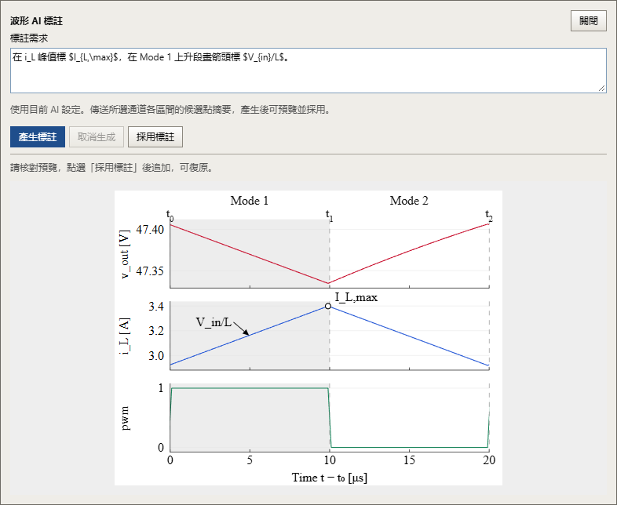

8、「區間尺寸線」按住起點拖到終點，始終保持水平，可標 `$D T_s$`。拖動端點修改區間，拖動整體保留長度，短區間的箭頭移至外側；文字、線寬、偏移、刪除和復原沿用標註操作。AI 尺寸線的起止時間必須取同一通道的真實候選點。

9、`examples/waveforms/interleaved_axes.json` 展示同軸電感電流與尺寸線；CSV 為理想解析參考，並非新增的開關模擬或實測資料。

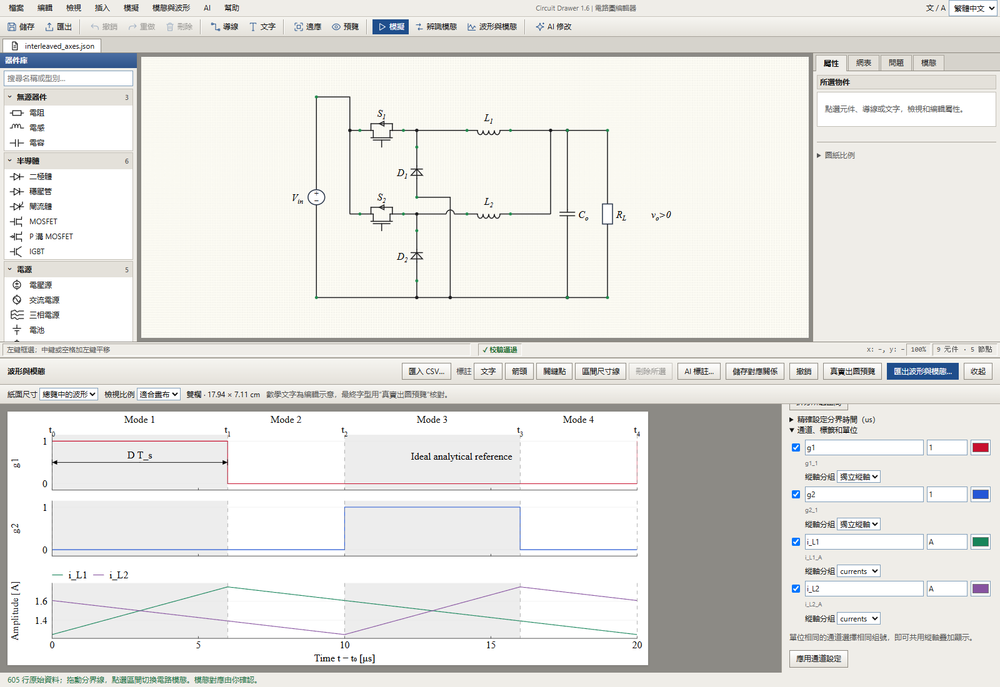

### 4a、XY／狀態平面

1、點「XY / 狀態平面…」，選橫軸與縱軸通道；兩座標來自同一時刻，範圍和分界沿用波形面板。箭頭表示時間方向，起點實心、終點空心；未綁定模態的區間為灰色。可關閉箭頭或模態著色，數值和單位保持原樣。

2、預覽不改圖。點「套用到目前圖紙」後可復原，再點「儲存對應關係」寫入檔案。匯出會多一份 `_xy` 圖，也可勾選「僅匯出 XY 圖」；「移除 XY 圖」保留時間波形和 CSV。圖幅始終按目前獨立圖寬度，原時間標註不會畫在 XY 圖上。

3、`examples/waveforms/boost_state_plane.json` 引用原 Boost 模擬資料，可直接檢視。此圖不自動判斷穩定性，不人為閉合軌跡，也不自動歸一化。

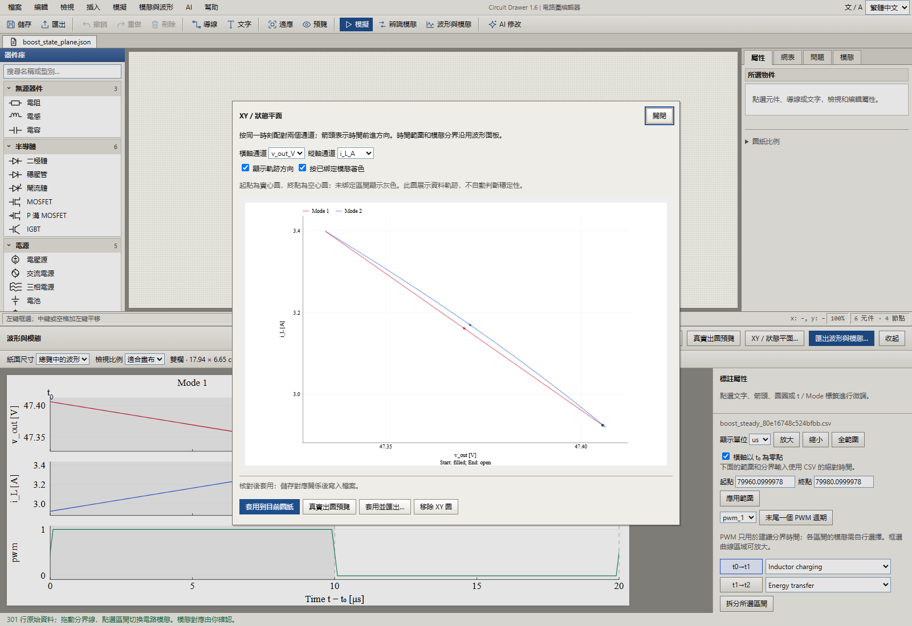

### 5、匯出

1、點“匯出波形與模態…”，選擇輸出資料夾和格式（預設只選 SVG；Word 用 SVG 或 PNG，LaTeX 用 PDF，另可勾選 TeX 原始碼）。

2、以 `boost` 為例，輸出：

| 檔案 | 內容 |
| --- | --- |
| `boost_waveforms.<格式>` | 獨立波形圖，含 t₀、t₁… 分界線 |
| `boost_mode1.<格式>` 等 | 每個用到的模態各一份 |
| `boost_waveform_modes.<格式>` | 波形與模態總覽 |

3、“波形按模態切片”（預設勾選）在波形上按區間交替加淺灰底，並標 `Mode 1`、`Mode 2`……（編號即模態列表順序，與 `_mode1` 等檔案一致）。取消勾選只畫虛線分界與 t₀、t₁…。

4、“總覽排版”：豎排（預設，單欄、雙欄都可）、並排（左波形右模態，只能雙欄）、兩列（波形在上，下面模態圖每行兩張）。後兩種每個模態只畫一次，圖注列出它對應的全部區間。

5、取消“包含對應模態與總覽”只輸出波形。全部編譯成功後才寫入目標資料夾，失敗時保留舊輸出。

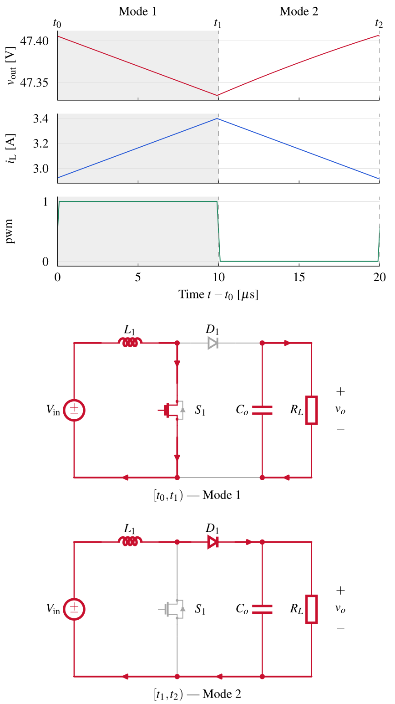

### 6、命令列

```bash
circuit-drawer waveforms examples/waveforms/boost.json -o out/boost-waveforms -f svg,pdf
circuit-drawer waveforms examples/waveforms/boost.json -o out/boost-waveforms -f png --wave-only
circuit-drawer waveforms examples/waveforms/boost_side.json -p double -o out/boost-side -f png
```

### 7、重新模擬後

1、重新匯入 CSV 後，仍適用的通道和區間繫結會保留；之前用了“末尾一個 PWM 週期”時會重新計算邊界。

2、只改母圖標籤、位置和符號尺寸後可以直接重新出圖。連線、元件類別或模擬參數改變時，程式提示重新匯入對應工況的資料；CSV 快照被改寫也會拒絕出圖。

3、顯示和匯出時，大檔案按分桶保留首點、最小值、最大值和末點，不會濾掉峰值；原始資料不修改。

---

## 十七、SPICE 模擬

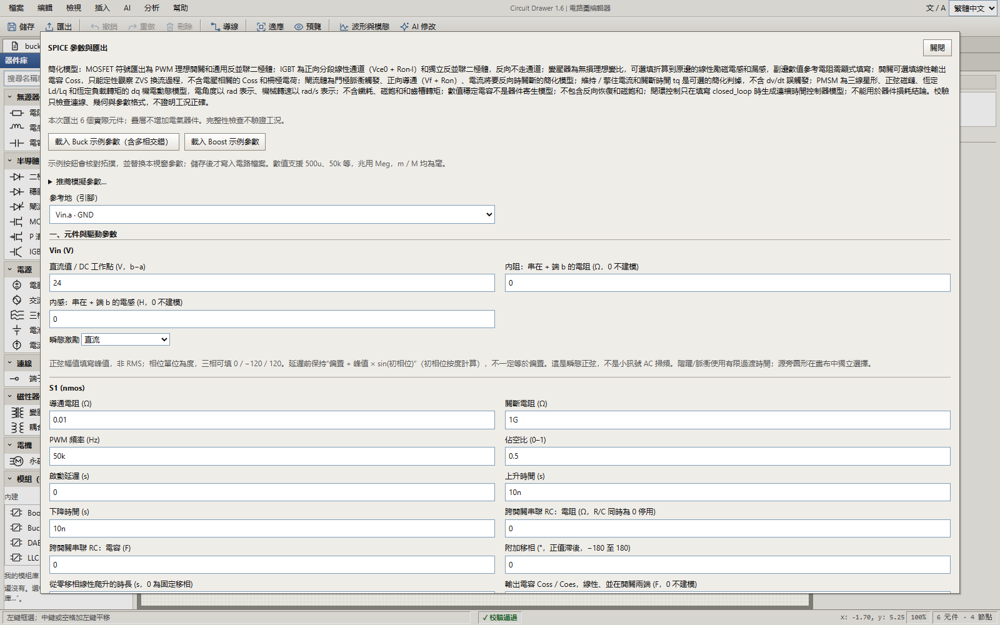

### 1、準備

1、僅生成 `.cir` 不需要 ngspice。執行模擬需要安裝 ngspice（見[第二章](#二安裝與啟動)），並在啟動編輯器之前設定好路徑。

2、參數儲存在當前座標表的 `simulation` 欄位裡。程式不從文字標籤猜數值，每個元件都要有參數。

### 2、視窗操作

點 **模擬 → SPICE 模擬…** 開啟“SPICE 參數與匯出”視窗：

1、**載入 Buck 示例參數（含多相交錯）/ 載入 Boost 示例參數**：核對拓撲後填入一組示例參數。多相交錯 Buck 每相 50 kHz、佔空比 0.5，第 k 相啟動延遲 k/N 個週期。只改視窗表單，點“儲存參數”後才寫入電路檔案。

2、**推薦模擬參數…**：見本章第 6 節。

3、**參考地（引腳）**：選擇一個真實引腳，它所在的網路作為 SPICE 地。

4、**一、元件與驅動參數**：每個元件一組參數，見本章第 3 節。

5、**二、瞬態設定**：輸出取樣間隔、結束時間、最大積分步長、數值穩定電容（每個網路到模擬地，預設 0 關閉；它不是器件寄生電容）。要求 0 < 最大積分步長 ≤ 取樣間隔 < 結束時間，每個 PWM 週期至少 50 個取樣點，導通和關斷段至少各 10 個積分步長。模擬從 0 秒開始，使用電感、電容的初始條件，不先求直流工作點。

6、**三、測量通道（可修改 JSON）**：電壓通道寫正負兩個引腳；電流通道寫元件（D、L、scr 為 a→b，V、vac 為 b→a，igbt 為 c→e 總埠電流；變壓器還要指定繞組）；驅動通道寫開關，輸出歸一化 0/1 PWM。通道名用英文、數字和下劃線，以字母開頭，最多 32 個。

7、**四、閉環控制（可選）**：見[第十八章](#十八simulink-與-plecs-匯出及閉環控制)。

8、**五、輸出資料夾**：可瀏覽或填寫；相對路徑以當前電路檔案所在資料夾為起點。

9、**儲存參數** 只儲存；**匯出 SPICE** 只生成 `.cir`；**匯出並模擬** 生成 `.cir`、`.csv`（列名帶單位）和執行日誌。匯出前照常校驗。

10、模擬成功後會直接開啟波形面板並載入本次的 CSV，接著可以做[第十六章](#十六波形與模態對應)的對應。

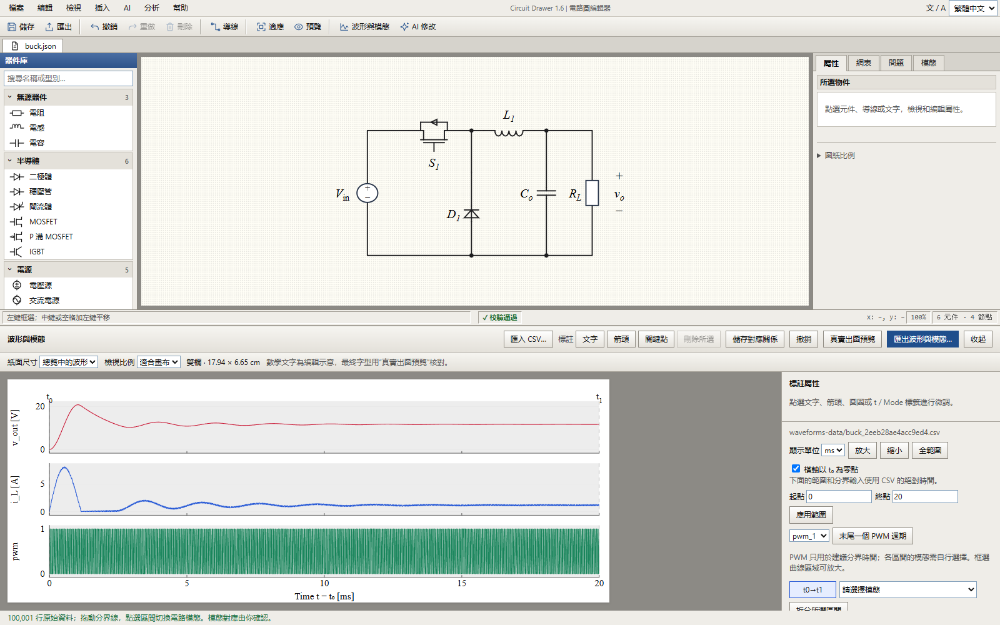

### 3、器件與參數

| 器件 | 模型 | 主要參數 |
| --- | --- | --- |
| R、L、C | 線性 | 數值；L、C 必須寫初始值（L 電流 a→b，C 電壓 a−b）；L 可選串聯電阻 |
| V、vac | 電壓源 | 直流值（b−a）；可選內阻、內感（串在 + 端 b）；瞬態激勵見下節 |
| I | 電流源 | 直流值（a→b）；瞬態激勵 |
| D | `generic_diode` | Is、N、Rs；穩壓管另填擊穿電壓 Vz@Izt、測試電流 Izt、動態電阻 Zzt |
| nmos、pmos | `ideal_switch` | Ron、Roff、PWM 頻率、佔空比、啟動延遲、上升 / 下降時間；可選跨開關 RC、附加移相與移相爬升時長、線性輸出電容 Coss、體二極體參數 |
| igbt | `simplified_igbt` | Vce0、Ron、Roff 和 PWM；正向通道 c→e，反向電流由反並聯二極體承擔 |
| scr | `simplified_thyristor` | Vf、Ron、Roff，觸發脈衝沿用 PWM 欄位（`delay` 為首次觸發時刻）；可選維持電流、擎住電流、關斷時間 |
| transformer | `ideal_transformer` | 全副邊匝比 Ns/Np（中心抽頭每半邊為一半）、同名端極性、參考電阻（至少 1 GΩ）；可選折算到原邊的勵磁電感和漏感 |

1、數值用 SI 單位，可寫 `500u`、`50k`、`20m`、`1Meg`。按 SPICE 約定，`m` 和 `M` 都是毫，兆要寫 `Meg`。

2、PWM 佔空比按上升沿和下降沿 50% 閾值之間的時間計算。CSV 裡的 PWM 是歸一化 0/1 控制訊號，不是物理門極電壓。

3、三相電源：窗口裡的“三相統一設定”按線電壓有效值、頻率、A 相初相和相序填三個源的正弦參數（峰值 = 線電壓 × √2 / √3），點“儲存參數”才寫入。

### 4、激勵

電壓源和電流源可選直流、階躍（可上升或下降）、重複脈衝和正弦交流；`vac` 必須是正弦。

1、階躍：初值、終值、延遲、過渡時間（必須大於零），匯出為 `PWL`。

2、脈衝：另填返回時間、平臺寬度和週期，匯出為 `PULSE`。

3、正弦：偏置、峰值（不是有效值）、頻率、延遲、相位（度，三相可填 0、−120、120）。延遲前輸出保持“偏置 + 峰值 × sin(初相位)”。這是時域瞬態正弦，不是小訊號 AC 掃頻。

### 5、輸出檔案和命令列

```bash
circuit-drawer spice examples/spice/buck.json -o out/spice/buck            # 只生成 .cir
circuit-drawer spice examples/spice/buck.json -o out/spice/buck --run      # 运行，生成 CSV
circuit-drawer spice-init my_boost.json --preset boost -o my_boost_sim.json
```

1、CSV 第一列是 `time_s`，其餘列名帶單位，如 `v_out_V`、`i_L_A`、`pwm_1`。時間軸轉換為指定的均勻取樣間隔。

2、只有模擬成功才寫出這一組檔案；引擎失敗、超時（最長 120 秒）或波形不完整時保留已有結果並報告錯誤。

3、`spice-init` 按真實網表核對基礎結構（V、L、C、R、D、nmos 各一個），把 Buck 或 Boost 示例參數寫進一份新 JSON，輸入檔案保持不動；輸出檔案已存在時需加 `--force`。

4、命令列不指定 `-p` 時，先按單欄校驗，單欄通不過而雙欄能通過時按雙欄校驗並提示；明確寫了 `-p` 就嚴格按它校驗。欄寬不影響匯出的模型。

5、可執行的示例在 `examples/spice/`：`buck.json`、`boost.json`、`llc_fullbridge.json`、`dab.json`、`igbt_ac.json`、`three_phase_ac.json`、`zener_regulator.json`、`thyristor_rectifier.json`、`thyristor_bridge_3ph.json`、`battery_internal_resistance.json` 等。

### 6、推薦模擬參數

在 SPICE 視窗展開“推薦模擬參數…”：

1、不填需求時，基礎 Buck 和交錯 Buck 用 24 V 輸入、12 V 輸出、24 W、50 kHz；Boost 用 24 V 輸入、48 V 輸出、24 W、50 kHz；電感紋波取每相平均電流的 30%，輸出紋波取輸出電壓的 1%。只填輸入電壓時，Buck 按 Vout = Vin/2、Boost 按 Vout = 2 × Vin 推算。

2、也可以填寫輸入、輸出電壓、功率、開關頻率和紋波，或用一段文字描述需求（文字需求要用到 AI 畫圖助手的介面配置）。其他已展開的開環電路由 AI 提議參數。

3、點“生成推薦並檢查”：結果逐項列出原值、建議值、理由和假設，並在臨時資料夾做一次不超過 10 ms 的短 ngspice 檢查。

4、核對後點“採用到參數列”，再點“儲存參數”或匯出才寫入檔案，可撤銷。推薦讀取本視窗當前參數；沒有 ngspice、校驗失敗、生成後圖紙或視窗參數變化、取消時不能採用。

5、這是基於理想 CCM 公式的初稿，不自動補償壓降，也不選器件額定值；短模擬完成不等於指標達標。

6、支援已有可執行工況的模組例項與閉環控制器調參，複用現有 AI 配置。模組只改允許調整的例項數值，共用預設值和其他例項保持不變；閉環只改已有數值，保留連線、公式和測量繫結。外部控制表調參後儲存為本電路內嵌副本，原控制檔案不動，副本不再隨原檔案更新。

7、可開啟 `examples/modules/boost_parallel_authored.json`，輸入“只把模組 M 的 L1 調到 600u，其餘參數保持不變”。閉環示例 `examples/closed_loop/buck_vmode.json` 可輸入“只把 Type III 的 fi 調到 14000 Hz”。先看建議和短模擬，再採用、儲存。閉環會顯示已有環路模型的分析；該模型是否與功率級一致仍需核對，短檢查不證明穩態或離散穩定性。

### 6.1、參數範圍搜尋

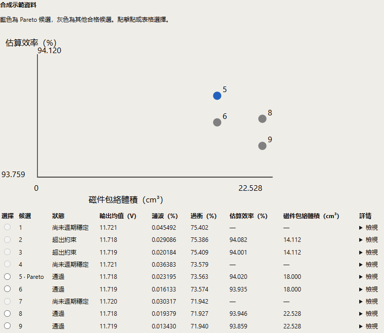

1、選擇「實驗功能 → 參數範圍搜尋…」，或在正在編輯的 SPICE 視窗中展開同名區域，讀取目前可調參數，填寫上下限、點數和線性／對數間隔。同一列按 Ctrl 多選可同步改變多個開關頻率；各列取所有組合，最多 32 組。模組只改允許編輯的實例數值。

2、選擇輸出電壓通道和非零直流目標，填寫輸出誤差上限，可另填漣波、啟動過衝上限。每組跑完整暫態，末尾八個完整週期通過重複性檢查後才比較。漣波取最後完整週期，過衝取整個模擬過程，百分數均相對於目標電壓絕對值。

3、未填寫損耗資料時比較漣波與過衝；填寫已驗證的 powerdesignkit 元件、磁件和輔助損耗資料後，比較估算效率與磁件整件包絡體積。藍色點是 Pareto 候選，表格保留失敗與超限原因。體積不代表整台變換器，效率是手冊模型後處理估算，不是實物結論。

4、選點後點擊「採用選取參數到視窗」，核對後再儲存或匯出；採用本身不寫檔案。修改圖紙、視窗參數、搜尋設定或資料檔案後須重新搜尋。關閉視窗會請求取消。可從 `examples/parameter_search/buck.json` 開始，範例的元件、磁件及損耗資料均為合成示範資料。完整格式、命令列與模型限制見 [參數搜尋說明](PARAMETER_SEARCH.md)。

### 7、全圖器件模型

**模擬 → 全圖器件模型…** 可以給整張圖統一選擇模擬模型，圖形不變：

| 類別 | 可選模型 | 參數 |
| --- | --- | --- |
| 開關管 | 理想開關、MOSFET（Level 1）、IGBT（分段線性） | MOSFET 需 vto、kp、gate_voltage；IGBT 需 vce0 |
| 電阻 | 理想、帶寄生參數 | 串聯電感、並聯電容 |
| 電感 | 理想、帶寄生參數 | 串聯電阻、並聯電容 |
| 電容 | 理想、帶寄生參數 | 串聯電阻、串聯電感 |

填寫參數後點“應用到全圖”；選“沿用各器件設定”恢復原行為。電感已有單獨的非零串聯電阻時，再選全圖電感寄生模型會提示衝突，請明確選擇一種。

### 8、限制

模型都是簡化模型：不含反向恢復、磁飽和、溫度特性、尾電流、廠商子電路。`.cir` 使用 ngspice 控制語法，不保證相容其他 SPICE。單獨的 SPICE 波形不包含手冊損耗模型，不能據此給出真實元件損耗、效率或 ZVS 結論。參數範圍搜尋中的估算另需明確損耗與磁件資料。

### 9、傳導 EMI 估算


從 `buck_emi` 模板或 [Buck LISN 示例](../examples/emi/buck_lisn.json) 開始。電路中須顯式畫出兩條供電線的 LISN、50 Ω 接收機埠和機殼迴路。在 **模擬 → SPICE 模擬…** 設定電源與取樣參數，再開啟 **實驗功能 → 傳導 EMI 估算…**。

選擇正、負線 LISN 電壓通道和分析時間窗，點“運行當前參數”執行 ngspice，顯示各線及共模／差模頻譜。寄生電容部分支援幾何公式或實測／Q3D CSV；“初算濾波器並重跑對比”會在候選中修改指定濾波元件並重新模擬，核對比較結果後再明確採用，採用可撤銷。

結果是使用 Hann 窗與正弦 RMS 幅值的工程估算，不是準峰值／平均值接收機讀數。CISPR 32 曲線只作指定 AC 電源埠參考，不構成 DC 埠合規結論。結果受開關邊沿、寄生、接線、機殼迴路、時間窗漂移與取樣步長影響，須比較更小步長並結合實測；示例候選仍高於參考線。


命令列：`circuit-drawer emi examples/emi/buck_lisn.json -p double --compare -o out/emi`。輸出頻譜、數值結果和模擬資料；採用參數後再儲存當前圖紙。

### 10、PMSM 與 FOC


1、從“電機”器件庫新增永磁同步電機，a、b、c 接三相輸出。按 `R` 旋轉；標籤可以獨立拖動，內部星點不引出。

2、在 SPICE 視窗填每相定子電阻、d/q 軸電感、永磁磁鏈、極對數和總轉動慣量；可補摩擦、恆定負載轉矩及初值。極對數不是總極數；速度用機械 rad/s，角度用電角度 rad。

3、展開“測量通道”，選擇電機與測量量，再點“新增電機測量”。支援三相電流、dq 電流、機械轉速、電角度和電磁轉矩。FOC 輸入繫結相應測量通道，速度環用機械轉速，Park 變換用電角度。


4、示例為 [三相電源帶電機](../examples/spice/pmsm.json) 和 [閉環 FOC](../examples/closed_loop/pmsm_foc.json)。修改 FOC 示例母線額定電壓時，同時修改控制器輸入 `vdc` 的定值。

5、模型為定參數正弦 PMSM，不含磁飽和、鐵損或溫升。Simulink 中的 PMSM 需要 Simscape Electrical；PLECS 使用 Standalone 模型。

---

### 11、Buck 輸出阻抗


1、載入 `buck_impedance` 範本或開啟 `examples/impedance/buck_output.json`。範例採用 12 V 輸入、3.3 V 輸出、同步平均橋臂與內嵌 PI 控制器。在「實驗功能 → 輸出阻抗分析…」選擇 `v_out`。

2、預設掃描 10 Hz～10 kHz，時域注入峰值 10 mA，初始穩定時間 200 ms。「掃頻並對照時域注入」選取至多三個頻點做正弦電流注入。工作點漂移時，增加穩定時間或檢查閉迴路參數。「一致」表示複阻抗相對誤差 ≤2%、相鄰整週期視窗漂移 ≤1%。可減小幅值重複計算，檢查小訊號結果。

3、定義為 `Zout = −ΔV/ΔI`，電流從量測正端流向負端，圖中負載參與計算。Bode 幅值以 dBΩ 表示，Nyquist 展示正頻率複阻抗軌跡。源負載穩定性判斷還需相應阻抗比與開迴路極點資訊。

4、支援直流 RLC 電路與明確設定的 `average` 上下橋臂，最高頻率取最低開關頻率的十分之一以內。電源填固定 `dc`，控制參考取啟動斜坡的最終值。每次執行獨立儲存設定、CSV、SVG、JSON、源圖快照及原始模擬檔案，視窗提供資料下載。

```sh
circuit-drawer impedance examples/impedance/buck_output.json --probe v_out --compare -o out/impedance
```

### 12、併網逆變器 dq 阻抗矩陣


1、載入 `grid_dq_impedance` 範本或開啟 `examples/impedance/grid_dq.json`，進入「實驗功能 → dq 阻抗矩陣…」。按 A、B、C 順序選擇 `Va`、`Vb`、`Vc`。範例包含 300 V 直流匯流排、50 Hz 三相電網、PLL 與 dq 電流 PI，參考電流為 id=10 A、iq=0 A。

2、每個頻點分別執行基線、d 軸電壓擾動與 q 軸電壓擾動，扣除基線後計算完整 2×2 導納矩陣，再求逆得到阻抗。頻率表示 dq 座標系中的擾動頻率。量測座標按電網頻率固定旋轉，d 軸由 A 相源的基準相位定義，原控制表的 PLL 動態參與計算。電流從變流器流向電網，定義 `ΔVdq = −Zdq·ΔIdq`。

3、預設 10 Hz～1 kHz、每十倍頻程 3 點，共 7 個頻點，注入峰值 2 V、初始穩定時間 300 ms、最大步長 20 μs。積分使用 Gear 二階，按擾動與電網頻率進一步約束步長。頻點增加時會增加模擬次數，視窗關閉後可重新開啟查看完成結果。

4、「掃頻並對照減半幅值與步長」在首、中、末頻點重複量測。表中「一致」要求所有矩陣項的相對差 ≤2%，每次量測的相鄰整週期視窗漂移 ≤1%。接近零的分量以矩陣範數的 0.1% 作為相對差分母下限。可繼續減小幅值與步長檢查收斂，工作點波動時增加穩定時間或檢查 PLL 與電流迴路。

5、電網須為同頻同幅的 ABC 正序正弦源，三相共用負端中性點，`offset`、`delay` 均為 0。電路採用 RLC 濾波器與 `average` 橋臂，其他獨立電源使用固定 `dc`。分析頻率上限為最低開關頻率的十分之一，注入峰值上限為電網相電壓峰值的 5%。

6、「矩陣項」切換 `Zdd`、`Zdq`、`Zqd`、`Zqq`，列表示電壓軸、欄表示電流軸。下載 CSV 可取得四項阻抗與導納的實部、虛部，四張 SVG 包含 Bode 與正頻率 Nyquist 軌跡。JSON 記錄參數、工作點、漂移與對照結果，獨立結果目錄同時儲存圖紙與控制表快照、網表及原始波形。穩定性判斷還需系統連接下的阻抗比矩陣與開迴路極點資訊。

```sh
circuit-drawer dq-impedance examples/impedance/grid_dq.json --sources Va Vb Vc --compare -o out/dq-impedance
```

### 13、直流源負載穩定性


1、開啟「實驗功能 → 源負載穩定性…」，選擇 48 V 匯流排範例，點「載入範例」，再點「計算阻抗比與極點」。也可用「讀取模型 JSON」載入獨立的埠模型檔案，編輯參數後重新計算。源阻抗 `Zs` 和負載導納 `Yl` 由這個檔案提供，目前畫布可繼續用於繪圖。

2、電流正向流入負載，源端定義 `Δv = −Zs·Δi`，負載端定義 `Δi = Yl·Δv`。兩端應對應同一工作點、同一分界埠，電容和控制迴路各自歸入對應子系統一次。阻抗比為 `Tm = Zs·Yl = Zs/Zl`，閉迴路特徵多項式為 `Ds·Dl + Ns·Nl`。源阻抗單位 Ω，負載導納單位 S，阻抗比無因次。

| 欄位 | 填寫方法 |
| --- | --- |
| `params` | 選填參數物件，數值或公式，按出現順序引用已定義參數 |
| `source_impedance` | 源阻抗的 `num`、`den` 係數陣列，按 s 降冪排列 |
| `load_admittance` | 負載導納的 `num`、`den` 係數陣列，按 s 降冪排列 |
| `freq` | 圖表的起訖頻率，單位 Hz，預設 `[1, 10000]`，正數遞增，最多六個十倍頻程 |
| `points` | 每十倍頻程點數，預設 80，整數 5～200 |

3、每個埠支援最高八階、實係數、連續時間正則有理模型，分子階數不超過分母。係數可寫 `"L*C"`、`"-P/V^2"` 等公式。程式保留提供的分子、分母公因式，將其包含的內部模態計入極點。穩定性結論涵蓋模型中表達的動態，純延遲、離散控制與 dq 矩陣互聯需要相應模型方法。

4、視窗顯示開迴路右半平面極點數 `P`、順時針繞數 `N`、閉迴路右半平面極點數 `Z`，核對 `Z=P+N`。完整右移閉合輪廓按模型根的位置取界並逐級細分，繞數獨立於圖表頻帶。圖表實線與虛線分別顯示所選頻帶的正、負頻率軌跡，紅叉標記 −1。`頻帶取樣最小 |1+Tm|` 僅涵蓋顯示取樣點。臨界或數值邊界結果需結合極點表檢查，重根精度不足、數值求解或繞數核對失敗會回傳錯誤。

5、範例使用 `Zs=(R+sL)/(LCs²+RCs+1)`、`Yl=−P/V²`，參數為 48 V、0.2 Ω、2 mH 和 470 μF。V 表示匯流排工作點，對應理想電源電壓為 `E=V+RP/V`。60 W 的閉迴路極點約為 `−22.2961 ± j1028.4901 rad/s`，200 W 約為 `+42.3463 ± j1021.5514 rad/s`。兩個可編輯檔案分別位於 [60 W 範例](../examples/impedance/source_load_stable.json) 和 [200 W 範例](../examples/impedance/source_load_unstable.json)。

6、下載 `model.json` 可保留輸入，`result.json` 儲存求值後的係數、極點、繞數與頻率響應，CSV 儲存複數資料，SVG 儲存圖表。命令列每次執行寫入獨立目錄。已有 Buck／dq 掃頻輸出可用於核對埠模型，完整穩定性判斷還依賴模型的內部動態與開迴路極點資訊。

```sh
circuit-drawer impedance-ratio examples/impedance/source_load_stable.json -o out/impedance-ratio
```

### 14、dq 互聯穩定性


1、開啟「實驗功能 → dq 互聯穩定性…」，載入 1500 W 或 6000 W 範例，點「計算阻抗比與極點」。也可讀取獨立埠模型 JSON，填寫同一工作點、同一固定 dq 座標下的源阻抗 `Zs` 與負載導納 `Yl`。電流和電壓均按 d、q 排列，矩陣列表示輸出軸，行表示輸入軸。

2、每個埠用連續時間狀態方程 `dx/dt=A·x+B·u`、`y=C·x+D·u` 表達，傳遞矩陣為 `C·(sI−A)⁻¹·B+D`。源端取 `u=Δi`、`y=−Δv`，負載端取 `u=Δv`、`y=Δi`，電流正向流入負載。兩個模型須使用一致的座標方向、角度基準、額定頻率、單位及功率正規化，控制器與線路各歸入相應埠一次。PLL、控制迴路和頻率變化的影響需體現在提供的狀態模型中。

| 欄位 | 填寫方法 |
| --- | --- |
| `params` | 選用參數物件，按出現順序引用已定義參數，支援數值和公式 |
| `source_impedance`、`load_admittance` | 各含實矩陣 `A`、`B`、`C`、`D`，表示源阻抗和負載導納 |
| `A`、`B`、`C`、`D` | 每埠狀態數 n 為 0～8，尺寸分別為 n×n、n×2、2×n、2×2，元素可引用 params |
| 靜態埠 | `A=[]`、`B=[]`、`C=[[],[]]`，由 2×2 的 D 提供響應 |
| `freq`、`points` | 顯示頻率範圍 Hz，預設 `[1,10000]`，正數遞增且最多六個十倍頻程。每程預設 80 點，整數 5～200 |

3、阻抗比採用完整矩陣 `T=Zs·Yl`。廣義 Nyquist 計算 `det(I+T)` 繞原點的順時針繞數 N，保留兩端全部內部狀態，核對開迴路右半平面極點數 P 與閉迴路右半平面極點數 Z 的關係 `Z=P+N`。繞數使用按模型極點取界的完整右移輪廓。閉迴路狀態矩陣和開閉迴路極點儲存在結果 JSON，可檢查埠響應中隱藏的內部模態。

4、「曲線」可選擇 `det(I+T)`、`Tdd`、`Tdq`、`Tqd`、`Tqq`。行列式圖的紅叉在原點，實線與虛線分別表示顯示頻帶內的正、負頻率，四個 T 項顯示正頻率響應。`頻帶取樣最小 |det(I+T)|` 只描述目前取樣點。虛軸或近虛軸閉迴路極點顯示臨界狀態。直接通道 `I+Ds·Dl` 接近奇異、求根精度不足或繞數與內部極點不一致時，視窗顯示計算錯誤。

5、範例使用 50 Hz 同步座標下的 RLC 電源與理想恆功率負載，`R=0.2 Ω`、`L=2 mH`、`Cbus=470 μF`。採用幅值不變 dq 變換，工作點 `vd=100 V`、`vq=0`，100 V 為相電壓峰值，P 為三相總有功功率，Q=0。負載導納為 `diag(−G,+G)`，其中 `G=2P/(3V²)`。1500 W 模型漸近穩定，6000 W 模型有兩個右半平面極點。可編輯檔案見 [1500 W 範例](../examples/impedance/dq_source_load_stable.json) 和 [6000 W 範例](../examples/impedance/dq_source_load_unstable.json)。

6、下載 `model.json` 儲存輸入，`result.json` 儲存求值矩陣、內部極點、輪廓和複數頻率響應。CSV 包含 Zs、Yl、T 四項及行列式，五個 SVG 分別儲存行列式與四項 T 曲線。已有 dq 掃頻資料可用來比較模型頻率響應，使用此入口時需另行提供完整狀態空間模型。

```sh
circuit-drawer dq-stability examples/impedance/dq_source_load_stable.json -o out/dq-stability
```

### 15、下垂、虛擬同步機與兩機並聯


1、空白畫布點「開啟示例」，選擇下垂控制、虛擬同步機或兩機並聯案例。也可開啟 `examples/grid_forming/gfm_droop.json`、`gfm_vsm.json`、`gfm_parallel.json`。進入「模擬 → SPICE 模擬…」後點「匯出並模擬」。額外三相電阻負載在 0.5 s 投入、1.1 s 切除。

2、執行下方配套指令，再從「波形與模態」匯入產生的 CSV。在「通道、標籤和單位」中勾選 `u1_P_W`、`u2_P_W`、`u1_f_Hz`、`u2_f_Hz` 並套用通道。P/Q 為橋臂端三相總功率，f 為控制器頻率，E 為相電壓峰值。腳本也會儲存可開啟的 `control.json`。兩機負載投入後的展示視窗中，有功約為 921 W、1846 W，頻率約為 49.707 Hz。

```sh
python examples/grid_forming/run.py --case parallel --out out/grid-forming
circuit-drawer-control edit out/grid-forming/parallel/control.json
```

3、案例使用連續一次調頻、Q/V 下垂、理想電壓內環及平均橋臂。兩機透過成比例的輸出阻抗及下垂參數實現約 1∶2 分配，頻率保留負載相關靜差。下垂的功率濾波時間為 0.03 s，VSM 的 M/D 為 0.16 s。限流、內環頻寬、開關紋波與硬體保護需相應模型。

4、控制框圖範本 `gfm_sync` 提供固定幅值、相同穩態相角、準穩態 RL 網路下的相對相角分析。載入後開啟環路分析可查看 Bode 圖與極點。預設工作點 E=98 V、Rload=5 Ω。其極點與裕度適用於此降階模型，完整系統還需納入電壓/無功、線路電磁狀態及公共相角模態。參數、公式及三語操作說明見 [構網案例說明](../examples/grid_forming/README.md)。

### 16、數位控制延遲與量化


1、載入 `buck_digital` 模板，在“模擬 → SPICE 模擬…”的閉環控制區域展開數位設定。控制框圖編輯器的環路分析視窗也有相同設定，點“套用數位設定”可更新 Bode 圖和極點。修改支援復原與儲存重開。

2、ADC 量程按測量輸入的物理數值填寫，PWM 位數控制佔空比步長。計算延遲按整拍設定，定點字長與小數位數一起填寫，留空則使用雙精度狀態。控制器從零開始，第一拍在 Ts。

3、範例採用 1 MHz 取樣與 PWM、12 位 ADC、14 位 PWM、24 位狀態字長。依序比較 0／1／3 拍延遲和 8 位 PWM。時域輸出附有逐拍 CSV，尾段重複振盪會提示疑似量化極限環。

4、Bode 計算使用零階保持功率級與量化係數，極點按單位圓判斷。逐拍模擬支援純量控制器，Simulink／PLECS 原生量化模型仍待接入。GaN 範例使用理想開關與有限導通電阻近似，器件損耗需要具體模型。[參數、量化規則與操作命令](../examples/digital_control/README.md#四繁體說明)

## 十八、Simulink 與 PLECS 匯出及閉環控制

同一份電路和模擬參數也能匯出為 Simulink 和 PLECS 模型。程式帶走實際接線、元件參數、PWM 和測量通道，並按原圖排版。


### 1、在編輯器裡匯出

1、開啟 **模擬 → SPICE 模擬…**，核對參數、參考地和測量通道，選擇輸出資料夾。

2、展開“外部模擬匯出說明與近似設定”：二極體線性化參考電流（預設 1 A）、PLECS 數值穩定電容串聯電阻（預設 1 mΩ）、閉環控制器模式（連續或離散）。這些隻影響本次匯出，不寫進電路的模擬參數。

3、點“匯出 Simulink”或“匯出 PLECS 獨立版”。按鈕會先儲存窗口裡的模擬參數；校驗失敗時不儲存、不寫檔案。

4、到對應軟體開啟並執行。編輯器顯示“已匯出”只表示檔案寫入成功，求解由目標軟體完成；編輯器不會啟動商業軟體。

### 2、Simulink

```bash
circuit-drawer simulink examples/spice/buck.json -o out/simulink
```

1、輸出 `build_cd_buck.m`、清單 `cd_buck_simulink.manifest.json` 和說明檔案。

2、在 MATLAB 中切換到輸出資料夾：

```matlab
model = build_cd_buck;
result = sim(model);
```

3、建模指令碼先連線和編譯，再儲存 `cd_buck.slx`。測量量接到 Scope 和按原順序排列的輸出埠，結果在 `result.yout`，單位與順序見清單的 `columns`。儲存後的 SLX 不再依賴 Python 或原 JSON。

4、同名模型已經開啟時不會重建；已有 SLX 預設也不覆蓋。確實要重新生成時，先關閉模型，再執行 `build_cd_buck(true)`。

5、需要 MATLAB、Simulink 和 Simscape（Foundation Library）；含 PMSM 或閉環控制器用到 Clarke、Park 變換時還需要 Simscape Electrical。

### 3、PLECS Standalone

```bash
circuit-drawer plecs examples/spice/buck.json -o out/plecs
```

1、輸出原生模型 `cd_buck.plecs`、清單和說明檔案。用 PLECS Standalone 開啟，執行後檢視 Scope；測量量同時接到頂層輸出埠。

2、模型使用 Radau 求解器和擴充套件矩陣精度，保留原最大積分步長。

3、模型名使用 `cd_` 字首；含空格、中文或過長的檔名會轉為安全名稱。

### 3a、PSIM

1、從 **模擬 → 匯出到 PSIM…** 開啟同一參數視窗，點選 **匯出 PSIM**。命令列使用 `circuit-drawer psim examples/spice/buck.json -o out/psim`。產生 Python 建模指令碼、清單與說明；執行指令碼需要 PSIM 2026 與官方 Python API。

2、執行 `python out/psim/build_cd_buck.py --psim-home "PSIM安裝目錄"` 產生 `.psimsch`；加 `--run` 可原生求解並輸出測量 CSV。已有同名模型或結果會阻止覆蓋，確認取代時才加 `--overwrite`。暫存檔位於結果目錄下。

3、支援開環 RLC、二極體、電阻開關、源與理想多繞組變壓器。閉環、摺疊子系統、IGBT 模型、閘流體與 PMSM 暫不支援，會顯示原因並保留原圖。網路標籤保留已檢查的連線，CSV 按設定的輸出間隔儲存。近似與限制詳見 [PSIM 匯出](PSIM_EXPORT.md)。

### 4、與 ngspice 的差異

1、**二極體**：兩個目標軟體使用分段線性二極體，取 27 °C、參考電流 I₀ 處的切線（預設 1 A，命令列 `--diode-current 2` 改為 2 A），與 ngspice 的指數模型不完全等價。穩壓管反向支路使用器件自己的測試電流 Izt。

2、**數值穩定電容**：PLECS 為每個數值電容串聯一個電阻（預設 1 mΩ，`--numerical-resistance 2m` 修改），以解除理想電壓源與電容狀態的約束。

3、**輸入電容直接並在理想電壓源上**：PLECS 無法把它當作獨立狀態，匯出會報錯並說明原因。請在 **模擬 → 全圖器件模型…** 把電容改為“帶寄生參數”並填寫實際 ESR，再匯出。注意這會作用於全圖所有電容，也會改變 SPICE 結果。

4、全圖 MOSFET（Level 1）預設不直接匯出。若接受電路級電阻開關近似，在匯出設定勾選“按導通電阻近似 LEVEL=1 開關”，明確使用當前 Ron/Roff 與邏輯 PWM；命令列加 `--approximate-mosfet`。重新開啟視窗需重新確認，原 SPICE 模型保留。

5、每個驅動訊號最多 200,000 個時間點，超出時請縮短時長或降低頻率。

### 5、閉環控制


把控制框圖表接到電路上，ngspice 直接閉環執行，匯出 Simulink / PLECS 時控制器變成目標軟體的原生控制方塊。

1、在 SPICE 視窗展開“四、閉環控制（可選）”，勾選“啟用閉環控制”，填寫控制表路徑（相對於電路檔案），點“讀取控制表”。

2、為控制器的每個輸入選擇來源：測量通道，或定值（可設軟啟動時間，0 為階躍）。

3、為每個輸出勾選要驅動的開關，並選擇調制方式。PWM 使用佔空比 0–1；VCO 使用頻率 Hz，須填寫最低、最高頻率，可編輯互補組的死區秒數。一個開關只能由一個輸出驅動。

3a、LLC 可開啟 [llc_vco.json](../examples/closed_loop/llc_vco.json)，保留同目錄控制表。互補組共用連續相位，所有開關 delay 相同，原 frequency/duty 不參與驅動。可執行 ngspice 或匯出 Simulink／PLECS；選擇連續或離散控制器後，相位仍連續，死區仍按秒保持。原生模型使用理想邊沿；帶 digital 延遲量化的表仍只在 ngspice 執行，VCO 須關閉 PWM 量化。範例明確畫出電容串聯電阻 Rc，並設數值節點電容，修改這些參數或步長後應重新核對波形。


3b、要在電路圖中展示同一個控制器，用「插入 → 標註 → 畫方框」畫出區域，選取後在屬性欄點「引用閉迴路控制表」。「控制器顯示」可切換折疊文字與展開框圖。展開前可拖四角放大；控制圖保持列印字級。移動、折疊和取消方框引用都保留控制器及仿真綁定。

3c、可開啟 [buck_control_view.json](../examples/closed_loop/buck_control_view.json)，保留同目錄 `buck_vmode.control.json`。仿真與圖中展示讀取同一個檔案；修改控制表後重新檢查或重新整理頁面，複製圖紙時同時攜帶控制檔案。展開預覽使用本機 LaTeX。檔案遺失或框圖放不下時拒絕出圖，保留既有匯出檔案。


4、對應的 JSON：

```json
"closed_loop": {
  "control": "buck_vmode.control.json",
  "inputs":  {"ref":   {"value": 1.65, "ramp": 5e-4},
              "plant": {"probe": "v_out"}},
  "outputs": {"pwm":   {"switches": ["S1"]}}
}
```

5、橋臂驅動寫成 `{"switches": ["S1"], "complement": ["S2"], "dead_time": "1u", "model": "average"}`：`complement` 是下管，`dead_time` 是死區，`model` 為 `average`（週期平均模型，預設）或 `switching`（逐開關）。測量輸入可加 `filter`（一階濾波時間常數，秒）。函式方塊的輸出寫成 `方块.输出`，如 `sv.da`。

6、ngspice 預設採用連續時間控制器，帶積分且有輸出限幅的傳遞函式自動加抗飽和。啟用數位設定後按取樣週期計算，計入整拍延遲及量化，參見第十七節的數位控制說明。單個開關用後沿 PWM。

7、匯出時控制器有兩種模式：`continuous`（預設，與 ngspice 對照）和 `discrete`（按控制表的 `code.fs` 和離散化方法，與生成的 C 程式碼一致）。編輯器在匯出設定裡選，命令列用 `--control discrete`。`average` 橋臂在 Simulink / PLECS 中按逐開關模型匯出。

```bash
circuit-drawer spice examples/closed_loop/buck_vmode.json -o out/closed-loop --run
circuit-drawer plecs examples/closed_loop/buck_vmode.json -o out/plecs/buck_closed
circuit-drawer simulink examples/closed_loop/grid_inverter_dq.json -o out/simulink/grid --control discrete
```

8、示例：`examples/closed_loop/buck_vmode.json`（Buck 電壓模式，Type III 補償）和 `examples/closed_loop/grid_inverter_dq.json`（三相併網逆變器，鎖相環加 dq 電流控制）。

### 6、摺疊模組匯出為子系統

顯示為摺疊的模組例項在 Simulink / PLECS 中匯出為一個子系統方塊，位置和大小按摺疊框；展開和部分摺疊的例項照常展平。電氣端子順序與摺疊框上的埠一致（先左側後右側，每側自上而下），內部保留展開後的電路。電壓測量的兩端分別在兩個摺疊例項內部時，匯出會拒絕並指出測量名，把其中一個例項改為展開顯示即可。

```bash
circuit-drawer simulink examples/modules/llc_single.json -o out/simulink/llc_single
circuit-drawer plecs examples/modules/dab_ipos.json -o out/plecs/dab_ipos
```

---

## 十九、控制框圖編輯器


### 1、啟動和示例

```bash
circuit-drawer-control list                          # 内置示例和已存的模板
circuit-drawer-control edit my.json -t dual_loop     # my.json 不存在时从示例新建
```

| 示例 | 內容 |
| --- | --- |
| `single_loop` | 單閉環電壓控制：參考、求和、PI、限幅、PWM，輸出經 LPF 反饋 |
| `dual_loop` | 電壓外環、電流內環 |
| `buck_charger` | 充電機 Buck 控制器：CV/CC-CP、乘除點、A/B 切換 |
| `foc_pmsm` | 永磁同步電機磁場定向控制 |
| `buck_vmode` | Buck 電壓模式單環，帶完整環路參數，可直接做環路分析 |
| `mpc_fcs` | 有限控制集模型預測電流控制 |

編輯器預設埠 8766，預設按 IEEE 雙欄出圖。

### 2、介面

1、選單欄：檔案（儲存、匯出…、從所選模板新建、整張圖存為模板…、選中的方塊存為片段…）、編輯（撤銷、重做、剪下、複製、貼上、刪除所選、給連線加 L 形拐點）、檢視（適應視窗、吸附步長、LaTeX 預覽）、插入（方框、限幅器、參考量標籤、測量量標籤、求和點、乘法點、除法點、A/B 開關、文字、底板、藍色虛線框、連線、插入所選片段）、AI（AI 介面設定…、描述新框圖…、AI 修改當前圖…）、實驗功能（環路分析）、幫助。

2、工具欄：儲存、撤銷、重做、＋ 新增…、連線、刪除、適應視窗、LaTeX 預覽、AI 修改…、匯出…。

3、右欄：校驗結果、選中物件的屬性（外觀、文字與公式、JSON）、模板與片段、整張表 JSON。

### 3、常用操作

| 操作 | 做法 |
| --- | --- |
| 移動方塊、文字 | 直接拖動，按吸附步長（0.05、0.1、0.25）對齊；方向鍵微調，Shift 加方向鍵步長 ×5 |
| 多選 | Shift 點選，或在空白處拖出選框；選中多個可整體拖動 |
| 連線 | 點“連線”（或按 `L`），先點起點埠，再點終點埠；終點點在空白處得到開口端；起點點在一條線上就從那裡分支（自動加黑點） |
| 拐點 | 點選連線後拖動拐點；雙擊連線加拐點；選中拐點按 `Delete` 刪除；斜線可用“給連線加 L 形拐點” |
| 複製、剪下、貼上 | `Ctrl+C`、`Ctrl+X`、`Ctrl+V`，帶上選中方塊之間的連線、框住它們的區域、傳遞函式和程式碼設定；重名編號自動加字尾 |
| 文字與公式 | 右欄“文字與公式”框直接輸入 LaTeX，符號按鈕插入希臘字母、上下標、分數等，停頓後用 LaTeX 預覽這一段 |
| 外觀 | 右欄“外觀”分別設定填充、邊框、文字顏色；連線可設顏色和實線、虛線、點線 |
| 精確修改 | 選中物件後右欄顯示它的 JSON，改完點“應用修改” |
| 撤銷、儲存 | `Ctrl+Z` 撤銷，`Ctrl+Shift+Z` 或 `Ctrl+Y` 重做，`Ctrl+S` 儲存 |

### 4、模板與片段

1、**模板**存整張圖，必須通過校驗：“整張圖存為模板…”或 `circuit-drawer-control save-template my.json lab_dual --title "实验室双环"`。之後 `list`、`export`、`edit -t` 和“從模板新建”都能使用。

2、**片段**存圖的一部分，比如一個 PI 環：選中幾個方塊，點“選中的方塊存為片段…”；“插入所選片段”放在當前圖下方，插入後處於選中狀態，拖到需要的位置即可。內建片段有 `foc_speed_pi`、`foc_dq_current_pi`、`foc_ipark_svpwm`、`foc_clarke_park`、`mpc_fcs_core`。

3、模板和片段儲存在 `~/.circuit_drawer/templates/control/`（片段在其下的 `snippets/`），設定了 `CIRCUIT_DRAWER_TEMPLATES` 時在該資料夾下。

### 5、環路分析和補償器設計


1、給方塊填上傳遞函式（表中的 `loop` 部分），說明圖外的功率級怎樣從輸出接回測量標籤，就能直接算開環增益、裕度和閉環響應。結構取自畫好的連線。

2、**實驗功能 → 環路分析**：畫 Bode 圖，列出穿越頻率、相位裕度、增益裕度和閉環極點；可勾選黑白，“匯出 Bode 圖（單欄 PDF+PNG）”。

3、**補償器設計（k 因子法）**：選擇補償器方塊和型別（自動、I、II、III），填穿越頻率和相位裕度，點“計算”，滿意後“寫入表”（可撤銷）。

4、傳遞函式寫法：`gain`、`num/den`、`pi`、`pid`、`pr`、`lpf`、`comp`（Type I/II/III）、功率級平均模型 `model: buck/boost/buckboost`，可加 `delay`。

5、命令列：

```bash
circuit-drawer-control loop buck_vmode                       # 裕度、闭环极点（JSON）
circuit-drawer-control bode buck_vmode -o out                # Bode 图
circuit-drawer-control design buck_vmode -b gc --fc 30k --pm 60 -w new.json
```


### 6、C 程式碼生成

1、表的 `code` 部分設定取樣頻率 `fs`、離散化方法（`tustin`、`zoh`、`backward`、`forward`）、算術（`fixed` int32 定點、`float`、`double`）、定點小數位 `q`、外部方塊和輸出限幅。

2、環路分析視窗點“生成 C 程式碼”寫到匯出資料夾下的 `<表名>_c/`，或用命令列：

```bash
circuit-drawer-control code buck_vmode -o c_out                # <名字>.c/.h、cg_lib.h、报告
circuit-drawer-control code buck_vmode -o c_out --arith float
circuit-drawer-control code buck_vmode --fs 200k --q 20 --harness   # 另写 PC 测试程序
```

3、生成的 `<名字>_step()` 每個控制週期呼叫一次；`cg_lib.h` 是隻有標頭檔案的執行庫，含 PI、二階節、Clarke、Park、反 Park 和 SVPWM。報告 `<名字>_report.json` 列出每個方塊的離散化結果和係數舍入影響。

### 7、函式方塊

Clarke、反 Clarke、Park、反 Park、SVPWM、角度取模在表的 `functions` 部分宣告，用於程式碼生成和閉環模擬（需要浮點算術）。函式方塊的輸出寫成 `方块.输出`，例如 `sv.da`。環路分析是線性的，到函式方塊會停下並說明原因。控制器內部有環（如鎖相環）時，在 `code.blocks.<积分器>.delay` 寫 1 斷開代數環。

### 7a、C 程式碼方塊


1、在控制框圖中選取普通方塊，點選「設定 C 程式碼…」。輸入／輸出 JSON 將變數名稱對應到既有埠（如 `{"u":"w"}`、`{"y":"e"}`）；填寫狀態初值和每拍 C 敘述。輸入與舊狀態唯讀，給輸出賦值，用 `next_狀態名` 更新狀態。修改可復原，點選儲存後才寫入檔案。轉換方塊或替同一埠的輸出改名時，控制表中的程式輸出選擇同步更新；電路頁的閉環設定仍需重新選取對應輸出。

2、整張控制表使用 `code.fs` 固定取樣和 double 算術。套用會取代此方塊的轉移函數與逐塊限幅；限幅寫在程式碼內。使用純計算與明確狀態，不使用 static 狀態、外部副作用或提前 return。程式檢查欄位和接線，目標編譯器檢查 C 語法；讀取、編輯和繪圖不會執行 C。

3、電路頁引用同一控制表，匯出 PLECS／Simulink 時選擇「離散」。PLECS 使用 C-Script，Simulink 使用 C Function 與一拍狀態儲存。亦可產生 C 原始碼，每個控制週期呼叫一次 step。ngspice、Python 波形計算、Bode 和 digital 延遲／量化暫不支援自訂 C。

4、開啟 [buck_c_mpc.json](../examples/closed_loop/buck_c_mpc.json)，保留同目錄 [控制表](../examples/closed_loop/buck_c_mpc.control.json)。範例以 100 kHz 取樣，枚舉占空比並預測八拍；12→9 V 擾動時輸出約 5.08～5.09 V，簡化模型有穩態偏差。改變 L、C、負載或取樣率時，也要核對程式碼內的模型常數；範例不代替硬體整定。

### 8、出圖

```bash
circuit-drawer-control check my.json
circuit-drawer-control render my.json -o out          # TeX、PDF、SVG、PNG
circuit-drawer-control render my.json --mono          # 黑白
circuit-drawer-control render my.json --grid -f png   # 叠加坐标网，方便改坐标
```


---

<a id="ai"></a>

## 二十、AI 畫圖助手

AI 畫圖助手是可選功能。普通繪圖、模態、模擬都不需要它。它適合兩種情況：模板庫裡沒有的拓撲，或想用一句話修改現有的圖。

### 1、它怎樣工作

1、模型按你的描述寫出完整的座標表。座標仍是“手寫”的，程式不呼叫自動佈局。

2、校驗器照常檢查。不通過就把報告（元件編號、座標、原因）交回模型重寫，直到通過或用完輪數（預設 4 輪）。

3、通過就儲存為新檔案；用完輪數仍不過，儲存問題最少的一版，你在編輯器裡把標紅處改完即可。

4、校驗只能保證圖規整、與模型自己寫的網表一致，判斷不了拓撲選得對不對，所以複雜電路建議先看結構。

### 2、你需要自己的 API Key

1、AI 畫圖助手呼叫你自己配置的大模型介面，需要你自己的 API Key，費用按服務商的規則計算。程式本身不附帶任何金鑰。

2、請求會把你的描述、參考圖，以及修改時的當前座標表和校驗報告發送到你配置的介面地址。不使用 AI 功能時，程式不會向任何模型介面傳送內容。

3、支援兩類介面：

| 介面型別 | 設定值 | 說明 |
| --- | --- | --- |
| Anthropic 相容介面 | `anthropic` | 需要安裝 `anthropic` Python 包；預設模型 `claude-opus-5-5`，預設地址 `https://api.anthropic.com` |
| OpenAI 相容介面 | `openai` | 不需要額外安裝；必須指定模型名；預設地址 `https://api.openai.com/v1`，可改為其他相容服務的地址 |

### 3、配置介面


1、**網頁設定（推薦）**：在電路或控制框圖編輯器點 **AI → AI 介面設定…**，選擇介面型別，填寫模型 ID、介面地址和 API Key，點“應用設定”。

   A、API Key 一欄有“保留已配置金鑰”“替換金鑰”“清除金鑰”三種操作。頁面只顯示金鑰是否已配置，從不回顯已有金鑰。只改模型或思考強度時選“保留”；更換介面型別或地址時必須重新填寫金鑰。

   B、勾選“在當前 Windows 賬戶中加密記住 API Key”後，金鑰加密儲存，下次不用再輸；不勾選時只在本次服務會話中使用。非 Windows 系統不提供這一項。

   C、同一啟動器開啟的電路編輯器和控制框圖編輯器共用配置；應用後對之後的請求生效，正在進行的請求不受影響。

2、**Windows 啟動器**：“API 與模擬設定…”裡填寫同一組參數，見[第二章](#二安裝與啟動)。

3、**環境變數**（PowerShell 寫 `$env:X = "..."`，bash 寫 `export X=...`），設定後重新啟動編輯器：

```powershell
# Anthropic 兼容接口
$env:ANTHROPIC_API_KEY = "<你的密钥>"
$env:ANTHROPIC_BASE_URL = "https://..."          # 使用代理或网关时才设置

# OpenAI 兼容接口
$env:OPENAI_API_KEY = "<你的密钥>"
$env:OPENAI_BASE_URL = "https://..."             # 使用其他兼容服务时设置
$env:CIRCUIT_DRAWER_PROVIDER = "openai"
$env:CIRCUIT_DRAWER_MODEL = "<模型名>"
```

只設置了 `OPENAI_API_KEY`、沒有 Anthropic 金鑰時，自動使用 OpenAI 相容介面。

4、**思考強度**：“先看結構”和“生成 / 修改”兩檔分別可選服務商預設、`low`、`medium`、`high`、`xhigh`、`max`。“服務商預設”不傳送額外參數。沒有設定時，結構階段請求 `low`，Anthropic 相容介面的生成階段請求 `high`，OpenAI 相容介面不額外指定。支援哪些檔位由模型和服務商決定；介面拒絕所選檔位時會報錯，請換檔或選服務商預設。提高強度可能增加等待時間和用量。

### 4、描述新拓撲


1、點 **AI → 描述新拓撲…**。視窗頂部顯示將使用的介面和模型；沒有配置金鑰會立即用紅字提示。“測試連線”在 10 秒內告訴你介面地址能否連上。

2、寫一段描述。好的描述按這個順序：拓撲與變體（如“二極體鉗位型”還是“飛跨電容型”）、器件選擇（MOSFET 或 IGBT、是否畫 Lm）、輸入輸出（直流源、交流源、電容加電阻負載或電池）、需要的標註（電流箭頭、電壓極性、元件名、顏色）、模組和畫法（幾個模組、怎樣連線、每個模組的色塊顏色）。

3、**模板提示**：描述裡出現已有模板的名稱或別名時，視窗提示“已有手畫模板……直接載入模板”，載入模板比呼叫模型更快、更準。提示按名稱匹配，例如描述“四開關 Buck-Boost”時也會提示 Boost 模板；不是你要的拓撲時忽略提示，繼續生成即可。

4、**先看結構**（強烈建議）：模型先列出它理解的元件和連線，不畫圖。你在文本框裡改對後點“按這個結構生成”。只寫拓撲名時尤其要走這一步。

5、**直接生成**：生成過程中顯示第幾輪、已用時間、每輪的問題清單和模型說明，可以隨時取消；啟動編輯器的終端裡也同步列印進度。

6、在視窗內用 **Ctrl+V**（macOS 用 **⌘V**）貼上參考圖，或拖入 PNG、JPG、WebP 檔案，也可點「選擇圖片…」。每個 AI 視窗最多保留 3 張，縮圖下的「移除圖片」可逐張刪除。大圖會等比例縮小至最長邊 2048 像素，縮小後仍超限或無法讀取的圖片會顯示原因。純文字可以照常貼上。模型需要支援圖片輸入。

6a、同一網頁中關閉、切換並重新開啟視窗會保留已選圖片。新增或移除參考圖後，已確認的結構失效，需要重新看結構或直接產生。

7、**輪數**：“最多 N 輪”可設 1–8。複雜拓撲（十幾個開關以上）建議寫明具體型別、先看結構、切到雙欄，輪數給到 6–8。描述裡有“三相”“多電平”等字樣時，視窗會提示先切到雙欄。

8、結果另存為新檔案，不覆蓋當前檔案。沒通過但雙欄能通過時給出“切到雙欄”按鈕。

### 5、AI 修改當前圖


1、點 **AI → AI 修改當前圖…**（或工具欄“AI 修改”），用一句話說要改什麼，例如“輸入側加一個電容 Cin”“把 v_sw 標籤放到開關節點上方”“給原邊全橋加綠色色塊”“RL 右移 0.5 格”。

2、模型拿到當前座標表，只改提到的部分，其餘元件和導線原樣保留。模擬參數、波形設定等附加資料一律從修改前的表裡保留。

3、完成後先顯示候選和“實際改動”，當前圖不會自動替換。可以下載候選，或核對後點“確認採用並另存…”。請求期間的手工編輯會保留；採用時若圖紙已變化，會再次提示確認。採用後可撤銷，原檔案保留。

4、打開了節點/支路標號時，可以按網路名和支路號指明位置，例如“在 A、B 之間加 10 Ω 電阻，放在 C1 左邊”。專案裡有自定義模組時，模型會收到模組庫，可以說“複用專案裡的 Boost 模組，兩個例項輸入並聯、輸出並聯”。

5、「AI 修改當前圖」也提供同樣的參考圖區域，可把期望的佈局或標註截圖與修改說明一起傳送給模型。

### 5a、出圖後自查


1、兩個電路 AI 視窗都可勾選「出圖後自查」，預設關閉。通過目前欄寬的校驗後，程式把實際出圖與座標表傳給已設定的模型，檢查導線繞遠、重複結構間距和標註擁擠。建議在原要求中寫清關注點及必須保留的位置。

2、模型有明確意見時最多再修改一次；修改必須通過校驗，且完整引腳連接、元件和模擬參數不變。隱藏模組也參與比較。失敗時保留自查前的圖紙與意見，最後仍須核對候選後採用。

3、此選項會增加出圖和模型請求時間。沒有 LaTeX、模型不支援圖片或請求失敗時會說明原因並保留原圖；單欄未通過時先切換雙欄。它只檢查版面，不執行模擬，也不保證找出所有問題。命令列 `new`、`tweak` 使用 `--review` 啟用。

### 6、控制框圖裡的 AI

控制框圖編輯器的 **AI → 描述新框圖…** 和 **AI → AI 修改當前圖…** 使用同一套介面設定。模型只返回結構（方塊、連線、傳遞函式），座標由程式複用模板和自動佈線器安排。程式檢查懸空埠、正負號、型別、代數環和排版，出錯時連同修改提示交回模型，最多生成 3 次；只有通過校驗才顯示“採用結果”，採用後可以撤銷，點“儲存”才寫入檔案。

### 7、命令列

```bash
circuit-drawer new "SEPIC 变换器，低侧 MOSFET，输入 Vin，耦合电容 C1，电感 L1、L2，输出二极管 D，Co 并联 RL" -o sepic.json --edit
circuit-drawer new "五电平逆变器" --plan -o plan.txt                    # 只看结构，写到 plan.txt
circuit-drawer new "五电平逆变器" --structure plan.txt -o inv.json -p double --rounds 8
circuit-drawer new "Boost 变换器……" -o boost.json --provider openai --model <模型名> --anyway
circuit-drawer tweak buck.json "把 D 挪到右边"                           # 结果写到 buck_ai.json
```

1、`--anyway`：描述匹配到模板時也呼叫模型。

2、`--image fig.png`：參考圖，可重複。

3、`--edit`：生成後在編輯器中開啟。

4、`tweak` 不修改原檔案，預設寫到 `<名字>_ai.json`，`-o` 可改。

5、滿意的結果可以存成模板（見[第三章](#三用模板出圖)），以後同一拓撲不再呼叫模型。

### 8、其他設定

`CIRCUIT_DRAWER_TIMEOUT`（單次請求無響應多少秒後放棄，預設 300）、`CIRCUIT_DRAWER_MAX_TOKENS`（輸出上限，Anthropic 相容介面預設 64000）、`CIRCUIT_DRAWER_FALLBACK=0`（閘道器不支援 fallback 參數時關閉）。模型回覆被輸出上限截斷時，殘缺的座標表不會被採用，程式在剩餘輪數內要求緊湊重寫一次。

---

## 二十一、匯出格式與 LaTeX、Word 用法


### 1、在編輯器裡匯出

1、點工具欄“匯出”或 **檔案 → 匯出電路圖…**。

2、“目標資料夾”可以瀏覽，也可以直接填寫；相對路徑以當前 JSON 所在資料夾為起點，新資料夾在匯出時建立。

3、勾選 PDF、SVG、PNG、TeX（可多選）；“包含節點標號”決定圖中是否帶節點和支路標號。

4、點“開始匯出”。只輸出勾選的格式，同名檔案會覆蓋，其他檔案保留。瀏覽器按每張表記住最近一次成功匯出的資料夾和格式。

5、**檔案 → 匯出全部模態…** 一次匯出每個模態和總覽。僅選 TeX 時匯出各模態的原始檔，PDF、SVG、PNG 還包含模態總覽。

### 2、四種格式

| 格式 | 用途 |
| --- | --- |
| PDF | LaTeX 論文首選，向量 |
| SVG | Word、PowerPoint 首選，向量 |
| PNG | 點陣圖預覽，單圖 600 dpi，模態總覽 300 dpi |
| TeX | standalone 獨立 CircuiTikZ 原始碼，留檔或手工微呼叫 |

命令列用 `-f` 選擇輸出格式；需要保留 TeX 原始碼時，把 `tex` 明確寫入格式列表，例如 `-f pdf,tex`。

### 3、尺寸與字型

單欄圖寬度不超過 8.79 cm，雙欄不超過 17.99 cm。文字為 8 pt Times（`mathptmx`），符號尺寸是絕對值。放進論文時不要再縮放，保持 1:1 才能與正文圖注的字號一致。

### 4、LaTeX

```latex
\begin{figure}[!t]
  \centering
  \includegraphics{figs/llc_fullbridge.pdf}   % 不加 width=，保持 8 pt 字号
  \caption{Full-bridge LLC resonant converter.}
  \label{fig:llc}
\end{figure}
```

1、雙欄圖用 `figure*`。模態總覽 `<名字>_modes.pdf` 已經排成一頁，可以直接作為 `figure*` 插入；也可以分別插入 `<名字>_mode1.pdf`……再用 `subcaption` 等宏包排版。

2、匯出的 `.tex` 是帶 `\documentclass{standalone}` 的完整文件，不能直接 `\input`。要在論文中使用原始碼，複製其中的 `circuitikz` 環境，並在導言區加入同樣的 `\usepackage{circuitikz}` 和 `\ctikzset{...}` 設定；一般直接用 PDF 更省事。

### 5、Word

支援 SVG 的 Word 版本直接插入 SVG，保持原始大小；無法插入 SVG 時用 PNG。

### 6、中文

圖中任何文字含中文時，出圖自動載入 `CJKutf8`（宋體）。MiKTeX 和 TeX Live 完整版自帶；精簡安裝需要另裝 CJK 宏包（Ubuntu 為 `latex-cjk-chinese`）。波形圖的標註只能寫英文和數學。

### 7、黑白列印

1、模態圖：命令列 `--mono`，或模態頁勾選“黑白列印樣式”。

2、色塊、箭頭：命令列 `--mono`，或 **檢視 → 色塊灰度**。

3、器件顏色：黑白出圖時自動印成黑色。

---

## 二十二、命令列參考

1、`draw`、`modes`、`export`、`edit` 的模板附加選項可放在 `-t`、`-o` 等開關前後。例如 `circuit-drawer edit fb.json -t flyback 二极管在下` 與 `edit fb.json 二极管在下 -t flyback` 等價；拼錯的命令開關仍會報錯。

2、`circuit-drawer export` 自動建立輸出父目錄；已有 JSON 必須換檔名或明確加 `--force` 才覆蓋。

3、`-f pdf` 等未包含 `tex` 的出圖不再額外生成或覆蓋同名 `.tex`。需要原始碼時把 `tex` 寫進格式列表。

4、`check` 單欄失敗但雙欄通過時，在錯誤輸出給出 `--profile double` 建議；JSON 報告和失敗退出碼不變，不自動改圖。

5、`waveforms` 需要先在編輯器“模態與波形 → 波形與模態”匯入 CSV、核對曲線與模態對應關係並儲存。

6、`new --image` 按檔案頭識別 PNG、JPEG、GIF、WebP，不靠副檔名猜測。圖片和 `--structure` 的讀取錯誤會先報告，再判斷模板或檢查金鑰；結構檔案須為 UTF-8 文本。圖片只識別格式，完整性由模型服務進一步檢查。

### 1、circuit-drawer

| 命令 | 作用 | 主要參數 |
| --- | --- | --- |
| `list` | 列出模板和選項 | |
| `draw <模板> [选项…]` | 模板出圖 | `-p`、`-o`、`-f`、`--name`、`--grid`、`--mono` |
| `export <模板> [选项…] -o x.json` | 匯出模板的座標表 | `-o`（必填）、`--force`（覆蓋已有 JSON） |
| `edit x.json [选项…]` | 開啟網頁編輯器 | `-t`、`-p`、`--port`、`-o`、`--no-browser`、`--provider`、`--model` |
| `check x.json` | 只校驗，輸出 JSON 報告；不通過時返回 1 | `-p` |
| `render x.json` | 校驗並出圖 | `-p`、`-o`、`-f`、`--name`、`--grid`、`--mono` |
| `modes <模板或 JSON> [选项…]` | 模態圖 | `--modes`、`--only`、`--list`、`--no-sheet`、`--color`、`--mono`、`--off grey/dashed`、`--arrows` 以及出圖參數 |
| `waveforms x.json` | 匯出波形與模態 | `--wave-only` 以及出圖參數 |
| `spice x.json` | 匯出 SPICE，可執行 | `-o`、`--name`、`-p`、`--run`、`--ngspice` |
| `emi x.json` | 傳導 EMI 估算與濾波前後對比 | `-o`、`-p`、`--compare`、`--ngspice` |
| `impedance x.json` | Buck 平均模型輸出阻抗 | `--probe`、`--f-min`、`--f-max`、`--points`、`--amplitude`、`--settle`、`--compare`、`-o` |
| `dq-impedance x.json` | 併網逆變器 dq 阻抗 | `--sources A B C`、`--f-min`、`--f-max`、`--points`、`--amplitude`、`--settle`、`--max-step`、`--compare`、`-o` |
| `impedance-ratio model.json` | 直流源負載阻抗比與穩定性 | `-o` |
| `dq-stability model.json` | dq 矩陣互聯穩定性 | `-o` |
| `spice-init x.json --preset buck/boost -o y.json` | 寫入示例模擬參數 | `--force`、`-p` |
| `simulink x.json` | 匯出 Simulink 建模指令碼 | `-o`、`--name`、`-p`、`--diode-current`、`--control continuous/discrete`、`--approximate-mosfet` |
| `plecs x.json` | 匯出 PLECS Standalone 模型 | 同上，另有 `--numerical-resistance` |
| `psim x.json` | 匯出 PSIM 2026 開環建模指令碼 | `-o`、`--name`、`-p`、`--diode-current`、`--approximate-mosfet` |
| `new "描述" -o x.json` | AI 生成新拓撲 | `-p`、`--rounds`、`--provider`、`--model`、`--edit`、`--plan`、`--image`、`--anyway`、`--structure`、`--port` |
| `tweak x.json "要改的地方"` | AI 修改已有的表 | `-o`、`-p`、`--rounds`、`--provider`、`--model`、`--edit`、`--port` |
| `save-template x.json 名字` | 存成模板 | `--title`、`--alias`（可重複）、`-p`、`--dir`、`--force` |

出圖類參數：`-p single/double`（或 `ieee-single`、`ieee-double`、`单栏`、`双栏`），`-o` 輸出資料夾，`-f pdf,svg,png,tex`，`--name` 檔名，`--grid` 座標網。每個命令都可用 `--help` 檢視完整參數。

### 2、circuit-drawer-control

| 命令 | 作用 |
| --- | --- |
| `list` | 列出示例和已存模板 |
| `export <名字> -o x.json` | 匯出示例為 JSON |
| `check x.json` | 校驗 |
| `render x.json` | 出圖（`-p`、`-o`、`-f`、`--name`、`--mono`、`--grid`） |
| `edit x.json` | 開啟控制框圖編輯器（`-t`、`-p`、`--port`、`-o`、`--no-browser`） |
| `save-template x.json 名字` | 存為模板（`--title`、`-p`、`--force`） |
| `loop x.json` | 環路增益、裕度、閉環極點 |
| `bode x.json` | Bode 圖（`-p`、`-o`、`-f`、`--name`、`--mono`） |
| `design x.json -b 方块 --fc 频率` | 建議 Type I/II/III 補償器（`--pm`、`--type`、`--break`、`--r1`、`-w`） |
| `code x.json` | 生成 C 程式碼（`-o`、`--arith`、`--fs`、`--method`、`--q`、`--harness`） |

### 3、circuit-drawer-launcher

`circuit-drawer-launcher [文件]`，可選 `--control`、`--settings 设置文件`。

### 4、Python 介面

```python
from circuit_drawer import from_template, render
lay = from_template("dab", "switch=igbt currents")
res = render(lay, "ieee-single", out_dir="figs")   # 不合格时抛出 LayoutRejected
```

---

## 二十三、環境變數

| 變數 | 含義 | 預設 |
| --- | --- | --- |
| `CIRCUIT_DRAWER_NGSPICE` | ngspice 執行檔 | 從 PATH 查詢 `ngspice_con` 或 `ngspice` |
| `PSIM_HOME` | 匯出後的 PSIM 建模指令碼所用安裝目錄 | 無；也可用指令碼的 `--psim-home` 指定 |
| `CIRCUIT_DRAWER_TEMPLATES` | 使用者模板資料夾（其下 `modules/` 為我的模組庫，`control/` 為控制框圖模板） | `~/.circuit_drawer/templates/` |
| `CIRCUIT_DRAWER_PROVIDER` | AI 介面型別：`anthropic` 或 `openai` | `anthropic`；只有 `OPENAI_API_KEY` 時為 `openai` |
| `CIRCUIT_DRAWER_MODEL` | 模型 ID | Anthropic 相容介面為 `claude-opus-5-5` |
| `ANTHROPIC_API_KEY`（或 `ANTHROPIC_AUTH_TOKEN`） | Anthropic 相容介面的金鑰 | 無 |
| `ANTHROPIC_BASE_URL` | Anthropic 相容介面地址 | `https://api.anthropic.com` |
| `OPENAI_API_KEY` | OpenAI 相容介面的金鑰 | 無 |
| `OPENAI_BASE_URL` | OpenAI 相容介面地址 | `https://api.openai.com/v1` |
| `CIRCUIT_DRAWER_PLAN_EFFORT` | “先看結構”的思考強度；`default` 表示不指定 | `low` |
| `CIRCUIT_DRAWER_EFFORT` | 生成 / 修改的思考強度；`default` 表示不指定 | Anthropic 相容介面為 `high`，OpenAI 相容介面不指定 |
| `CIRCUIT_DRAWER_TIMEOUT` | 單次請求無響應的超時秒數 | 300 |
| `CIRCUIT_DRAWER_MAX_TOKENS` | 模型輸出上限 | Anthropic 相容介面 64000 |
| `CIRCUIT_DRAWER_FALLBACK` | 設為 `0` 關閉 fallback 參數 | 開啟 |

啟動器“API 與模擬設定”和網頁“AI 介面設定”中的介面型別、模型 ID、介面地址、金鑰、思考強度和 ngspice 路徑分別對應上表的變數。由命令列獨立啟動的編輯器以它自己的啟動環境為準，也可以在它的網頁裡單獨應用設定。

---

## 二十四、常見問題與排錯

**1、終端提示找不到 `circuit-drawer` 命令。**
Python 的 Scripts 資料夾不在 PATH 中。改用 `python -m circuit_drawer`，或把 `python -c "import sysconfig; print(sysconfig.get_path('scripts'))"` 顯示的資料夾加入 PATH。

**2、本書裡的 `examples/...` 檔案找不到。**
示例不在 wheel 裡。下載原始碼壓縮包或克隆倉庫，在倉庫根目錄執行命令，見[第二章第 4 節](#4獲取示例檔案)。

**3、匯出按鈕不能用，或提示不能匯出。**
校驗沒通過。看右欄“問題”頁，按[第十一章](#十一校驗器與問題欄)逐條處理。空白圖也可以儲存，但要通過校驗才能匯出。

**4、“預覽”或匯出 PDF 時報錯找不到 pdflatex。**
LaTeX 沒裝或不在 PATH 中。新開終端執行 `pdflatex --version` 檢查。MiKTeX 第一次出圖會下載宏包，需要聯網並等待。

**5、能出 PDF，但沒有 SVG / PNG。**
缺 Poppler 的 `pdftocairo`，安裝後把它的 `bin` 加入 PATH。

**6、圖裡有中文就編譯失敗。**
缺 `CJKutf8`。MiKTeX 會自動安裝；Ubuntu 安裝 `latex-cjk-chinese`。

**7、單欄放不下（`too-cramped`）。**
切到雙欄（`-p double` 或 **檔案 → 圖紙欄寬**）。全橋整流版 LLC、三相、多電平電路通常需要雙欄。

**8、重新開啟大電路時一片紅。**
JSON 不記錄欄寬，預設按單欄開啟。用 `circuit-drawer edit x.json -p double`，或在 **檔案 → 圖紙欄寬** 切到雙欄。

**9、埠 8765 被佔用。**
用 `--port 8766` 等其他埠啟動。啟動器會自動改用空閒埠。

**10、關掉了瀏覽器，編輯器還在嗎？**
在。重新訪問 `http://127.0.0.1:8765`，或在啟動器裡點“重新開啟瀏覽器”。命令列啟動的編輯器在終端按 `Ctrl+C` 停止。

**11、“匯出並模擬”報找不到 ngspice。**
設定 `CIRCUIT_DRAWER_NGSPICE` 或在啟動器裡選擇 `ngspice_con.exe`，然後重新啟動編輯器。沒有 ngspice 時仍可儲存參數和匯出 `.cir`。

**12、模擬報積分步長過小（timestep too small）。**
通常來自浮空節點或開關不連續。先核對初始條件、電源上升沿和 PWM 啟動延遲；也可以在瞬態設定中填寫數值穩定電容（如 100p–1n），並比較不同取值下關注的指標是否一致。

**13、PLECS 匯出報電壓源與電容構成狀態約束。**
輸入電容直接並在理想電壓源上。按[第十八章第 4 節](#4與-ngspice-的差異)給電容配置實際 ESR。

**14、AI 選單提示沒有金鑰或連不上。**
在 **AI → AI 介面設定…** 或啟動器裡填寫並“應用設定”；使用環境變數時設定後要重新啟動編輯器。點“測試連線”確認地址可達，並檢查介面型別（Anthropic 相容或 OpenAI 相容）是否與服務商一致。

**15、AI 請求返回 403。**
403 表示介面或閘道器拒絕訪問。按錯誤中服務端的說明檢查介面型別、地址、模型許可權和服務商的訪問限制；錯誤明確提示不支援 fallback 參數時，設定 `CIRCUIT_DRAWER_FALLBACK=0`。

**16、AI 生成的拓撲連線不對，或反覆不過校驗。**
先點“先看結構”，在清單裡改正連線再生成；輪數調到 6–8、切雙欄；剩下的少量問題在編輯器裡拖動修正。常用拓撲先用模板，再讓 AI 區域性修改。

**17、AI 等了很久沒反應。**
單次請求超過 `CIRCUIT_DRAWER_TIMEOUT` 秒（預設 300）無響應會報錯。大電路生成本來就慢，可以先看結構確認，或降低思考強度。

**18、改了母圖後模態提示“已失效”。**
刪了元件或改了接法導致迴路斷開。點模態頁的失效提示跳過去，重新點選導通器件或編輯模態 JSON。

**19、模態圖裡我設的器件顏色不見了。**
設計如此：模態圖裡元件按導通 / 關斷著色，文字顏色會保留。

**20、匯出覆蓋了以前的圖。**
同名檔案會被覆蓋。不同論文或版本請用不同的輸出資料夾。

**21、換成 MOSFET / IGBT 後工況還對嗎？**
程式只換符號，不驗證電氣工況，需要你自己確認。

**22、畫布上的公式和預覽不一樣。**
畫布上的數學文字是近似顯示，認不出的命令會原樣顯示。以“預覽”或匯出結果為準。

**23、幫助選單裡的“使用者指南”打不開。**
它在瀏覽器中開啟專案的線上文件，需要聯網。離線時直接開啟本書。

---

## 二十五、快捷鍵與滑鼠操作

### 1、電路編輯器

| 操作 | 快捷鍵或滑鼠 |
| --- | --- |
| 順時針／逆時針旋轉所選元件 90°（含變壓器） | `R` / `Shift+R` |
| 開關和閘流體映象 / 二端元件反向 | `F` |
| 按當前長寬比放大 / 縮小符號 | `+`（或 `=`）/ `-`（或 `_`） |
| 剪下 / 複製 / 貼上 / 建立副本 | `Ctrl+X` / `Ctrl+C` / `Ctrl+V` / `Ctrl+D` |
| 撤銷 / 重做 | `Ctrl+Z` / `Ctrl+Y` 或 `Ctrl+Shift+Z` |
| 刪除所選 | `Delete` 或 `Backspace` |
| 移動一個網格 / 十個網格 | 方向鍵 / Shift + 方向鍵 |
| 同類物件上移一層 / 下移一層 | `Ctrl+]` / `Ctrl+[` |
| 同類物件置頂 / 置底 | `Ctrl+Shift+]` / `Ctrl+Shift+[` |
| 上一個 / 下一個模態 | `[` / `]` |
| 結束 / 取消正在畫的導線、區域或箭頭 | `Enter`（或雙擊）/ `Esc` |
| 取消正在進行的整組拖動 | `Esc` |
| 框選 / 追加選擇 | 空白處左鍵拖動 / Shift + 拖動或 Shift + 單擊 |
| 平移 | 中鍵拖動，或按住空格加左鍵拖動 |
| 縮放 | 滾輪 |
| 拖動時只對齊網格，不吸附輔助線 | 按住 `Alt` |
| 在導線上加折點 | 雙擊線段 |
| 展開 / 摺疊模組例項 | 雙擊例項 |
| 開啟動作選單 | 右鍵 |

在輸入框中輸入時，這些鍵不會觸發畫布操作。macOS 上可用 `Cmd` 代替 `Ctrl`。電路編輯器沒有儲存快捷鍵。

### 2、控制框圖編輯器

| 操作 | 快捷鍵 |
| --- | --- |
| 儲存 | `Ctrl+S` |
| 撤銷 / 重做 | `Ctrl+Z` / `Ctrl+Shift+Z` 或 `Ctrl+Y` |
| 剪下 / 複製 / 貼上 | `Ctrl+X` / `Ctrl+C` / `Ctrl+V` |
| 刪除 | `Delete` 或 `Backspace` |
| 連線模式 | `L` |
| 微調 / 加速微調 | 方向鍵 / Shift + 方向鍵（步長 ×5） |

### 3、波形面板

| 操作 | 快捷鍵 |
| --- | --- |
| 移動所選標註 0.01 cm / 0.1 cm | 方向鍵 / Shift + 方向鍵 |
| 刪除所選標註 | `Delete` |
| 取消選擇 | `Esc` |
| 撤銷 | `Ctrl+Z` |

---

## 附錄 A、座標表格式

座標表是 JSON，單位為佈局單位（約 1 cm）。`circuit-drawer export <模板> -o x.json` 可以匯出任何模板作為起點。隨包模板在 [`src/circuit_drawer/templates/saved_tables/`](../src/circuit_drawer/templates/saved_tables/) 中，也可作格式參考。

### 1、最小例子

```json
{
 "name": "rc",
 "elements": [
  {"id": "V1", "kind": "V", "pins": {"a": [0, 0], "b": [0, 2]}, "label": "$V$", "label_pos": "left"},
  {"id": "R1", "kind": "R", "pins": {"a": [0, 2], "b": [2, 2]}, "label": "$R$"},
  {"id": "C1", "kind": "C", "pins": {"a": [2, 2], "b": [2, 0]}, "label": "$C$"}
 ],
 "wires": [[[2, 0], [0, 0]]],
 "hops": [],
 "annotations": [{"at": [1, 0], "text": "$i$", "arrow": "left", "side": "below"}],
 "netlist": {"V1.b": "N1", "R1.a": "N1", "R1.b": "N2", "C1.a": "N2", "C1.b": "N0", "V1.a": "N0"}
}
```

### 2、頂層欄位

| 欄位 | 含義 |
| --- | --- |
| `name` | 圖名；`draw` 用模板出圖時預設用它作檔名（`render` 預設用 JSON 檔名，`--name` 可改） |
| `elements` | 元件列表 |
| `wires` | 導線，每條是一串拐點 `[[x, y], ...]`，每段水平或豎直 |
| `hops` | 十字交叉而不相連的交點，必須位於一條水平導線上 |
| `annotations` | 自由文字和導線上的電流箭頭 |
| `netlist` | `"元件.引脚": "网络名"`；可省略，寫了就逐對核對 |
| `regions`、`callouts`、`blocks`、`glyphs`、`wave_symbols` | 區域、箭頭、方框、功能標誌、獨立波形標記 |
| `modes` | 模態列表 |
| `waveform` | 波形與模態的設定（CSV 引用、通道、區間），不含取樣值 |
| `simulation` | 模擬參數 |
| `closed_loop` | 閉環控制 |
| `emi` | 傳導 EMI 測量通道、分析時間窗、濾波器和寄生參數 |
| `model_mapping` | 全圖模擬模型 |
| `electrical` | 穩定的節點與支路編號（由編輯器維護） |
| `no_connect` | 故意懸空的引腳列表，如 `["R1.b"]` |
| `stack_usage` | 疊放面板的模擬用途 |
| `modules`、`module_view`、`module_authoring` | 模組定義、例項和編輯器維護的封裝記錄 |

上面以外的頂層欄位會原樣讀入、原樣寫回。AI 修改圖時，這些附加欄位一律從修改前的表裡保留。

### 3、元件

每個元件有 `id`（全圖唯一）、`kind`、`pins`，可選 `label`、`label_pos`（`above`、`below`、`left`、`right`）和 `opts`。引腳名見[第五章](#五器件庫與全部器件)的表。二端元件省略 `label_pos` 時，水平元件標籤在上方，豎直元件在右側。

`opts` 只接受下表的鍵，拼錯或用在不適用的元件上會報 `bad-option`，並寫明允許值：

| 鍵 | 適用元件 | 取值（預設） | 作用 |
| --- | --- | --- | --- |
| `color` | 全部 | 顏色名或 `#rrggbb` | 符號、標籤和電流箭頭的顏色 |
| `scale_length`、`scale_width` | 全部 | 0.5–2（1） | 沿 / 垂直引腳方向的符號尺寸 |
| `scale` | 全部 | 0.5–2（1） | 舊的等比大小，被上面兩項覆蓋 |
| `label_size` | 全部 | 5–14 pt（8） | 標籤、電流和變比文字的字號 |
| `label_offset` | 全部 | `[dx, dy]` | 標籤或變壓器變比文字相對預設位置的偏移 |
| `dash` | `R`、`L`、`C` | `solid`、`dashed`、`dotted` | 元件線型，不改變接線或模擬 |
| `current` | 二端元件 | 文字，如 `"$i_L$"` | 引線上的電流箭頭 |
| `current_side` | 二端元件 | `^`、`_`（`^`） | 箭頭文字在 a→b 行進方向的左側或右側 |
| `invert` | 二端元件 | `true`/`false` | 只把符號反向畫，模擬不讀 |
| `wave`、`wave_pos`、`wave_scale` | `V`、`I` | `step-up`、`step-down`、`pulse`；`auto`、`left`、`right`、`above`、`below`；0.5–2 | 源旁小波形 |
| `mirror` | `nmos`、`pmos`、`igbt`、`scr` | `true`/`false` | 門極換到另一側 |
| `battery` | `V` | `true`/`false` | 畫成電池 |
| `zener` | `D` | `true`/`false` | 畫成穩壓管 |
| `diode` | `nmos`、`pmos`、`igbt` | `true`/`false`（`true`） | 體二極體 / 反並聯二極體，`false` 時繪圖和模擬都去掉 |
| `ratio` | `transformer` | 文字，如 `"$1:n$"` | 變比文字，只用於顯示 |
| `dots` | `transformer` | `same`、`opposite`、`false`（`same`） | 同名端，須與模擬極性一致 |
| `core` | `transformer` | `true`/`false`（`true`） | `false` 畫成耦合電感 |
| `bare` | `port` | `true`/`false` | 不畫空心圓，用於導線接到方框邊 |

### 4、自由文字

`annotations` 每項有 `at`、`text`，可選 `size`（5–14 pt）、`color`；加 `arrow`（`right`、`left`、`up`、`down`）即為導線上的電流箭頭，`side`（`above`、`below`、`left`、`right`，預設 `above`）決定文字在箭頭哪一側，此時 `at` 必須落在導線上。

### 5、區域、箭頭和方框

區域：

```json
"regions": [
 {"id": "M1", "from": [-0.75, 5.05], "to": [9.0, 9.65], "fill": "green", "label": "双有源桥 1"},
 {"id": "arm", "from": [0.75, -0.45], "to": [2.75, 5.45], "fill": "green", "label": "$a$ 相",
  "stack": {"count": 2, "dx": 0.3, "dy": 0.3, "fills": ["blue", "teal"]}},
 {"id": "bridge", "fit": "members", "members": ["S1", "S2"], "fill": "green"}
]
```

| 欄位 | 含義 |
| --- | --- |
| `from`、`to` | 兩個對角；使用 `fit` 時可省略 |
| `fit` | 只接受 `"members"`，按成員自動貼合 |
| `fill` | `green`、`blue`、`orange`、`red`、`purple`、`yellow`、`teal`、`gray`（預設）、`#rrggbb` 或 `none` |
| `border`、`border_color` | `none`、`solid`、`dashed`、`dotted`；邊框顏色 |
| `label`、`label_pos`、`size` | 標籤、位置（`below`、`above`、`left`、`right`、`inside`）、字號 |
| `members` | 模組成員的元件編號 |
| `stack` | 疊放面板：`count`（1–6）、`dx`、`dy`、`fills` |

箭頭 `callouts`：`from`、`to`、`style`（`block`、`line`、`wave`）、`color`、`label`、`label_pos`（含 `inline`）、`label_at`、`size`；細箭頭另有 `bend`（−120 到 120 度）、`via`（折點列表）、`dash`、`head`（`end`、`start`、`both`、`none`）、`isolation`（0 到 1 之間的沿線位置）；波浪箭頭有 `wave_amplitude`（cm）、`wave_cycles`（1–8）；塊箭頭有 `border_color`、`border_width`（0.1–3 pt）、`fill_opacity`（0–1）、`foreground`、`over_parts`；`detail: false` 表示只是指向、不是放大圖。

```json
"callouts": [
 {"from": [3.2, 4.5], "to": [4.85, 4.5], "style": "block"},
 {"from": [0.6, 2.4], "to": [1.6, 1.2], "style": "line", "bend": 50, "color": "blue",
  "label": "$v_\\mathrm{GS}$", "label_pos": "left"}
]
```

方框 `blocks`：`id`、`from`、`to`、`text`（一行，可寫 LaTeX），可選 `fill`（`white` 預設、`none`、調色盤顏色或 `#rrggbb`）、`border`（`solid`、`dashed`、`dotted`）、`color`、`size`。功能標誌 `glyphs`：`{"kind": "dcdc", "from": [0, 0], "to": [2, 2]}`，`kind` 可為 `dcdc`、`acdc`、`dcac`、`mosfet`、`igbt`、`diode`。

### 6、獨立波形標記

```json
"wave_symbols": [{"at": [2, 1], "wave": "step-down", "color": "blue", "scale": 1}]
```

寫 `"on_wire": true` 表示故意畫在導線上。

### 7、模態

`modes` 每項：`name`、`caption`、`on`、`loops`、可選 `arrows`（`{"at": [x, y], "dir": "right"}`）和 `condition`。寫法見[第十五章](#十五模態圖)。

### 8、模擬參數

```json
"simulation": {
  "version": 1,
  "ground": "Vin.a",
  "components": {
    "Vin": {"dc": "24"},
    "L1": {"value": "500u", "initial": "0"},
    "D1": {"model": "generic_diode", "is": "1n", "n": "1", "rs": "0.01"},
    "S1": {"model": "ideal_switch", "ron": "0.01", "roff": "1G", "frequency": "50k",
           "duty": "0.5", "delay": "0", "rise": "10n", "fall": "10n"},
    "Co": {"value": "220u", "initial": "0"},
    "RL": {"value": "30"}
  },
  "transient": {"step": "200n", "stop": "80m", "max_step": "200n"},
  "probes": [
    {"name": "v_out", "kind": "voltage", "positive": "RL.a", "negative": "Vin.a"},
    {"name": "i_L", "kind": "current", "element": "L1"},
    {"name": "pwm", "kind": "drive", "element": "S1"}
  ]
}
```

1、`ground` 必須引用一個真實引腳。`components` 必須為每個元件提供恰好一項參數，不允許漏項或殘留已刪除的元件。

2、電源的 `wave` 例：`{"kind": "step", "initial": "0", "final": "5", "delay": "1m", "rise": "1u"}`；脈衝另加 `fall`、`width`、`period`；正弦為 `{"kind": "sine", "offset": "0", "amplitude": "24", "frequency": "50", "delay": "0", "phase": "-120"}`。

3、IGBT：`{"model": "simplified_igbt", "vce0": "1.5", "ron": "0.1", "roff": "1G", ...PWM 字段}`。閘流體：`{"model": "simplified_thyristor", "vf": "1", "ron": "0.01", "roff": "1G", ...PWM 字段}`，可選 `holding_current`、`latching_current`、`turn_off_time`。

4、變壓器：`{"model": "ideal_transformer", "ratio": "1", "polarity": "same", "reference_resistance": "1T"}`，可選 `magnetizing_inductance`、`leakage_inductance`；變壓器電流測量需寫 `winding`（`primary`、`secondary`，中心抽頭為 `upper`、`lower`）。

5、可選項：L 的 `series_resistance`；V、vac 的 `series_resistance`、`series_inductance`；開關的 `snubber_resistance`、`snubber_capacitance`、`output_capacitance`、`diode_is`、`diode_n`、`diode_rs`、`phase_shift`（−180 到 180 度，正值滯後）、`phase_ramp`（秒）；`transient.node_capacitance`（數值穩定電容）。

### 9、全圖模擬模型

```json
"model_mapping": {
  "switch": {"model": "mosfet", "vto": "3", "kp": "10", "gate_voltage": "10"},
  "L": {"model": "parasitic", "series_resistance": "0.1", "parallel_capacitance": "1p"}
}
```

開關可選 `ideal_switch`、`mosfet`、`igbt`；R、L、C 可選 `ideal`、`parasitic`。參數必須為正。

### 10、模組

```json
"modules": {"version": 1,
  "instances": [{"id": "M1", "definition": "llc_halfbridge", "display": "collapsed"},
                {"id": "M2", "definition": "llc_halfbridge", "display": "collapsed"}],
  "parts": [{"id": "Vin", "kind": "V", "label": "$V_{in}$"}, {"id": "RL", "kind": "R", "label": "$R_L$"}],
  "links": [["Vin.b", "M1.P"], ["Vin.a", "M1.N"], ["M1.P", "M2.P"], ["M1.N", "M2.N"],
            ["M1.OP", "RL.a"], ["M1.ON", "M2.OP"], ["M2.ON", "RL.b"]]}
```

1、`definitions` 儲存每個定義的區域性座標表（`layout`）、公開埠（`ports`，引用真實 `port` 元件）和預設模擬參數（`defaults`）；可選 `port_layout`、`editable`、`source`。

2、例項：`id`、`definition`（可直接寫內建的 `buck`、`boost`、`llc_halfbridge`、`dab`），可選 `at`、`overrides`（只寫差異）、`display`（`expanded`、`collapsed`、`partial`）、`symbol`、`collapsed_size`（`{"w": 3, "h": 4}`，每邊至少 0.8）、`appearance`、`group`、`unconnected`、`label`。

3、`links` 每項兩個名字：例項埠 `实例.端口` 或頂層引腳 `Vin.b`。`routes` 儲存手畫走線的拐點，鍵為一條連線兩端名字用 `|` 連線。`parts` 是自動擺放在埠外側的二端元件。

4、新繪製的模組接線儲存在頂層 `wires` 中，可直接連線例項埠座標；`modules.links`／`routes` 繼續用於舊式命名連線。展開後的元件編號形如 `M1/S1`。

### 11、穩定電氣標號

```json
{"electrical": {"version": 1, "nodes": [{"id": "N1", "name": "OP", "pins": ["R1.a"]}, {"id": "N2", "pins": ["R1.b"]}],
                "branches": {"R1": 1}, "next_node": 3, "next_branch": 2}}
```

由編輯器維護，一般不必手寫。名稱以字母開頭，1–41 個 ASCII 字母、數字和下劃線；`cd_`、`ctl_` 字首保留。

### 12、模板檔案

`save-template` 寫出 `{"template": {"name": ..., "title": ..., "aliases": [...], "checked_profile": ...}, "layout": 坐标表}`。`template.default_profile` 可指定預設欄寬。

---

## 附錄 B、繪圖規則

錯誤級問題出現任何一條，座標表即被退回，不出圖。括號裡是問題程式碼。

### 1、佈局來源

1、座標只來自人工模板或座標表。程式不計算元件位置，也不呼叫任何通用佈局演算法。

2、適配欄寬時，橫向比例由欄寬決定（單欄 8.79 cm，雙欄 17.99 cm，雙欄最多放大到 1.4 倍）；縱向比例在 1.0 到 1.2 之間。符號和字號是絕對尺寸。

### 2、幾何（`not-orthogonal`、`too-short`、`zero-length`、`bad-order`）

1、每段導線、每個二端元件、每個開關、每個變壓器繞組都必須水平或豎直。唯一例外是標準畫法本身就斜放的元件（如 Z 源網路的 X 形電容）：二端元件可以精確 45° 斜放，導線只能沿它所在的直線延長。

2、二端元件兩引腳間距不小於符號長度加兩側 0.06 cm 引線；開關上下引腳間距不小於器件本體高度。

3、變壓器兩側繞組分別豎直（或旋轉後分別水平），引腳沿繞組方向排列。

### 3、重疊（`body-overlap`、`line-through-body`、`collinear-overlap`、`too-close`）

1、任意兩個符號本體之間至少留 0.06 cm。

2、導線和其他元件的引線不得穿過符號本體。獨立波形標記寫了 `on_wire: true` 時例外。

3、兩條線不得重疊走線；平行線間距不小於 0.18 cm。

### 4、交叉與接點（`unmarked-crossing`、`bad-hop`、`touches-lead`）

1、兩條線十字相交而不連線時，交點必須寫進 `hops`，由水平導線畫跨線弧；未宣告的十字交叉一律拒絕，避免讀者誤判為連線。

2、T 形相接視為連線，自動畫實心接點；端點落在元件引線中段視為錯誤。

3、三條及以上線段匯於一點時自動畫接點。

### 5、連線（`open-pin`、`dangling-wire`、`shorted-pins`、`netlist-open`、`netlist-short`）

1、每個元件引腳都必須接到別的東西（或列入 `no_connect`）；導線端點不得懸空。

2、聲明瞭網表時，校驗器從幾何推出連線關係，與網表逐對比較：該連的沒連、不該連的連上都拒絕。

### 6、文字（`text-on-symbol`、`text-on-line`、`text-overlap`、`arrow-off-wire`、`subscript-braces`）

1、元件標籤、變比、自由文字不得壓在符號或線上，彼此之間至少 0.06 cm。文字尺寸按 8 pt Times 估算。

2、電流參考箭頭必須落在導線上。

3、多個字母的下標要加花括號（`$V_{in}$`），否則給出警告；警告不阻止匯出。

### 7、欄寬（`too-cramped`）

橫向比例低於 0.55 時判定放不下該欄寬，命令列會檢查雙欄是否可行並提示。

### 8、標註與模組

1、區域邊框（包括露出的疊放面板邊）不能切過元件符號（`region-cuts-symbol`）；模組成員必須在框內（`member-outside`）。

2、箭頭預設不能壓在元件上（`callout-on-symbol`）；放大圖不能接到主電路（`detail-wired`）。

3、方框不能壓在元件上（`block-on-symbol`），導線不能穿過方框（`line-through-block`），方框之間不能重疊（`block-overlap`），文字要放得下（`block-text-overflow`），細箭頭不能穿過方框（`callout-through-block`）。

4、摺疊框不能互相重疊，也不能遮住可見外部元件的符號、引線、標籤或引腳（`module-box-overlap`）；埠連線要能布通（`module-route`）。

5、模擬匯出（SPICE、Simulink、PLECS）對已知的純標註問題（箭頭和文字遮擋、區域邊框、裝飾顏色與文字格式）不拒絕匯出；繪圖預覽和 PDF 仍要求修好或明確允許。電氣連線、網表、參數、模型對映和例項完整性照常檢查。
