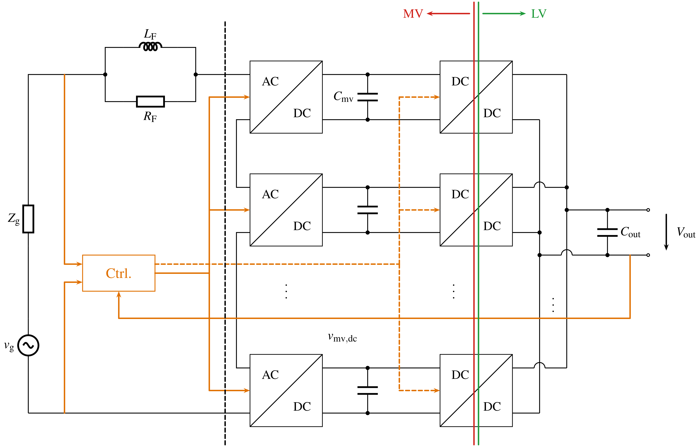
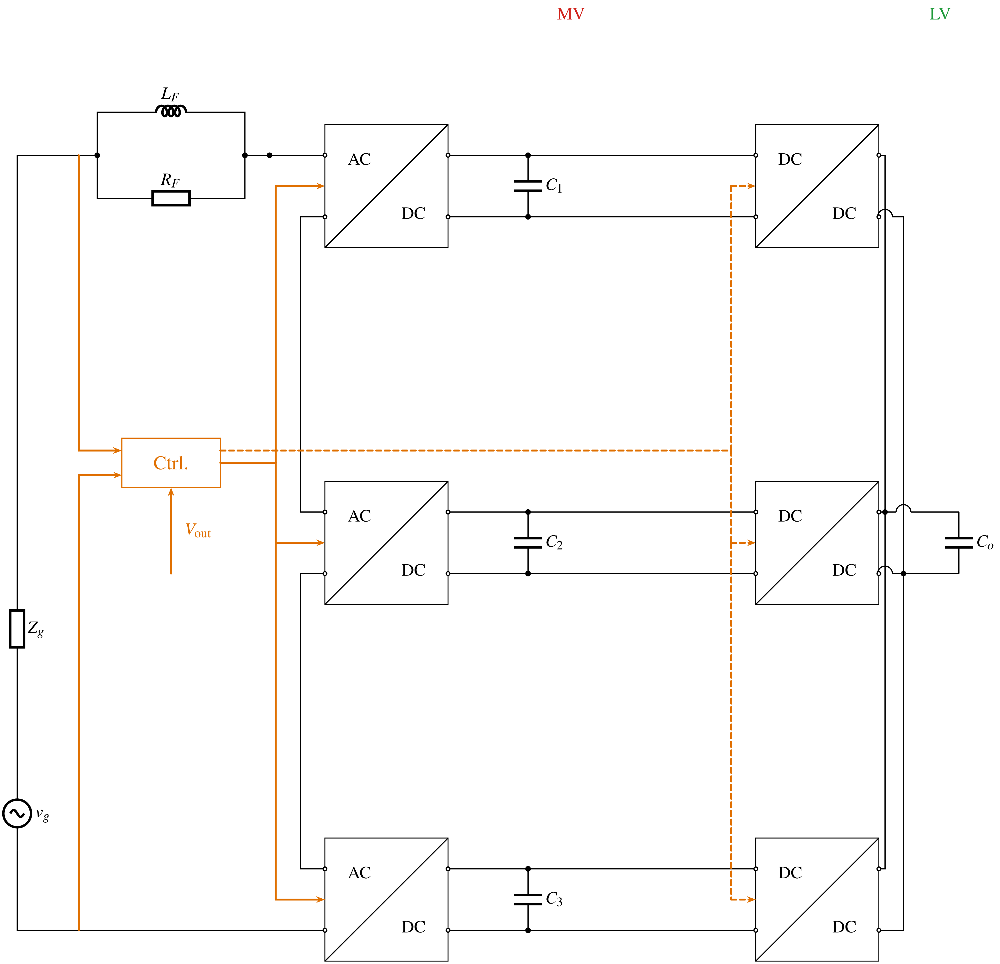
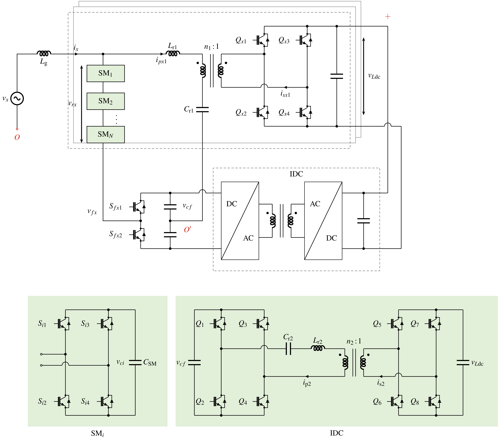
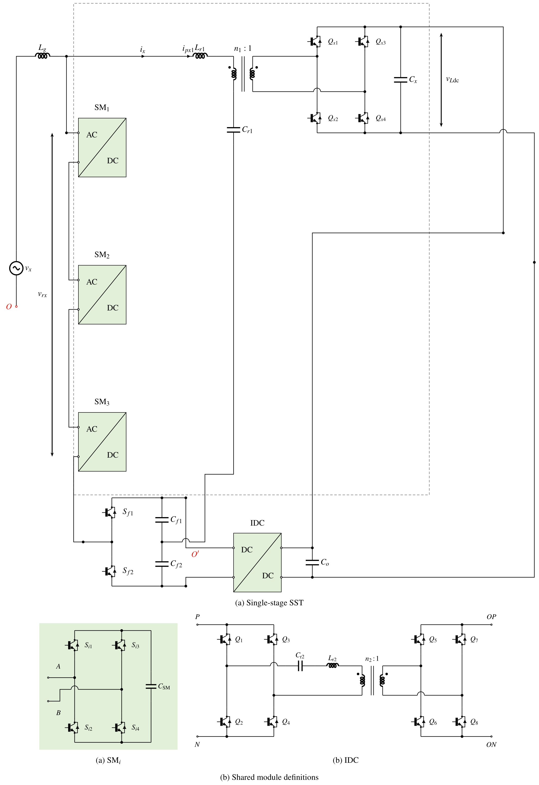

# SST module examples

[简体中文](#简体中文) · [繁體中文](#繁體中文) · [English](#english)

## 简体中文

### 打开和使用

1、两级 SST 包含三个串联输入、并联输出的变换单元。每个 AC/DC 方框展开为四只 IGBT 的全桥，DC/DC 方框展开为文件内保存的内置 DAB 模块。`C1`～`C3` 是原图的中压直流电容 `Cmv1`～`Cmv3`。DAB 沿用库内输出电容，外部 `Co` 是公共母线电容。[打开两级表](two_stage_sst.json)

2、单级 SST 包含一个 x 相、三个 SM 全桥子模块和一个串联谐振 DAB 型 IDC。保留 `Cr2`、`Lr2` 和变压器，以及原图的 IGBT 接法。主图中的 `Cf1/Cf2` 和 `Co` 分别表示 IDC 输入、输出母线电容。`O` 与 `O'` 按原表分属两个网络。[打开单级表](single_stage_sst.json)

3、在仓库根目录运行以下命令。选双栏，双击方框或使用“视图 → 模块显示”展开、折叠。选中实例后按 Enter 可编辑共用定义，保存后同类实例一起更新。外部电容可直接拖动，移动量相对端口保存，展开和折叠分别计算位置。属性栏可微调水平、竖直偏移和标签，支持撤销、重做与保存重开。

```sh
circuit-drawer edit examples/sst/two_stage_sst.json -p double
circuit-drawer edit examples/sst/single_stage_sst.json -p double
```

4、运行下面的脚本可导出两张主图、全部展开图、SM／IDC 放大图和单级拼版。放大图直接读取主表中的定义，编辑定义后重新运行即可更新。

```sh
python examples/sst/export.py -o out/sst
```

5、两张表明确放置三个单元。模块目前使用左右端口，SM 竖向串联采用侧边接线。为容纳展开后的器件，行距加大。两级控制图以带名称的 `Vout` 箭头引入输出采样，MV／LV 用文字标示。单级图显示一个实际相，SM 的省略号改为三个明确实例。电气连接依照原表，原来的放大图改为同源的独立视图。

6、两张完整 SST 表用于拓扑编辑和出图。整机仿真还需填写功率级数值、变压器参数、开关调制、控制策略及外部接法。单级表中的 `O` 端供外部连接，橙色 `Ctrl.` 箭头表达控制关系。以下命令额外生成并运行一个 DAB 单元的启动示例，参数为 48 V 输入、14.4 Ω 负载、50 kHz、40 μH 和 220 μF，采用库内理想开关及 1∶0.5 变压器，时长 1 ms。生成的 JSON 可在编辑器打开，CSV 可导入波形面板。

```sh
python examples/sst/export.py -o out/sst --simulate
circuit-drawer edit out/sst/sst_dab_bench.json -p double
```

7、图像导出需要 LaTeX 与 PDF 图像工具。`--simulate` 还需要 ngspice，可通过 `CIRCUIT_DRAWER_NGSPICE` 指定可执行文件。DAB 启动示例的参数可在生成的表中修改。

### 图纸

1、两级 SST。[折叠 PDF](figures/two_stage_sst.pdf) · [折叠 PNG](figures/two_stage_sst.png) · [展开 PDF](figures/two_stage_sst_expanded.pdf) · [展开 PNG](figures/two_stage_sst_expanded.png)

2、单级 SST 及下方两张模块放大图。[拼版 PDF](figures/single_stage_sst_sheet.pdf) · [拼版 PNG](figures/single_stage_sst_sheet.png) · [主图 PDF](figures/single_stage_sst.pdf) · [展开 PDF](figures/single_stage_sst_expanded.pdf)

3、独立模块细节。[SM PDF](figures/sm_detail.pdf) · [SM PNG](figures/sm_detail.png) · [IDC PDF](figures/idc_detail.pdf) · [IDC PNG](figures/idc_detail.png)

### 原图对照

原图由用户提供的两份 JSON 渲染。右栏由当前模块表生成。

| 图纸 | 原表 | 模块表 |
| --- | --- | --- |
| 两级 SST |  |  |
| 单级 SST |  |  |

## 繁體中文

1、兩級 SST 包含三個串聯輸入、並聯輸出的變換單元。AC/DC 展開為四顆 IGBT 的全橋，DC/DC 使用檔案內保存的內建 DAB。`C1`～`C3` 對應原圖的 `Cmv1`～`Cmv3`，DAB 內有各自的輸出電容，外部 `Co` 為共用母線電容。[兩級座標表](two_stage_sst.json)

2、單級 SST 包含一個 x 相、三個 SM 全橋與一個串聯諧振 DAB 型 IDC，保留 `Cr2`、`Lr2`、變壓器和 IGBT 接法。`Cf1/Cf2` 與 `Co` 為 IDC 的外部母線電容。`O` 與 `O'` 依原表分屬兩個網路。[單級座標表](single_stage_sst.json)

3、在儲存庫根目錄執行上方的 `circuit-drawer edit` 指令，選用雙欄。雙擊方框可展開／折疊，“視圖 → 模組顯示”可一次切換全部。選取實例後按 Enter 編輯共用定義，儲存後同步更新相同定義的實例。外部電容可直接拖曳，移動量相對連接埠儲存，展開與折疊分別計算位置。屬性欄可微調水平、垂直偏移和標籤，支援復原、重做與儲存後重開。

4、`python examples/sst/export.py -o out/sst` 會產生主圖、展開圖、SM／IDC 細節與單級拼版。下方細節直接讀取主表的定義，修改定義後重新執行即可更新。[兩級 PDF](figures/two_stage_sst.pdf) · [單級拼版 PDF](figures/single_stage_sst_sheet.pdf)

5、兩張表各放置三個實際單元。模組目前採左右埠，SM 垂直串聯使用側邊繞線，行距預留展開電路的空間。兩級圖用 `Vout` 文字箭頭引入輸出取樣，MV／LV 用文字標示。單級圖顯示一個實際相，SM 的省略號改為三個明確實例。上方對照圖保留原表外觀。

6、整機模擬需要補上功率級數值、變壓器參數、開關調變、控制策略與外部接法，單級 `O` 端供外部連接。橙色 `Ctrl.` 箭頭表達控制關係。加入 `--simulate` 可執行獨立 DAB 單元的 1 ms 啟動範例，採 48 V、14.4 Ω、50 kHz、40 μH、220 μF、理想開關及 1∶0.5 變壓器。產生的 JSON 可在編輯器開啟，CSV 可匯入波形面板。圖像匯出需 LaTeX 與 PDF 圖像工具，模擬另需 ngspice。

## English

1、The two-stage table contains three input-series, output-parallel converter cells. Each AC/DC block expands into a four-IGBT full bridge. Each DC/DC block uses a saved copy of the built-in DAB definition. `C1`–`C3` correspond to the original `Cmv1`–`Cmv3`. Each DAB retains its library output capacitor, alongside the external common-bus capacitor `Co`. [Two-stage table](two_stage_sst.json)

2、The single-stage table contains one phase x, three full-bridge SM cells and a series-resonant DAB-type IDC. It retains `Cr2`, `Lr2`, the transformer and the original IGBT connections. External `Cf1/Cf2` and `Co` represent the IDC bus capacitances. The original `O` and `O'` remain separate nodes. [Single-stage table](single_stage_sst.json)

3、Run the `circuit-drawer edit` commands above from the repository root using the double-column profile. Double-click blocks to expand or fold them. View → Module display changes all instances. Select an instance and press Enter to edit its shared definition. Drag external capacitors to adjust their position relative to module ports. Each expanded or collapsed view applies the saved offset to its own port positions. Edit horizontal and vertical offsets or labels in Properties. Undo, redo and save/reopen are supported.

4、`python examples/sst/export.py -o out/sst` exports the main figures, expanded circuits, SM/IDC details and a combined single-stage sheet. Detail views read the same definitions as the main table. Re-run after editing those definitions. [Two-stage PDF](figures/two_stage_sst.pdf) · [Single-stage sheet PDF](figures/single_stage_sst_sheet.pdf)

5、Both tables explicitly instantiate three cells. SM series wiring uses side ports, with extra row spacing for the expanded circuit. The two-stage control sketch uses a named `Vout` feedback arrow and MV/LV text. The single-stage table shows one actual phase and three explicit SM cells. The comparison above includes renders of the supplied coordinate tables.

6、Whole-system simulation requires power-stage values, transformer parameters, modulation, control and external circuit connections. The single-stage `O` terminal is available for external wiring. The orange `Ctrl.` arrows illustrate control relationships. Add `--simulate` to run a separate 1 ms DAB startup example with 48 V input, 14.4 Ω load, 50 kHz switching, 40 μH, 220 μF, ideal switches and a 1∶0.5 transformer. Open the generated JSON in the editor or import its CSV into the waveform panel. Figure export needs LaTeX and PDF image tools. Simulation also needs ngspice, optionally configured through `CIRCUIT_DRAWER_NGSPICE`.
